# Creature icons

References for drawing each kind of creature as a mark of its own, and a Shadow as the creature it was, gathered for
the redesign of the creature's and the Shadow's icon (today every creature wears its family's line glyph, so a Dire
Wolf, a Cave Bat and a Razor Boar look alike, and a Shadow wears the same glyph doubled in violet on a shield). Not yet
a step of the order to build in [docs/DESIGN.md](../../../DESIGN.md#order-to-build).

Every image belongs to the game's publisher, or to the wiki, site or player who captured it, as listed beside it. They are kept here as design reference only: nothing in ARISE copies their art, and none of them ships with the game.

Most images are sheets assembled from a wiki's icon files, each labelled with the wiki's own names. Where a sheet
repeats its icons at 48, 32 and 24 pixels, the same files were scaled down to show how each reads at the size ARISE
draws a creature on its card and in the army.

## How each game draws a creature

The view, the silhouette, the frame and the colour; how a boss or a leader differs from its kind; and how a creature
that serves the player differs from the one that fought them.

**Monster Hunter** gives every monster a framed icon of its own and changes no rule between its games but the hand.
**World** folds the whole body into a rounded square, the head or horns turned to the viewer, flat colour broken by
tribal spirals; the small monsters are drawn the same way, simpler. Each monster owns a hue, so at 24 pixels the red
Odogaron, the gold Diablos and the green Deviljho still read by colour and mass, while the near-black Kushala Daora
and Vaal Hazak sink into a dark ground. A pack's leader keeps the pack's body and grows it (Jagras and Great Jagras,
Girros and Great Girros); a variant keeps the outline and changes the colour (Rathalos and Azure Rathalos, Diablos and
Black Diablos). **Rise** brushes each monster as one curling ink stroke with a dark outline and a pale halo round it,
and the halo is what keeps a small one apart from any ground; its Apex monsters keep the stroke and darken it, the wiki:
'a darker and more brown carapace covered in scars and wounds. His eyes and scars glow a faint red'. **Wilds** draws as
World does and shows a monster's kinds by two means that survive at 24 pixels: a Guardian, an artificial copy of the
monster, is the same drawing drained to bone white and grey ('pale-white discolorations and pitch-black eyes being the
major visual differences', and in the game 'the signature glowing, purple veins of the Guardian monsters'); a Tempered
monster is the same icon ringed in a thick violet line.

**Solo Leveling: Arise** draws its bosses as painted busts in rounded squares, each in its own colours and lit from
inside: Igris the Red in crimson armour, the Ice Bear Alpha white with red eyes, Cerberus in yellow fire. The Shadow
raised from one (Igris from Igris the Red, Tank from the Alpha Ice Bear, Tusk from the orc shaman Kargalgan, Iron from
the hunter Kim Chul) is the same kind of bust re-lit: the colour drained to blue-black and violet, the eyes, the edges of
the armour and any flame or mane in cyan. Tusk keeps the red of his mask, the one trace of what he was. At 48 pixels the
bosses still read by colour; at 32 and 24 every Shadow merges into the same blue-violet square, save Tank's cyan mane.
Overdrive's 'Army of Shadows' sets the Shadows owned as discs at the foot of the screen, a close head in each, the chosen
one ringed in gold; there each holds one bright accent of its own (Igris's blue crown, Tusk's red mask, Tank's pale teal),
and the discs read better small than the square busts do. In the world, the raised army is near-black figures drawn only
by a cyan rim of light along helm, armour and blade, with small lit eyes.

**Darkest Dungeon** draws every creature whole, in the pose of its attack, inked in black: the gnasher low and lunging,
the webber a spider's legs splayed, the bone rabble with a raised club, the cobra coiled. Flattened to one grey, the same
twelve still tell themselves apart at 28 pixels by the pose alone. Its bosses are drawn in the same hand; nothing but the
drawing marks them out. **Darkest Dungeon II** adds a portrait to each creature for the turn order: a painted head and
shoulders cropped tight on black, the colour held down, the eyes or the mouth the lightest thing in it. A creature's
stronger kind has a name of its own and the same drawing armoured, crowned or recoloured (the Carrion Eater and the
Carrion Devourer, the Bosun and the Hull Keeper, the Swine Brute and Wilbur); the parts of a final boss that the party must
break (the Shackles of Denial's 'Latch of Regret', the Focused Fault's 'Cloistered Eye') stand on a blue ground under a
pale chevron. In the fight the turn order sets each portrait in a diamond and caps a foe's in blue and a hero's in gold,
the same blue that brackets a foe's health bar.

**Hades** names its creatures in the Codex's 'Perilous Foes' and draws them as bold shapes under a dark outline, lit from
a core: Tartarus's Wretches in warm orange, a Numbskull a glowing gold skull with red eyes, a Brimstone or a Voidstone a
crystal glowing its own colour. The glowing ones read best at 24 pixels. Deeper foes cool toward teal and violet. A
mini-boss is the small foe grown: the Megagorgon is 'a larger version of the regular Gorgon', and a Gigantic Vermin a
Crawler grown huge. The boss Bone Hydra's mark is a single pale skull crowned in gold.

**Pokémon** sets every creature in its box as a 40 by 30 pixel icon: the whole creature in three-quarter view, a
one-pixel dark outline, flat bright colour, and nothing else; they read at their own size, the ones with a strong outline
best (Gengar, Houndoom, Golurk). A shiny is the same model recoloured, read as a rarer one of its kind, never a new kind:
Charizard's goes black, Gyarados's red. **Pokémon GO**'s Shadow Pokémon, caught after defeating a Team GO Rocket Grunt, keep
their own colours but stand in a purple flame with red eyes, before a dark violet sky; purified, the same creature returns to
its plain look and ground. Serebii: they 'are distinguishable due to a purple shadow aura' 'and deep red eyes'.

**Palworld** renders each Pal's head and shoulders, cropped by the square's edges, on no ground, the face turned to the
viewer and the eyes the brightest point; at 24 pixels a Pal reads by its colour and its eye. A Pal's element variant is
the same model in another element's colours, and a Noct variant (its elements given as 'Fire Dark' for Blazehowl Noct) turns
to violet, deep blue or black: Frostallion Noct's white horse goes black with a violet mane, Kitsun Noct's cyan flame
violet.

**Dragon Quest** gives each family one mark: Dragon Quest Tact's are a single white glyph on black, 33 pixels, a slime's
drop, a dragon's head, a leaf, a paw, bricks, a trident, a skull, a crown for the unknown, as ARISE's are today. The
monsters themselves are never glyphs: Dragon Quest XI's 2D mode draws each one facing the player, full body, at its own
size, so a slime is small and a golem fills its place. A stronger kin is the same sprite recoloured (Slime, She-slime,
Metal slime; Golem, Stone golem, Gold golem; Troll and Boss troll; Cyclops and Gigantes), and a leader grows and is
crowned: the wiki's King slimes 'appear to be large, engorged slimes' and 'Going along with their kingly status, they
have crowns'.

**Elden Ring** gives the player creatures to summon: 'Ashen Remains, also referred to as Spirit Ashes, are items [...]
that allow players to summon spirits to assist in combat.' Each ash's icon is the creature whole as a pale blue-white
phantom, its edge glowing, before a dark grave-stone, and the living creature's colour is gone; a wolf, a rat, a hawk or
a jellyfish reads by its outline alone. Summoned, the spirit stands beside the player translucent and sparking, the same
creature the player fought, made of light.

| | What it shows | Source |
|---|---|---|
| <a href="monsterhunterworld_large_small_icons_and_leaders.jpg">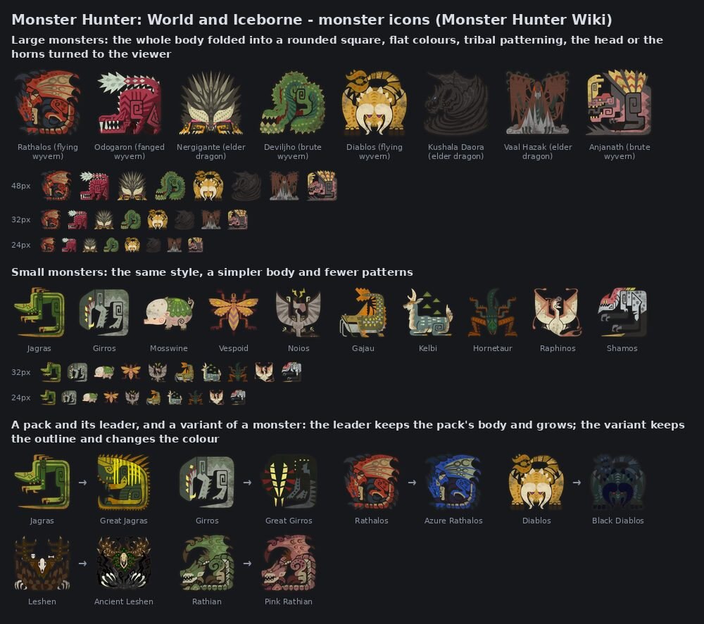</a> | `monsterhunterworld_large_small_icons_and_leaders.jpg` Assembled from the Monster Hunter Wiki's icon files: Monster Hunter: World and Iceborne. Eight large monsters, each its whole body folded into a rounded square of flat colour and spirals ('Rathalos', 'Odogaron', 'Nergigante', 'Deviljho', 'Diablos', 'Kushala Daora', 'Vaal Hazak', 'Anjanath'), then the same at 48, 32 and 24 pixels. Ten small monsters in the same hand ('Jagras', 'Girros', 'Mosswine', 'Vespoid', 'Noios', 'Gajau', 'Kelbi', 'Hornetaur', 'Raphinos', 'Shamos'), at 32 and 24. Then pairs: a pack and its leader ('Jagras' → 'Great Jagras', 'Girros' → 'Great Girros') and a monster and its variant ('Rathalos' → 'Azure Rathalos', 'Diablos' → 'Black Diablos', 'Leshen' → 'Ancient Leshen', 'Rathian' → 'Pink Rathian'). | [page](https://monsterhunterwiki.org/wiki/MHWorld/Monsters) · [image](https://monsterhunterwiki.org/images/b/bb/MHWI-Rathalos_Icon.png) (one `MHWI-<Name>_Icon.png` to each) |
| <a href="monsterhunterrise_ink_icons_pack_leaders_apex.jpg">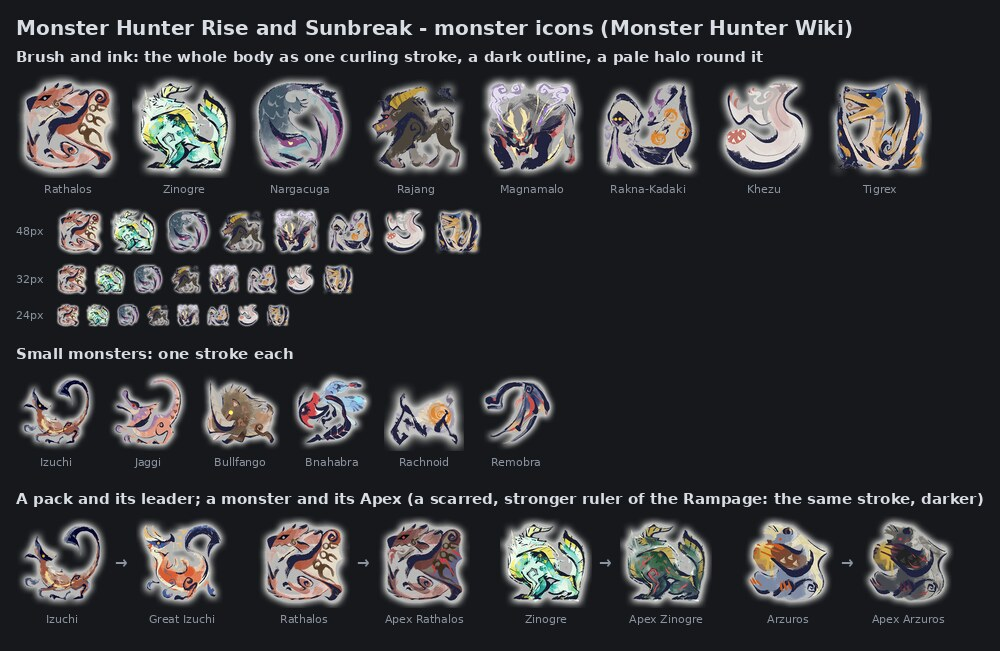</a> | `monsterhunterrise_ink_icons_pack_leaders_apex.jpg` Assembled from the wiki's icon files: Monster Hunter Rise and Sunbreak. Eight large monsters brushed as one curling ink stroke, a dark outline and a pale halo round each ('Rathalos', 'Zinogre', 'Nargacuga', 'Rajang', 'Magnamalo', 'Rakna-Kadaki', 'Khezu', 'Tigrex'), then at 48, 32 and 24 pixels. Six small monsters ('Izuchi', 'Jaggi', 'Bullfango', 'Bnahabra', 'Rachnoid', 'Remobra'). 'Izuchi' → 'Great Izuchi', and three monsters and their Apex, the stroke kept and darkened ('Rathalos', 'Zinogre', 'Arzuros'). The wiki: the Apex Rathalos 'is distinguished by his larger size than the nominate species as well as a darker and more brown carapace covered in scars and wounds.' | [page](https://monsterhunterwiki.org/wiki/MHRise/Monsters) · [page](https://monsterhunterwiki.org/wiki/Apex_Rathalos) · [image](https://monsterhunterwiki.org/images/6/65/MHRS-Rathalos_Icon.png) (one `MHRS-<Name>_Icon.png` to each) |
| <a href="monsterhunterwilds_guardian_tempered_variants.jpg">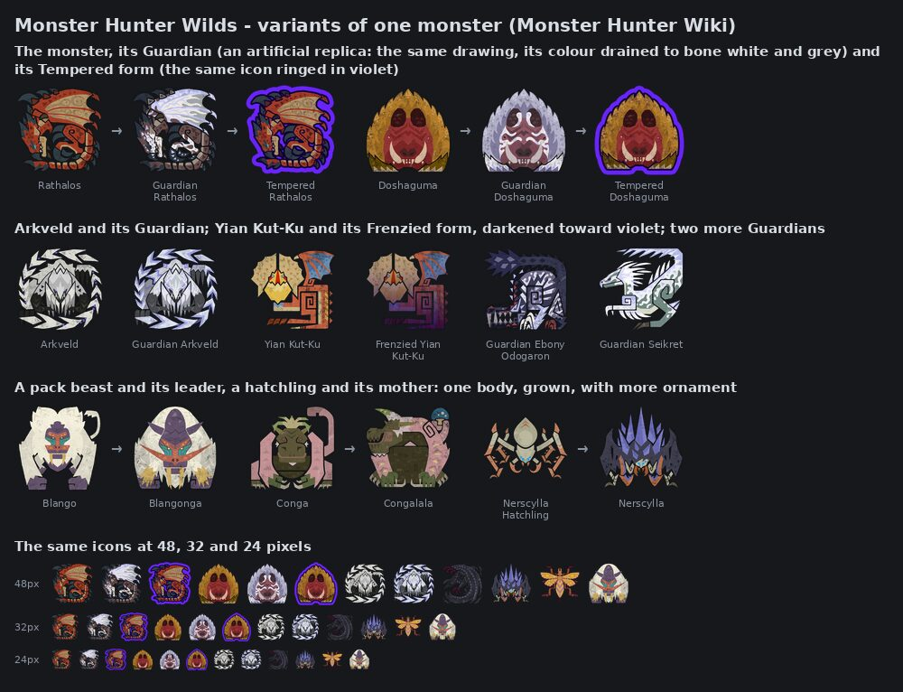</a> | `monsterhunterwilds_guardian_tempered_variants.jpg` Assembled from the wiki's icon files: Monster Hunter Wilds. 'Rathalos' → 'Guardian Rathalos' → 'Tempered Rathalos', and the same for 'Doshaguma': the Guardian the same drawing drained to bone white and grey, the Tempered the same icon ringed in a thick violet line. 'Arkveld' → 'Guardian Arkveld'; 'Yian Kut-Ku' → 'Frenzied Yian Kut-Ku', darkened toward violet; 'Guardian Ebony Odogaron' and 'Guardian Seikret'. A pack beast and its leader, a hatchling and its mother ('Blango' → 'Blangonga', 'Conga' → 'Congalala', 'Nerscylla Hatchling' → 'Nerscylla'). Twelve of them at 48, 32 and 24 pixels. The wiki: 'Like other Guardians, these creatures mostly resemble the monster they were based on, with pale-white discolorations and pitch-black eyes being the major visual differences.' | [page](https://monsterhunterwiki.org/wiki/MHWilds/Monsters) · [page](https://monsterhunterwiki.org/wiki/Guardian_Rathalos) · [image](https://monsterhunterwiki.org/images/9/96/MHWA-Guardian_Rathalos_Icon.webp) · [image](https://monsterhunterwiki.org/images/c/c9/MHWA-Tempered_Rathalos_Icon.webp) (one `MHWA-<Name>_Icon.webp` to each) |
| <a href="sololevelingarise_boss_and_shadow_portraits.jpg">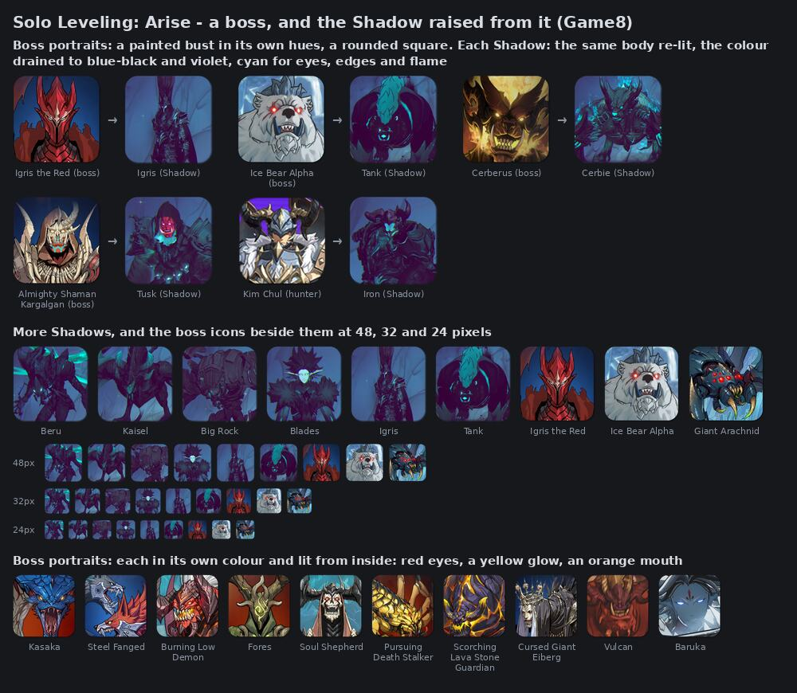</a> | `sololevelingarise_boss_and_shadow_portraits.jpg` Assembled from Game8's icons: Solo Leveling: Arise. A boss and the Shadow raised from it: 'Igris the Red' → 'Igris', 'Ice Bear Alpha' → 'Tank', 'Cerberus' → 'Cerbie', 'Almighty Shaman Kargalgan' → 'Tusk', and the hunter 'Kim Chul' → 'Iron'. Each boss a painted bust in its own colours; each Shadow the same kind of bust in blue-black and violet, eyes, edges and flame in cyan, Tusk's mask still red. Six Shadows ('Beru', 'Kaisel', 'Big Rock', 'Blades', 'Igris', 'Tank') beside three bosses at 48, 32 and 24 pixels, where the Shadows merge into one blue-violet square and the bosses keep their colour. Ten more bosses, each lit from inside ('Kasaka', 'Steel Fanged', 'Burning Low Demon', 'Fores', 'Soul Shepherd', 'Pursuing Death Stalker', 'Scorching Lava Stone Guardian', 'Cursed Giant Eiberg', 'Vulcan', 'Baruka'). | [page](https://game8.co/games/Solo-Leveling-ARISE/archives/494214) · [page](https://game8.co/games/Solo-Leveling-ARISE/archives/459584) · [page](https://game8.co/games/Solo-Leveling-ARISE/archives/458145) · [image](https://img.game8.co/4083809/8ebe7094fa0e82252b71b24f9ca3e002.png/show) · [image](https://img.game8.co/3916832/51d61360d29f12622188620c7fbdee84.png/show) (one file to each) |
| <a href="sololevelingarise_overdrive_shadow_roster_discs.jpg">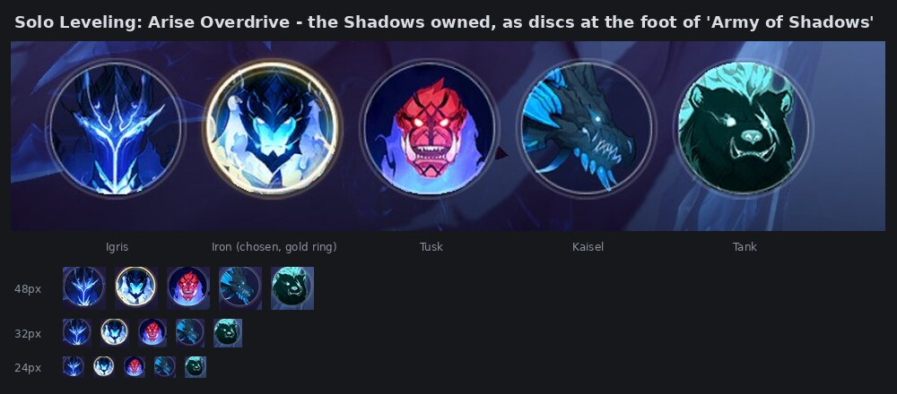</a> | `sololevelingarise_overdrive_shadow_roster_discs.jpg` Crop: Solo Leveling: Arise Overdrive, the foot of 'Army of Shadows' (the whole screen is `../step-6-map-army-gear-daily/army_sla_army_of_shadows_authority.jpg`), enlarged one and a quarter times, then each disc at 48, 32 and 24 pixels. Five Shadows owned, a close head in each disc, read here as Igris, Iron (chosen, ringed in gold, the Shadow the screen shows), Tusk, Kaisel and Tank: blue and teal light on violet, Tusk's red mask the one warm colour. | [page](https://steamcommunity.com/sharedfiles/filedetails/?id=3624202743) · [image](https://images.steamusercontent.com/ugc/17059731680714314083/7752CA469BCC9276379FEB18B61DCB65CE73D478/) |
| <a href="sololevelingarise_overdrive_shadow_army_rim_light.jpg">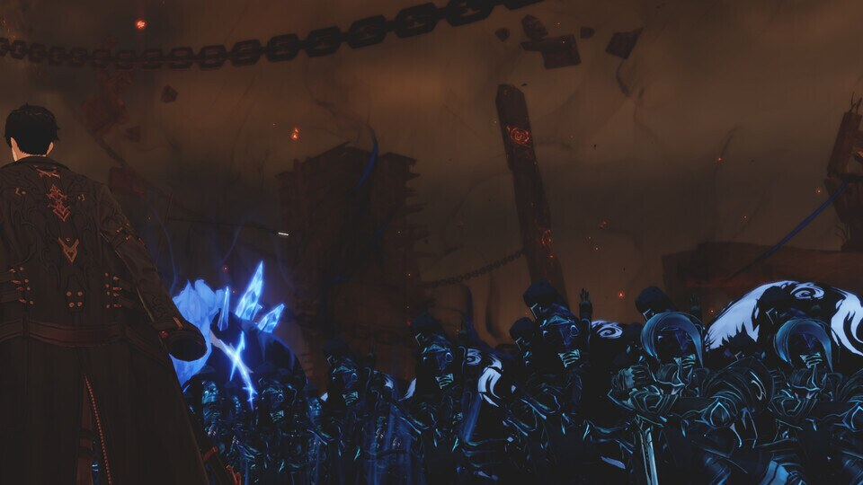</a> | `sololevelingarise_overdrive_shadow_army_rim_light.jpg` Crop: a store screenshot of Solo Leveling: Arise Overdrive. The hunter, back turned, before the raised army: every Shadow near-black, drawn only by a cyan rim of light along helm, armour and blade, with small lit eyes; a cyan flame rises from one at the left. | [page](https://store.steampowered.com/app/2373990/) · [image](https://shared.akamai.steamstatic.com/store_item_assets/steam/apps/2373990/a830e6794df0358da283be9f07240bd2c38ff457/ss_a830e6794df0358da283be9f07240bd2c38ff457.1920x1080.jpg) |
| <a href="darkestdungeon2_turn_order_portraits_champions_boss_parts.jpg">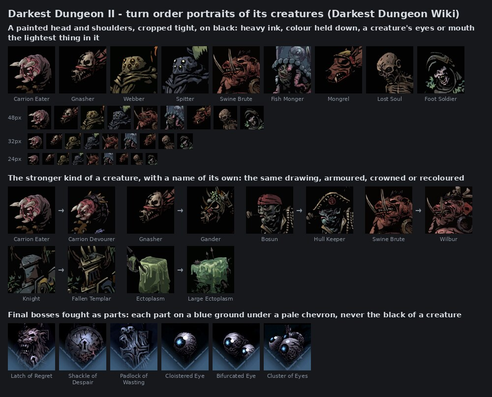</a> | `darkestdungeon2_turn_order_portraits_champions_boss_parts.jpg` Assembled from the Darkest Dungeon Wiki's files: Darkest Dungeon II's turn order portraits. Nine creatures, each a painted head and shoulders cropped tight on black ('Carrion Eater', 'Gnasher', 'Webber', 'Spitter', 'Swine Brute', 'Fish Monger', 'Mongrel', 'Lost Soul', 'Foot Soldier'), then at 48, 32 and 24 pixels. A creature's stronger kind, named apart: 'Carrion Eater' → 'Carrion Devourer', 'Gnasher' → 'Gander', 'Bosun' → 'Hull Keeper', 'Swine Brute' → 'Wilbur', 'Knight' → 'Fallen Templar', 'Ectoplasm' → 'Large Ectoplasm'. Two final bosses' parts on a blue ground under a pale chevron: 'Latch of Regret', 'Shackle of Despair', 'Padlock of Wasting' (the Shackles of Denial), 'Cloistered Eye', 'Bifurcated Eye', 'Cluster of Eyes' (the Focused Fault). | [page](https://darkestdungeon.wiki.gg/wiki/Enemies_%28Darkest_Dungeon_II%29) · [image](https://darkestdungeon.wiki.gg/images/Combat_turnorder_enemy_shared_carrion_eater.png) (one `Combat_turnorder_*.png` to each) |
| <a href="darkestdungeon2_turn_order_foe_blue_hero_gold.jpg">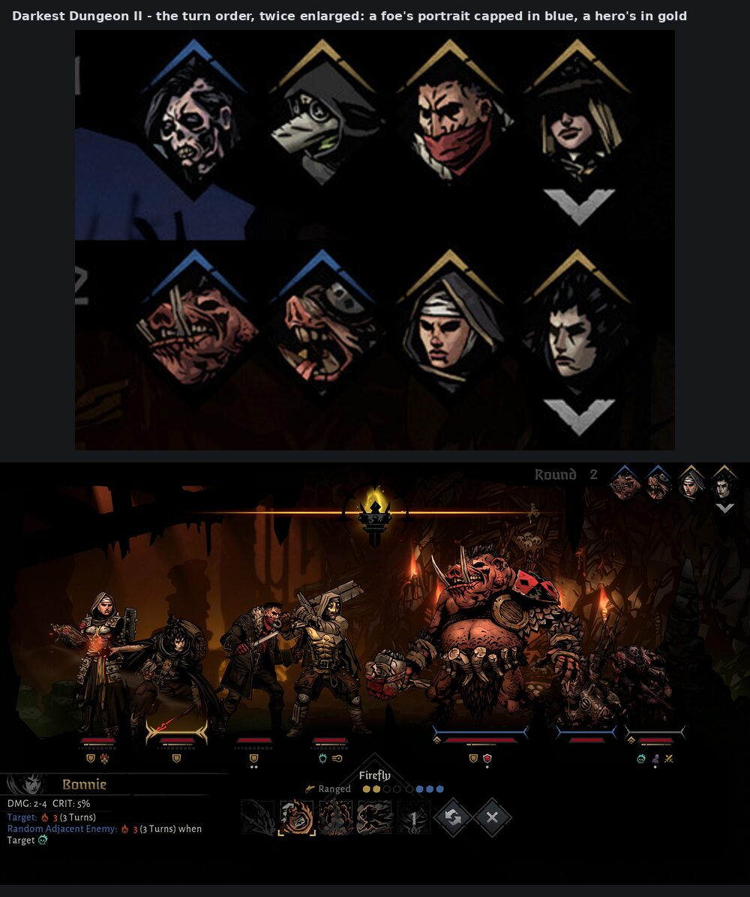</a> | `darkestdungeon2_turn_order_foe_blue_hero_gold.jpg` Darkest Dungeon II, two store screenshots: the turn order at the top right of each, cut out and twice enlarged above one of the whole screens. Each portrait stands in a diamond; a foe's is capped in blue (a Lost Soul, two swine), a hero's in gold, a white chevron under the last. Below, a fight against a Swine Brute and its kin, the foes' health bars bracketed in the same blue. | [page](https://store.steampowered.com/app/1940340/Darkest_Dungeon_II/) · [image](https://shared.akamai.steamstatic.com/store_item_assets/steam/apps/1940340/ss_bc4c7aec5704ed4108a181ec9a790c3fea4a9f12.1920x1080.jpg) · [image](https://shared.akamai.steamstatic.com/store_item_assets/steam/apps/1940340/ss_fed764604bcb367ccd2411c9540b8754c21e8090.1920x1080.jpg) |
| <a href="darkestdungeon_full_body_sprites_as_silhouettes.jpg">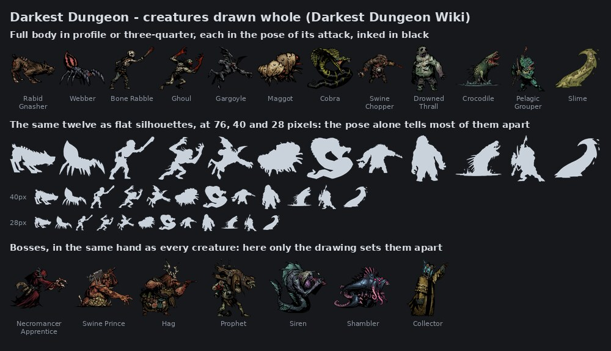</a> | `darkestdungeon_full_body_sprites_as_silhouettes.jpg` Assembled from the Darkest Dungeon Wiki's files: twelve of Darkest Dungeon's creatures whole, in the pose of their attack ('Rabid Gnasher', 'Webber', 'Bone Rabble', 'Ghoul', 'Gargoyle', 'Maggot', 'Cobra', 'Swine Chopper', 'Drowned Thrall', 'Crocodile', 'Pelagic Grouper', 'Slime'); the same twelve flattened here to one grey, at 76, 40 and 28 pixels, where the pose alone still tells most apart; seven bosses in the same hand ('Necromancer Apprentice', 'Swine Prince', 'Hag', 'Prophet', 'Siren', 'Shambler', 'Collector'). | [page](https://darkestdungeon.wiki.gg/wiki/Enemies_%28Darkest_Dungeon%29) · [image](https://darkestdungeon.wiki.gg/images/Rabid_Gnasher.png) (one file to each) |
| <a href="hades_foes_lit_cores_and_minibosses.jpg">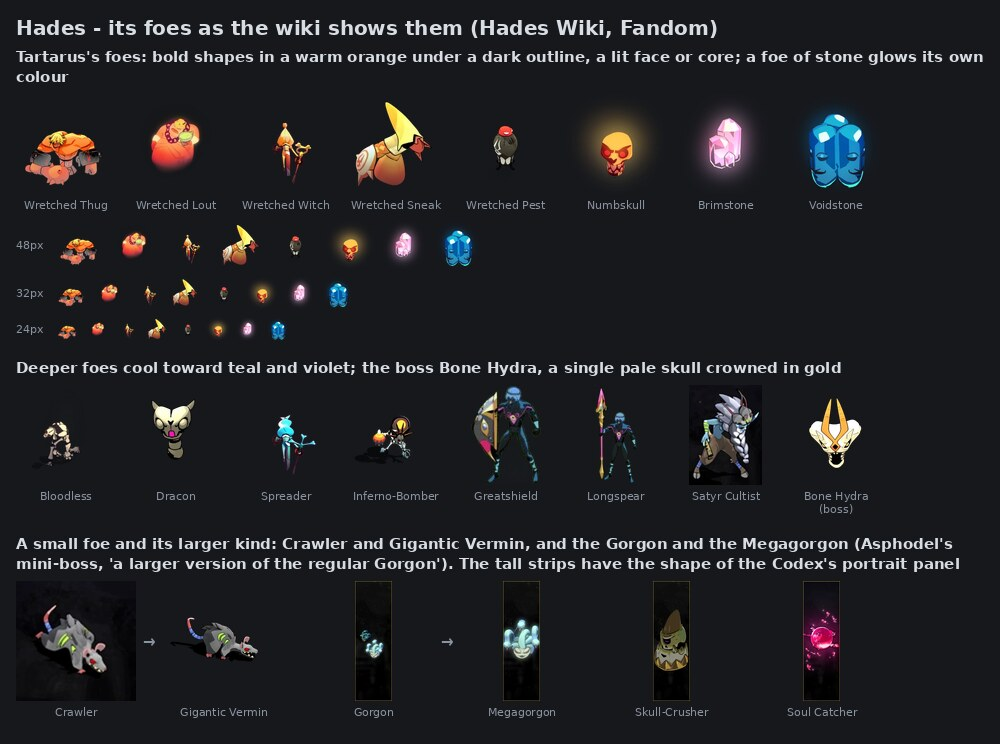</a> | `hades_foes_lit_cores_and_minibosses.jpg` Assembled from the Hades Wiki's files. Tartarus's foes, bold shapes in warm orange under a dark outline ('Wretched Thug', 'Wretched Lout', 'Wretched Witch', 'Wretched Sneak', 'Wretched Pest'), a glowing gold 'Numbskull', a pink 'Brimstone' and a blue 'Voidstone', then at 48, 32 and 24 pixels. Deeper foes in teal and violet ('Bloodless', 'Dracon', 'Spreader', 'Inferno-Bomber', 'Greatshield', 'Longspear', 'Satyr Cultist') and the boss 'Bone Hydra', a pale skull crowned in gold. 'Crawler' → 'Gigantic Vermin', 'Gorgon' → 'Megagorgon', and 'Skull-Crusher' and 'Soul Catcher', the four tall strips the shape of the Codex's portrait panel. The wiki: the Megagorgon 'is a larger version of the regular Gorgon'. | [page](https://hades.fandom.com/wiki/Wretched_Lout) · [page](https://hades.fandom.com/wiki/Megagorgon) · [image](https://static.wikia.nocookie.net/hades_gamepedia_en/images/9/99/Wretched_Lout.png) (one file to each) |
| <a href="pokemon_box_icons_and_shiny_recolours.jpg">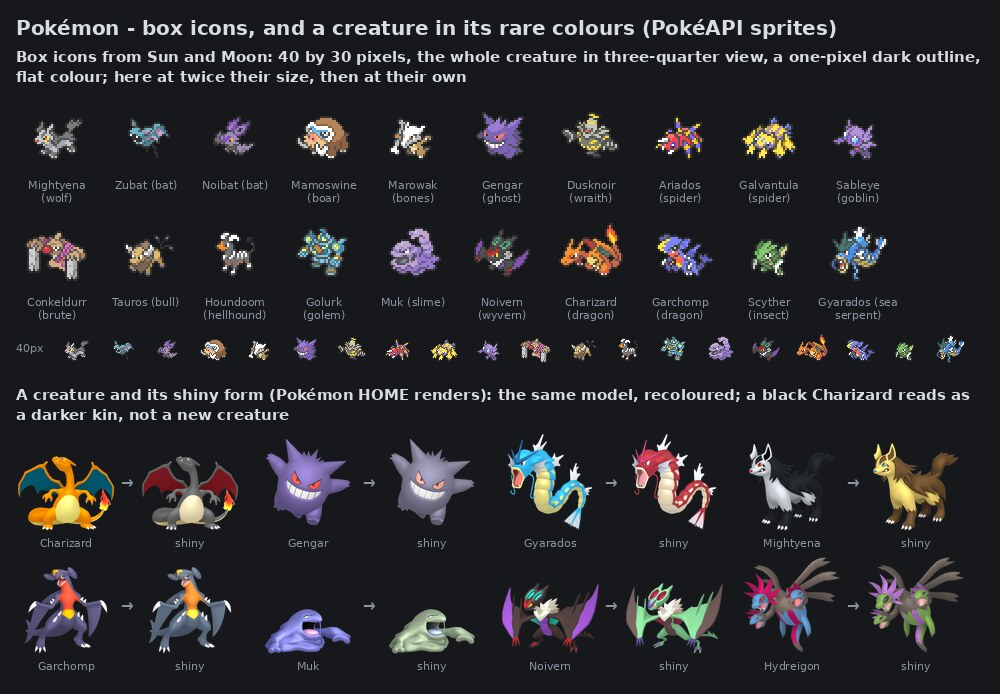</a> | `pokemon_box_icons_and_shiny_recolours.jpg` Assembled from PokéAPI's sprite files. Twenty of Sun and Moon's 40 by 30 pixel box icons, chosen for the kinds ARISE draws and labelled with them, at twice their size and then at their own: 'Mightyena (wolf)', 'Zubat (bat)', 'Noibat (bat)', 'Mamoswine (boar)', 'Marowak (bones)', 'Gengar (ghost)', 'Dusknoir (wraith)', 'Ariados (spider)', 'Sableye (goblin)', 'Conkeldurr (brute)', 'Tauros (bull)', 'Houndoom (hellhound)', 'Golurk (golem)', 'Muk (slime)', 'Noivern (wyvern)', 'Charizard (dragon)', 'Garchomp (dragon)', 'Scyther (insect)', 'Gyarados (sea serpent)' and 'Galvantula (spider)'. Then eight Pokémon HOME renders beside their shiny forms: 'Charizard' (black), 'Gengar', 'Gyarados' (red), 'Mightyena', 'Garchomp', 'Muk', 'Noivern', 'Hydreigon'. | [page](https://github.com/PokeAPI/sprites) · [image](https://raw.githubusercontent.com/PokeAPI/sprites/master/sprites/pokemon/versions/generation-vii/icons/262.png) · [image](https://raw.githubusercontent.com/PokeAPI/sprites/master/sprites/pokemon/other/home/shiny/6.png) (one file to each, by National Pokédex number) |
| <a href="pokemongo_shadow_pokemon_purple_aura_red_eyes.jpg">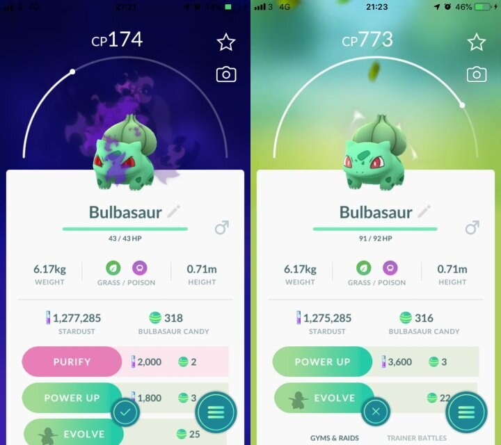</a> | `pokemongo_shadow_pokemon_purple_aura_red_eyes.jpg` Pokémon GO, Serebii's two phone screenshots side by side: a Shadow Bulbasaur, its own green kept, in a purple flame with red eyes, before a dark violet sky, its first button 'PURIFY'; and a purified Bulbasaur, plain, before a green ground. Serebii: Shadow Pokémon 'are distinguishable due to a purple shadow aura' 'and deep red eyes'. | [page](https://www.serebii.net/pokemongo/shadowpokemon.shtml) · [image](https://www.serebii.net/pokemongo/shadowpokemon.jpg) · [image](https://www.serebii.net/pokemongo/purifiedpokemon.jpg) |
| <a href="palworld_pal_bust_icons_and_noct_variants.jpg">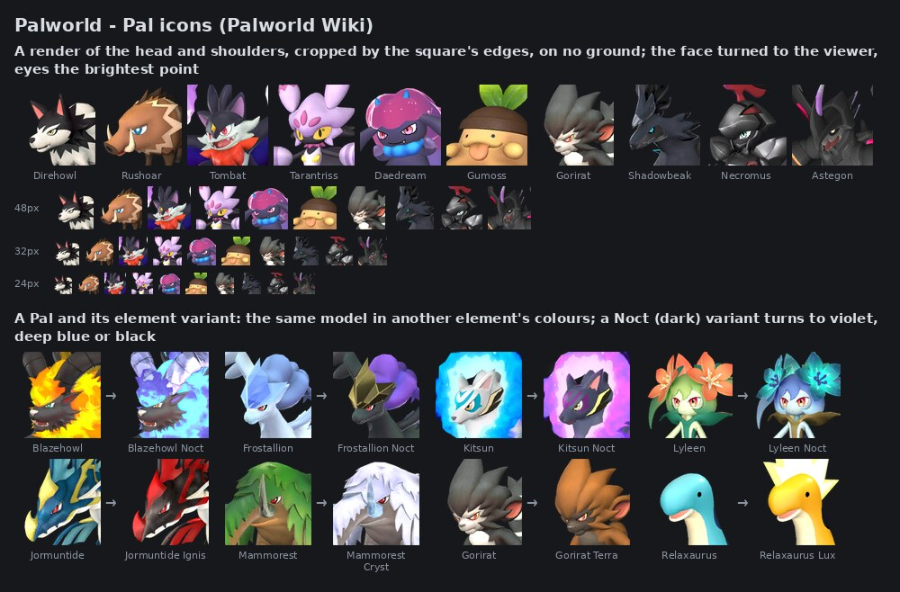</a> | `palworld_pal_bust_icons_and_noct_variants.jpg` Assembled from the Palworld Wiki's icon files. Ten Pals as head-and-shoulders renders cropped by the square, the face to the viewer ('Direhowl', 'Rushoar', 'Tombat', 'Tarantriss', 'Daedream', 'Gumoss', 'Gorirat', 'Shadowbeak', 'Necromus', 'Astegon'), then at 48, 32 and 24 pixels. A Pal and its element variant: 'Blazehowl' → 'Blazehowl Noct', 'Frostallion' → 'Frostallion Noct', 'Kitsun' → 'Kitsun Noct', 'Lyleen' → 'Lyleen Noct', 'Jormuntide' → 'Jormuntide Ignis', 'Mammorest' → 'Mammorest Cryst', 'Gorirat' → 'Gorirat Terra', 'Relaxaurus' → 'Relaxaurus Lux'. The wiki gives Blazehowl Noct's elements as 'Fire Dark'. | [page](https://palworld.wiki.gg/wiki/Pals) · [page](https://palworld.wiki.gg/wiki/Blazehowl_Noct) · [image](https://palworld.wiki.gg/images/Blazehowl_Noct_icon.png) (one `<Name>_icon.png` to each) |
| <a href="dragonquest_family_glyphs_sprites_palette_swaps.jpg">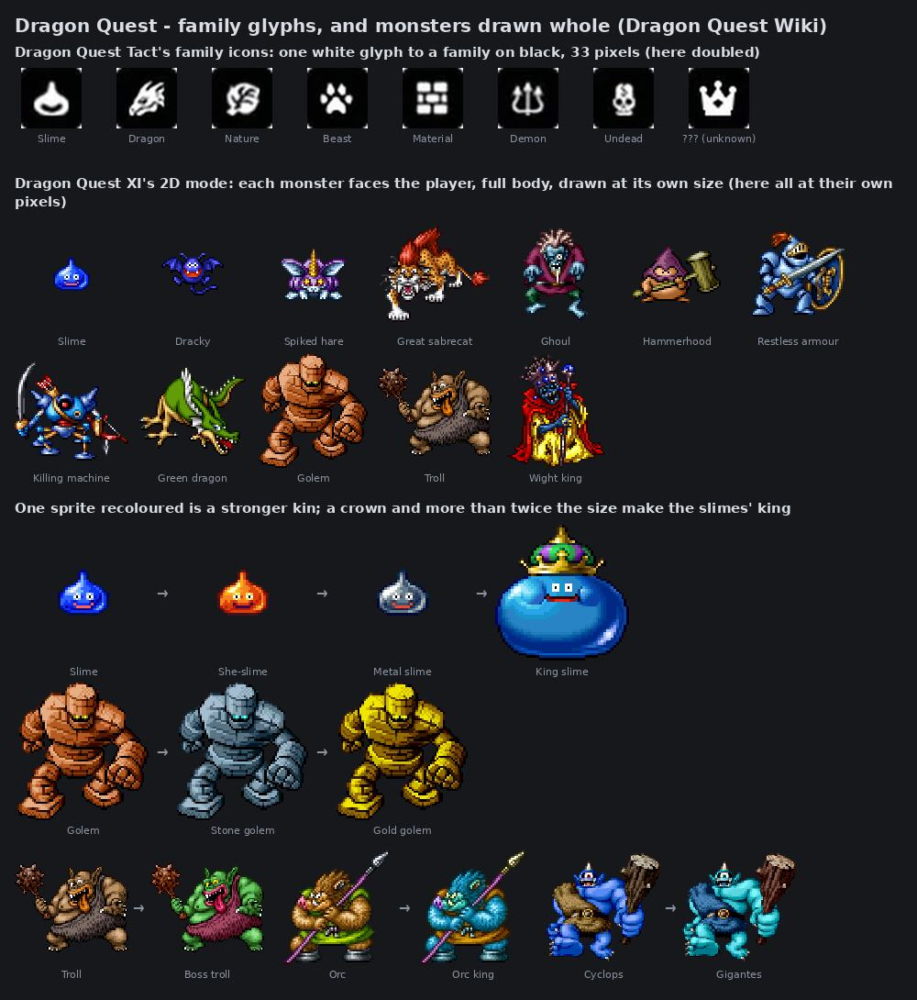</a> | `dragonquest_family_glyphs_sprites_palette_swaps.jpg` Assembled from the Dragon Quest Wiki's files. Dragon Quest Tact's family icons, one white glyph on black to each, doubled: 'Slime', 'Dragon', 'Nature', 'Beast', 'Material', 'Demon', 'Undead' and the unknown family's crown. Dragon Quest XI's 2D sprites at their own pixels, each facing the player, full body: 'Slime', 'Dracky', 'Spiked hare', 'Great sabrecat', 'Ghoul', 'Hammerhood', 'Restless armour', 'Killing machine', 'Green dragon', 'Golem', 'Troll', 'Wight king'. One sprite recoloured as a stronger kin ('Slime' → 'She-slime' → 'Metal slime'; 'Golem' → 'Stone golem' → 'Gold golem'; 'Troll' → 'Boss troll'; 'Orc' → 'Orc king'; 'Cyclops' → 'Gigantes'), and the crowned 'King slime'. The wiki: King slimes 'appear to be large, engorged slimes'. | [page](https://dragonquest.fandom.com/wiki/Category:Dragon_Quest_Tact_family_icons) · [page](https://dragonquest.fandom.com/wiki/King_slime) · [image](https://static.wikia.nocookie.net/dragonquest/images/d/d3/Slime_Family_Icon.jpg) · [image](https://static.wikia.nocookie.net/dragonquest/images/b/b8/DQXI_-_King_slime_2D.png) (one `DQXI_-_<Name>_2D.png` to each) |
| <a href="eldenring_spirit_ash_ghost_icons_and_summon.jpg">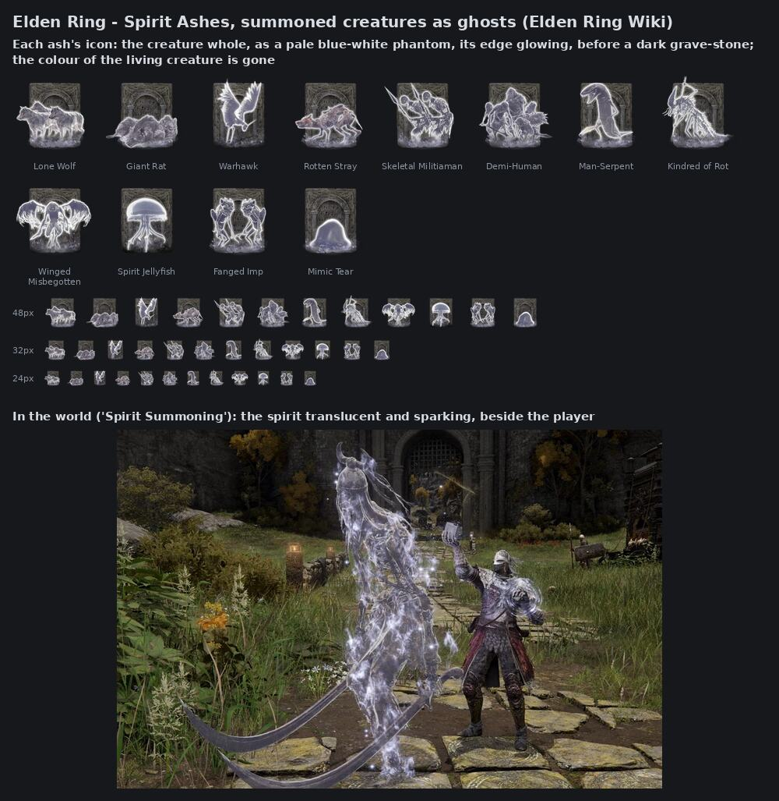</a> | `eldenring_spirit_ash_ghost_icons_and_summon.jpg` Assembled from the Elden Ring Wiki's files. Twelve Spirit Ashes' icons, each creature whole as a pale blue-white phantom with a glowing edge before a dark grave-stone ('Lone Wolf', 'Giant Rat', 'Warhawk', 'Rotten Stray', 'Skeletal Militiaman', 'Demi-Human', 'Man-Serpent', 'Kindred of Rot', 'Winged Misbegotten', 'Spirit Jellyfish', 'Fanged Imp', 'Mimic Tear'), then at 48, 32 and 24 pixels. Below, the wiki's 'Spirit Summoning' screenshot, cropped: a summoned spirit, translucent and sparking, beside the player. The wiki: 'Ashen Remains, also referred to as Spirit Ashes, are items [...] that allow players to summon spirits to assist in combat.' | [page](https://eldenring.fandom.com/wiki/Ashes) · [page](https://eldenring.fandom.com/wiki/Spirits) · [image](https://static.wikia.nocookie.net/eldenring/images/c/c6/ER_Icon_Ash_Lone_Wolf_Ashes.png) (one `ER_Icon_Ash_<Name>.png` to each) · [image](https://static.wikia.nocookie.net/eldenring/images/8/81/Spirit_Summoning.jpg) |

## What ARISE can take

- **A mark to every kind, not to every family**, as Monster Hunter and Palworld give each monster its own: the wolf,
  the bat and the boar told apart by their outline. The family's glyph can stay where Dragon Quest Tact keeps its own,
  beside the name, as the family's badge.
- **The head and shoulders, cropped by the frame, facing the viewer**, as Darkest Dungeon II's, Palworld's and
  Solo Leveling's portraits are: the face is what reads at 24 pixels. Kinds whose body is their mark (a slime, a spider,
  a bat, a serpent, a jellyfish) are drawn whole, as Darkest Dungeon's silhouettes still read at 28 pixels by pose alone.
- **One flat fill and an outline that holds against the ground**: Pokémon's one-pixel dark line and Monster Hunter Rise's
  pale halo keep a small icon apart from the card; World's near-black monsters and Solo Leveling's Shadows sink into a
  dark ground at 24 pixels.
- **The eyes lit**: the brightest point of nearly every portrait here (Solo Leveling's bosses and Shadows, Palworld,
  Darkest Dungeon II, the Shadow Pokémon's red eyes, the Guardian's black ones).
- **A boss is its kind grown and crowned**: Great Jagras, King slime, the Megagorgon, Darkest Dungeon II's named stronger
  kinds; a mark of its own round the frame where the kind repeats (Wilds' Tempered ring, Darkest Dungeon II's boss-part
  ground).
- **A Shadow is the creature it was, re-lit**: the same silhouette filled near-black and drawn by a rim of light and lit
  eyes, as Solo Leveling's army and Elden Ring's spirits are, in violet where Solo Leveling uses cyan (cyan is the
  System's in ARISE). One trace of the creature may stay, as Tusk keeps his red mask. Not taken: Wilds' and Elden Ring's
  pale-white drain, which reads as a ghost, not a shadow.
