# Effect icons

References for drawing statuses, boons and banes, and a creature's habits as icons on a unit in a fight,
gathered for the redesign of the foe's card. Not yet a step of the order to build in
[docs/DESIGN.md](../../../DESIGN.md#order-to-build).

Every image belongs to the game's publisher, or to the wiki, site or player who captured it, as listed beside it. They are kept here as design reference only: nothing in ARISE copies their art, and none of them ships with the game.

## On the unit, and in the tip

How each game draws an effect on a fighter: the shape and frame of the icon, how a buff is told from a debuff, where
the number goes, where the row sits, and what a tap or a hover says.

**Slay the Spire** puts every power, buff, debuff and a creature's own rules alike, in one row under the health bar:
painted symbols with no frame and no ground, each told apart by its silhouette and its hue, the amount in small figures
at the icon's lower right (green on the buffs shown). A player's puzzle: 'Below each combatant, you can see several
icons. These are buffs and debuffs, static effects that persist between turns.' The wiki counts the number two ways:
'Duration buffs last for as many turns as there are stacks of the buff', while intensity buffs are as strong as their
stacks. A creature's rules ('Curl Up', 'Split', 'Minion', 'Flying', 'Unawakened') look exactly like a passing effect,
some with no number at all; only the tip, on a hover, tells them apart. Slay the Spire 2 keeps the row and sets a
debuff's figure in red.

**Darkest Dungeon** sets a tray of tiny icons, 24 pixels each, on the top edge of the health bar at its left end: a
red drop for bleed, a green drop for blight, gold diamonds for stun, blue chevrons up for any buff and orange chevrons
down for any debuff. The wiki: 'Buffs are represented by two light blue arrows pointing upward, as an icon appearing
over the health bar of the affected unit', and a bleed 'lasts for a specified amount of turns, which can be seen by
hovering the cursor over the red drop.' No number shows on the icon; the hover gives it. A hero's lasting traits,
quirks, are never icons: words in a list, the good in white and the bad in red. **Darkest Dungeon II** draws tokens as
flat two-tone symbols in a row under the bar, and its colour carries the sign: 'Positive tokens are yellow and Negative
tokens are blue.' Damage over time keeps its own colours (red bleed, green blight, orange burn) and one hero's or one
faction's tokens theirs (the Beastmen's orange Enrage). A token held twice shows once, with a small diamond under it
for each. A skill's tip names its effect by the same icon and a figure, 'Target: [burn] 3 (3 Turns)', and a creature's
panel lists its standing 'Statuses', each token in a dark square frame beside one line of text, over its
'Resistances', one icon to each kind in that kind's colour.

**Honkai: Star Rail** puts a boss's weaknesses above its bar as element icons and its effects under the bar as small
icons in dark square frames, a figure at the lower right. A stat raised wears a small cyan arrow pointing up at its
corner and a stat lowered a red arrow pointing down, so the sign does not rest on the icon's colour alone; other effects
carry no arrow. Where a row runs out, a `>` ends it. Beebom: 'Both the Toughness and Elemental Weakness can be seen above the enemy's health.'

**Monster Train 2** gives the two kinds two shapes. A unit's triggered ability, which it always has, is a violet disc
over its attack and health; the statuses it carries are small square tiles under them, each coloured and with its
count beside it. The tip leads with the icon on a coloured header, then the name and one line: 'Pyregel', '+1 incoming
damage per stack.'

**Wildfrost** builds its figures into the card's frame: health on a heart at the top left, attack on a blade at the top
right, the counter on a gold burst at the foot. A status stacks down the card's edge under the attack, its number on
the icon. A lasting trait, such as 'Resist Snow', sits on the foot beside the counter as a shield badge. Inspecting a
card sets a callout beside every mark: the name in a colour, the icon after it, one line under ('Snow', 'Freezes
counter & reactions', 'Counts down every turn').

**Epic Seven** and **Summoners War** draw each effect as a small square tile over the health bar. Summoners War's are
blue with a white glyph, the turns left in white at the lower right; a fan guide: 'Monsters that are buffed will have
a blue icon over its Health bar', the duration 'on the bottom right of the icon', and 'Debuffs are signified by a red
icon over the monster it affects.' Epic Seven fills a buff's tile in bright blue and leaves a debuff's dark with a red
glyph, its turns as a small figure at the top left; a buff held many times is as many tiles. Beside a boss's bar, its
own abilities are larger badges of painted art, never mistaken for the tiles under it. **RAID: Shadow Legends**, of the
same kind, has a tile to every effect: solid blue for every buff, solid red for every debuff, one white glyph, and a
third colour for a boss's own mark (the Hydra's, green).

**Solo Leveling: Arise** is fought in real time, and its boss's bar carries the level and name in red, the bar with its
percentage and the bars still to go ('x 15'), and under it the Break gauge in segments; the boss's effects are tiny
icons under the bar's right end, a cyan arrow pointing up beside gold and teal square tiles. Inven
Global: 'Kargalgan receives significant damage reduction while the Break gauge is active'.

| | What it shows | Source |
|---|---|---|
| <a href="slaythespire_power_rows_under_hp_bars.jpg">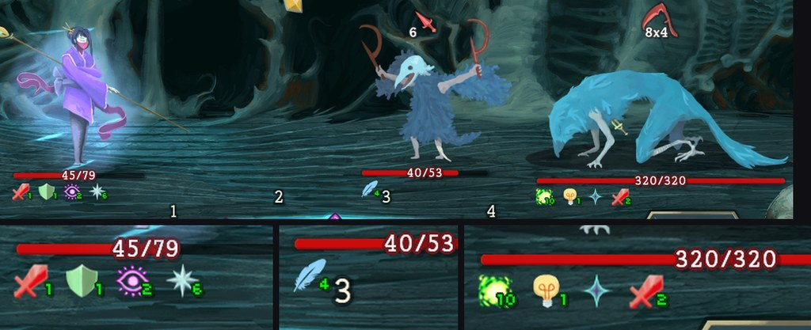</a> | `slaythespire_power_rows_under_hp_bars.jpg` Slay the Spire, the Watcher against a Cultist and the Awakened One, a player's screenshot; below, the three power rows enlarged. Under each health bar a row of unframed icons, the amount in small green figures at each one's lower right: the Watcher's red sword '1', green shield '1', violet eye '2' and white star '6'; the Cultist's blue feather '4'; the Awakened One's green orb '10', a bulb '1', a cyan star with no number and a red sword '2'. Above the foes, their intents, a dagger '6' and a scythe '8x4'. The player: 'The Cultist has: 4 Ritual, which means at the end of all of its turns, it will gain 4 Strength.' | [page](https://tck.mn/blog/a-slay-the-spire-puzzle/mechanics) · [image](https://tck.mn/blog/a-slay-the-spire-puzzle/puz1.png) |
| <a href="slaythespire_wiki_buff_debuff_monster_power_icons.png">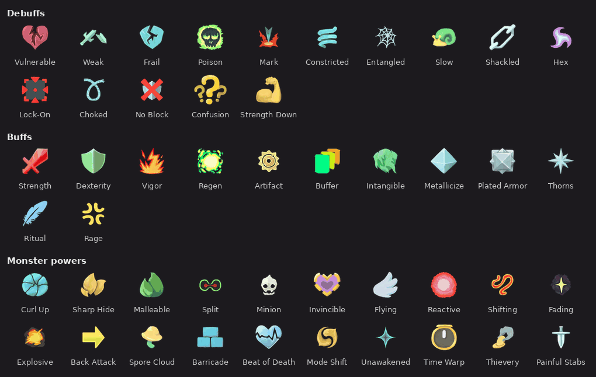</a> | `slaythespire_wiki_buff_debuff_monster_power_icons.png` Assembled from the wiki's icon files: Slay the Spire's 'Debuffs' ('Vulnerable', 'Weak', 'Frail', 'Poison', 'Mark', 'Constricted' and nine more), 'Buffs' ('Strength', 'Dexterity', 'Regen', 'Artifact', 'Thorns', 'Ritual' and six more) and, grouped here, powers only creatures have ('Curl Up', 'Sharp Hide', 'Split', 'Minion', 'Invincible', 'Flying', 'Fading', 'Explosive', 'Time Warp' and eleven more). One style for all: a painted symbol, no frame, no ground. | [page](https://slaythespire.wiki.gg/wiki/Buff) · [page](https://slaythespire.wiki.gg/wiki/Debuffs) · [image](https://slaythespire.wiki.gg/images/thumb/Icon_Vulnerable.png/60px-Icon_Vulnerable.png) (one `Icon_<Name>.png` to each) |
| <a href="slaythespire2_debuff_numbers_in_red.jpg">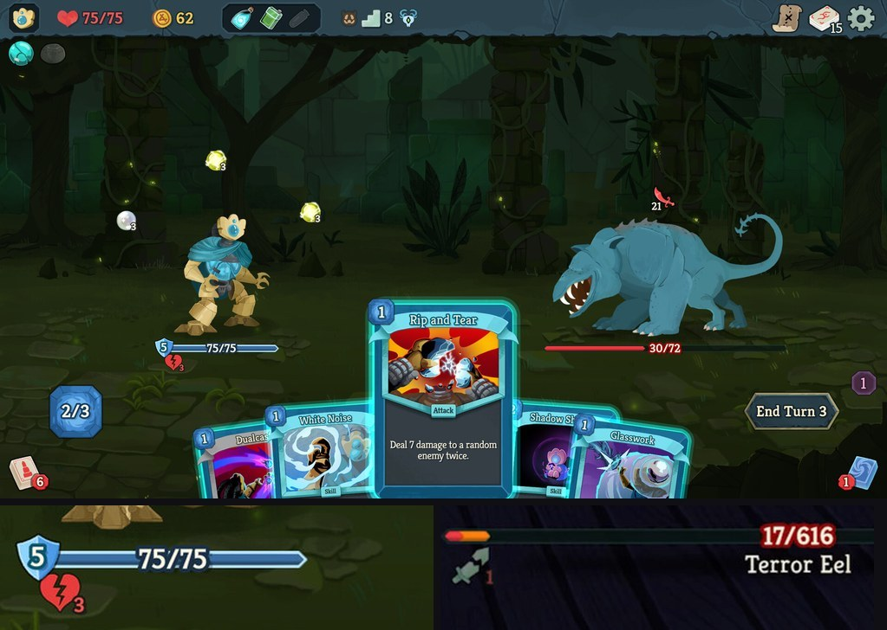</a> | `slaythespire2_debuff_numbers_in_red.jpg` Slay the Spire 2, in early access, a store screenshot of a fight; below, two bars enlarged: the hero's, its Block '5' on a blue shield at the bar's left end and under it a red broken heart with a red '3' (Vulnerable, as the first game draws it); the 'Terror Eel' '17/616', a broken green sword with a red '1' (Weak) under its bar. The foe's intent over it, a red blade '21'. | [page](https://store.steampowered.com/app/2868840/Slay_the_Spire_2/) · [image](https://shared.fastly.steamstatic.com/store_item_assets/steam/apps/2868840/1a373a95229aab0cfd97f553ecbe86092364bb9c/ss_1a373a95229aab0cfd97f553ecbe86092364bb9c.1920x1080.jpg) · [image](https://shared.fastly.steamstatic.com/store_item_assets/steam/apps/2868840/f3af7cb9693b9c4b6a7555227db3fef943db3992/ss_f3af7cb9693b9c4b6a7555227db3fef943db3992.1920x1080.jpg) |
| <a href="darkestdungeon_status_tray_on_health_bars.jpg">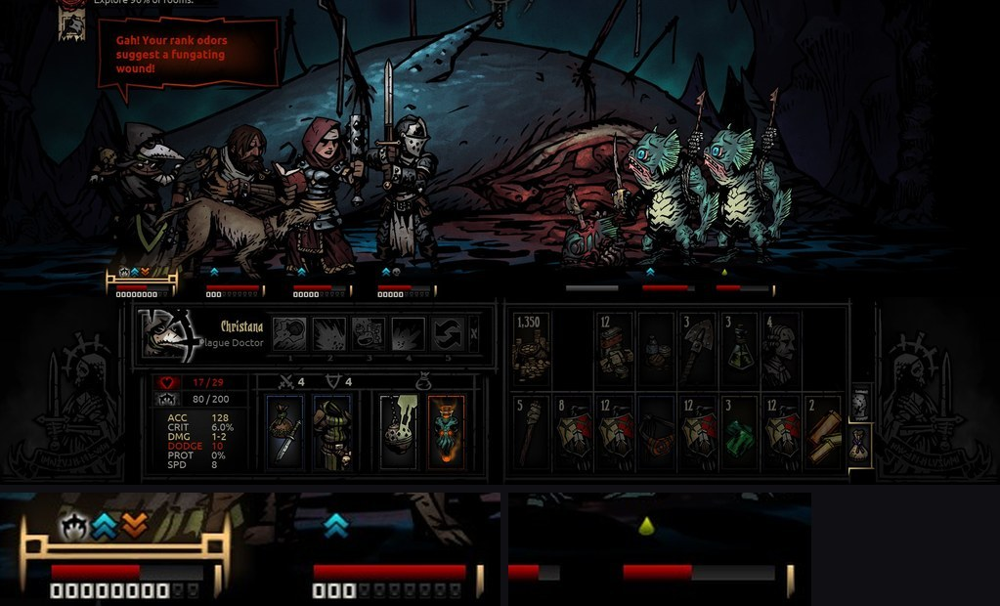</a> | `darkestdungeon_status_tray_on_health_bars.jpg` Darkest Dungeon, a fight in the Cove; below, the trays enlarged. Small icons stand side by side on the top edge of a health bar, at its left end: the Plague Doctor at the back, under a gold bracket, has a dark icon, blue chevrons up and orange chevrons down; two heroes the blue chevrons alone; a fishman a yellow-green drop. The wiki: 'Buffs are represented by two light blue arrows pointing upward, as an icon appearing over the health bar of the affected unit.' | [page](https://store.steampowered.com/app/262060/Darkest_Dungeon/) · [image](https://shared.fastly.steamstatic.com/store_item_assets/steam/apps/262060/ss_e65f764e9af2a8173faf70efc1b785f797cd714d.1920x1080.jpg) |
| <a href="darkestdungeon_quirks_as_text_resistances_as_icons.jpg">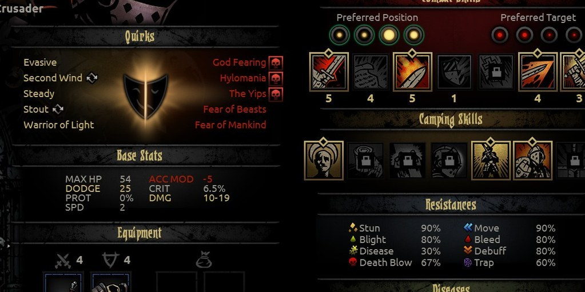</a> | `darkestdungeon_quirks_as_text_resistances_as_icons.jpg` Crop: Darkest Dungeon, a Crusader's sheet. 'Quirks' as words, the good in white at the left ('Evasive', 'Second Wind', 'Steady', 'Stout', 'Warrior of Light'), the bad in red at the right ('God Fearing', 'Hylomania', 'The Yips', 'Fear of Beasts', 'Fear of Mankind'), a few with a small badge after the name. 'Resistances' gives each status its tray icon beside its name: 'Stun 90%', 'Blight 80%', 'Disease 30%', 'Death Blow 67%', 'Move 90%', 'Bleed 80%', 'Debuff 80%', 'Trap 60%'. | [page](https://store.steampowered.com/app/262060/Darkest_Dungeon/) · [image](https://shared.fastly.steamstatic.com/store_item_assets/steam/apps/262060/ss_29888feb5adb6924ffb7e83997fcd0430dc4ca56.1920x1080.jpg) |
| <a href="darkestdungeon_tray_icons_and_dd2_tokens_sheet.png">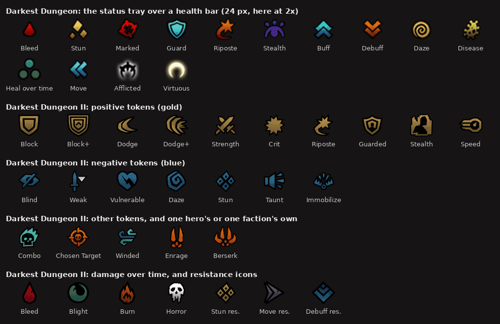</a> | `darkestdungeon_tray_icons_and_dd2_tokens_sheet.png` Assembled from the wiki's icon files. Darkest Dungeon's tray icons at twice their 24 pixels, each its own silhouette and colour: a red drop 'Bleed', gold diamonds 'Stun', a red target 'Marked', a teal shield 'Guard', blue chevrons 'Buff', orange chevrons 'Debuff'. Darkest Dungeon II's tokens as the wiki groups them, 'Positive' in gold ('Block', 'Dodge', 'Strength', 'Riposte', 'Stealth'), 'Negative' in blue ('Blind', 'Weak', 'Vulnerable', 'Stun', 'Taunt'), then 'Combo', one hero's and one faction's own ('Winded', the Beastmen's orange 'Enrage' and 'Berserk'), the damage over time in its own colours ('Bleed', 'Blight', 'Burn', 'Horror') and three resistance icons. The wiki: 'The easiest way to determine whether a token qualifies is to look at its colour: Positive tokens are yellow and Negative tokens are blue.' | [page](https://darkestdungeon.wiki.gg/wiki/Status_effects) · [page](https://darkestdungeon.wiki.gg/wiki/Tokens) · [image](https://darkestdungeon.wiki.gg/images/Tray_bleed.png) · [image](https://darkestdungeon.wiki.gg/images/Dd2_token_block.png) (one file to each) |
| <a href="darkestdungeon2_tokens_under_health_bars.jpg">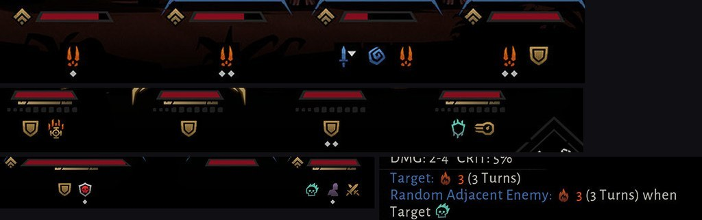</a> | `darkestdungeon2_tokens_under_health_bars.jpg` Crops of two Darkest Dungeon II fights, enlarged. Tokens stand in a row under each health bar, no frame, a token held more than once drawn once with a small diamond under it to each: the foes' orange claws (Enrage) with one or two diamonds, a blue dagger (Weak), a blue spiral (Daze) and a gold shield (Block); the heroes' gold shields (one with two diamonds), an orange target, a teal skull (Combo) and a gold Speed; at the lower left, a gold shield and a red one, a teal skull, a violet figure and gold crossed swords. At the lower right, a skill's tip: 'Target: [burn] 3 (3 Turns)', 'Random Adjacent Enemy: [burn] 3 (3 Turns) when Target [combo]'. | [page](https://store.steampowered.com/app/1940340/Darkest_Dungeon_II/) · [image](https://shared.fastly.steamstatic.com/store_item_assets/steam/apps/1940340/ss_e5f532902ce528340bce0735f16a8816f56182d9.1920x1080.jpg) · [image](https://shared.fastly.steamstatic.com/store_item_assets/steam/apps/1940340/ss_fed764604bcb367ccd2411c9540b8754c21e8090.1920x1080.jpg) |
| <a href="darkestdungeon2_creature_panel_statuses_resistances.jpg">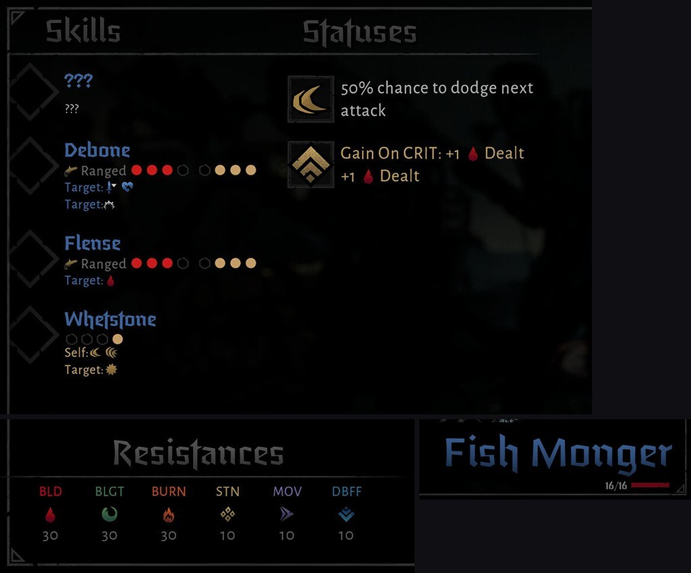</a> | `darkestdungeon2_creature_panel_statuses_resistances.jpg` Crop: Darkest Dungeon II, a creature's panel, the 'Fish Monger', '16/16'. Under 'Statuses', each standing effect as its token in a dark square frame beside one line: a gold dodge token, '50% chance to dodge next attack'; a gold chevron, 'Gain On CRIT: +1 [bleed] Dealt +1 [bleed] Dealt'. Its skills name their effects by token ('Target:', 'Self:'), one still '???'. 'Resistances', an icon in each kind's colour over its figure: 'BLD' red '30', 'BLGT' green '30', 'BURN' orange '30', 'STN' gold '10', 'MOV' violet '10', 'DBFF' blue '10'. | [page](https://store.steampowered.com/app/1940340/Darkest_Dungeon_II/) · [image](https://shared.fastly.steamstatic.com/store_item_assets/steam/apps/1940340/ss_e45a78cf2c30c0bea63cd7db9c17782cabf82a16.1920x1080.jpg) |
| <a href="honkaistarrail_boss_debuff_row_party_buff_arrows.jpg">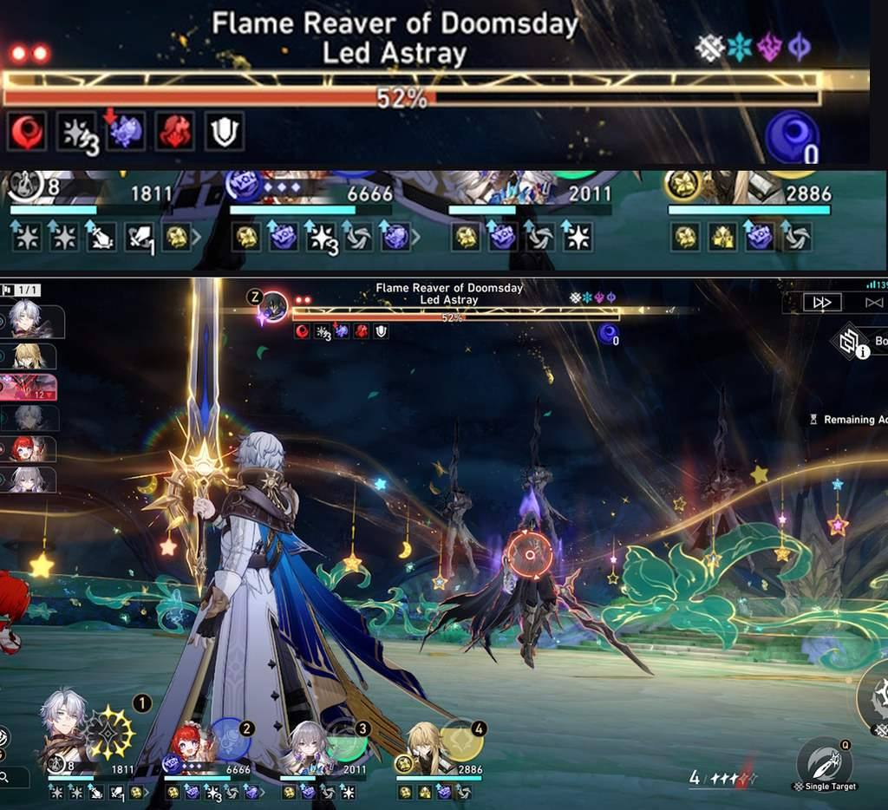</a> | `honkaistarrail_boss_debuff_row_party_buff_arrows.jpg` Honkai: Star Rail, a boss fight, with the boss's bar and the party's rows enlarged above the whole screen. 'Flame Reaver of Doomsday', 'Led Astray': its weaknesses as four element icons over the bar at the right; under it at the left, its effects in dark square frames, mostly red, one with a '3' at its lower right, one with a small red arrow pointing down at its corner, and a white shield; a blue orb '0' at the right. Under each of the party's four bars, a row of dark squares, each with a small cyan arrow pointing up at its top left, a figure at its lower right ('1', '3') and a '>' where the row runs out. | [page](https://beebom.com/honkai-star-rail-elements-and-effects) · [image](https://static.beebom.com/wp-content/uploads/2025/07/Weakness-Breaking-Enemies-in-Honkai-Star-Rail.jpg) |
| <a href="monstertrain2_trigger_discs_status_tiles_tooltip.jpg">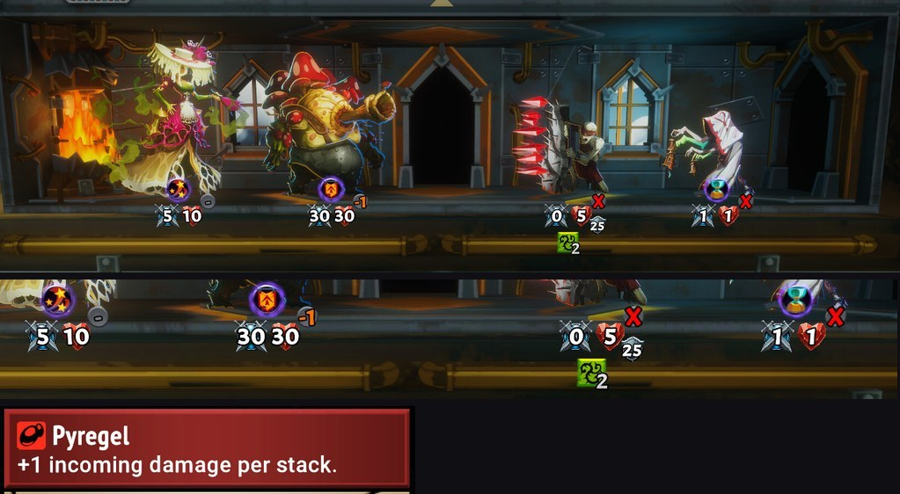</a> | `monstertrain2_trigger_discs_status_tiles_tooltip.jpg` Monster Train 2, a floor in a fight ('Heavenly Toll'), the units' figures enlarged under it, and a tip from another screenshot. Under each unit a violet disc with its ability's glyph, then attack on crossed swords and health on a heart ('5 10', '30 30'), armour on a small shield ('25'), and a status as a small green square tile with its count, '2'; a red cross where a unit will die, an orange '-1' for the damage coming. The tip, on a red header: the status's icon, 'Pyregel', '+1 incoming damage per stack.' | [page](https://store.steampowered.com/app/2742830/Monster_Train_2/) · [image](https://shared.fastly.steamstatic.com/store_item_assets/steam/apps/2742830/c5a5a06f35b12fcc88bc585c41ade318c31de60d/ss_c5a5a06f35b12fcc88bc585c41ade318c31de60d.1920x1080.jpg) · [image](https://shared.fastly.steamstatic.com/store_item_assets/steam/apps/2742830/13915332da0cba36880fffd5061a3f89a82ff3fe/ss_13915332da0cba36880fffd5061a3f89a82ff3fe.1920x1080.jpg) |
| <a href="wildfrost_miniboss_keyword_callouts.jpg">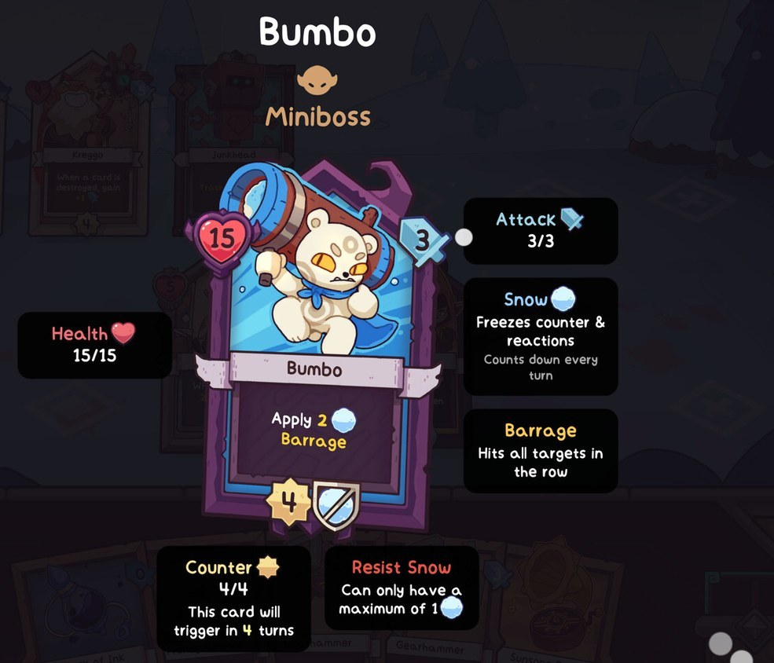</a> | `wildfrost_miniboss_keyword_callouts.jpg` Crop: Wildfrost, a miniboss inspected, 'Bumbo', 'Miniboss'. Every mark on its card has a callout, the name in a colour with its icon after it and a line under: 'Health' '15/15', 'Attack' '3/3', 'Snow' 'Freezes counter & reactions' 'Counts down every turn', 'Barrage' 'Hits all targets in the row', 'Counter' '4/4' 'This card will trigger in 4 turns', and in red 'Resist Snow' 'Can only have a maximum of 1 [snow]', whose shield sits on the card's foot beside the counter. | [page](https://store.steampowered.com/app/1811990/Wildfrost/) · [image](https://shared.fastly.steamstatic.com/store_item_assets/steam/apps/1811990/ss_0251000ca945c16ebadd7af9abbe2b501b6513ce.1920x1080.jpg) |
| <a href="wildfrost_card_edge_statuses_and_traits.jpg">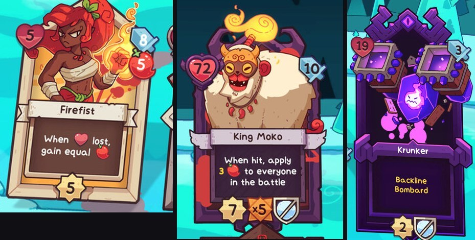</a> | `wildfrost_card_edge_statuses_and_traits.jpg` Crops of two Wildfrost fights, enlarged: 'Firefist', 'King Moko' and 'Krunker'. Health on a heart at the top left, attack on a blade at the top right, the counter on a gold burst at the foot. Firefist's red pepper '5' stacks on the edge under her attack; King Moko's foot carries the counter '7', an orange burst '×5' and a shield crossed through, Krunker's the counter '2' and the same shield. | [page](https://store.steampowered.com/app/1811990/Wildfrost/) · [image](https://shared.fastly.steamstatic.com/store_item_assets/steam/apps/1811990/ss_466a72188ee33b24d37c45a2bfffdd7bb2e45962.1920x1080.jpg) · [image](https://shared.fastly.steamstatic.com/store_item_assets/steam/apps/1811990/ss_8575eff1311bb8fa50a67d80902aed3ea23f7da3.1920x1080.jpg) |
| <a href="epicseven_boss_bar_buffs_debuffs_turn_counters.jpg">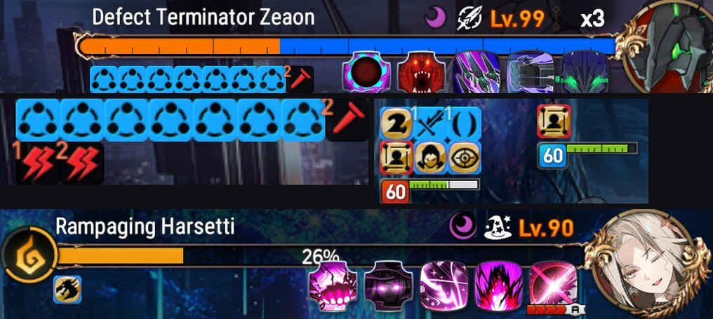</a> | `epicseven_boss_bar_buffs_debuffs_turn_counters.jpg` Crops of two Epic Seven fights, enlarged. 'Defect Terminator Zeon', 'Lv.99', 'x3': under the bar, seven tiles of one buff, filled bright blue with a dark glyph, and a dark tile with a red glyph and a small red '2' at its top left; beside the bar, five larger badges of painted art, round and rounded-square, the boss's own. A hero's rows: the same blue tiles, two dark tiles with red lightning, '1' and '2'; another's gold tiles with small blue figures. 'Rampaging Harsetti', 'Lv.90': five pink and violet badges of art, the last with a row of red pips under it. | [page](https://store.steampowered.com/app/5019180/Epic_Seven/) · [image](https://shared.fastly.steamstatic.com/store_item_assets/steam/apps/5019180/0f27106c09f107d4bd4bc9091579b72db790ff66/ss_0f27106c09f107d4bd4bc9091579b72db790ff66.1920x1080.jpg) · [image](https://shared.fastly.steamstatic.com/store_item_assets/steam/apps/5019180/5a0706801756b9841f84fac9d0428bbf4a11e69c/ss_5a0706801756b9841f84fac9d0428bbf4a11e69c.1920x1080.jpg) |
| <a href="summonerswar_buff_icons_turn_counters.jpg">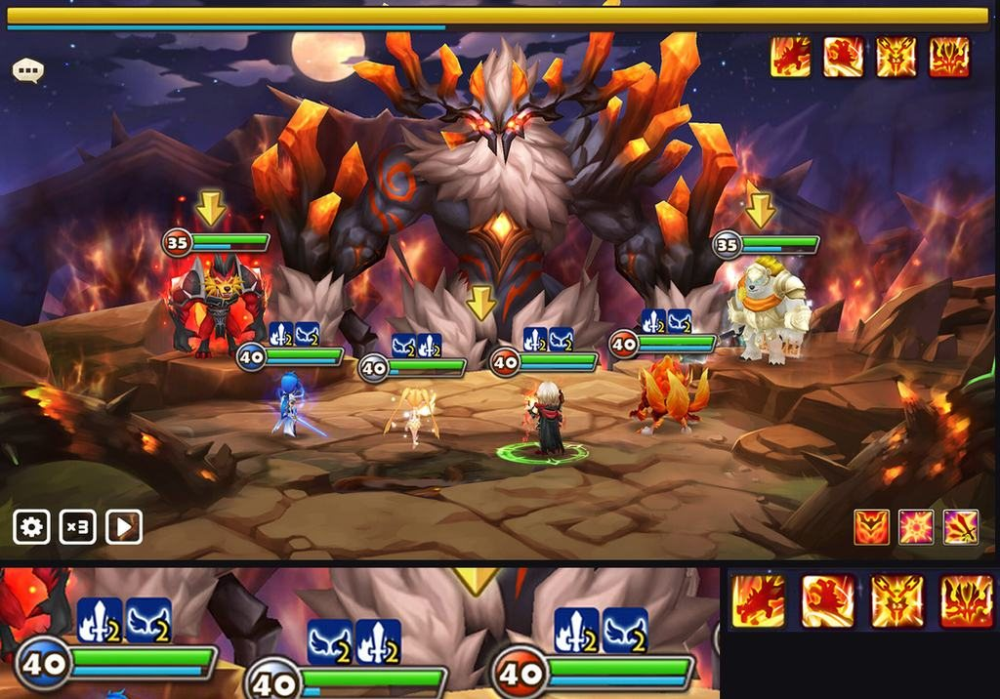</a> | `summonerswar_buff_icons_turn_counters.jpg` Summoners War, a dungeon fight against a fire beast; below, the party's bars enlarged. Over each health bar, two small square tiles, blue with a white glyph (a sword, a wing), the turns left as a white '2' at each one's lower right; yellow arrows over the foes; a row of four square fire-art icons at the top right. A fan guide: 'Monsters that are buffed will have a blue icon over its Health bar', the duration 'on the bottom right of the icon'. | [page](https://store.steampowered.com/app/2426960/Summoners_War/) · [page](https://summoners-war.blogspot.com/p/skills.html) · [image](https://shared.fastly.steamstatic.com/store_item_assets/steam/apps/2426960/ss_f4a2640a61daed6edb3d5a707687a177508198b9.1920x1080.jpg) |
| <a href="raidshadowlegends_buff_debuff_tiles_sheet.png">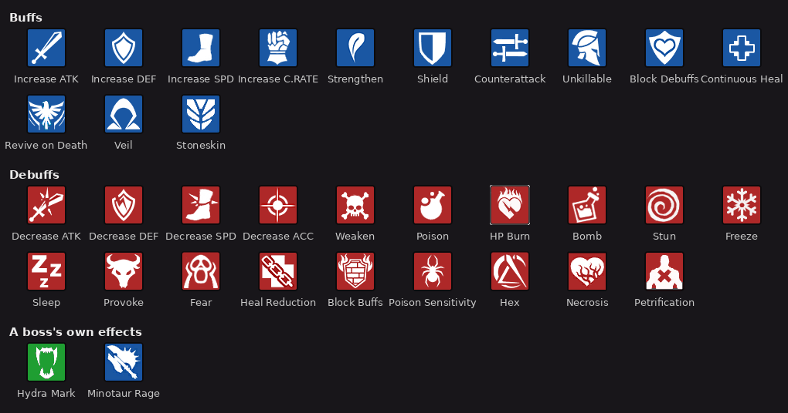</a> | `raidshadowlegends_buff_debuff_tiles_sheet.png` Assembled from HellHades' icon files: RAID: Shadow Legends' effects, one tile each, solid blue for every buff ('Increase ATK', 'Shield', 'Counterattack', 'Unkillable', 'Block Debuffs', 'Veil' and seven more), solid red for every debuff ('Decrease ATK', 'Weaken', 'Poison', 'HP Burn', 'Bomb', 'Stun', 'Freeze', 'Provoke' and eleven more), one white glyph on each; two of a boss's own, the Hydra's mark on green and the Minotaur's rage on blue. HellHades: 'Bomb: When this Debuff is placed it is seen as a countdown'. | [page](https://hellhades.com/raid-shadow-legends-debuffs-buffs/) · [image](https://hellhades.com/wp-content/uploads/2020/11/Bomb.png) (one file to each) |
| <a href="sololevelingarise_boss_bar_status_tiles.jpg">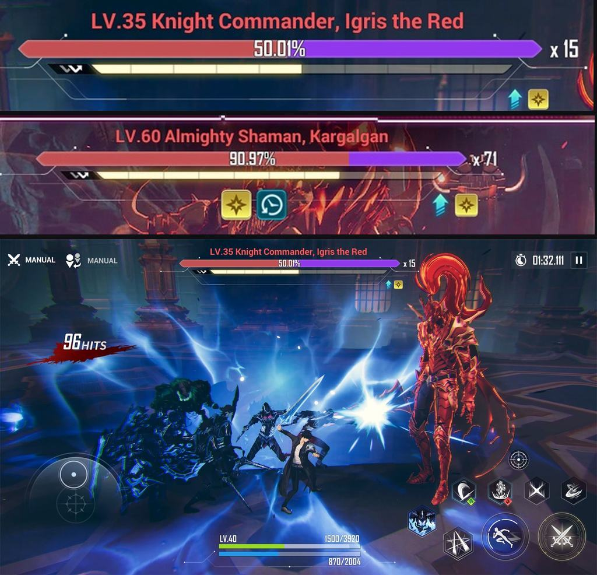</a> | `sololevelingarise_boss_bar_status_tiles.jpg` Solo Leveling: Arise on a phone, from its App Store screenshots, two bosses' bars enlarged over a whole screen. 'LV.35 Knight Commander, Igris the Red' in red, the bar '50.01%' and 'x 15', the Break gauge under it in cream segments; under the bar's right end, a cyan arrow pointing up and a gold tile with a star. 'LV.60 Almighty Shaman, Kargalgan', '90.97%', 'x 71': a gold tile and a teal one with a clock under the bar's middle, the arrow and the gold tile at its end. Inven Global: 'Kargalgan receives significant damage reduction while the Break gauge is active'. | [page](https://apps.apple.com/us/app/solo-leveling-arise/id1662742277) · [page](https://www.invenglobal.com/articles/18942/guide-for-almighty-shaman-kargalgan-use-meilin-or-hwang-dongsoo-to-break-the-shield) · [image](https://is1-ssl.mzstatic.com/image/thumb/PurpleSource221/v4/03/a4/f7/03a4f714-ce8d-00dd-7256-afa054f94bce/e0855491-bb5b-4ede-a31c-151963ee79ce_IOS_2208x1242_7_EN.jpg/1600x0w.jpg) · [image](https://is1-ssl.mzstatic.com/image/thumb/PurpleSource221/v4/91/04/8e/91048efc-b38e-1148-d61a-2e2678fb1660/2ba84672-6d21-48e8-812b-ef4c76ac9506_IOS_2208x1242_6_EN.jpg/1600x0w.jpg) |

## What ARISE took

Built in `src/ui/effects.tsx` and the creature's card in `src/screens/Arena.tsx`; the words in
[docs/VOICE.md](../../../VOICE.md), the fight card's row.

- **A mark to every effect, one silhouette each**, as Darkest Dungeon's and Raid's: a drop for Bleeding, a flame for
  Burning, roots for Rooted, stars about a ring for Stunned, a broken sword for Weakened. Filled, on the 24 grid, so it
  reads at fourteen pixels.
- **Two frames for two kinds**, as Monster Train 2 puts a unit's own ability in a disc and its statuses in squares, and
  Epic Seven sets a boss's abilities apart from the tiles under its bar: a habit, the creature's for good, in a
  hexagonal plate rimmed in the creature's red; a status, laid on for a time, in a square tile. Slay the Spire draws the
  two alike, and only its tip tells them apart; ARISE does not.
- **A habit and the status it lays share one mark**: Enrage and Enraged, Bodyguard and Shielded, War Cry and
  Emboldened. The plate says the creature will; the tile, that it has.
- **The sign at the tile's corner**, as Honkai: Star Rail marks its effects with an arrow, so it never rests on colour
  alone: a point up for what serves the one it holds, down for what harms it. The tile keeps its tag's colour: red what
  harms, green what serves the party, orange what serves a creature.
- **The name stays beside the mark** on the card: a fight shows two to four habits and statuses, and Wildfrost's and
  Darkest Dungeon II's panels name each mark beside it.
- **The tip leads with the mark**, as Monster Train 2's tooltip leads with the icon on its header: a habit's plate or a
  status's tile beside its name.
- **The creature card names its resistances by their marks**, as Darkest Dungeon II's creature panel and the first
  game's hero sheet list theirs.
- **Not taken**: a figure for the turns left on each tile (Summoners War's, Star Rail's). A fight's card does not yet
  know how many turns a status has left; the tip tells what it does. Raid's solid blue and red tiles were not taken
  either: blue is the System's and the defence's in ARISE.
