# Step 1: Read the fight and the map

The references for the first step of the roadmap the research led to, built as "Read the fight and the map" in
[docs/DESIGN.md](../../../DESIGN.md#read-the-fight-and-the-map--built): Slay the Spire's intents, Into the
Breach's numbered attack order, Wildfrost's numbers kept in the same place on every card, and Etrian Odyssey's
map, where what waits in a room is marked on its square. They gave ARISE the reckoning on each foe's card, its
place in the order, and the pips on the plan.

Every image belongs to the game's publisher, or to the wiki, site or player who captured it, as listed beside it. They are kept here as design reference only: nothing in ARISE copies their art, and none of them ships with the game.

## Slay the Spire

Slay the Spire, by Mega Crit. Store screenshots from its [Steam page](https://store.steampowered.com/app/646570/). The source of the foe's intent: an icon and the damage it will do, over the foe.

| | What it shows | Source |
|---|---|---|
| <a href="slay-the-spire-1.jpg">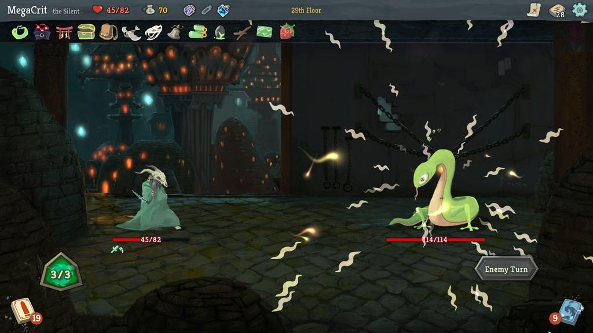</a> | `slay-the-spire-1.jpg` A fight: each foe's intent over its head, its HP under it, the energy orb and End Turn. | [Steam store](https://store.steampowered.com/app/646570/) · [image](https://shared.akamai.steamstatic.com/store_item_assets/steam/apps/646570/ss_c171816f7ecd35b5b46d2fa27532f4c5b8ca3cc5.1920x1080.jpg) |
| <a href="slay-the-spire-2.jpg">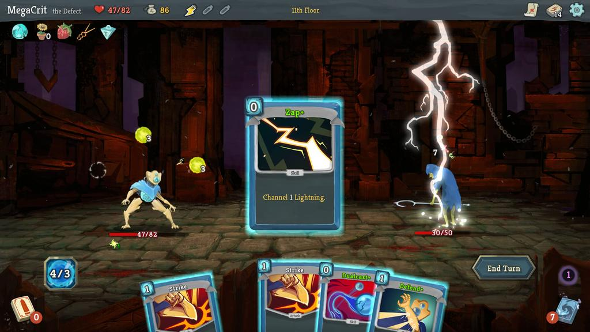</a> | `slay-the-spire-2.jpg` The Defect channelling Lightning, with an intent over each foe. | [Steam store](https://store.steampowered.com/app/646570/) · [image](https://shared.akamai.steamstatic.com/store_item_assets/steam/apps/646570/ss_01aa3e7759e457bfbf2422f31c325d7b3ba8a6eb.1920x1080.jpg) |
| <a href="slay-the-spire-3.jpg">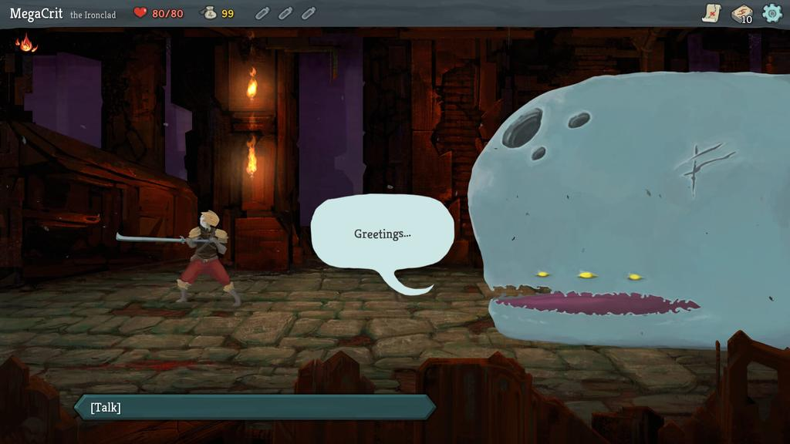</a> | `slay-the-spire-3.jpg` Neow's greeting at the start of a run. | [Steam store](https://store.steampowered.com/app/646570/) · [image](https://shared.akamai.steamstatic.com/store_item_assets/steam/apps/646570/ss_b757436d08ba08292796bfed9c60e7cc99d5f2c3.1920x1080.jpg) |
| <a href="slay-the-spire-4.jpg">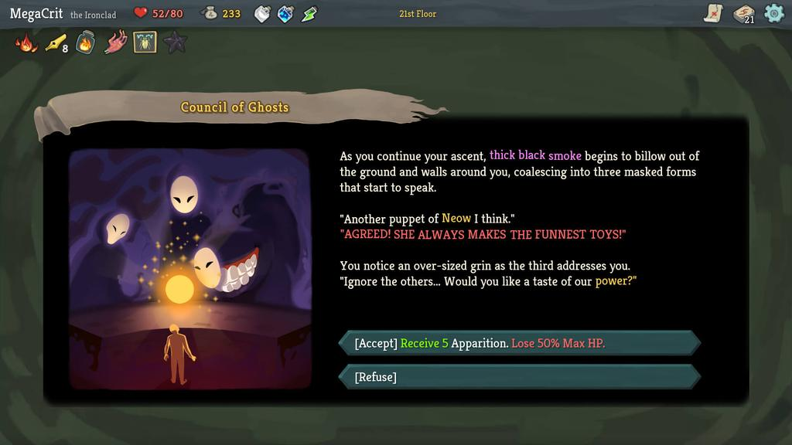</a> | `slay-the-spire-4.jpg` An event, the Council of Ghosts: each choice states its cost. | [Steam store](https://store.steampowered.com/app/646570/) · [image](https://shared.akamai.steamstatic.com/store_item_assets/steam/apps/646570/ss_1299d7fe55771cf564848c5046fbef7936178440.1920x1080.jpg) |
| <a href="slay-the-spire-5.jpg">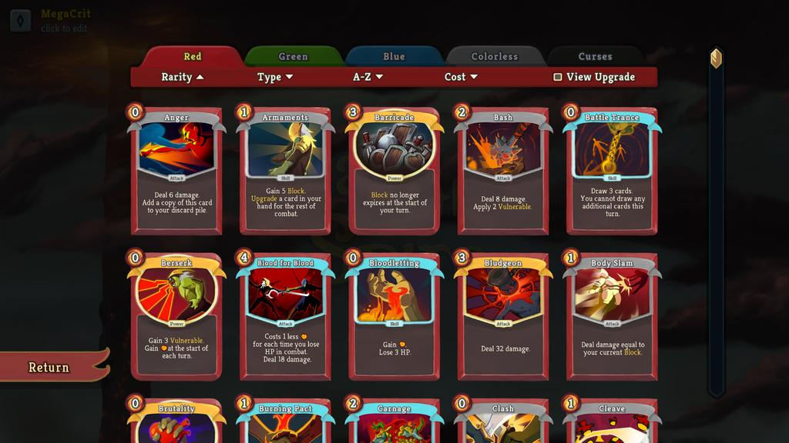</a> | `slay-the-spire-5.jpg` The card library. | [Steam store](https://store.steampowered.com/app/646570/) · [image](https://shared.akamai.steamstatic.com/store_item_assets/steam/apps/646570/ss_8af73365121b1b1e2d8004fca2cbffb9b9f6d7a5.1920x1080.jpg) |
| <a href="crop-slay-the-spire-intent.jpg">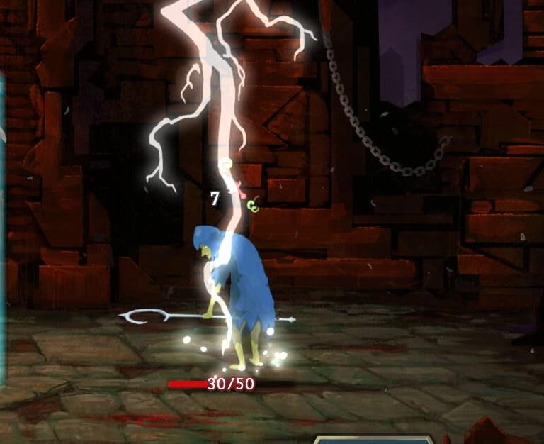</a> | `crop-slay-the-spire-intent.jpg` Crop: the foes' intents and HP bars. | [cropped from Slay the Spire store shot 2](https://shared.akamai.steamstatic.com/store_item_assets/steam/apps/646570/ss_01aa3e7759e457bfbf2422f31c325d7b3ba8a6eb.1920x1080.jpg) |
| <a href="slay-the-spire-intent-demonstration.jpg">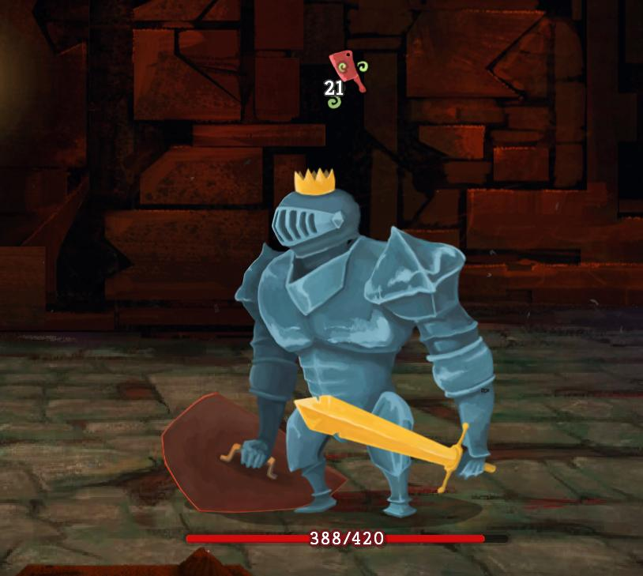</a> | `slay-the-spire-intent-demonstration.jpg` The wiki's demonstration of an intent: the icon tells the kind of action and the number its damage. | [Slay the Spire Wiki, Intent](https://slaythespire.wiki.gg/wiki/Intent) · [image](https://slaythespire.wiki.gg/images/IntentDemonstration.png) |
| <a href="slay-the-spire-intent-icons.png">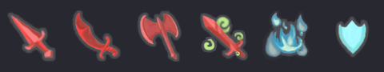</a> | `slay-the-spire-intent-icons.png` Six intent icons side by side: attacks of growing weight, an attack with a debuff, a buff, a defend. | [Slay the Spire Wiki, Intent](https://slaythespire.wiki.gg/wiki/Intent) · [Attack2](https://slaythespire.wiki.gg/images/Intent_Attack2.png) · [Attack4](https://slaythespire.wiki.gg/images/Intent_Attack4.png) · [Attack6](https://slaythespire.wiki.gg/images/Intent_Attack6.png) · [DebuffAttack3](https://slaythespire.wiki.gg/images/Intent_DebuffAttack3.png) · [Buff](https://slaythespire.wiki.gg/images/Intent_Buff.png) · [Defend](https://slaythespire.wiki.gg/images/Intent_Defend.png) |

## Into the Breach

Into the Breach, by Subset Games. Store screenshots from its [Steam page](https://store.steampowered.com/app/590380/). The source of the numbered attack order.

| | What it shows | Source |
|---|---|---|
| <a href="into-the-breach-1.jpg">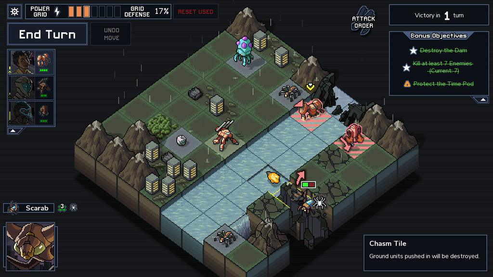</a> | `into-the-breach-1.jpg` A turn: every Vek's attack previewed on the tiles it will hit. | [Steam store](https://store.steampowered.com/app/590380/) · [image](https://shared.akamai.steamstatic.com/store_item_assets/steam/apps/590380/ss_6113590509c195f98fa64cd738df534762e0c358.1920x1080.jpg) |
| <a href="into-the-breach-2.jpg">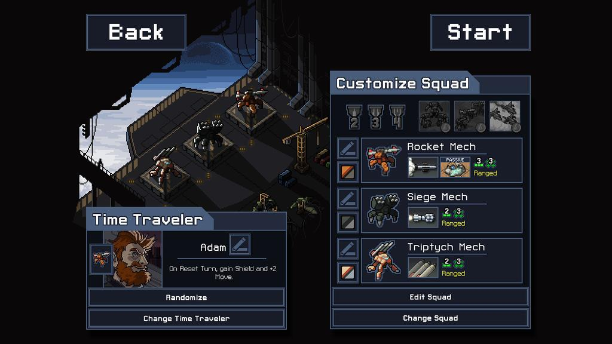</a> | `into-the-breach-2.jpg` Choosing a squad and a pilot. | [Steam store](https://store.steampowered.com/app/590380/) · [image](https://shared.akamai.steamstatic.com/store_item_assets/steam/apps/590380/ss_edc919f964fd053441967b89592bc930a65f4171.1920x1080.jpg) |
| <a href="into-the-breach-3.jpg">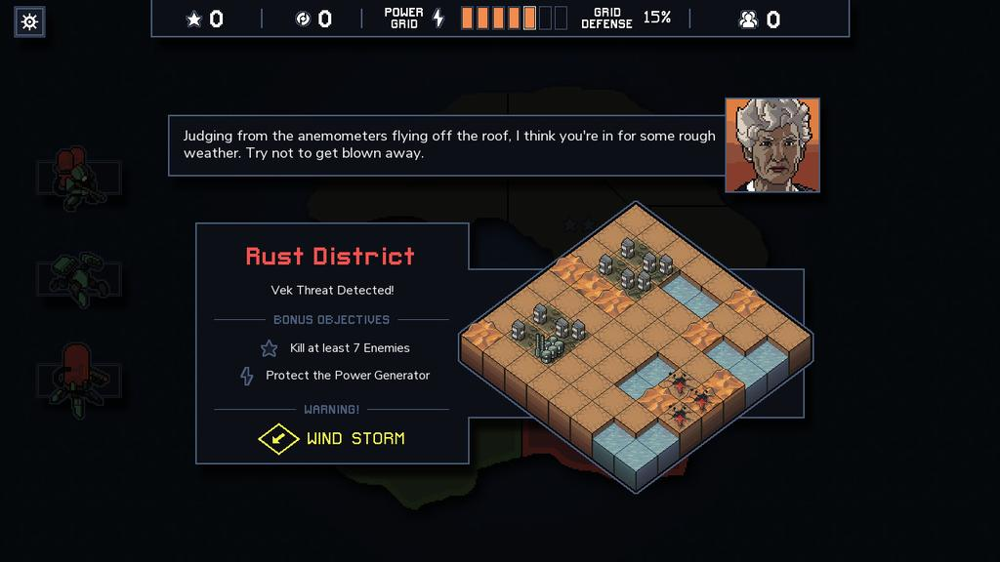</a> | `into-the-breach-3.jpg` An island's mission, its objectives listed. | [Steam store](https://store.steampowered.com/app/590380/) · [image](https://shared.akamai.steamstatic.com/store_item_assets/steam/apps/590380/ss_82cfc5241c4a093091fbd7d2e124a52a57930527.1920x1080.jpg) |
| <a href="into-the-breach-4.jpg">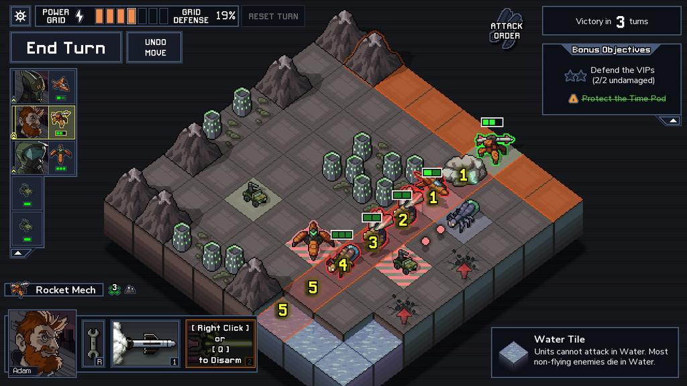</a> | `into-the-breach-4.jpg` The attack order: a number on each Vek for when it acts. | [Steam store](https://store.steampowered.com/app/590380/) · [image](https://shared.akamai.steamstatic.com/store_item_assets/steam/apps/590380/ss_4b985c7747c1ff0b7fbbf3eaf8ca5a1272f0dadb.1920x1080.jpg) |
| <a href="into-the-breach-5.jpg">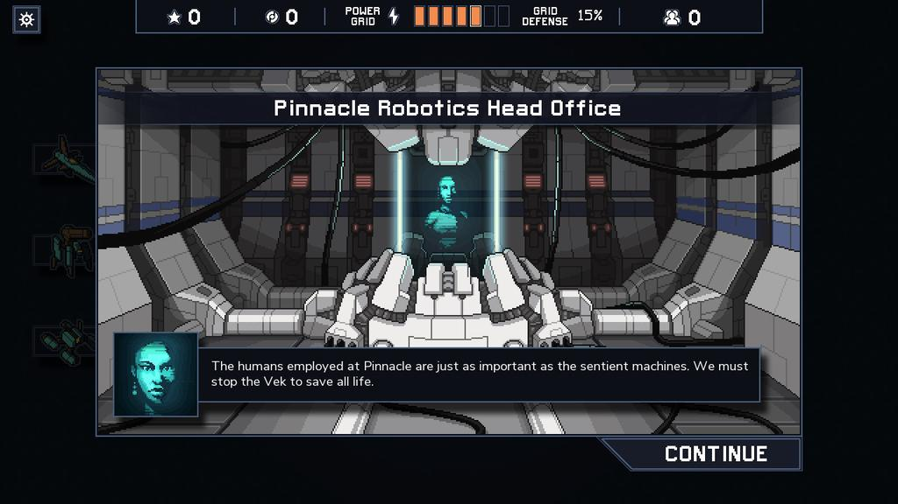</a> | `into-the-breach-5.jpg` A corporate briefing. | [Steam store](https://store.steampowered.com/app/590380/) · [image](https://shared.akamai.steamstatic.com/store_item_assets/steam/apps/590380/ss_1ac6f8ce8e81bc1b3fe9cb23f58c477cbda04a04.1920x1080.jpg) |
| <a href="into-the-breach-6.jpg">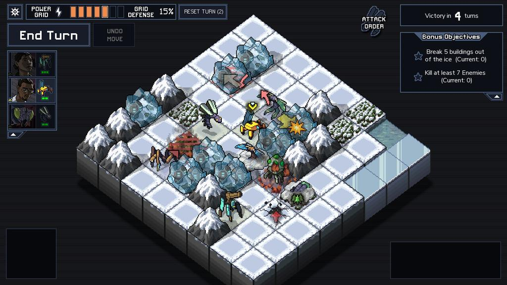</a> | `into-the-breach-6.jpg` An ice map with the Vek's attacks previewed. | [Steam store](https://store.steampowered.com/app/590380/) · [image](https://shared.akamai.steamstatic.com/store_item_assets/steam/apps/590380/ss_567488bb66f15710b4fd40eb57446e5d652717f5.1920x1080.jpg) |
| <a href="into-the-breach-7.jpg">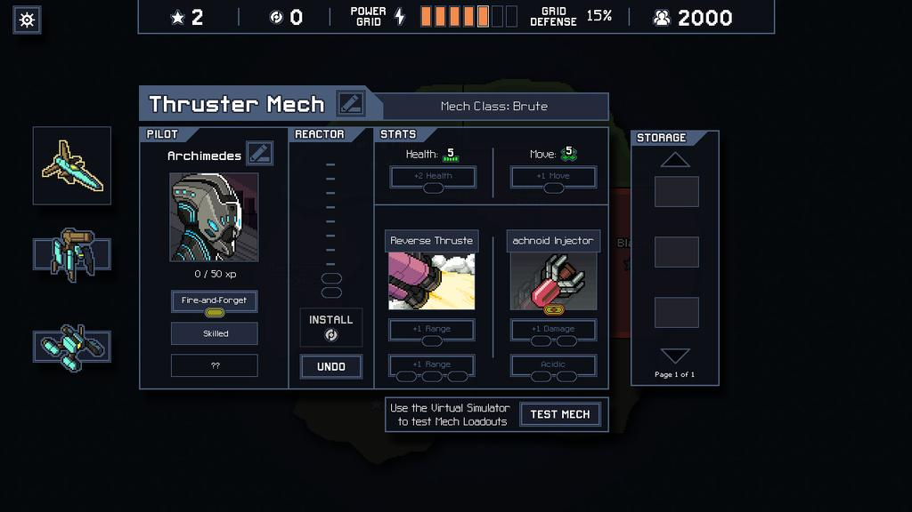</a> | `into-the-breach-7.jpg` A mech's loadout. | [Steam store](https://store.steampowered.com/app/590380/) · [image](https://shared.akamai.steamstatic.com/store_item_assets/steam/apps/590380/ss_f3ca4120fe01efcdd4cd355b7e5798f98b695233.1920x1080.jpg) |
| <a href="crop-into-the-breach-order.jpg">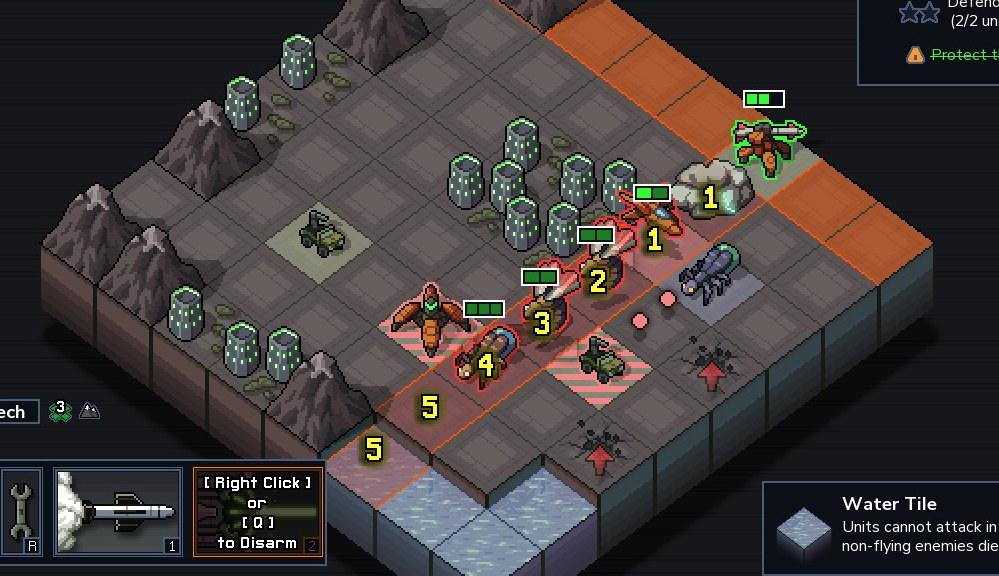</a> | `crop-into-the-breach-order.jpg` Crop: the numbered attack order on the board. | [cropped from Into the Breach store shot 4](https://shared.akamai.steamstatic.com/store_item_assets/steam/apps/590380/ss_4b985c7747c1ff0b7fbbf3eaf8ca5a1272f0dadb.1920x1080.jpg) |

## Wildfrost

Wildfrost, by Deadpan Games and Gaziter. Store screenshots from its [Steam page](https://store.steampowered.com/app/1811990/). The source of numbers kept in the same place on every card.

| | What it shows | Source |
|---|---|---|
| <a href="wildfrost-1.jpg">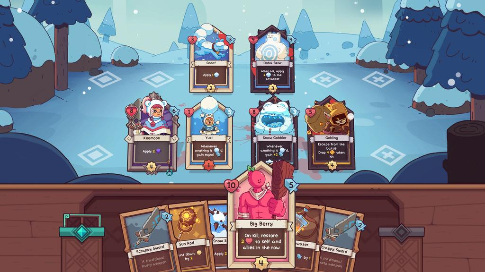</a> | `wildfrost-1.jpg` A fight: every card's attack, HP and counter in the same corners. | [Steam store](https://store.steampowered.com/app/1811990/) · [image](https://shared.akamai.steamstatic.com/store_item_assets/steam/apps/1811990/ss_d7ed2146d858a0abd02a8256befe264328595537.1920x1080.jpg) |
| <a href="wildfrost-2.jpg">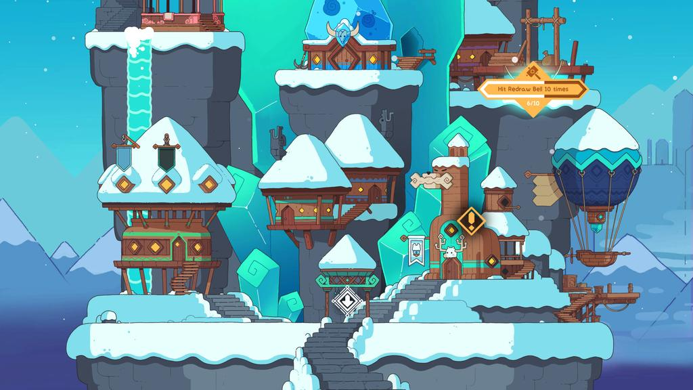</a> | `wildfrost-2.jpg` The town of Snowdwell. | [Steam store](https://store.steampowered.com/app/1811990/) · [image](https://shared.akamai.steamstatic.com/store_item_assets/steam/apps/1811990/ss_81c4f6108af5679782590dfbce1a3f948069d27b.1920x1080.jpg) |
| <a href="wildfrost-3.jpg">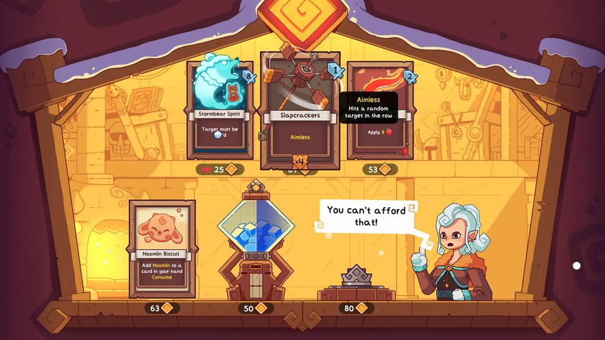</a> | `wildfrost-3.jpg` A shop. | [Steam store](https://store.steampowered.com/app/1811990/) · [image](https://shared.akamai.steamstatic.com/store_item_assets/steam/apps/1811990/ss_099d1276c899b5d6813bb2fd354fe1f0c9dbe789.1920x1080.jpg) |
| <a href="wildfrost-4.jpg">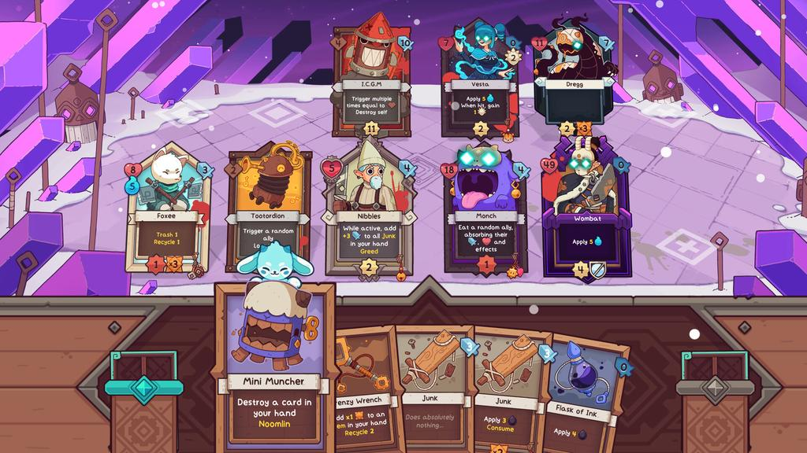</a> | `wildfrost-4.jpg` A fight on another board, the counters on every card. | [Steam store](https://store.steampowered.com/app/1811990/) · [image](https://shared.akamai.steamstatic.com/store_item_assets/steam/apps/1811990/ss_b749d8c76c55e060e44b7db56dfedc615333035f.1920x1080.jpg) |
| <a href="wildfrost-5.jpg">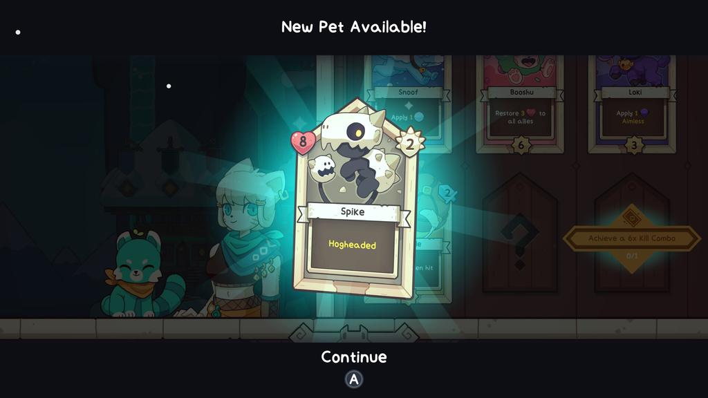</a> | `wildfrost-5.jpg` A new pet. | [Steam store](https://store.steampowered.com/app/1811990/) · [image](https://shared.akamai.steamstatic.com/store_item_assets/steam/apps/1811990/ss_e398f9145d22a6afa92676dde13e32cff418f91d.1920x1080.jpg) |
| <a href="wildfrost-6.jpg">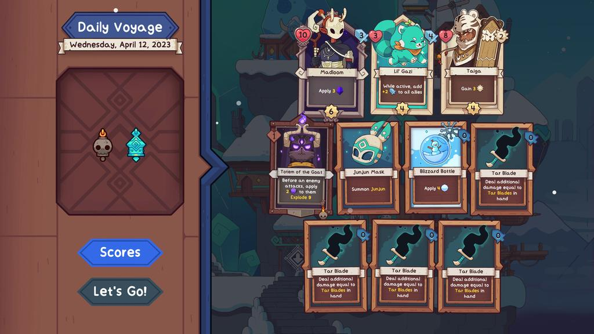</a> | `wildfrost-6.jpg` The deck at the start of a journey. | [Steam store](https://store.steampowered.com/app/1811990/) · [image](https://shared.akamai.steamstatic.com/store_item_assets/steam/apps/1811990/ss_d9f7f1d4fc074ac1db54295677f415010d12bbed.1920x1080.jpg) |
| <a href="wildfrost-7.jpg">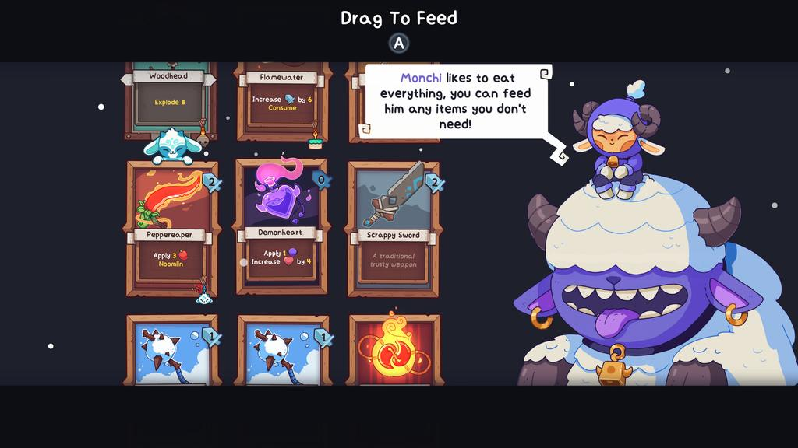</a> | `wildfrost-7.jpg` Feeding items to a companion. | [Steam store](https://store.steampowered.com/app/1811990/) · [image](https://shared.akamai.steamstatic.com/store_item_assets/steam/apps/1811990/ss_cef61ad891c00ea162a9a514d32df7254fb6eb5c.1920x1080.jpg) |
| <a href="wildfrost-8.jpg">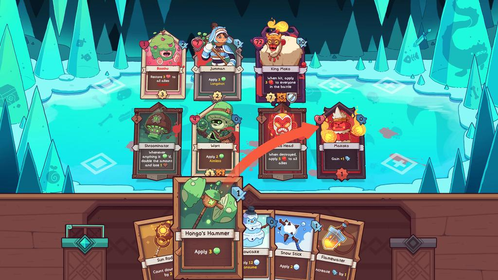</a> | `wildfrost-8.jpg` A fight: a card dragged at a foe, its arrow showing the target. | [Steam store](https://store.steampowered.com/app/1811990/) · [image](https://shared.akamai.steamstatic.com/store_item_assets/steam/apps/1811990/ss_8575eff1311bb8fa50a67d80902aed3ea23f7da3.1920x1080.jpg) |
| <a href="crop-wildfrost-counters.jpg">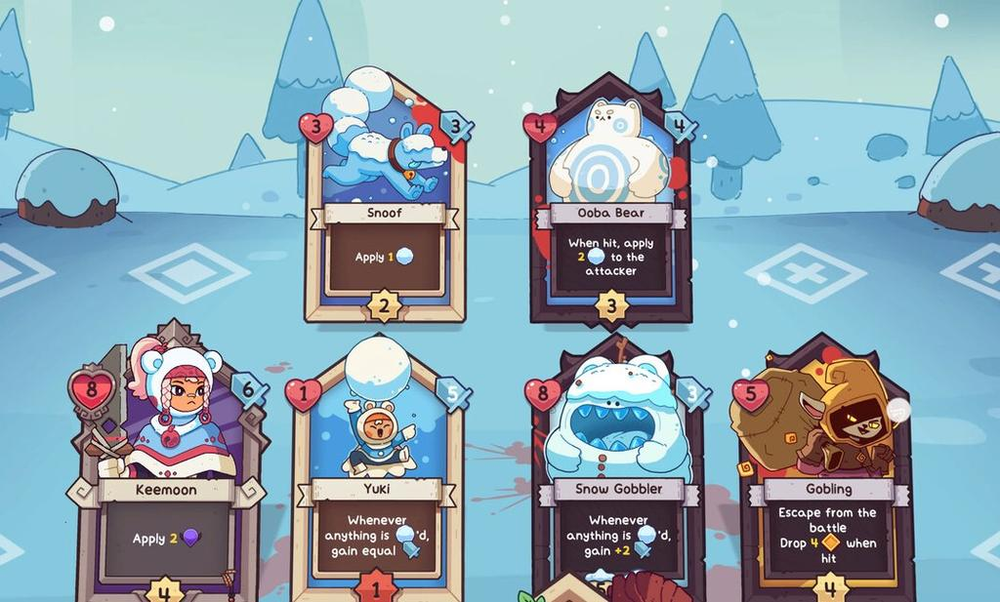</a> | `crop-wildfrost-counters.jpg` Crop: the counters on the cards in a fight. | [cropped from Wildfrost store shot 1](https://shared.akamai.steamstatic.com/store_item_assets/steam/apps/1811990/ss_d7ed2146d858a0abd02a8256befe264328595537.1920x1080.jpg) |

## Etrian Odyssey HD and Etrian Odyssey III HD

Etrian Odyssey HD and Etrian Odyssey III HD, by Atlus. Store screenshots from their Steam pages ([HD](https://store.steampowered.com/app/1868180/), [III HD](https://store.steampowered.com/app/1810820/)). The source of the map that marks what waits in a room on its square.

| | What it shows | Source |
|---|---|---|
| <a href="etrian-odyssey-hd-1.jpg">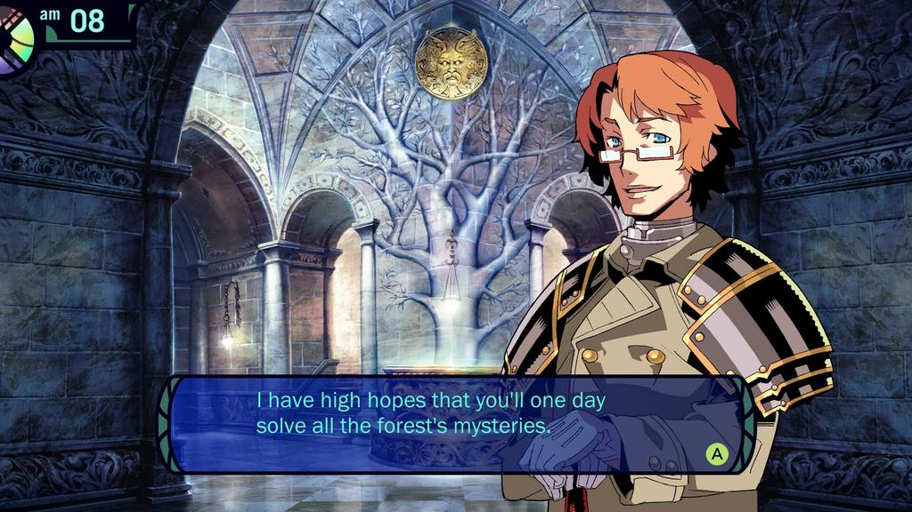</a> | `etrian-odyssey-hd-1.jpg` A guild master in town. | [Steam store](https://store.steampowered.com/app/1868180/) · [image](https://shared.akamai.steamstatic.com/store_item_assets/steam/apps/1868180/ss_6ff345f48d83e6a1c3019dcc429cf89f15fc4a14.1920x1080.jpg) |
| <a href="etrian-odyssey-hd-2.jpg">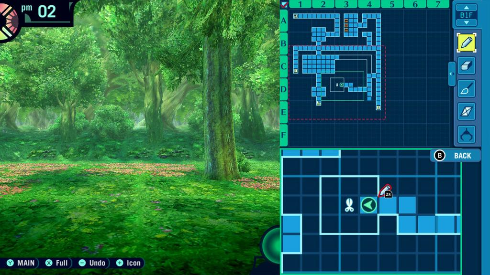</a> | `etrian-odyssey-hd-2.jpg` Exploring: the labyrinth in first person and the floor map drawn square by square. | [Steam store](https://store.steampowered.com/app/1868180/) · [image](https://shared.akamai.steamstatic.com/store_item_assets/steam/apps/1868180/ss_343a0795d1cf8adce0f957171f49d8841640eb27.1920x1080.jpg) |
| <a href="etrian-odyssey-hd-3.jpg">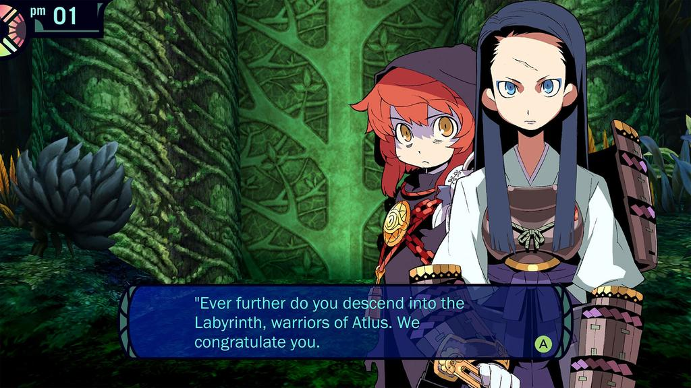</a> | `etrian-odyssey-hd-3.jpg` Two explorers in the labyrinth. | [Steam store](https://store.steampowered.com/app/1868180/) · [image](https://shared.akamai.steamstatic.com/store_item_assets/steam/apps/1868180/ss_b73e71d1c3106d5d040ef2bbe27de5c18ae0af4f.1920x1080.jpg) |
| <a href="etrian-odyssey-hd-4.jpg">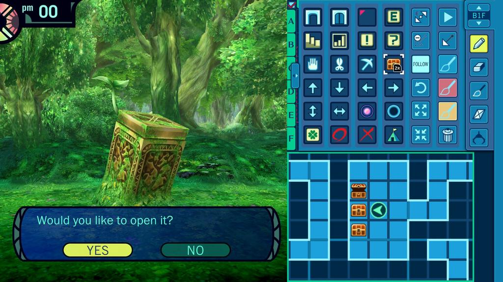</a> | `etrian-odyssey-hd-4.jpg` A chest, with the map's icons ready to mark it. | [Steam store](https://store.steampowered.com/app/1868180/) · [image](https://shared.akamai.steamstatic.com/store_item_assets/steam/apps/1868180/ss_32b33864c6209bd9a6843bbe3f45d2e10e851128.1920x1080.jpg) |
| <a href="etrian-odyssey-3-hd-1.jpg">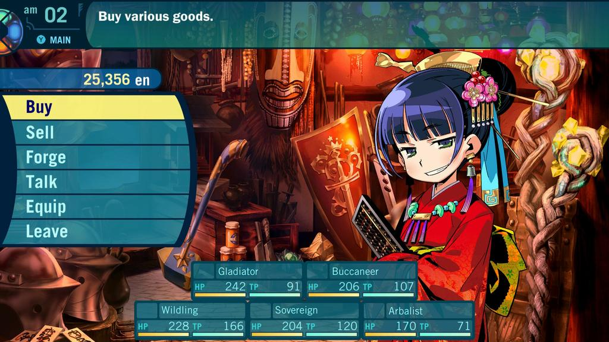</a> | `etrian-odyssey-3-hd-1.jpg` A shop. | [Steam store](https://store.steampowered.com/app/1810820/) · [image](https://shared.akamai.steamstatic.com/store_item_assets/steam/apps/1810820/ss_b012e01d49afcf244a7dda09ce79640a26ef6fe6.1920x1080.jpg) |
| <a href="etrian-odyssey-3-hd-2.jpg">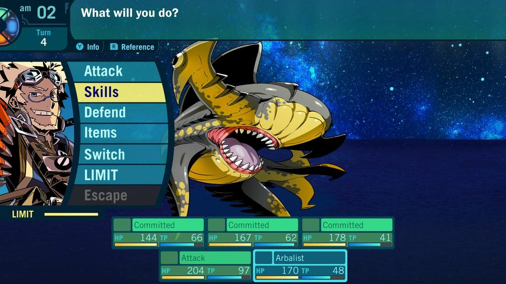</a> | `etrian-odyssey-3-hd-2.jpg` A fight: Attack, Skills, Defend, Items, the party's HP and TP below. | [Steam store](https://store.steampowered.com/app/1810820/) · [image](https://shared.akamai.steamstatic.com/store_item_assets/steam/apps/1810820/ss_e1386aadcdb97e928a3fdf95b7f4c6e448dc48b7.1920x1080.jpg) |
| <a href="etrian-odyssey-3-hd-3.jpg">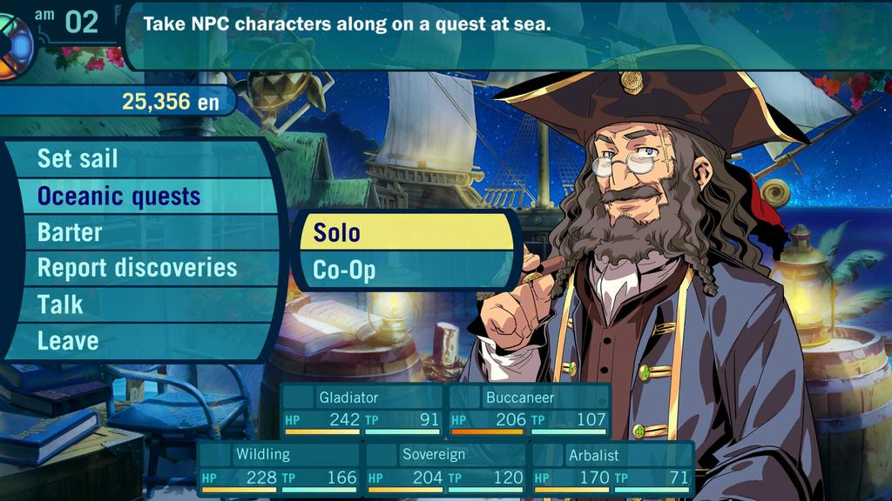</a> | `etrian-odyssey-3-hd-3.jpg` The port's menu. | [Steam store](https://store.steampowered.com/app/1810820/) · [image](https://shared.akamai.steamstatic.com/store_item_assets/steam/apps/1810820/ss_39a448788d6bf71854a5477ec1d6062c972c6db1.1920x1080.jpg) |
| <a href="etrian-odyssey-3-hd-4.jpg">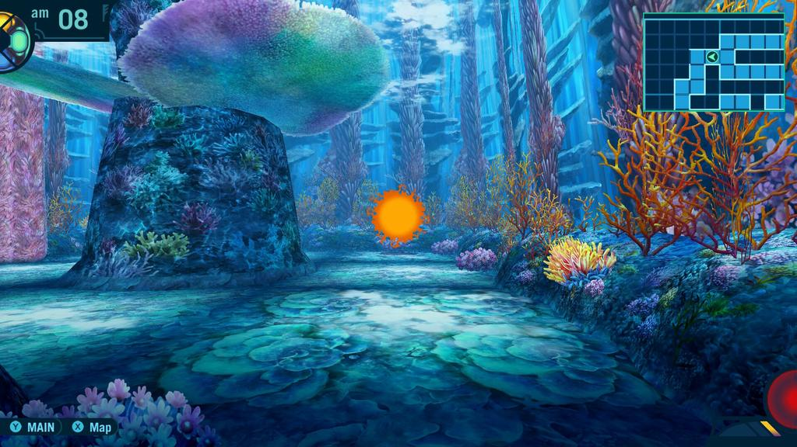</a> | `etrian-odyssey-3-hd-4.jpg` Sailing, the sea chart at the top right. | [Steam store](https://store.steampowered.com/app/1810820/) · [image](https://shared.akamai.steamstatic.com/store_item_assets/steam/apps/1810820/ss_78edb2db89217f563e8651907a1836367faa459c.1920x1080.jpg) |
| <a href="crop-etrian-odyssey-map.jpg">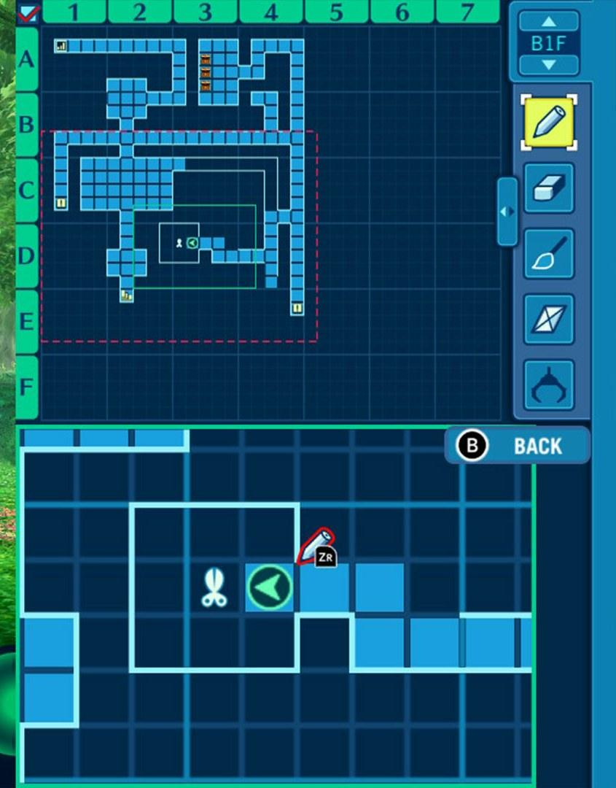</a> | `crop-etrian-odyssey-map.jpg` Crop: the floor map and its icons. | [cropped from Etrian Odyssey HD store shot 2](https://shared.akamai.steamstatic.com/store_item_assets/steam/apps/1868180/ss_343a0795d1cf8adce0f957171f49d8841640eb27.1920x1080.jpg) |

## Darkest Dungeon

Darkest Dungeon, by Red Hook Studios. Store screenshots from its [Steam page](https://store.steampowered.com/app/262060/). Looked at for the party's line and the hero panel.

| | What it shows | Source |
|---|---|---|
| <a href="darkest-dungeon-1.jpg">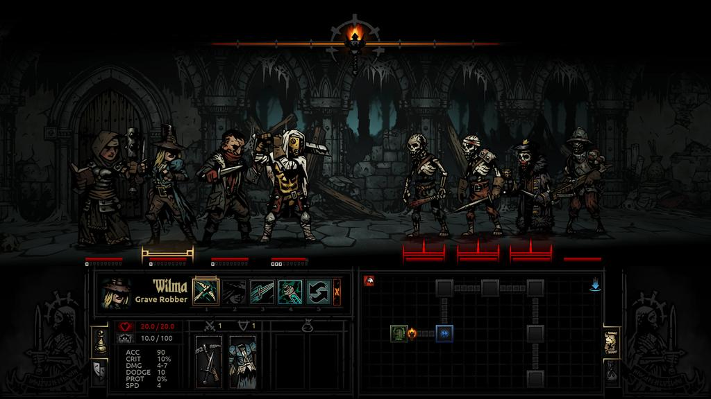</a> | `darkest-dungeon-1.jpg` The party in a corridor: the torch bar at the top, the hero panel at the foot. | [Steam store](https://store.steampowered.com/app/262060/) · [image](https://shared.akamai.steamstatic.com/store_item_assets/steam/apps/262060/ss_04572edc979601b038756f87861c6f8c6c337806.1920x1080.jpg) |
| <a href="darkest-dungeon-2.jpg">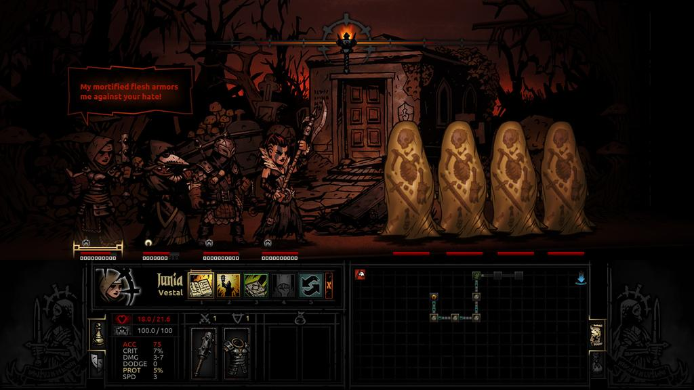</a> | `darkest-dungeon-2.jpg` A fight against shrouded foes. | [Steam store](https://store.steampowered.com/app/262060/) · [image](https://shared.akamai.steamstatic.com/store_item_assets/steam/apps/262060/ss_799c78932c87f2be0cbd45dd1b80ebd0a355e575.1920x1080.jpg) |
| <a href="darkest-dungeon-3.jpg">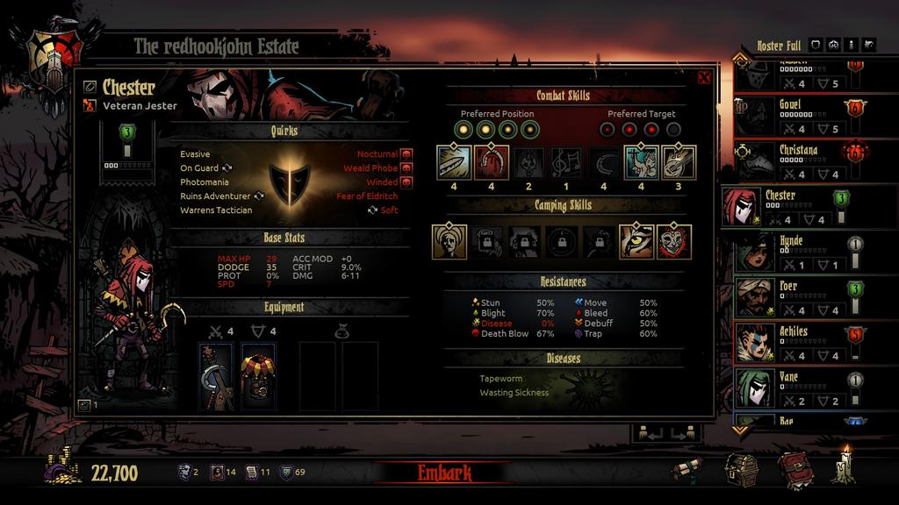</a> | `darkest-dungeon-3.jpg` A hero's sheet: skills, camping skills, resistances. | [Steam store](https://store.steampowered.com/app/262060/) · [image](https://shared.akamai.steamstatic.com/store_item_assets/steam/apps/262060/ss_a967c2d7344433cdf72a53ef1922586b0d7cce69.1920x1080.jpg) |
| <a href="darkest-dungeon-4.jpg">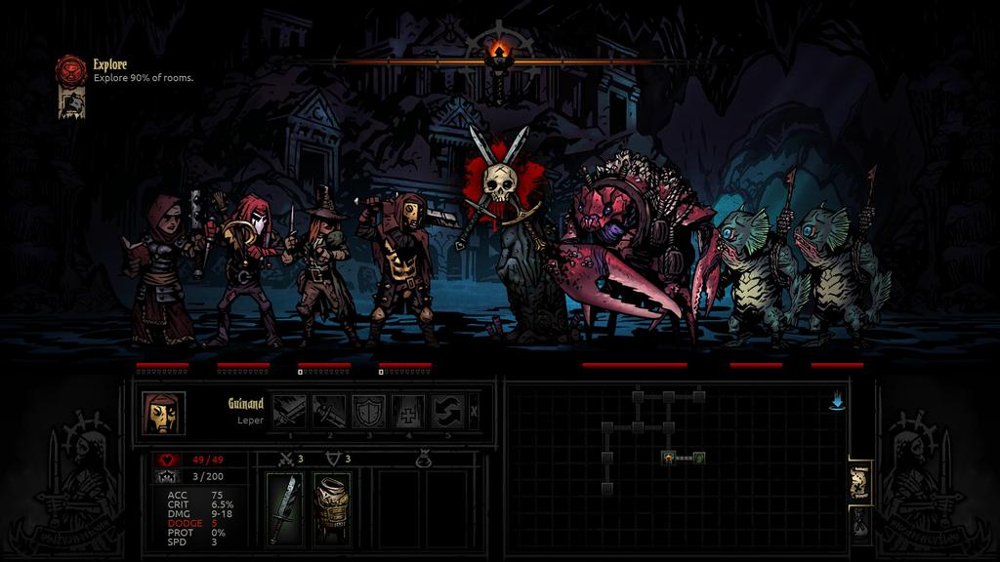</a> | `darkest-dungeon-4.jpg` A fight against a creature of the coast. | [Steam store](https://store.steampowered.com/app/262060/) · [image](https://shared.akamai.steamstatic.com/store_item_assets/steam/apps/262060/ss_c9d41e74d574f6fa9bf53c0cf74f8430c2072cc2.1920x1080.jpg) |
| <a href="darkest-dungeon-5.jpg">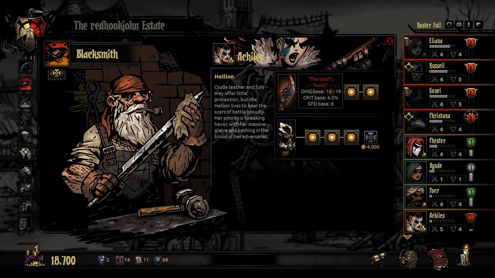</a> | `darkest-dungeon-5.jpg` The Blacksmith. | [Steam store](https://store.steampowered.com/app/262060/) · [image](https://shared.akamai.steamstatic.com/store_item_assets/steam/apps/262060/ss_b78c562dc67379f42691dcc8522b40d5385bb32e.1920x1080.jpg) |
| <a href="darkest-dungeon-6.jpg">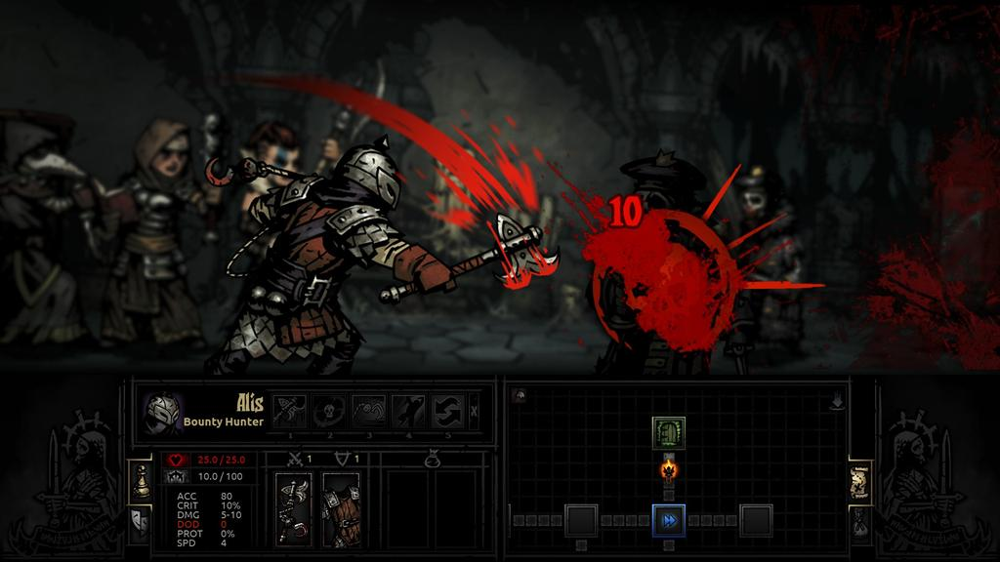</a> | `darkest-dungeon-6.jpg` A critical hit. | [Steam store](https://store.steampowered.com/app/262060/) · [image](https://shared.akamai.steamstatic.com/store_item_assets/steam/apps/262060/ss_ac1f594bf8128e376ca95ff266d400d404b639bf.1920x1080.jpg) |
| <a href="darkest-dungeon-7.jpg">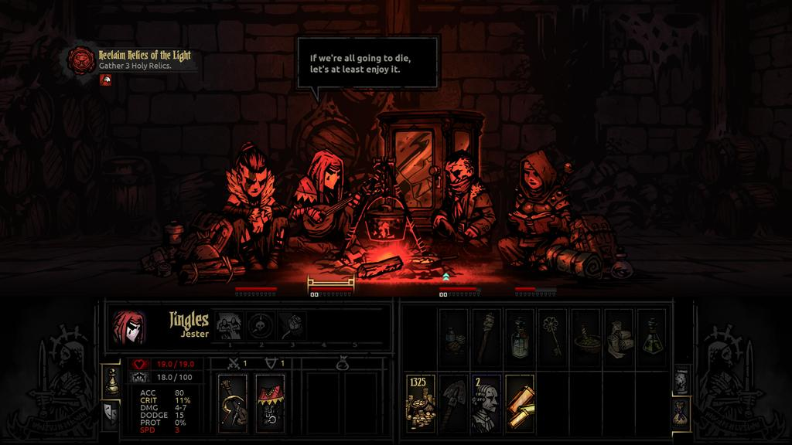</a> | `darkest-dungeon-7.jpg` Camping by the fire. | [Steam store](https://store.steampowered.com/app/262060/) · [image](https://shared.akamai.steamstatic.com/store_item_assets/steam/apps/262060/ss_897ef292768a8e413ffe2dbf18614ec8e1fdbc64.1920x1080.jpg) |
| <a href="darkest-dungeon-8.jpg">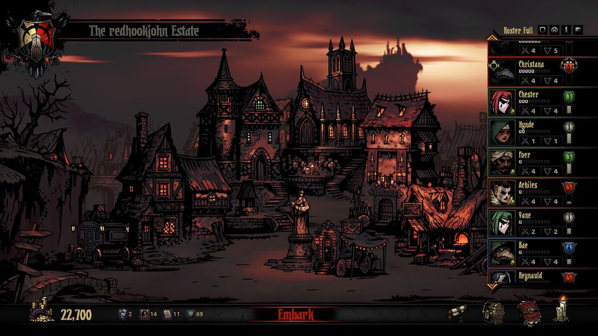</a> | `darkest-dungeon-8.jpg` The Hamlet. | [Steam store](https://store.steampowered.com/app/262060/) · [image](https://shared.akamai.steamstatic.com/store_item_assets/steam/apps/262060/ss_7232ad33cf7e5e58613004fb888c18d3ab1fdd8d.1920x1080.jpg) |
| <a href="crop-darkest-dungeon-party.jpg">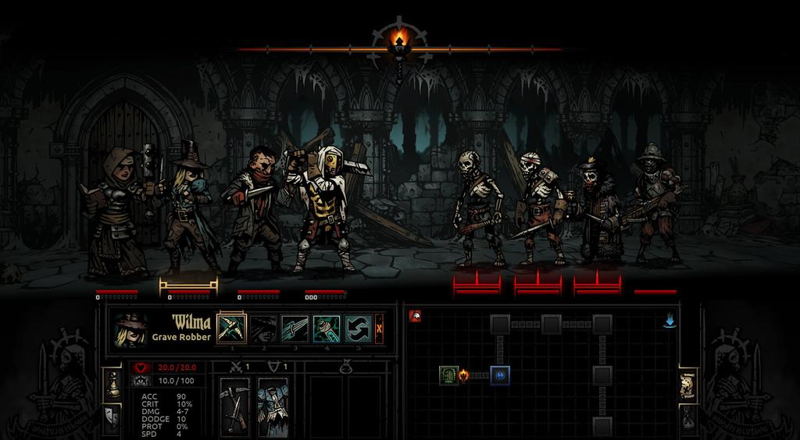</a> | `crop-darkest-dungeon-party.jpg` Crop: the party and the hero panel. | [cropped from Darkest Dungeon store shot 1](https://shared.akamai.steamstatic.com/store_item_assets/steam/apps/262060/ss_04572edc979601b038756f87861c6f8c6c337806.1920x1080.jpg) |

## Hades

Hades, by Supergiant Games. Store screenshots from its [Steam page](https://store.steampowered.com/app/1145360/). Looked at for how a room's doors show what lies behind them.

| | What it shows | Source |
|---|---|---|
| <a href="hades-1.jpg">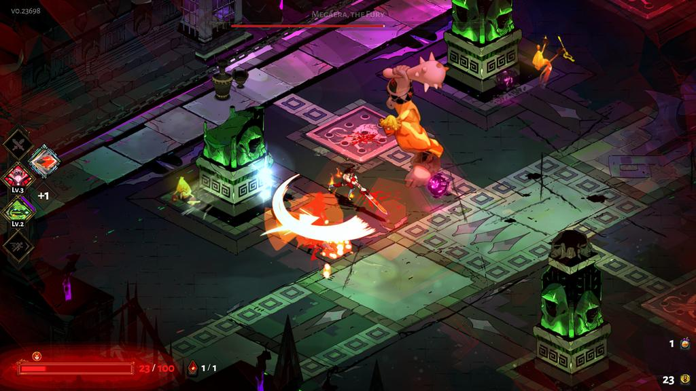</a> | `hades-1.jpg` A fight in Tartarus, the boons down the left side. | [Steam store](https://store.steampowered.com/app/1145360/) · [image](https://shared.akamai.steamstatic.com/store_item_assets/steam/apps/1145360/ss_c0fed447426b69981cf1721756acf75369801b31.1920x1080.jpg) |
| <a href="hades-2.jpg">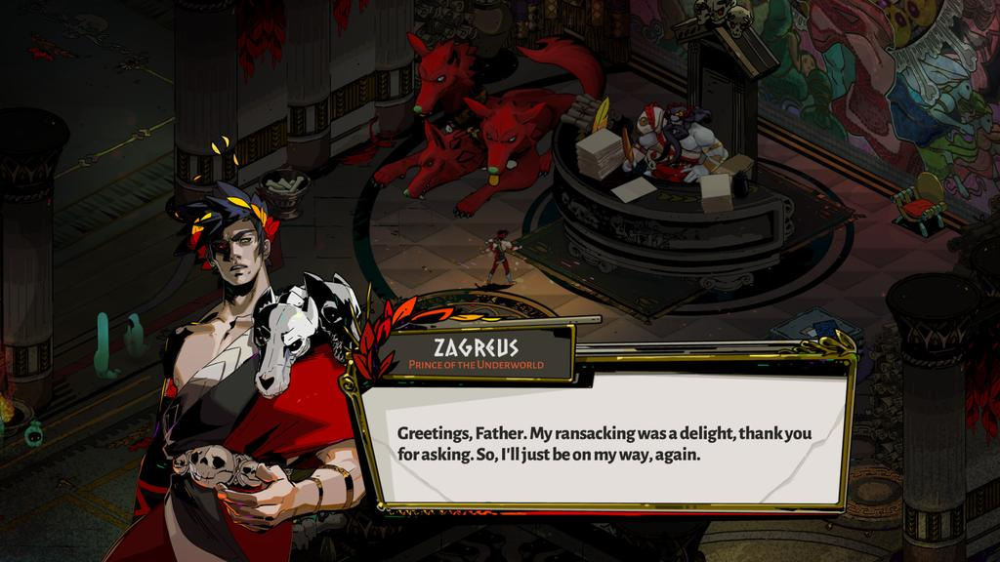</a> | `hades-2.jpg` Zagreus and Hades. | [Steam store](https://store.steampowered.com/app/1145360/) · [image](https://shared.akamai.steamstatic.com/store_item_assets/steam/apps/1145360/ss_8a9f0953e8a014bd3df2789c2835cb787cd3764d.1920x1080.jpg) |
| <a href="hades-3.jpg">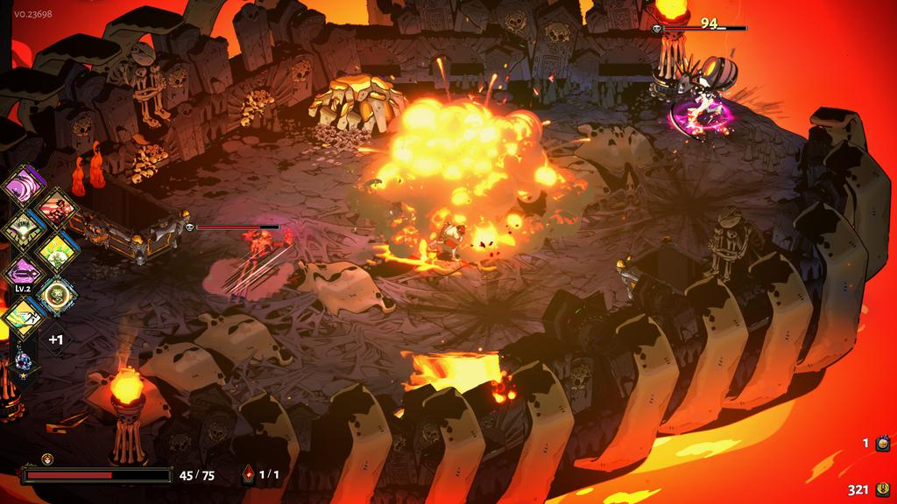</a> | `hades-3.jpg` A cast exploding in Asphodel. | [Steam store](https://store.steampowered.com/app/1145360/) · [image](https://shared.akamai.steamstatic.com/store_item_assets/steam/apps/1145360/ss_68300459a8c3daacb2ec687adcdbf4442fcc4f47.1920x1080.jpg) |
| <a href="hades-4.jpg">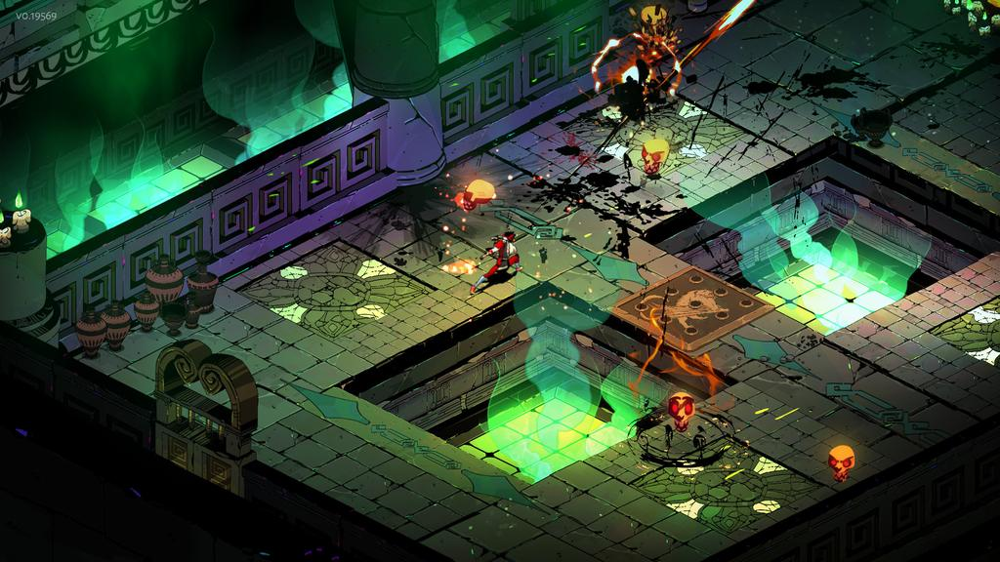</a> | `hades-4.jpg` A chamber and its way on. | [Steam store](https://store.steampowered.com/app/1145360/) · [image](https://shared.akamai.steamstatic.com/store_item_assets/steam/apps/1145360/ss_bcb499a0dd001f4101823f99ec5094d2872ba6ee.1920x1080.jpg) |
| <a href="hades-5.jpg">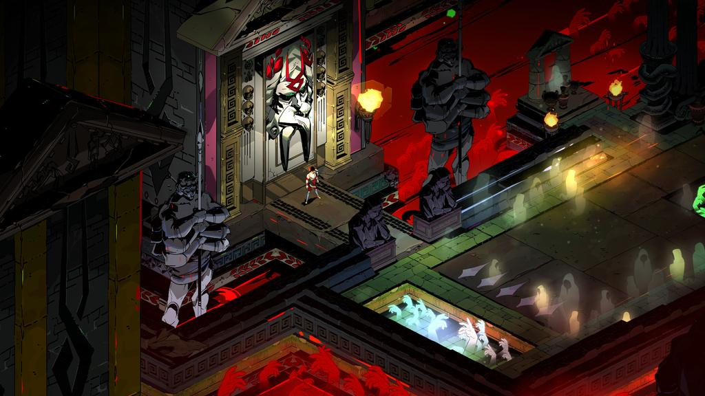</a> | `hades-5.jpg` A hall in the House. | [Steam store](https://store.steampowered.com/app/1145360/) · [image](https://shared.akamai.steamstatic.com/store_item_assets/steam/apps/1145360/ss_8e07e477fa7ff2f88c8984bc89b9652a655da0e9.1920x1080.jpg) |
| <a href="hades-6.jpg">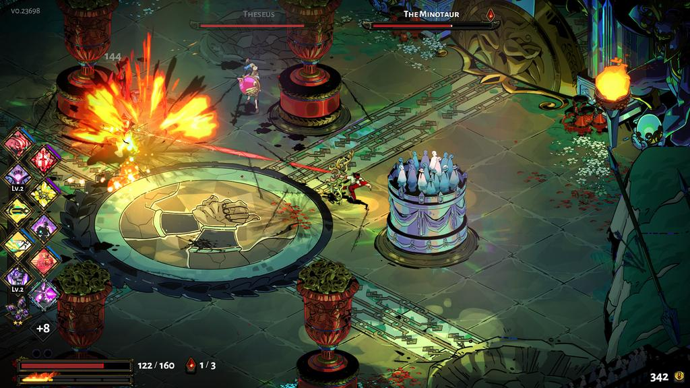</a> | `hades-6.jpg` A fight round an urn, HP and boons on the edges. | [Steam store](https://store.steampowered.com/app/1145360/) · [image](https://shared.akamai.steamstatic.com/store_item_assets/steam/apps/1145360/ss_34e6660705cfe47d2b2f95189c37f7cb77f75ca6.1920x1080.jpg) |
| <a href="hades-7.jpg">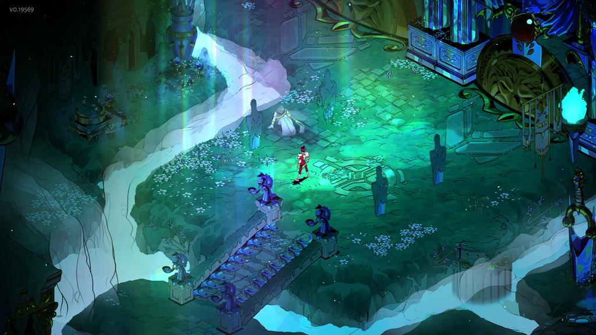</a> | `hades-7.jpg` A meadow in Elysium. | [Steam store](https://store.steampowered.com/app/1145360/) · [image](https://shared.akamai.steamstatic.com/store_item_assets/steam/apps/1145360/ss_217b70678a2eea71a974fba1a4cd8baa660581bb.1920x1080.jpg) |
|  | `hades-8.jpg` A fight over lava in Asphodel. | [Steam store](https://store.steampowered.com/app/1145360/) · [image](https://shared.akamai.steamstatic.com/store_item_assets/steam/apps/1145360/ss_5e52844b891b54608eb51a850d6b53313eeed0f7.1920x1080.jpg) |

## Hades II

Hades II, by Supergiant Games. Store screenshots from its [Steam page](https://store.steampowered.com/app/1145350/). Looked at for the door that shows its reward.

| | What it shows | Source |
|---|---|---|
|  | `hades-2-1.jpg` A fight in Erebus. | [Steam store](https://store.steampowered.com/app/1145350/) · [image](https://shared.akamai.steamstatic.com/store_item_assets/steam/apps/1145350/ss_ef0f63061d0a0a9a7e46f3b84f125d25330e8f19.1920x1080.jpg) |
|  | `hades-2-2.jpg` Melinoë. | [Steam store](https://store.steampowered.com/app/1145350/) · [image](https://shared.akamai.steamstatic.com/store_item_assets/steam/apps/1145350/ss_f28befd916e59b8bf0a8a801b8a498b8adaa01eb.1920x1080.jpg) |
|  | `hades-2-3.jpg` A cast across the room. | [Steam store](https://store.steampowered.com/app/1145350/) · [image](https://shared.akamai.steamstatic.com/store_item_assets/steam/apps/1145350/ss_b88cb7b48a86f07a7288bf37141f6558279f9bfc.1920x1080.jpg) |
|  | `hades-2-4.jpg` A fight in the depths. | [Steam store](https://store.steampowered.com/app/1145350/) · [image](https://shared.akamai.steamstatic.com/store_item_assets/steam/apps/1145350/ss_c8d2b18451a2cc4d5b4fdd78ed84a5e64e051eac.1920x1080.jpg) |
|  | `hades-2-5.jpg` A room, its door marked with the reward behind it. | [Steam store](https://store.steampowered.com/app/1145350/) · [image](https://shared.akamai.steamstatic.com/store_item_assets/steam/apps/1145350/ss_f366f20f4fb699f6735581e04c7c45a1ef7bd1b8.1920x1080.jpg) |
|  | `hades-2-6.jpg` A fight in the fields. | [Steam store](https://store.steampowered.com/app/1145350/) · [image](https://shared.akamai.steamstatic.com/store_item_assets/steam/apps/1145350/ss_47e14ed55ac7f1bf9266b2cd5b3e4d9eae0ca54c.1920x1080.jpg) |
|  | `hades-2-7.jpg` Nemesis. | [Steam store](https://store.steampowered.com/app/1145350/) · [image](https://shared.akamai.steamstatic.com/store_item_assets/steam/apps/1145350/ss_295de30c8ec9fc82b73f226e68dd8b7fa8b07a62.1920x1080.jpg) |
|  | `crop-hades-2-door.jpg` Crop: the door and its reward. | [cropped from Hades II store shot 5](https://shared.akamai.steamstatic.com/store_item_assets/steam/apps/1145350/ss_f366f20f4fb699f6735581e04c7c45a1ef7bd1b8.1920x1080.jpg) |

## Last Epoch

Last Epoch, by Eleventh Hour Games. Store screenshots from its [Steam page](https://store.steampowered.com/app/899770/). Looked at in the same pass.

| | What it shows | Source |
|---|---|---|
|  | `last-epoch-1.jpg` A shrine in the dark. | [Steam store](https://store.steampowered.com/app/899770/) · [image](https://shared.akamai.steamstatic.com/store_item_assets/steam/apps/899770/36dfb279173da522836c6444dc70d5a232d5d8bb/ss_36dfb279173da522836c6444dc70d5a232d5d8bb.1920x1080.jpg) |
|  | `last-epoch-2.jpg` The wheel of classes and masteries. | [Steam store](https://store.steampowered.com/app/899770/) · [image](https://shared.akamai.steamstatic.com/store_item_assets/steam/apps/899770/ss_7bb351d2b4344d96123631deb9239448709e11ab.1920x1080.jpg) |
|  | `last-epoch-3.jpg` A fight. | [Steam store](https://store.steampowered.com/app/899770/) · [image](https://shared.akamai.steamstatic.com/store_item_assets/steam/apps/899770/b147fd10d7b8dd0213c4acb99a6bc69be23ef220/ss_b147fd10d7b8dd0213c4acb99a6bc69be23ef220.1920x1080.jpg) |
|  | `last-epoch-4.jpg` The Necromancer's passive tree. | [Steam store](https://store.steampowered.com/app/899770/) · [image](https://shared.akamai.steamstatic.com/store_item_assets/steam/apps/899770/ss_82f015b200420398447bef8a1bbb75cd8951ed5c.1920x1080.jpg) |
|  | `last-epoch-5.jpg` A fight in fire. | [Steam store](https://store.steampowered.com/app/899770/) · [image](https://shared.akamai.steamstatic.com/store_item_assets/steam/apps/899770/b429c579742dcc789265f16e8c8ec78f10ad3ef6/ss_b429c579742dcc789265f16e8c8ec78f10ad3ef6.1920x1080.jpg) |
|  | `last-epoch-6.jpg` A skill's tree. | [Steam store](https://store.steampowered.com/app/899770/) · [image](https://shared.akamai.steamstatic.com/store_item_assets/steam/apps/899770/ss_e51b2a99932a05cc5e97da15080b358835c66343.1920x1080.jpg) |
|  | `last-epoch-7.jpg` A fight from above. | [Steam store](https://store.steampowered.com/app/899770/) · [image](https://shared.akamai.steamstatic.com/store_item_assets/steam/apps/899770/6a329eefc0bd1545843f235b4fac5564b7b6dba7/ss_6a329eefc0bd1545843f235b4fac5564b7b6dba7.1920x1080.jpg) |
|  | `last-epoch-8.jpg` The forge: an affix upgraded. | [Steam store](https://store.steampowered.com/app/899770/) · [image](https://shared.akamai.steamstatic.com/store_item_assets/steam/apps/899770/ss_2e36b4ef4b1682679932004ab95540ae2d4456f5.1920x1080.jpg) |
