# Step 2: The Gate clock

The references for the Gate clock and Red Gates, built in
[docs/DESIGN.md](../../../DESIGN.md#the-gate-clock--built): FTL's rebel fleet, Invisible Inc's alarm, Loop Hero's
boss meter, Risk of Rain 2's difficulty bar, Darkest Dungeon's torch, Etrian Odyssey's danger orb, Persona's
Reaper and the anime's Red Gate. They gave ARISE the moves meter with the Gate's mark at its end, the costs on
the plan, the stirring plan's red rim, and the Red Gate's look.

Every image belongs to the game's publisher, or to the wiki, site or player who captured it, as listed beside it. They are kept here as design reference only: nothing in ARISE copies their art, and none of them ships with the game.

## FTL: Faster Than Light

FTL: Faster Than Light, by Subset Games. Store screenshots from its [Steam page](https://store.steampowered.com/app/212680/). The source of the front that takes the map: the rebel fleet's advance in red hazard stripes, every beacon it reaches marked.

| | What it shows | Source |
|---|---|---|
| <a href="ftl-rebel-fleet-map.jpg">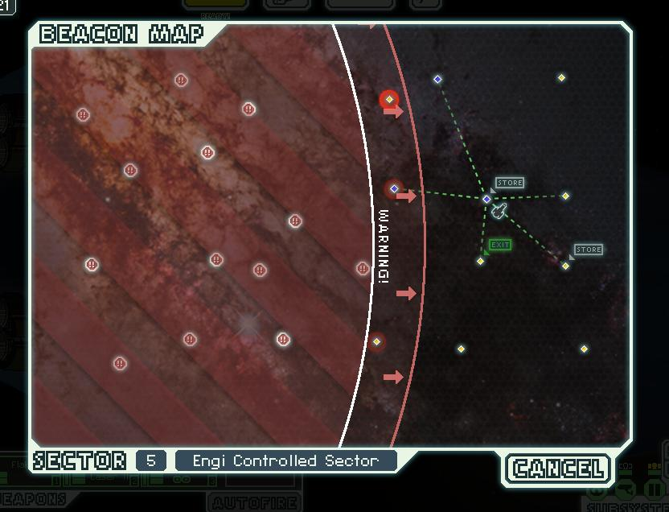</a> | `ftl-rebel-fleet-map.jpg` The sector map with the rebel fleet's front advancing over it in red. | [ftl wiki, File:Rebels.png](https://ftl.fandom.com/wiki/File:Rebels.png) · [image](https://static.wikia.nocookie.net/ftl/images/0/0e/Rebels.png) |
| <a href="ftl-map-path-planning.jpg">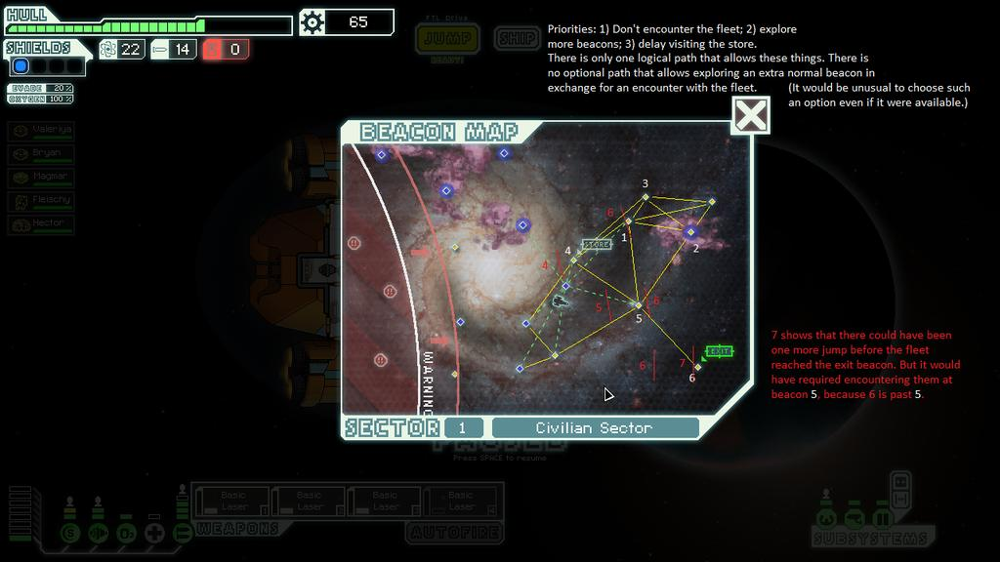</a> | `ftl-map-path-planning.jpg` Planning a path through the beacons ahead of the fleet. | [ftl wiki, File:Map - Path Planning.png](https://ftl.fandom.com/wiki/File:Map_-_Path_Planning.png) · [image](https://static.wikia.nocookie.net/ftl/images/a/a1/Map_-_Path_Planning.png) |
| <a href="ftl-sector-map.png">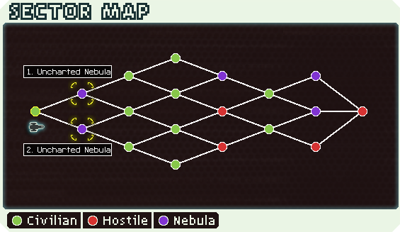</a> | `ftl-sector-map.png` The map of sectors chosen between jumps. | [ftl wiki, File:Sector Map.png](https://ftl.fandom.com/wiki/File:Sector_Map.png) · [image](https://static.wikia.nocookie.net/ftl/images/1/1e/Sector_Map.png) |
| <a href="ftl-1.jpg">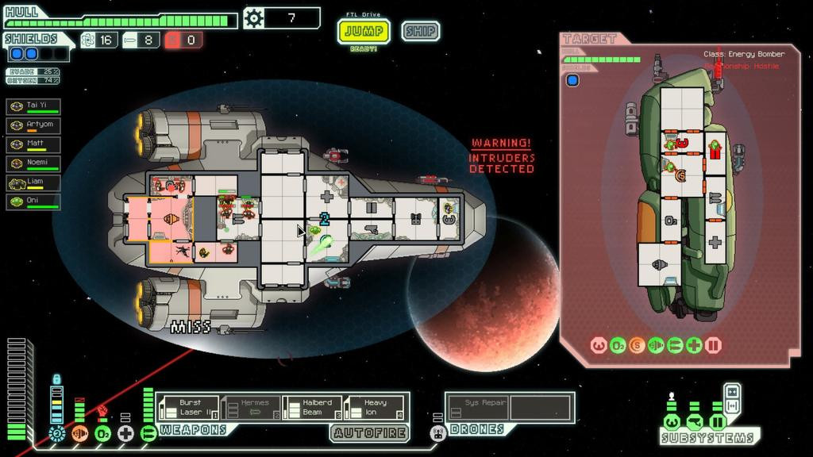</a> | `ftl-1.jpg` A fight: intruders detected aboard. | [Steam store](https://store.steampowered.com/app/212680/) · [image](https://shared.akamai.steamstatic.com/store_item_assets/steam/apps/212680/ss_052d698926073e8d407a864f0e63a486af24ec0d.1920x1080.jpg) |
| <a href="ftl-2.jpg">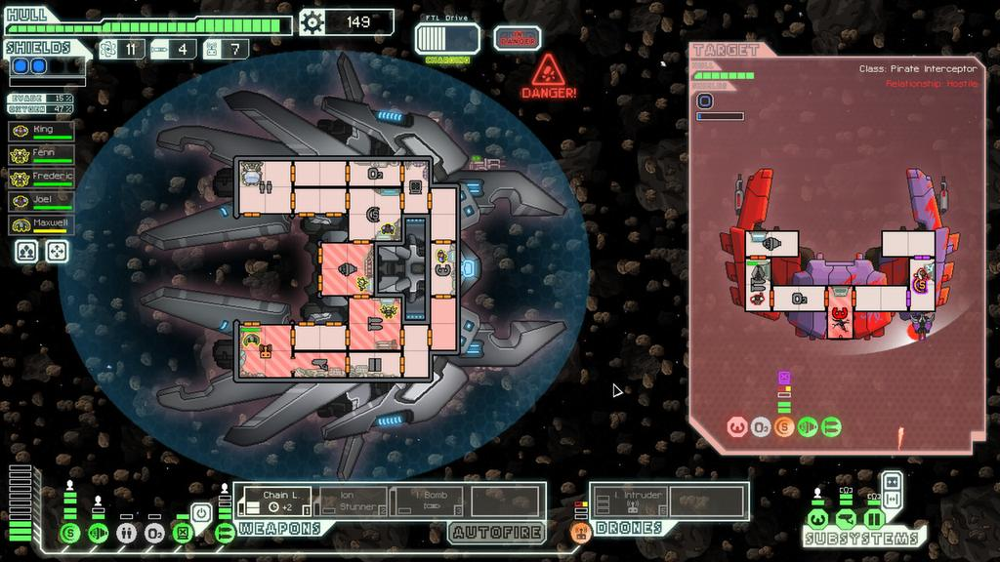</a> | `ftl-2.jpg` A fight against a pirate ship. | [Steam store](https://store.steampowered.com/app/212680/) · [image](https://shared.akamai.steamstatic.com/store_item_assets/steam/apps/212680/ss_779ba1fda143fc42a8eb1212830ad855422e84ad.1920x1080.jpg) |
| <a href="ftl-3.jpg">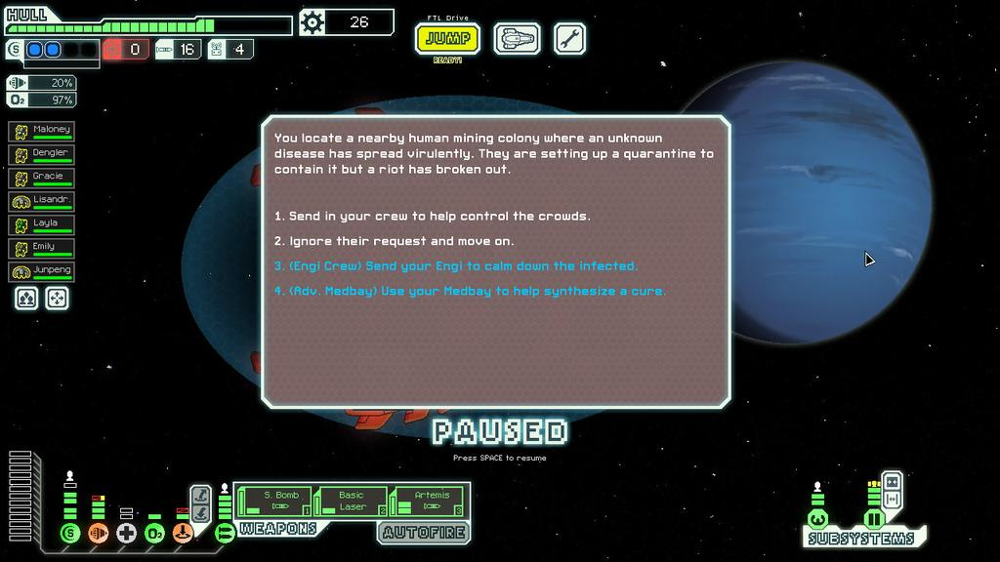</a> | `ftl-3.jpg` An event: a mining colony under quarantine, the choices listed. | [Steam store](https://store.steampowered.com/app/212680/) · [image](https://shared.akamai.steamstatic.com/store_item_assets/steam/apps/212680/ss_19d6b545c89bf8e73abc13c548a1e5aeb8801f53.1920x1080.jpg) |
| <a href="ftl-4.jpg">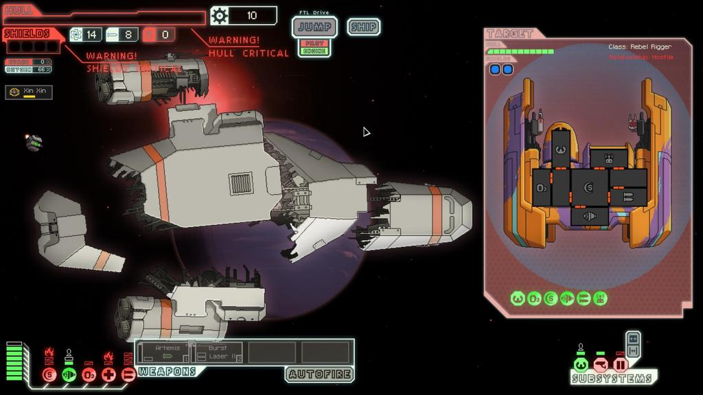</a> | `ftl-4.jpg` A fight, the hull critical. | [Steam store](https://store.steampowered.com/app/212680/) · [image](https://shared.akamai.steamstatic.com/store_item_assets/steam/apps/212680/ss_8bc4c5c483fb85bcdcbcdbe98cbe44e82bfc961f.1920x1080.jpg) |
| <a href="ftl-5.jpg">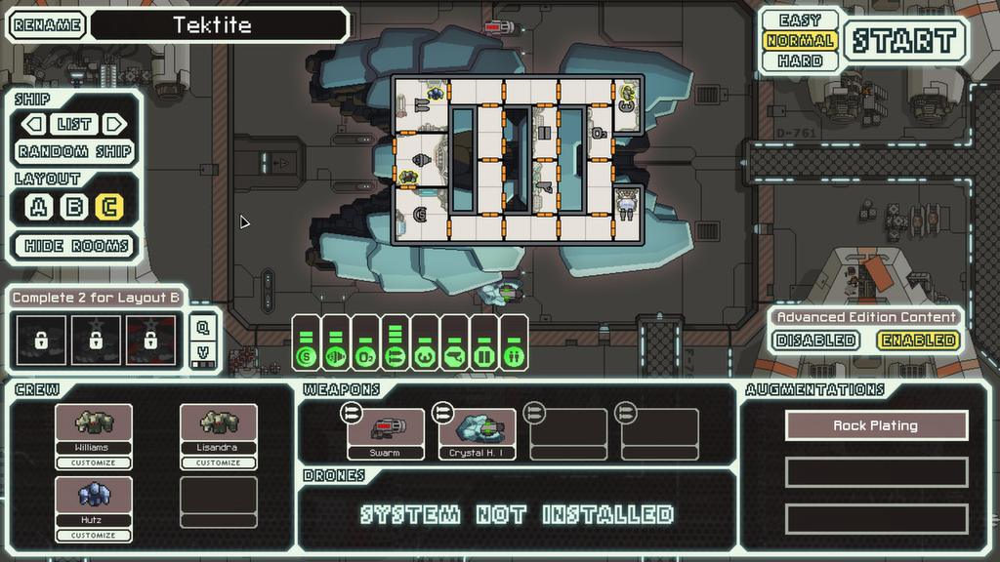</a> | `ftl-5.jpg` The hangar: a ship's layout. | [Steam store](https://store.steampowered.com/app/212680/) · [image](https://shared.akamai.steamstatic.com/store_item_assets/steam/apps/212680/ss_9dd5cc63efcc5964d45713b7304e71d41be6a3d5.1920x1080.jpg) |
| <a href="ftl-6.jpg">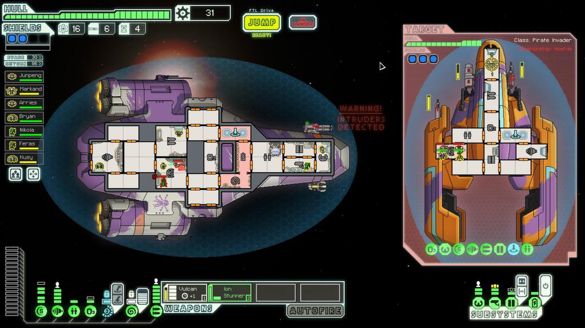</a> | `ftl-6.jpg` A fight against a pirate ship. | [Steam store](https://store.steampowered.com/app/212680/) · [image](https://shared.akamai.steamstatic.com/store_item_assets/steam/apps/212680/ss_708e385bd461625790763fb8ddad537d278ad15c.1920x1080.jpg) |
| <a href="ftl-7.jpg">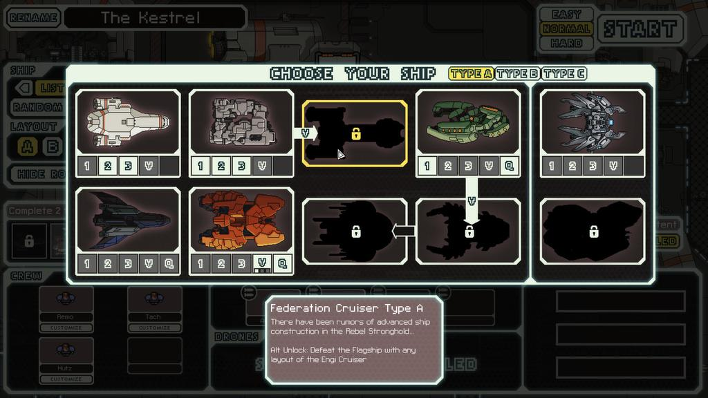</a> | `ftl-7.jpg` Choosing a ship. | [Steam store](https://store.steampowered.com/app/212680/) · [image](https://shared.akamai.steamstatic.com/store_item_assets/steam/apps/212680/ss_a97ea1950b4e1a61b07c5a44cbbbb50a3c29dc27.1920x1080.jpg) |
| <a href="ftl-8.jpg">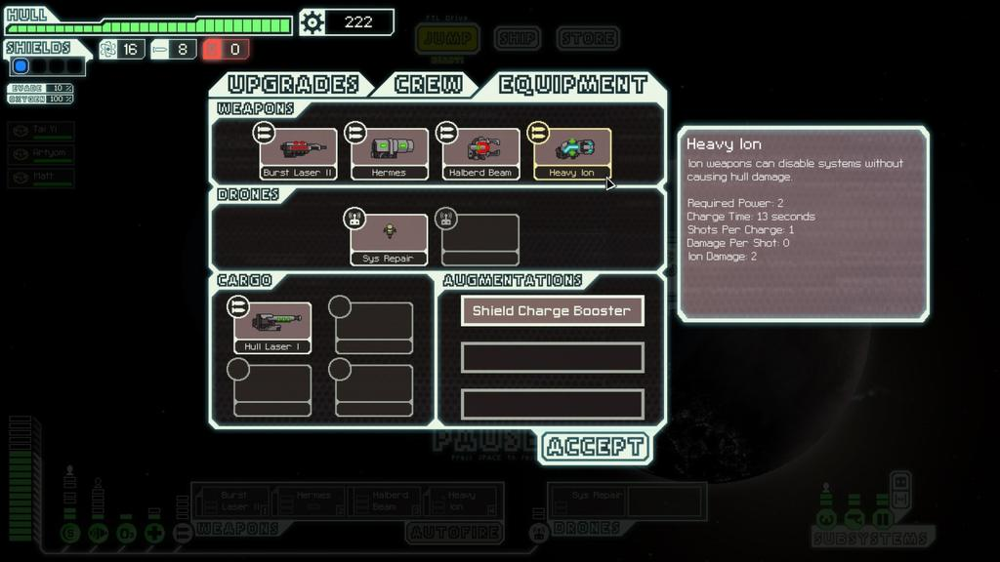</a> | `ftl-8.jpg` The upgrades screen. | [Steam store](https://store.steampowered.com/app/212680/) · [image](https://shared.akamai.steamstatic.com/store_item_assets/steam/apps/212680/ss_59c1d5ad2824bea54e7d09798674aa5530e525ba.1920x1080.jpg) |
| <a href="ftl-9.jpg">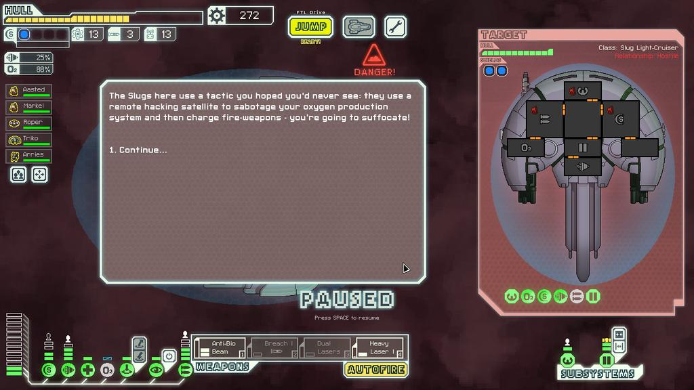</a> | `ftl-9.jpg` An event: the Slugs sabotage the oxygen. | [Steam store](https://store.steampowered.com/app/212680/) · [image](https://shared.akamai.steamstatic.com/store_item_assets/steam/apps/212680/ss_216ee74f5bee3e78c0c327242d5f6d03395134ad.1920x1080.jpg) |

## Invisible, Inc.

Invisible, Inc., by Klei Entertainment. Store screenshots from its [Steam page](https://store.steampowered.com/app/243970/). The source of the alarm: a ring of ticks round the level that fills as turns pass.

| | What it shows | Source |
|---|---|---|
| <a href="invisible-inc-1.jpg">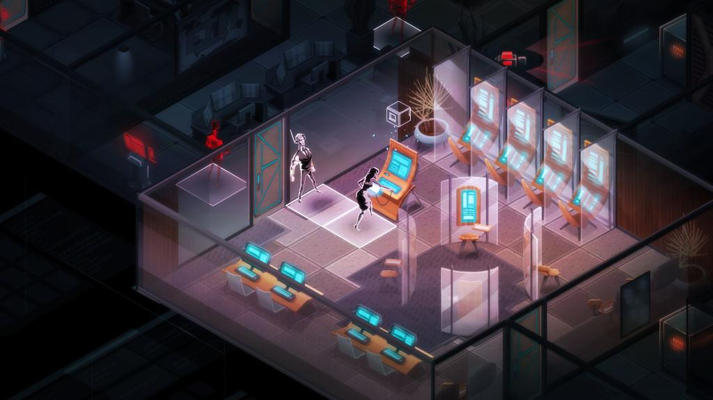</a> | `invisible-inc-1.jpg` An agent at a terminal. | [Steam store](https://store.steampowered.com/app/243970/) · [image](https://shared.akamai.steamstatic.com/store_item_assets/steam/apps/243970/ss_065423f51f4f35e9867ac6cec9598d32baf7c37b.1920x1080.jpg) |
| <a href="invisible-inc-2.jpg">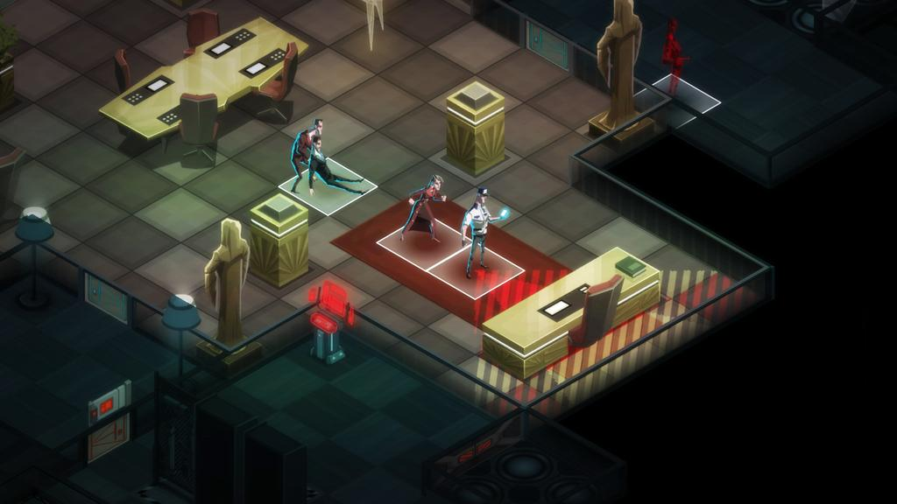</a> | `invisible-inc-2.jpg` Two agents in an office. | [Steam store](https://store.steampowered.com/app/243970/) · [image](https://shared.akamai.steamstatic.com/store_item_assets/steam/apps/243970/ss_33c9bdeb0dcbc64c6699e4375e591f7ab3c94ce3.1920x1080.jpg) |
| <a href="invisible-inc-3.jpg">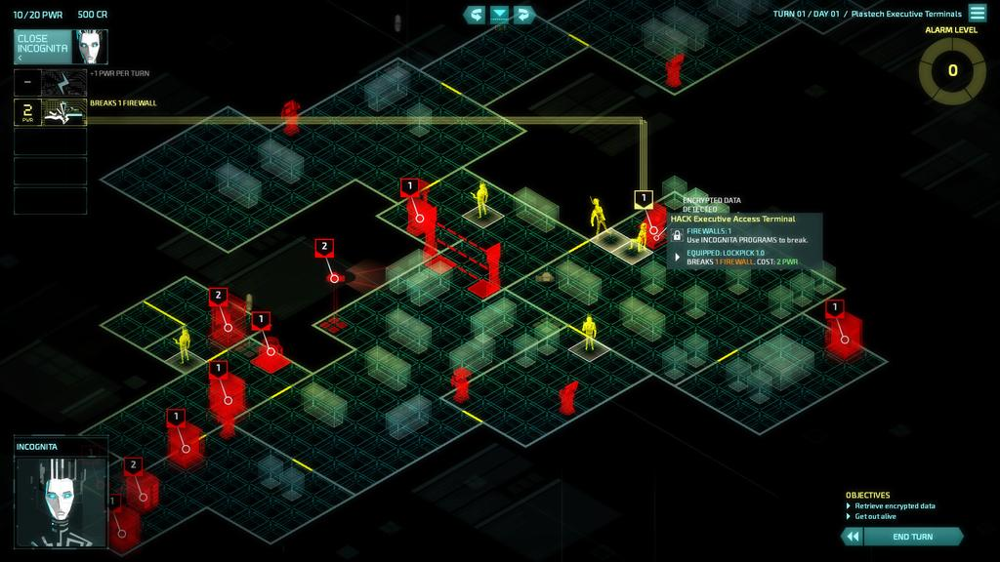</a> | `invisible-inc-3.jpg` The level's map, the alarm ring at the top right. | [Steam store](https://store.steampowered.com/app/243970/) · [image](https://shared.akamai.steamstatic.com/store_item_assets/steam/apps/243970/ss_5bc3599a1531d384933c93e2cc8f5df464ce9bec.1920x1080.jpg) |
| <a href="invisible-inc-4.jpg">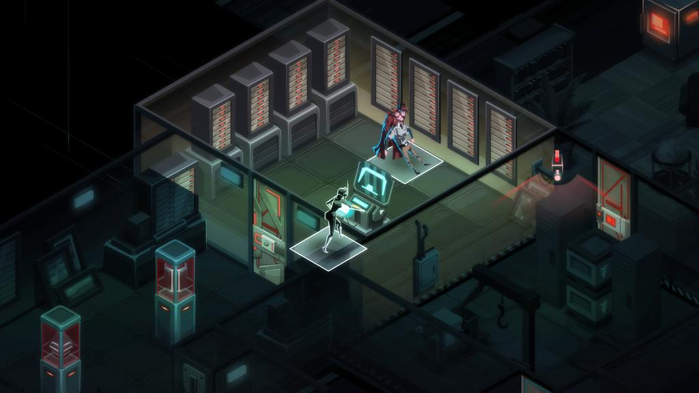</a> | `invisible-inc-4.jpg` An agent at a console. | [Steam store](https://store.steampowered.com/app/243970/) · [image](https://shared.akamai.steamstatic.com/store_item_assets/steam/apps/243970/ss_e4dfbe4874614270e46e99dd9a6a5c0286b2a529.1920x1080.jpg) |
| <a href="crop-invisible-inc-alarm.jpg">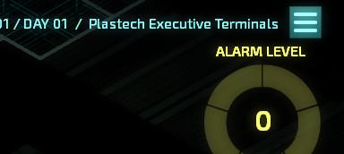</a> | `crop-invisible-inc-alarm.jpg` Crop: the alarm ring and its level. | [cropped from Invisible, Inc. store shot 3](https://shared.akamai.steamstatic.com/store_item_assets/steam/apps/243970/ss_5bc3599a1531d384933c93e2cc8f5df464ce9bec.1920x1080.jpg) |

## Loop Hero

Loop Hero, by Four Quarters. Store screenshots from its [Steam page](https://store.steampowered.com/app/1282730/). The source of the boss meter: a bar with the boss's mark at its end.

| | What it shows | Source |
|---|---|---|
| <a href="loop-hero-1.jpg">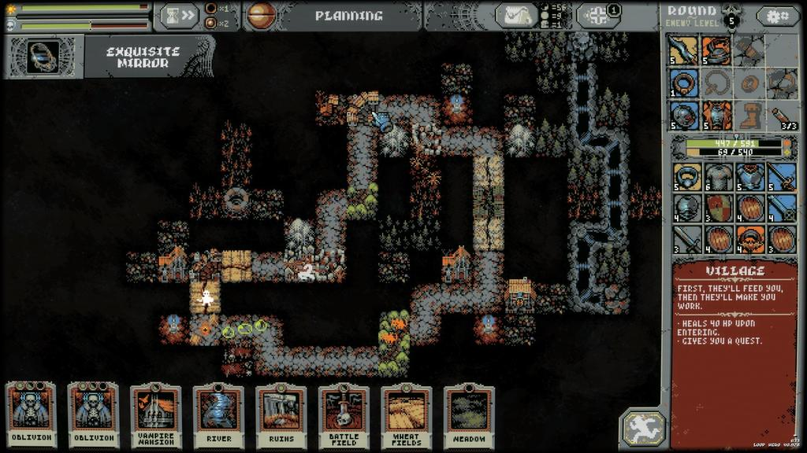</a> | `loop-hero-1.jpg` The loop, the boss meter at the top left. | [Steam store](https://store.steampowered.com/app/1282730/) · [image](https://shared.akamai.steamstatic.com/store_item_assets/steam/apps/1282730/ss_500e7212653fa6586f7a84c89b4c60be4e425fbb.1920x1080.jpg) |
| <a href="loop-hero-2.jpg">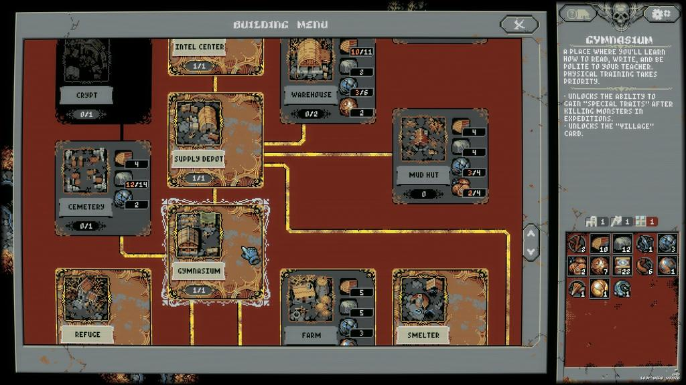</a> | `loop-hero-2.jpg` Building the camp. | [Steam store](https://store.steampowered.com/app/1282730/) · [image](https://shared.akamai.steamstatic.com/store_item_assets/steam/apps/1282730/ss_455789884ed94fd20410ac5a139e8c3bb8f6f369.1920x1080.jpg) |
| <a href="loop-hero-3.jpg">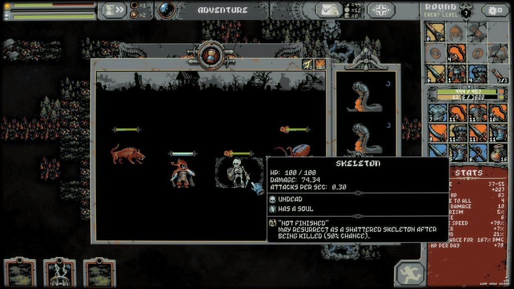</a> | `loop-hero-3.jpg` A fight, a skeleton's card open. | [Steam store](https://store.steampowered.com/app/1282730/) · [image](https://shared.akamai.steamstatic.com/store_item_assets/steam/apps/1282730/ss_d6cf090e7c644756cc66443c0740f5497e6afbba.1920x1080.jpg) |
| <a href="loop-hero-4.jpg">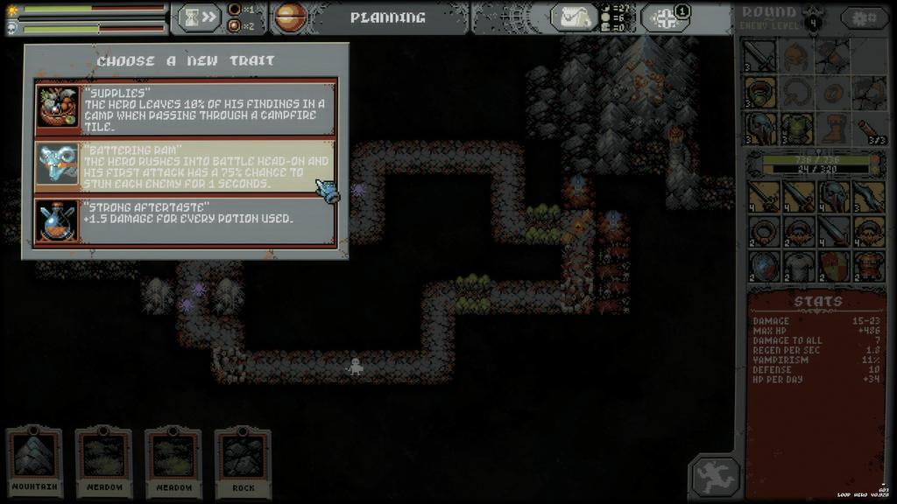</a> | `loop-hero-4.jpg` Choosing a trait. | [Steam store](https://store.steampowered.com/app/1282730/) · [image](https://shared.akamai.steamstatic.com/store_item_assets/steam/apps/1282730/ss_6a416c70c8f1bc80c84a02a0627d2050061b0e39.1920x1080.jpg) |
| <a href="loop-hero-5.jpg">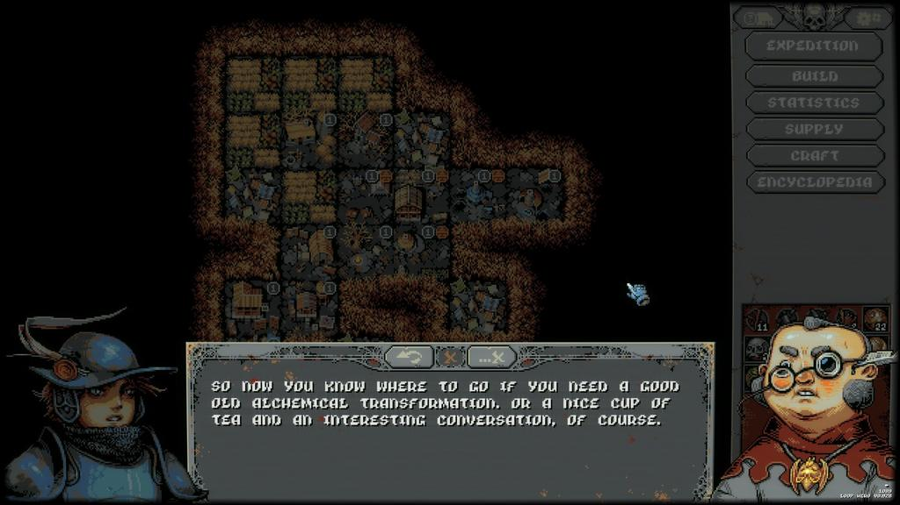</a> | `loop-hero-5.jpg` Talk over the camp. | [Steam store](https://store.steampowered.com/app/1282730/) · [image](https://shared.akamai.steamstatic.com/store_item_assets/steam/apps/1282730/ss_d03a4b7460d5da83d7a208c7500d73861922664b.1920x1080.jpg) |
| <a href="loop-hero-6.jpg">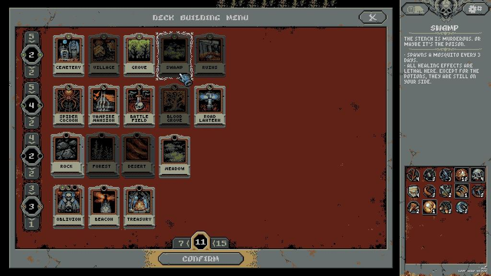</a> | `loop-hero-6.jpg` Choosing the deck. | [Steam store](https://store.steampowered.com/app/1282730/) · [image](https://shared.akamai.steamstatic.com/store_item_assets/steam/apps/1282730/ss_58039fc526fe3f2006826a8ea11ca64c145b7a24.1920x1080.jpg) |
| <a href="loop-hero-7.jpg">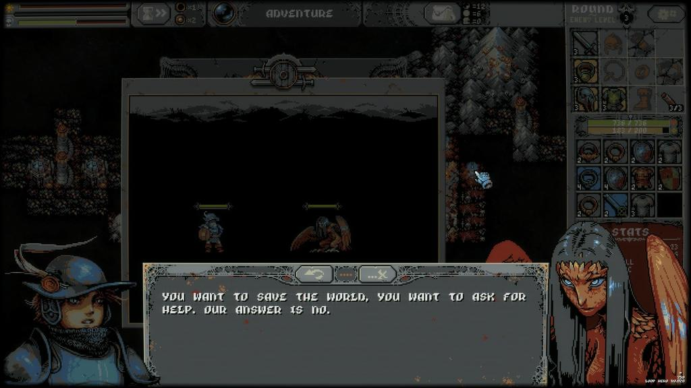</a> | `loop-hero-7.jpg` Talk. | [Steam store](https://store.steampowered.com/app/1282730/) · [image](https://shared.akamai.steamstatic.com/store_item_assets/steam/apps/1282730/ss_bcb21a8fc92d2931befe3a6dd67c835e47b9e479.1920x1080.jpg) |
| <a href="loop-hero-8.jpg">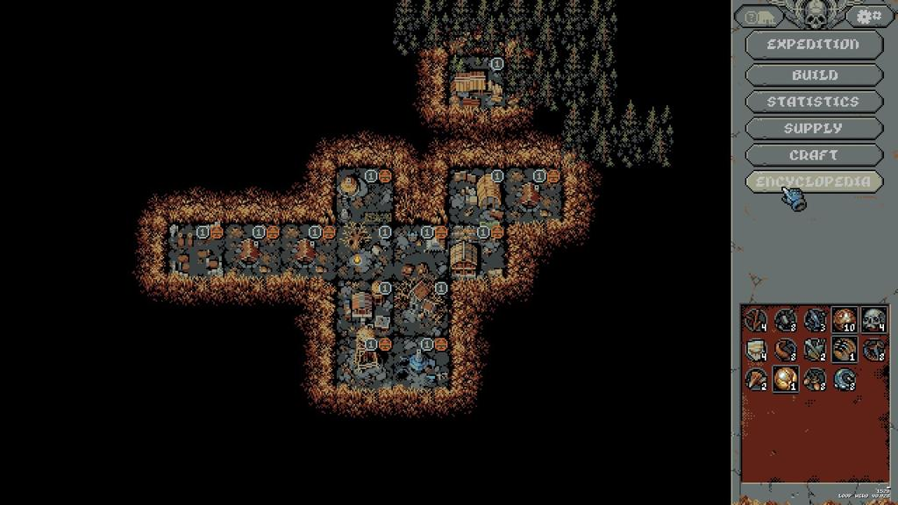</a> | `loop-hero-8.jpg` The camp's map. | [Steam store](https://store.steampowered.com/app/1282730/) · [image](https://shared.akamai.steamstatic.com/store_item_assets/steam/apps/1282730/ss_bd22017edf5191f2bd8051e7ad0d8da4d0a6e172.1920x1080.jpg) |
| <a href="loop-hero-9.jpg">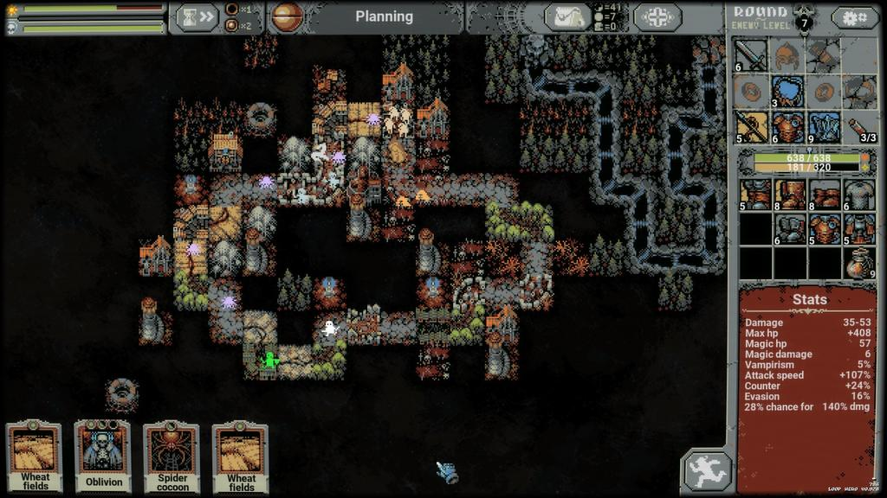</a> | `loop-hero-9.jpg` The loop late in an expedition. | [Steam store](https://store.steampowered.com/app/1282730/) · [image](https://shared.akamai.steamstatic.com/store_item_assets/steam/apps/1282730/ss_535cb6f102a0a421f6b50ccb509e10074067bb89.1920x1080.jpg) |
| <a href="crop-loop-hero-boss-meter.jpg">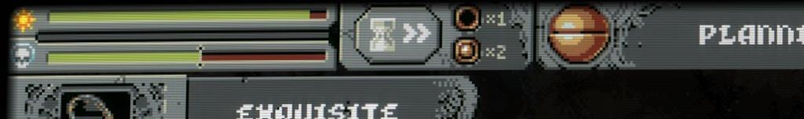</a> | `crop-loop-hero-boss-meter.jpg` Crop: the boss meter and the day's bar. | [cropped from Loop Hero store shot 1](https://shared.akamai.steamstatic.com/store_item_assets/steam/apps/1282730/ss_500e7212653fa6586f7a84c89b4c60be4e425fbb.1920x1080.jpg) |

## Risk of Rain 2

Risk of Rain 2, by Hopoo Games. Store screenshots from its [Steam page](https://store.steampowered.com/app/632360/). The source of the difficulty bar, which names each stage of the run as it passes into it.

| | What it shows | Source |
|---|---|---|
| <a href="risk-of-rain-2-hud-easy.jpg">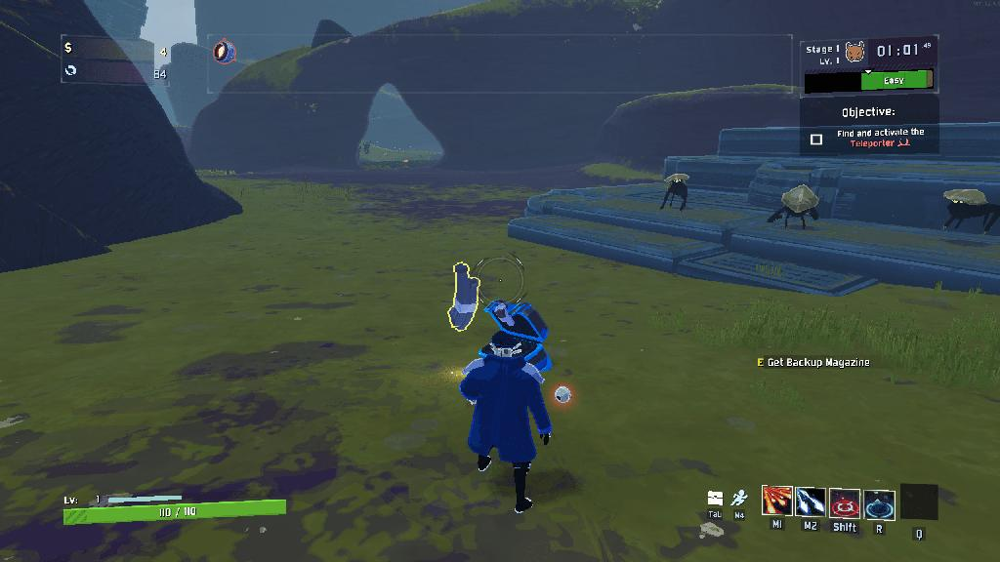</a> | `risk-of-rain-2-hud-easy.jpg` The HUD a minute in: the difficulty bar at the top right on Easy. | [Mechanics of Magic](https://mechanicsofmagic.com/) · [image](https://mechanicsofmagic.com/wp-content/uploads/2024/04/Screenshot-79.png) |
| <a href="crop-risk-of-rain-2-difficulty-easy.png">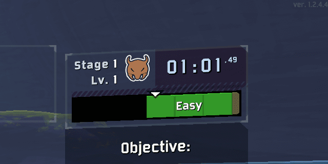</a> | `crop-risk-of-rain-2-difficulty-easy.png` Crop: the timer and the difficulty bar on Easy. | [cropped from the image above](https://mechanicsofmagic.com/wp-content/uploads/2024/04/Screenshot-79.png) |
| <a href="risk-of-rain-2-hud-medium.jpg">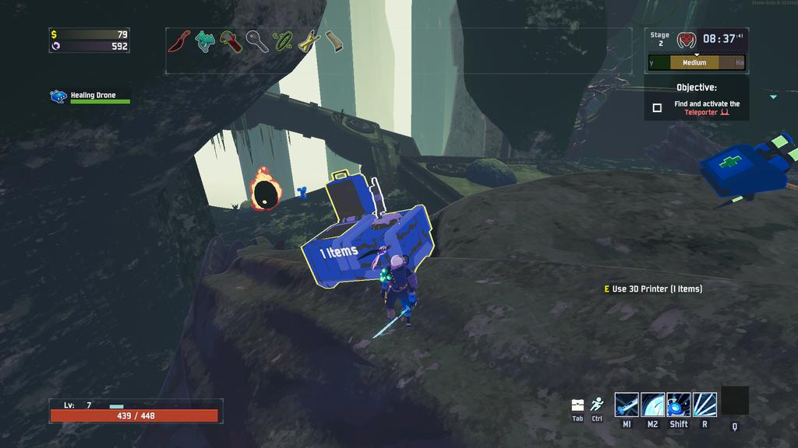</a> | `risk-of-rain-2-hud-medium.jpg` The HUD eight minutes in: the bar has moved on to Medium. | [Nerd Lodge](https://nerdlodge.com/) · [image](https://nerdlodge.com/wp-content/uploads/2020/01/3dprinter.png) |
| <a href="crop-risk-of-rain-2-difficulty-medium.jpg">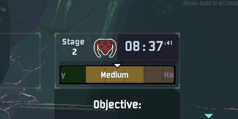</a> | `crop-risk-of-rain-2-difficulty-medium.jpg` Crop: the timer and the difficulty bar on Medium. | [cropped from the image above](https://nerdlodge.com/wp-content/uploads/2020/01/3dprinter.png) |
| <a href="risk-of-rain-2-monster-level.png">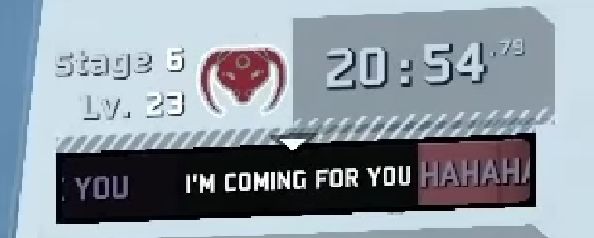</a> | `risk-of-rain-2-monster-level.png` The monsters' level on the HUD. | [riskofrain2 wiki, File:MonsterLevelHUD.png](https://riskofrain2.fandom.com/wiki/File:MonsterLevelHUD.png) · [image](https://static.wikia.nocookie.net/riskofrain2_gamepedia_en/images/9/9a/MonsterLevelHUD.png) |
| <a href="risk-of-rain-2-1.jpg">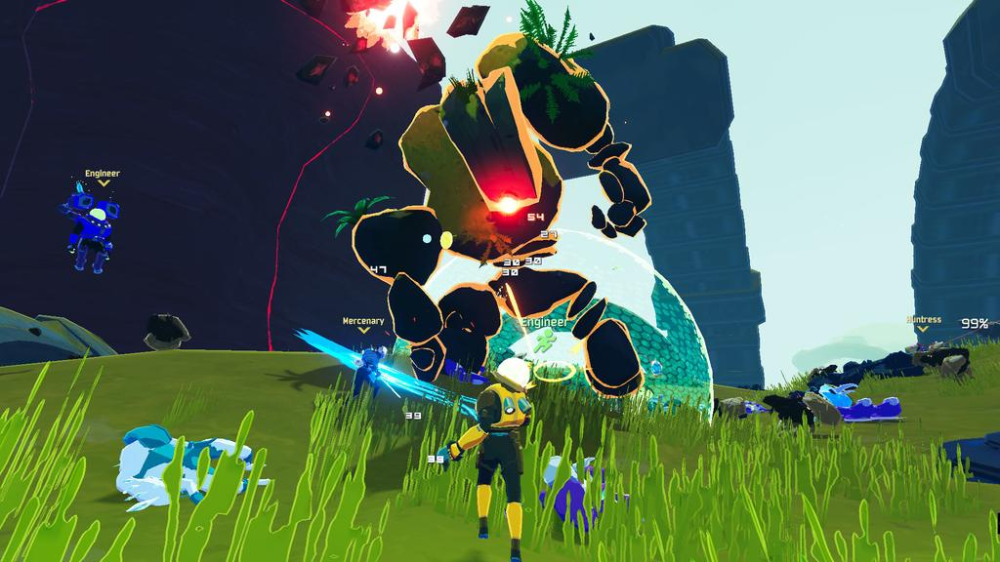</a> | `risk-of-rain-2-1.jpg` A fight with a golem. | [Steam store](https://store.steampowered.com/app/632360/) · [image](https://shared.akamai.steamstatic.com/store_item_assets/steam/apps/632360/ss_2bb49071317f7b241a527cf6e7aabd2cb6af055b.1920x1080.jpg) |
| <a href="risk-of-rain-2-2.jpg">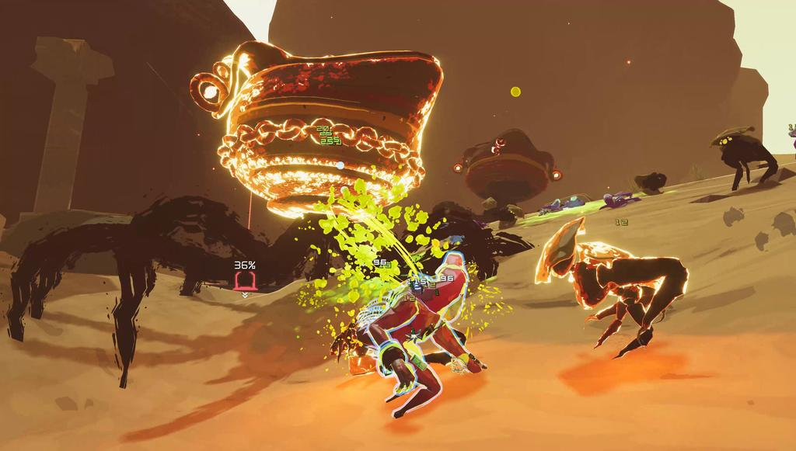</a> | `risk-of-rain-2-2.jpg` A boss. | [Steam store](https://store.steampowered.com/app/632360/) · [image](https://shared.akamai.steamstatic.com/store_item_assets/steam/apps/632360/ss_a3f57f281813cb51cb5d919701470acb962ff297.1920x1080.jpg) |
| <a href="risk-of-rain-2-3.jpg">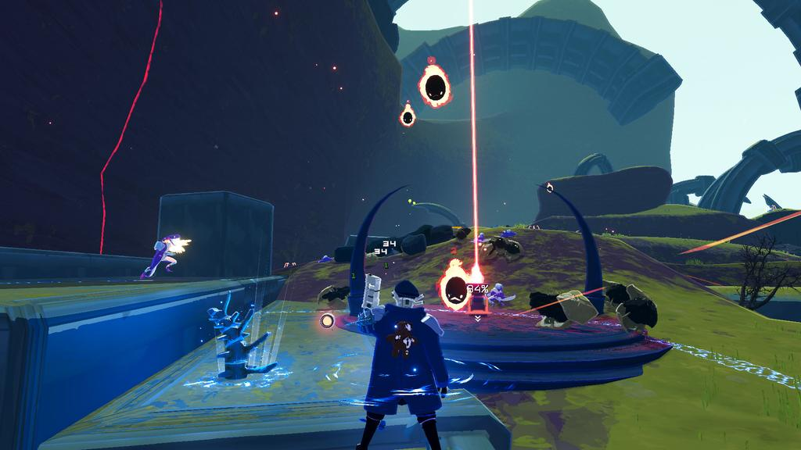</a> | `risk-of-rain-2-3.jpg` The teleporter charging. | [Steam store](https://store.steampowered.com/app/632360/) · [image](https://shared.akamai.steamstatic.com/store_item_assets/steam/apps/632360/ss_328d6fcb223f848c2a1047bb86702c4175d92317.1920x1080.jpg) |
| <a href="risk-of-rain-2-4.jpg">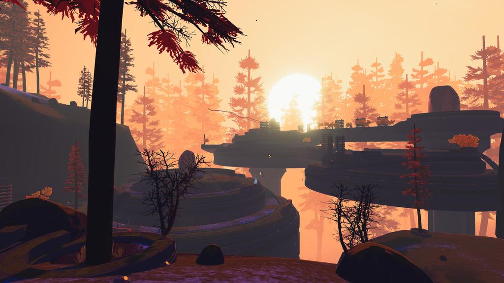</a> | `risk-of-rain-2-4.jpg` A stage at sunset. | [Steam store](https://store.steampowered.com/app/632360/) · [image](https://shared.akamai.steamstatic.com/store_item_assets/steam/apps/632360/ss_dc777b5c583794c99440b196cd1d26884fb1720b.1920x1080.jpg) |
| <a href="risk-of-rain-2-5.jpg">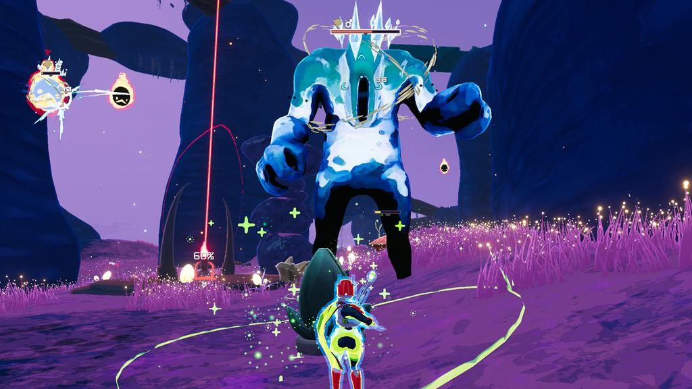</a> | `risk-of-rain-2-5.jpg` A fight with a large foe. | [Steam store](https://store.steampowered.com/app/632360/) · [image](https://shared.akamai.steamstatic.com/store_item_assets/steam/apps/632360/ss_0377ff24b4d60db6a38ddc0824b7f308890b9231.1920x1080.jpg) |

## Darkest Dungeon

Darkest Dungeon, by Red Hook Studios. Store screenshots from its [Steam page](https://store.steampowered.com/app/262060/). The source of the torch, whose tip states exactly what the dark adds.

| | What it shows | Source |
|---|---|---|
| <a href="darkest-dungeon-full-torch.jpg">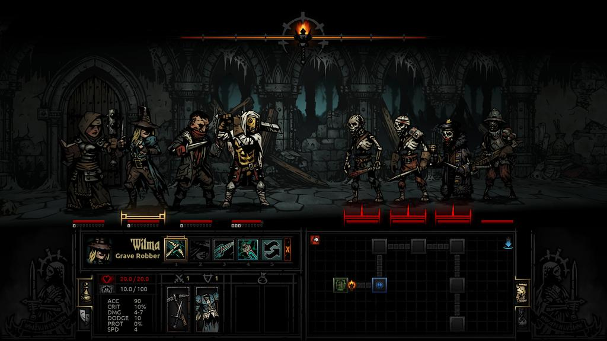</a> | `darkest-dungeon-full-torch.jpg` A corridor with the torch full. | [Steam store](https://store.steampowered.com/app/262060/) · [image](https://shared.akamai.steamstatic.com/store_item_assets/steam/apps/262060/ss_04572edc979601b038756f87861c6f8c6c337806.1920x1080.jpg) |
| <a href="crop-darkest-dungeon-torch-full.jpg">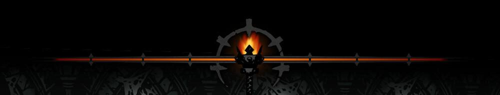</a> | `crop-darkest-dungeon-torch-full.jpg` Crop: the torch bar full. | [cropped from the image above](https://shared.akamai.steamstatic.com/store_item_assets/steam/apps/262060/ss_04572edc979601b038756f87861c6f8c6c337806.1920x1080.jpg) |
| <a href="darkest-dungeon-low-torch.jpg">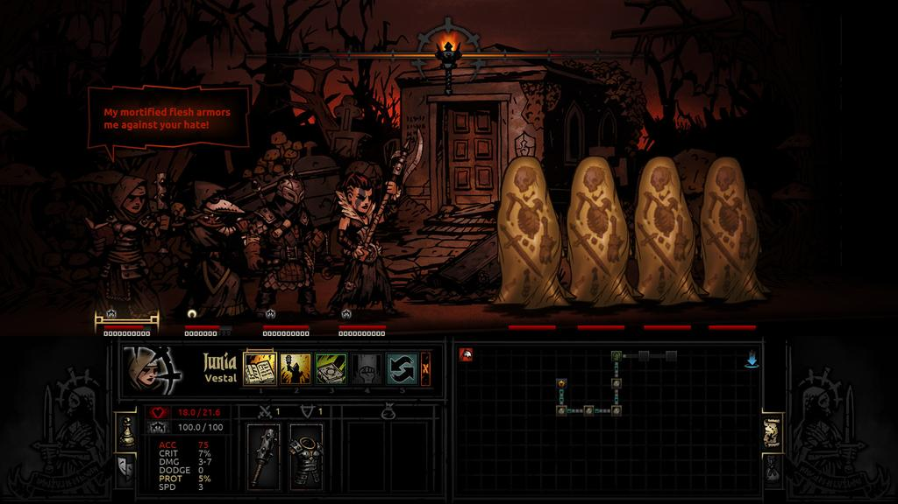</a> | `darkest-dungeon-low-torch.jpg` A room with the torch burning low. | [Steam store](https://store.steampowered.com/app/262060/) · [image](https://shared.akamai.steamstatic.com/store_item_assets/steam/apps/262060/ss_799c78932c87f2be0cbd45dd1b80ebd0a355e575.1920x1080.jpg) |
| <a href="crop-darkest-dungeon-torch-partial.jpg">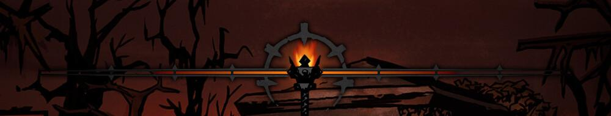</a> | `crop-darkest-dungeon-torch-partial.jpg` Crop: the torch bar part spent. | [cropped from the image above](https://shared.akamai.steamstatic.com/store_item_assets/steam/apps/262060/ss_799c78932c87f2be0cbd45dd1b80ebd0a355e575.1920x1080.jpg) |
| <a href="darkest-dungeon-round-counter.jpg">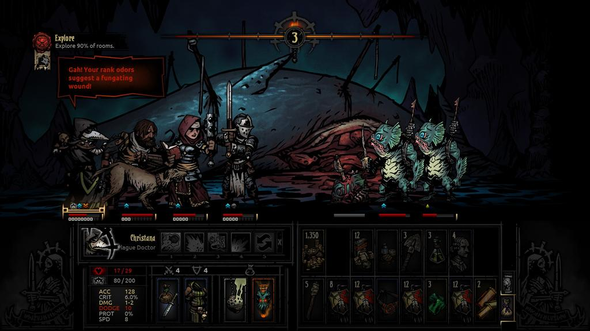</a> | `darkest-dungeon-round-counter.jpg` A fight, its round counted at the top. | [Steam store](https://store.steampowered.com/app/262060/) · [image](https://shared.akamai.steamstatic.com/store_item_assets/steam/apps/262060/ss_e65f764e9af2a8173faf70efc1b785f797cd714d.1920x1080.jpg) |
| <a href="crop-darkest-dungeon-torch-round.jpg">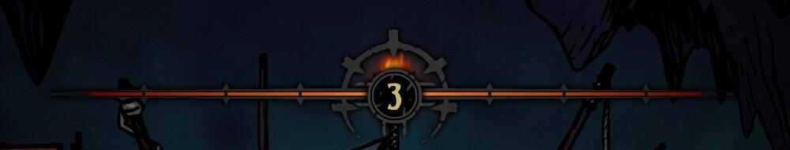</a> | `crop-darkest-dungeon-torch-round.jpg` Crop: the torch bar and the round count. | [cropped from the image above](https://shared.akamai.steamstatic.com/store_item_assets/steam/apps/262060/ss_e65f764e9af2a8173faf70efc1b785f797cd714d.1920x1080.jpg) |
|  | `darkest-dungeon-torch-meter.png` The torch meter. | [darkestdungeon wiki, File:Torch meter.png](https://darkestdungeon.fandom.com/wiki/File:Torch_meter.png) · [image](https://static.wikia.nocookie.net/darkestdungeon_gamepedia/images/c/c8/Torch_meter.png) |
| <a href="darkest-dungeon-torch-tip.jpg">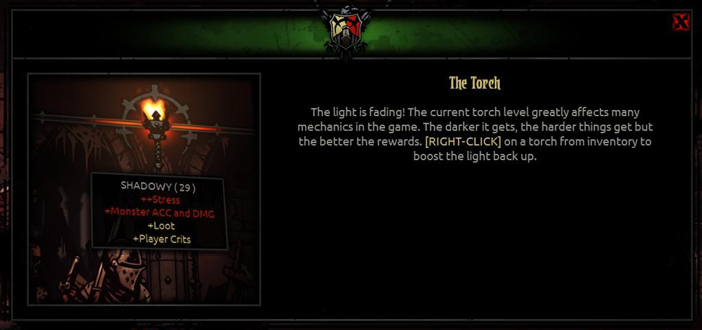</a> | `darkest-dungeon-torch-tip.jpg` The torch's tip: what each level of light adds and takes. | [darkestdungeon wiki, File:Tips Torch.jpg](https://darkestdungeon.fandom.com/wiki/File:Tips_Torch.jpg) · [image](https://static.wikia.nocookie.net/darkestdungeon_gamepedia/images/c/c7/Tips_Torch.jpg) |

## Etrian Odyssey HD, II HD and III HD

By Atlus. Store screenshots from their Steam pages. The source of the danger orb, which turns from blue to red as a fight nears.

| | What it shows | Source |
|---|---|---|
| <a href="etrian-odyssey-hd-orb.jpg">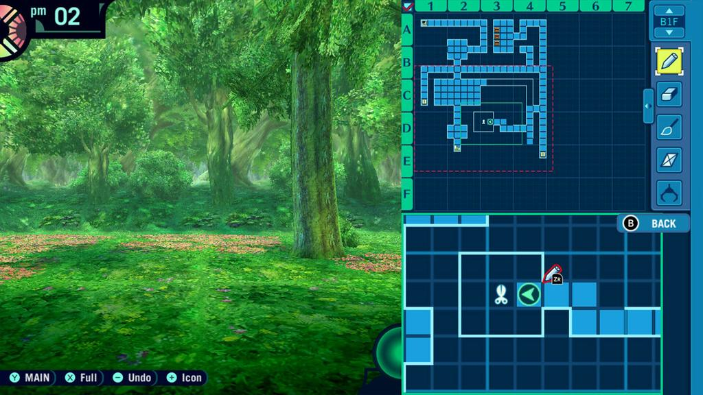</a> | `etrian-odyssey-hd-orb.jpg` Exploring, the danger orb calm at the foot of the screen. | [Steam store](https://store.steampowered.com/app/1868180/) · [image](https://shared.akamai.steamstatic.com/store_item_assets/steam/apps/1868180/ss_343a0795d1cf8adce0f957171f49d8841640eb27.1920x1080.jpg) |
| <a href="crop-etrian-odyssey-hd-orb.jpg">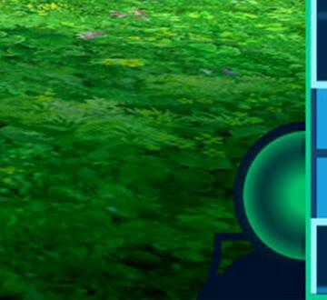</a> | `crop-etrian-odyssey-hd-orb.jpg` Crop: the orb, calm. | [cropped from the image above](https://shared.akamai.steamstatic.com/store_item_assets/steam/apps/1868180/ss_343a0795d1cf8adce0f957171f49d8841640eb27.1920x1080.jpg) |
| <a href="etrian-odyssey-2-hd-orb.jpg">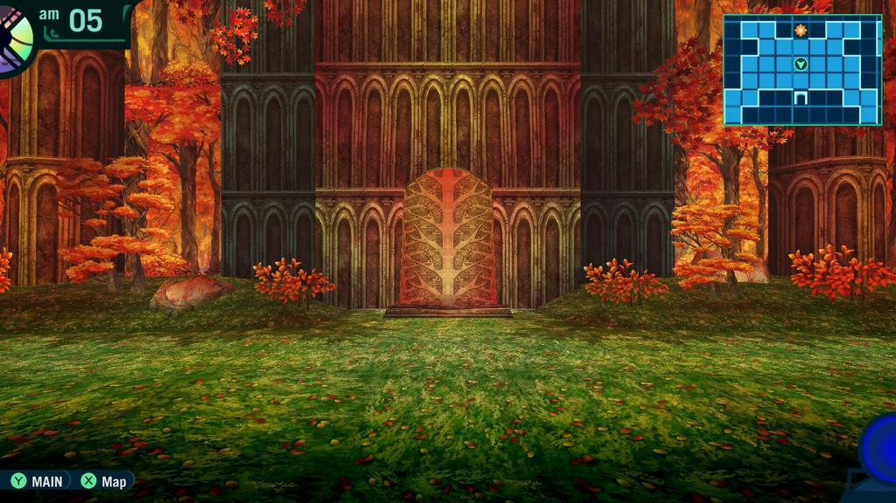</a> | `etrian-odyssey-2-hd-orb.jpg` Exploring, the orb blue. | [Steam store](https://store.steampowered.com/app/1868170/) · [image](https://shared.akamai.steamstatic.com/store_item_assets/steam/apps/1868170/ss_4baad1f8ad777533838bbf960396b59304cefb23.1920x1080.jpg) |
| <a href="crop-etrian-odyssey-2-hd-orb.jpg">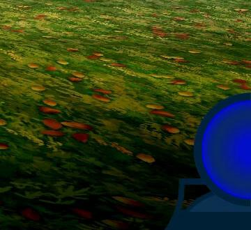</a> | `crop-etrian-odyssey-2-hd-orb.jpg` Crop: the orb, blue. | [cropped from the image above](https://shared.akamai.steamstatic.com/store_item_assets/steam/apps/1868170/ss_4baad1f8ad777533838bbf960396b59304cefb23.1920x1080.jpg) |
| <a href="etrian-odyssey-3-hd-orb.jpg">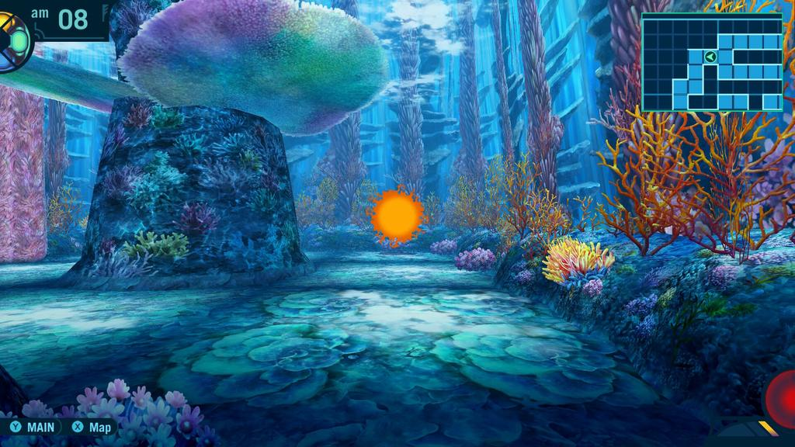</a> | `etrian-odyssey-3-hd-orb.jpg` Exploring, the orb red: a fight is near. | [Steam store](https://store.steampowered.com/app/1810820/) · [image](https://shared.akamai.steamstatic.com/store_item_assets/steam/apps/1810820/ss_78edb2db89217f563e8651907a1836367faa459c.1920x1080.jpg) |
| <a href="crop-etrian-odyssey-3-hd-orb.jpg">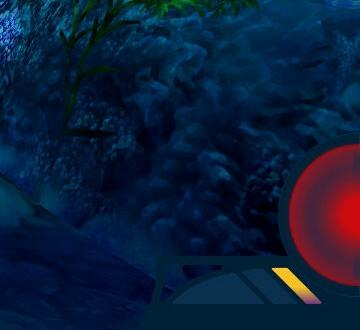</a> | `crop-etrian-odyssey-3-hd-orb.jpg` Crop: the orb, red. | [cropped from the image above](https://shared.akamai.steamstatic.com/store_item_assets/steam/apps/1810820/ss_78edb2db89217f563e8651907a1836367faa459c.1920x1080.jpg) |

## Persona 3 Reload

By Atlus. The source of the screen's edges reddening while the Reaper hunts.

| | What it shows | Source |
|---|---|---|
|  | `persona-3-reload-reaper.jpg` The Reaper in pursuit, the screen's edges red. | [megamitensei wiki, File:Reaper P3R Pursuit.png](https://megamitensei.fandom.com/wiki/File:Reaper_P3R_Pursuit.png) · [image](https://static.wikia.nocookie.net/megamitensei/images/c/ce/Reaper_P3R_Pursuit.png) |

## Solo Leveling

The anime (A-1 Pictures) and the manhwa (Chugong, Dubu of Redice Studio, Jang Sung-rak). The source of the Red Gate: a crimson portal.

| | What it shows | Source |
|---|---|---|
|  | `solo-leveling-red-gate-anime.jpg` The anime: a Red Gate, season 2, episode 13. | [solo-leveling wiki, File:Red Gate - S2 Episode 13.png](https://solo-leveling.fandom.com/wiki/File:Red_Gate_-_S2_Episode_13.png) · [image](https://static.wikia.nocookie.net/solo-leveling/images/d/d7/Red_Gate_-_S2_Episode_13.png) |
|  | `solo-leveling-red-gate-incident.jpg` The anime: the Red Gate incident. | [solo-leveling wiki, File:Red Gate Incident Anime.png](https://solo-leveling.fandom.com/wiki/File:Red_Gate_Incident_Anime.png) · [image](https://static.wikia.nocookie.net/solo-leveling/images/d/d4/Red_Gate_Incident_Anime.png) |
|  | `solo-leveling-red-gate-inside.jpg` The anime: inside the second Red Gate. | [solo-leveling wiki, File:2nd red gate dungeon anime.png](https://solo-leveling.fandom.com/wiki/File:2nd_red_gate_dungeon_anime.png) · [image](https://static.wikia.nocookie.net/solo-leveling/images/7/7b/2nd_red_gate_dungeon_anime.png) |
|  | `solo-leveling-red-gate-manhwa-1.jpg` The manhwa: the Red Gate. | [solo-leveling wiki, File:RedGate1.jpg](https://solo-leveling.fandom.com/wiki/File:RedGate1.jpg) · [image](https://static.wikia.nocookie.net/solo-leveling/images/f/f7/RedGate1.jpg) |
|  | `solo-leveling-red-gate-manhwa-2.jpg` The manhwa: the second Red Gate. | [solo-leveling wiki, File:RedGate2.jpg](https://solo-leveling.fandom.com/wiki/File:RedGate2.jpg) · [image](https://static.wikia.nocookie.net/solo-leveling/images/1/12/RedGate2.jpg) |

## Solo Leveling: Arise Overdrive

Solo Leveling: Arise Overdrive, by Netmarble Neo. Store screenshots from its [Steam page](https://store.steampowered.com/app/2373990/). Looked at for how the licensed game draws a Gate.

| | What it shows | Source |
|---|---|---|
|  | `solo-leveling-arise-1.jpg` A fight against a burning demon. | [Steam store](https://store.steampowered.com/app/2373990/) · [image](https://shared.akamai.steamstatic.com/store_item_assets/steam/apps/2373990/6e2f1aa804ce7e85757117e976c22ca0e7f90036/ss_6e2f1aa804ce7e85757117e976c22ca0e7f90036.1920x1080.jpg) |
|  | `solo-leveling-arise-2.jpg` The Hunter Association. | [Steam store](https://store.steampowered.com/app/2373990/) · [image](https://shared.akamai.steamstatic.com/store_item_assets/steam/apps/2373990/eeb045f2d753939f780fd0ac5f162bc6c93d36ea/ss_eeb045f2d753939f780fd0ac5f162bc6c93d36ea.1920x1080.jpg) |
|  | `solo-leveling-arise-3.jpg` Hunters before a blue Gate. | [Steam store](https://store.steampowered.com/app/2373990/) · [image](https://shared.akamai.steamstatic.com/store_item_assets/steam/apps/2373990/9122156e9ce4eb2ddbfe9b5f23e4058885eb154c/ss_9122156e9ce4eb2ddbfe9b5f23e4058885eb154c.1920x1080.jpg) |
|  | `solo-leveling-arise-4.jpg` Three hunters. | [Steam store](https://store.steampowered.com/app/2373990/) · [image](https://shared.akamai.steamstatic.com/store_item_assets/steam/apps/2373990/4d8fabc0435dda2245f7d2c4b653b35bd8514c65/ss_4d8fabc0435dda2245f7d2c4b653b35bd8514c65.1920x1080.jpg) |
|  | `solo-leveling-arise-5.jpg` A fight. | [Steam store](https://store.steampowered.com/app/2373990/) · [image](https://shared.akamai.steamstatic.com/store_item_assets/steam/apps/2373990/32a7ab88d959fad2e26374f16e2e769135468588/ss_32a7ab88d959fad2e26374f16e2e769135468588.1920x1080.jpg) |
|  | `solo-leveling-arise-6.jpg` An army before a burning Gate. | [Steam store](https://store.steampowered.com/app/2373990/) · [image](https://shared.akamai.steamstatic.com/store_item_assets/steam/apps/2373990/a830e6794df0358da283be9f07240bd2c38ff457/ss_a830e6794df0358da283be9f07240bd2c38ff457.1920x1080.jpg) |
|  | `solo-leveling-arise-7.jpg` The Shadows at night. | [Steam store](https://store.steampowered.com/app/2373990/) · [image](https://shared.akamai.steamstatic.com/store_item_assets/steam/apps/2373990/ba7853c00aefb5d1590e75d2bdfab26dcd414407/ss_ba7853c00aefb5d1590e75d2bdfab26dcd414407.1920x1080.jpg) |
