# Step 3: More answers per turn

The references for Cover, throwables, breakable wind-ups and creature behaviours, built as "More answers per
turn" in [docs/DESIGN.md](../../../DESIGN.md#more-answers-per-turn--built). They gave ARISE the guarded tag and
the Cover pick, the Throw slot and its chips, the break pips under a wind-up's intent, and an intent for each
behaviour.

Every image belongs to the game's publisher, or to the wiki, site or player who captured it, as listed beside it. They are kept here as design reference only: nothing in ARISE copies their art, and none of them ships with the game.

## Wind-ups the party can break

Octopath Traveler and Octopath Traveler II (Square Enix): a shield badge with the hits it can still take, and BREAK when it runs out. Honkai: Star Rail (HoYoverse): the toughness bar, and the charged attack a break interrupts. Slay the Spire (Mega Crit): the Guardian's Mode Shift, a count of damage that turns it.

| | What it shows | Source |
|---|---|---|
| <a href="1a_octopath1_shield_counters_weakness_icons.jpg">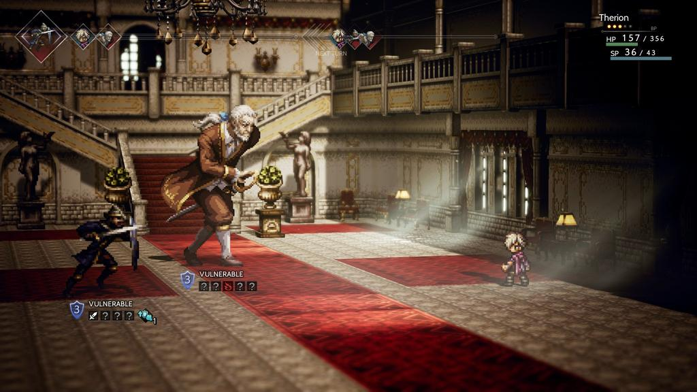</a> | `1a_octopath1_shield_counters_weakness_icons.jpg` A fight: each foe's shield count and its weaknesses under it. | [Steam store](https://store.steampowered.com/app/921570/) · [image](https://shared.akamai.steamstatic.com/store_item_assets/steam/apps/921570/ss_1f77510857d899639f49ea1da2bd55d7ea07e37a.1920x1080.jpg) |
| <a href="1a_octopath1_shield_counters_crop.jpg">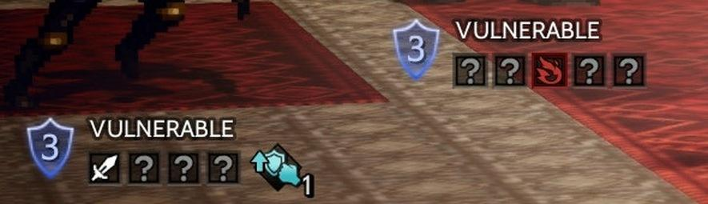</a> | `1a_octopath1_shield_counters_crop.jpg` Crop: the shield badges with their counts. | [Steam store](https://store.steampowered.com/app/921570/) · [image](https://shared.akamai.steamstatic.com/store_item_assets/steam/apps/921570/ss_1f77510857d899639f49ea1da2bd55d7ea07e37a.1920x1080.jpg) |
| <a href="1b_octopath1_BREAK_state.jpg">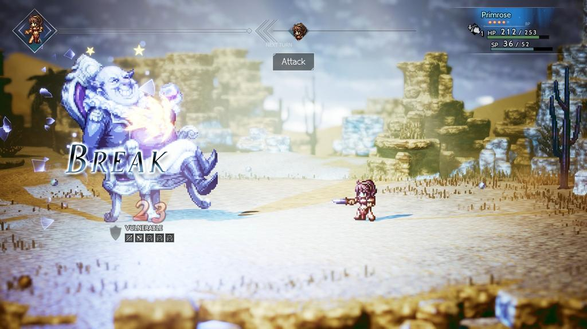</a> | `1b_octopath1_BREAK_state.jpg` A foe broken: BREAK over it, its shield gone. | [Steam store](https://store.steampowered.com/app/921570/) · [image](https://shared.akamai.steamstatic.com/store_item_assets/steam/apps/921570/ss_5a64da850a5ede9313c43da9c732d5a65a3ec4e0.1920x1080.jpg) |
| <a href="1b_octopath1_BREAK_crop.jpg">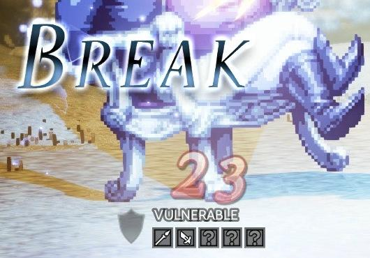</a> | `1b_octopath1_BREAK_crop.jpg` Crop: BREAK. | [Steam store](https://store.steampowered.com/app/921570/) · [image](https://shared.akamai.steamstatic.com/store_item_assets/steam/apps/921570/ss_5a64da850a5ede9313c43da9c732d5a65a3ec4e0.1920x1080.jpg) |
| <a href="1c_octopath1_WEAK_hit_shield_counts.jpg">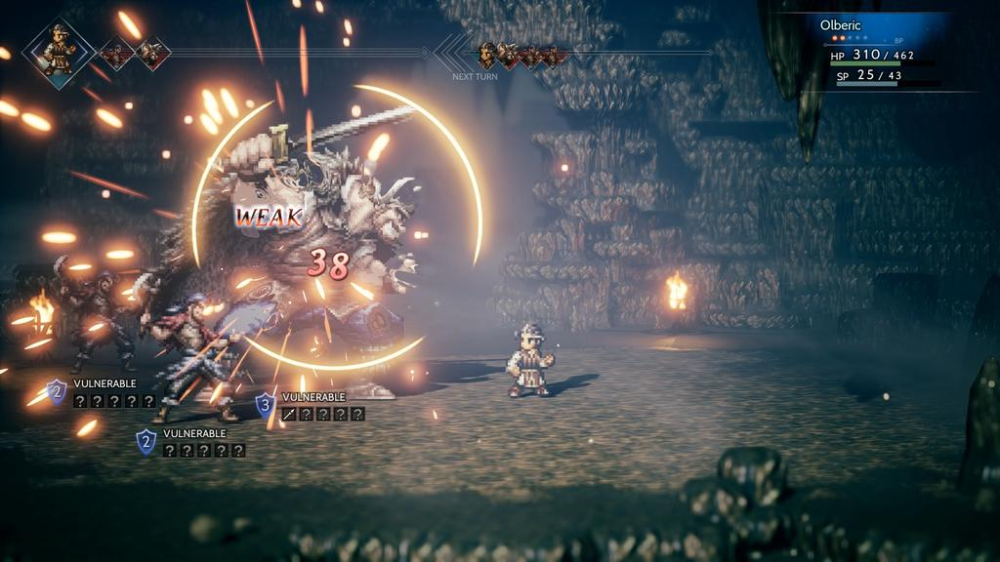</a> | `1c_octopath1_WEAK_hit_shield_counts.jpg` A hit on a weakness takes a point off the shield. | [Steam store](https://store.steampowered.com/app/921570/) · [image](https://shared.akamai.steamstatic.com/store_item_assets/steam/apps/921570/ss_f2d62d746b4733802516c7f76120246ee3e29327.1920x1080.jpg) |
| <a href="1d_octopath2_shield_counters_revealed_weaknesses.jpg">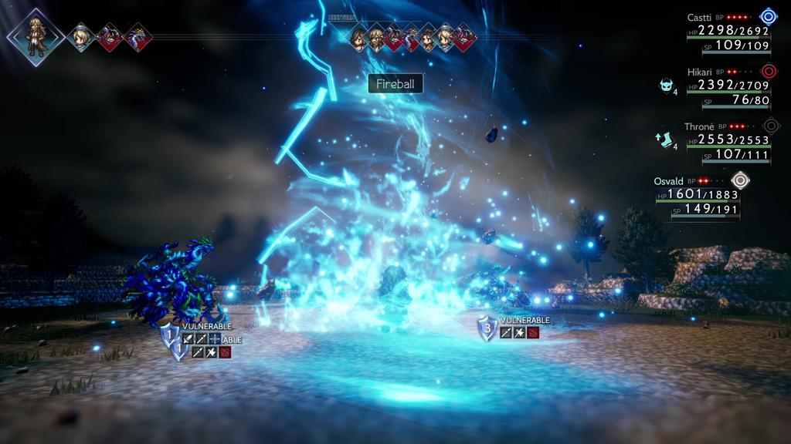</a> | `1d_octopath2_shield_counters_revealed_weaknesses.jpg` Octopath Traveler II: shield counts and weaknesses found. | [Steam store](https://store.steampowered.com/app/1971650/) · [image](https://shared.akamai.steamstatic.com/store_item_assets/steam/apps/1971650/ss_cd859f6ff08f678304dac0d8c36299b0a2f82a32.1920x1080.jpg) |
| <a href="1d_octopath2_shield_counters_crop.jpg">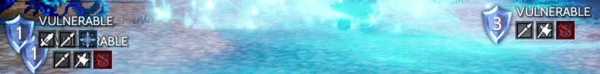</a> | `1d_octopath2_shield_counters_crop.jpg` Crop: the shield counts. | [Steam store](https://store.steampowered.com/app/1971650/) · [image](https://shared.akamai.steamstatic.com/store_item_assets/steam/apps/1971650/ss_cd859f6ff08f678304dac0d8c36299b0a2f82a32.1920x1080.jpg) |
| <a href="1e_hsr_toughness_bar_wikicrop_x6.jpg">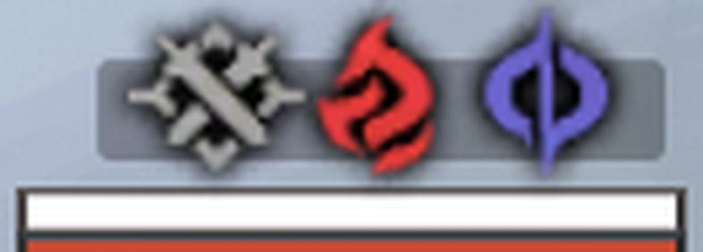</a> | `1e_hsr_toughness_bar_wikicrop_x6.jpg` The toughness bar under a foe's HP, enlarged six times. | [Honkai: Star Rail Wiki, File:Toughness.png](https://honkai-star-rail.fandom.com/wiki/File:Toughness.png) · [image](https://static.wikia.nocookie.net/houkai-star-rail/images/1/12/Toughness.png/revision/latest?cb=20230430213659) |
| <a href="1f_hsr_exo_toughness_two_layer_bar_wikicrop_x6.jpg">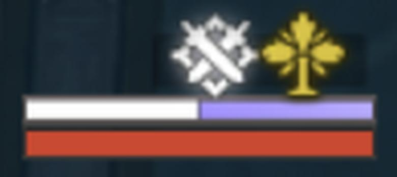</a> | `1f_hsr_exo_toughness_two_layer_bar_wikicrop_x6.jpg` A toughness bar in two layers, enlarged six times. | [Honkai: Star Rail Wiki, File:Exo-Toughness.png](https://honkai-star-rail.fandom.com/wiki/File:Exo-Toughness.png) · [image](https://static.wikia.nocookie.net/houkai-star-rail/images/2/23/Exo-Toughness.png/revision/latest?cb=20241108162735) |
| <a href="1g_hsr_tutorial_toughness_full_vs_broken.jpg">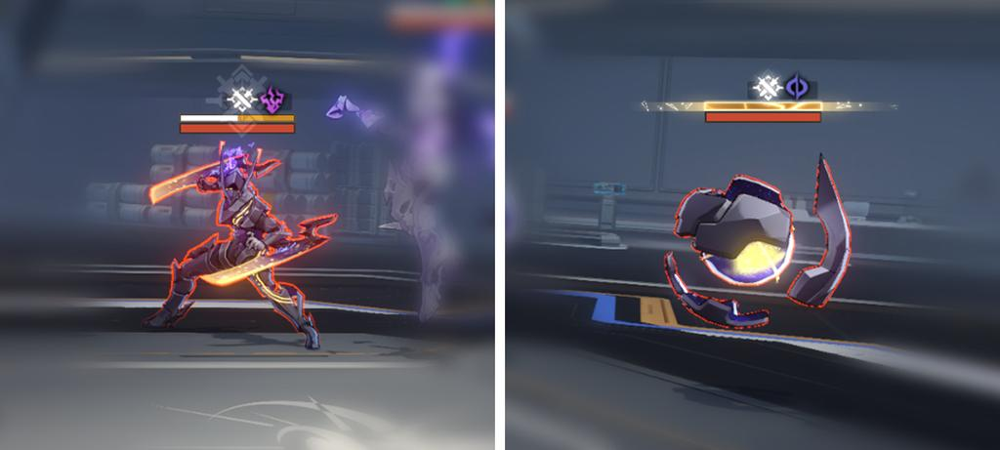</a> | `1g_hsr_tutorial_toughness_full_vs_broken.jpg` The tutorial: toughness full, and broken. | [Honkai: Star Rail Wiki, File:Tutorial_Battle_Toughness.png](https://honkai-star-rail.fandom.com/wiki/File:Tutorial_Battle_Toughness.png) · [image](https://static.wikia.nocookie.net/houkai-star-rail/images/d/dd/Tutorial_Battle_Toughness.png/revision/latest?cb=20231224143943) |
| <a href="1h_hsr_charged_attack_windup_warning.jpg">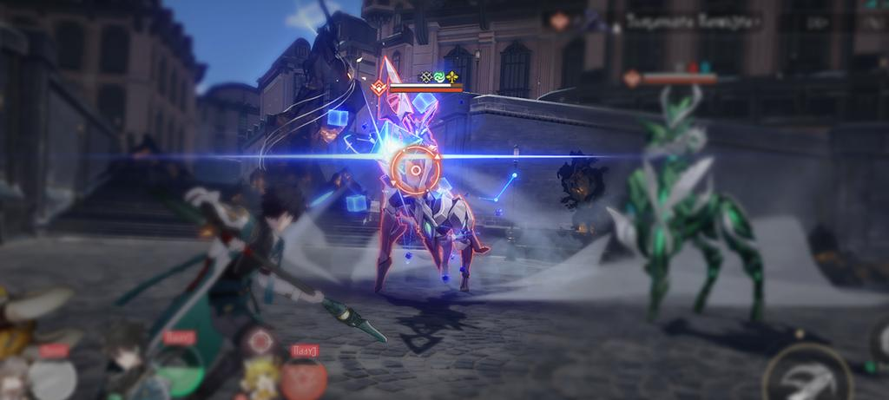</a> | `1h_hsr_charged_attack_windup_warning.jpg` The tutorial: a foe charging an attack, warned of a turn ahead. | [Honkai: Star Rail Wiki, File:Tutorial_Interrupt_Enemies'_Charged_Attacks_1.png](https://honkai-star-rail.fandom.com/wiki/File:Tutorial_Interrupt_Enemies'_Charged_Attacks_1.png) · [image](https://static.wikia.nocookie.net/houkai-star-rail/images/6/6a/Tutorial_Interrupt_Enemies%27_Charged_Attacks_1.png/revision/latest?cb=20240816053758) |
| <a href="1h_hsr_charged_attack_windup_bar_crop_x4.jpg">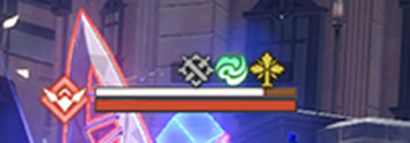</a> | `1h_hsr_charged_attack_windup_bar_crop_x4.jpg` Crop: the charge warning, enlarged four times. | [Honkai: Star Rail Wiki, File:Tutorial_Interrupt_Enemies'_Charged_Attacks_1.png](https://honkai-star-rail.fandom.com/wiki/File:Tutorial_Interrupt_Enemies'_Charged_Attacks_1.png) · [image](https://static.wikia.nocookie.net/houkai-star-rail/images/6/6a/Tutorial_Interrupt_Enemies%27_Charged_Attacks_1.png/revision/latest?cb=20240816053758) |
| <a href="1i_hsr_charged_attack_interrupted_by_break.jpg">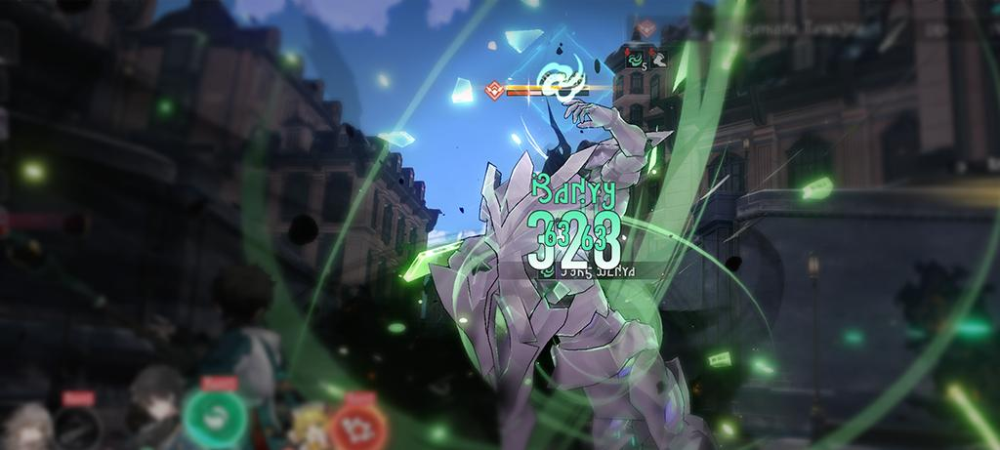</a> | `1i_hsr_charged_attack_interrupted_by_break.jpg` The tutorial: a break interrupts the charged attack. | [Honkai: Star Rail Wiki, File:Tutorial_Interrupt_Enemies'_Charged_Attacks_2.png](https://honkai-star-rail.fandom.com/wiki/File:Tutorial_Interrupt_Enemies'_Charged_Attacks_2.png) · [image](https://static.wikia.nocookie.net/houkai-star-rail/images/d/d9/Tutorial_Interrupt_Enemies%27_Charged_Attacks_2.png/revision/latest?cb=20240816053804) |
| <a href="1j_hsr_weakness_break_moment.jpg">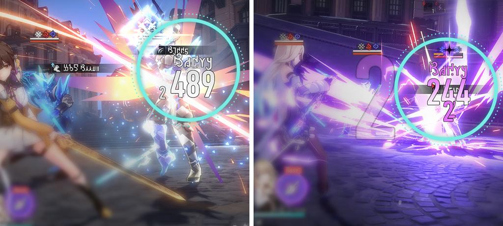</a> | `1j_hsr_weakness_break_moment.jpg` The tutorial: the moment of a weakness break. | [Honkai: Star Rail Wiki, File:Tutorial_Battle_Break_DMG_Types_and_Toughness_1.png](https://honkai-star-rail.fandom.com/wiki/File:Tutorial_Battle_Break_DMG_Types_and_Toughness_1.png) · [image](https://static.wikia.nocookie.net/houkai-star-rail/images/2/2a/Tutorial_Battle_Break_DMG_Types_and_Toughness_1.png/revision/latest?cb=20240816040737) |
| <a href="1k_sts_guardian_mode_shift_tooltip.jpg">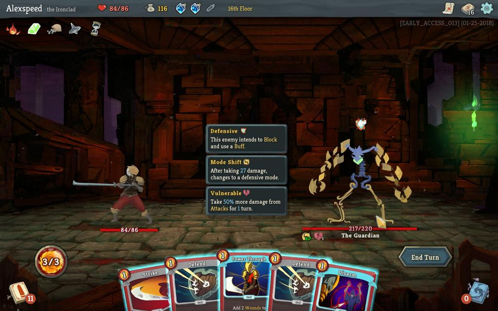</a> | `1k_sts_guardian_mode_shift_tooltip.jpg` The Guardian's Mode Shift, its tip open: the damage left before it shifts. | [Steam Community screenshot](https://steamcommunity.com/sharedfiles/filedetails/?id=1288709786) · [image](https://images.steamusercontent.com/ugc/941685170148337403/C99627B0707F2E6E4105AD8D6345F05EA4E35805/) |
| <a href="1k_sts_guardian_mode_shift_crop.jpg">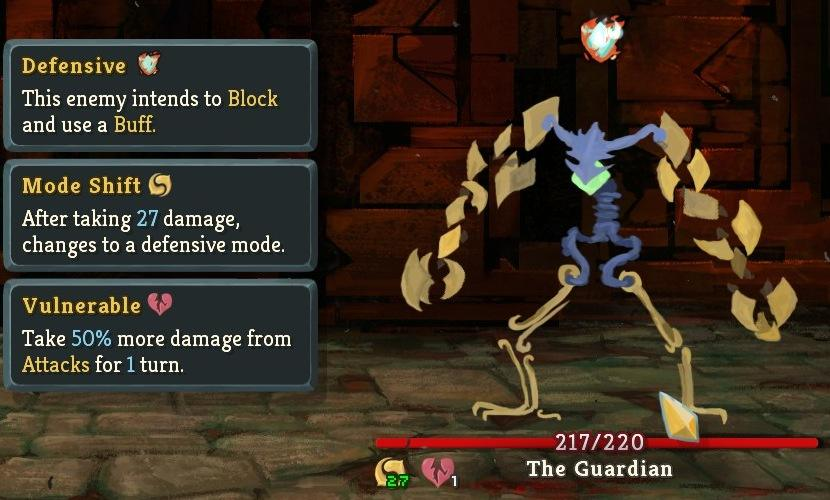</a> | `1k_sts_guardian_mode_shift_crop.jpg` Crop: Mode Shift and its tip. | [Steam Community screenshot](https://steamcommunity.com/sharedfiles/filedetails/?id=1288709786) · [image](https://images.steamusercontent.com/ugc/941685170148337403/C99627B0707F2E6E4105AD8D6345F05EA4E35805/) |
| <a href="1l_sts_guardian_mode_shift_40_whirlwind_intent.jpg">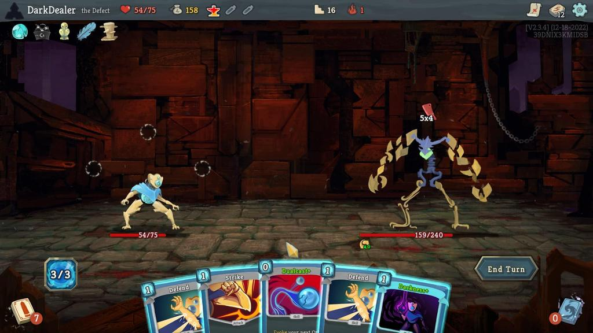</a> | `1l_sts_guardian_mode_shift_40_whirlwind_intent.jpg` The Guardian with Mode Shift 40 and a multi-hit intent. | [High Ground Gaming, Slay the Spire bosses](https://www.highgroundgaming.com/slay-the-spire-bosses-guide/) · [image](https://www.highgroundgaming.com/wp-content/uploads/2023/06/Slay-the-Spire-Guardian-.jpg) |
| <a href="1l_sts_guardian_mode_shift_40_crop.jpg">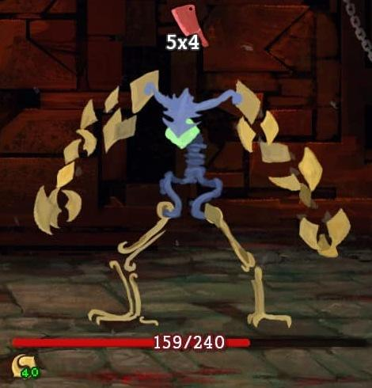</a> | `1l_sts_guardian_mode_shift_40_crop.jpg` Crop: the Guardian, Mode Shift and the intent. | [High Ground Gaming, Slay the Spire bosses](https://www.highgroundgaming.com/slay-the-spire-bosses-guide/) · [image](https://www.highgroundgaming.com/wp-content/uploads/2023/06/Slay-the-Spire-Guardian-.jpg) |
| <a href="1m_sts_hexaghost_unknown_intent_first_turn.jpg">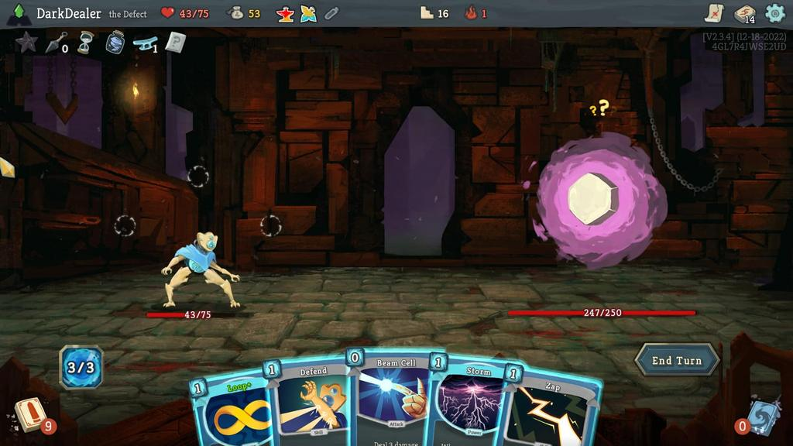</a> | `1m_sts_hexaghost_unknown_intent_first_turn.jpg` The Hexaghost's first turn: its intent unknown. | [High Ground Gaming, Slay the Spire bosses](https://www.highgroundgaming.com/slay-the-spire-bosses-guide/) · [image](https://www.highgroundgaming.com/wp-content/uploads/2023/06/Slay-the-Spire-Hexaghost.jpg) |
| <a href="1m_sts_hexaghost_unknown_intent_crop.jpg">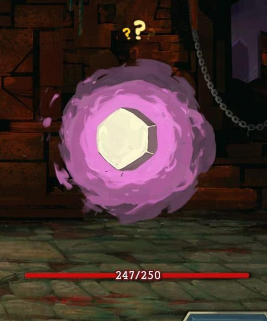</a> | `1m_sts_hexaghost_unknown_intent_crop.jpg` Crop: the unknown intent. | [High Ground Gaming, Slay the Spire bosses](https://www.highgroundgaming.com/slay-the-spire-bosses-guide/) · [image](https://www.highgroundgaming.com/wp-content/uploads/2023/06/Slay-the-Spire-Hexaghost.jpg) |

## Cover

Darkest Dungeon (Red Hook Studios): a shield over the guarded hero's HP bar, and "Guarded by" in the tip. Final Fantasy V Pixel Remaster (Square Enix): Cover.

| | What it shows | Source |
|---|---|---|
| <a href="2a_dd1_guarded_by_tooltip.jpg">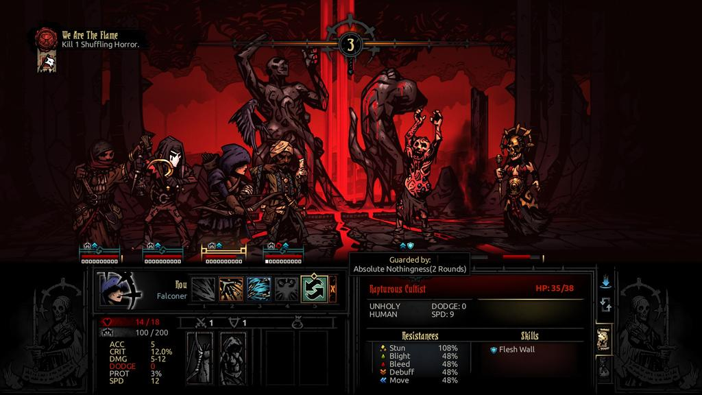</a> | `2a_dd1_guarded_by_tooltip.jpg` A guarded hero's tip: "Guarded by". | [Steam Community screenshot](https://steamcommunity.com/sharedfiles/filedetails/?id=1169151067) · [image](https://images.steamusercontent.com/ugc/869617511820469656/BCF6AEEF64CAEAF82D21429167EC1818EDDCDED3/) |
| <a href="2a_dd1_guarded_by_tooltip_crop.jpg">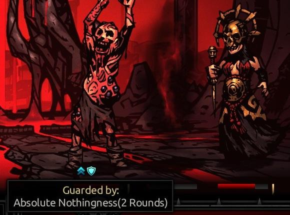</a> | `2a_dd1_guarded_by_tooltip_crop.jpg` Crop: the tip. | [Steam Community screenshot](https://steamcommunity.com/sharedfiles/filedetails/?id=1169151067) · [image](https://images.steamusercontent.com/ugc/869617511820469656/BCF6AEEF64CAEAF82D21429167EC1818EDDCDED3/) |
| <a href="2b_dd1_man_at_arms_guarding_two_crusaders.jpg">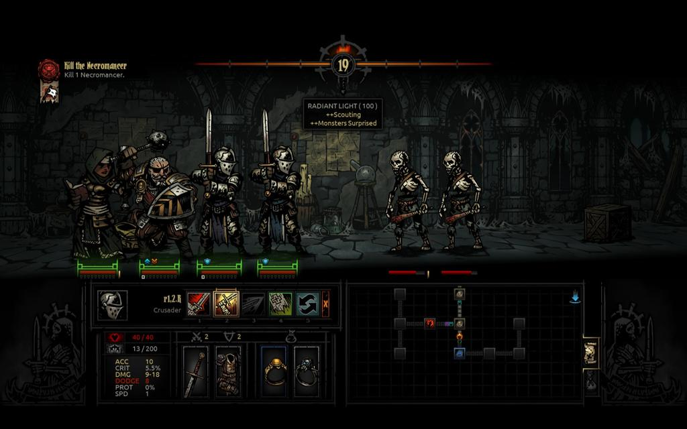</a> | `2b_dd1_man_at_arms_guarding_two_crusaders.jpg` The Man-at-Arms guarding: the guard tokens on the heroes he covers. | [Steam Community screenshot](https://steamcommunity.com/sharedfiles/filedetails/?id=574002926) · [image](https://images.steamusercontent.com/ugc/646628456460725037/DC420A4847F7F97CA6CE9F73964289457872E05D/) |
| <a href="2b_dd1_guard_shield_tokens_crop_x2.jpg">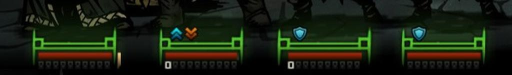</a> | `2b_dd1_guard_shield_tokens_crop_x2.jpg` Crop: the shield tokens over the HP bars, enlarged twice. | [Steam Community screenshot](https://steamcommunity.com/sharedfiles/filedetails/?id=574002926) · [image](https://images.steamusercontent.com/ugc/646628456460725037/DC420A4847F7F97CA6CE9F73964289457872E05D/) |
| <a href="2c_dd1_pvp_grave_robber_guarded_by_maa.jpg">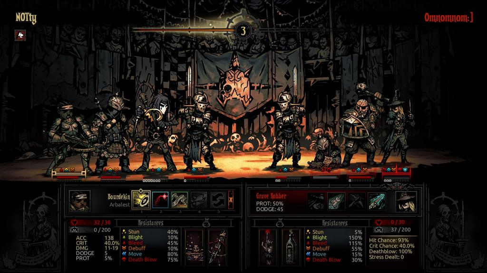</a> | `2c_dd1_pvp_grave_robber_guarded_by_maa.jpg` A Grave Robber guarded by a Man-at-Arms. | [Steam Community screenshot](https://steamcommunity.com/sharedfiles/filedetails/?id=2442785369) · [image](https://images.steamusercontent.com/ugc/1720912609140603610/13F94217520D84A7563D78ED347D362838929F30/) |
| <a href="2c_dd1_pvp_guarded_target_crop_x2.jpg">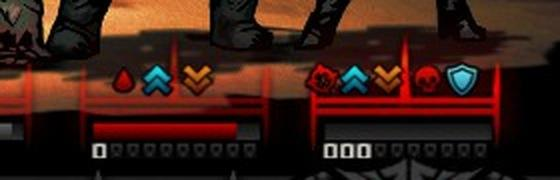</a> | `2c_dd1_pvp_guarded_target_crop_x2.jpg` Crop: the guarded target, enlarged twice. | [Steam Community screenshot](https://steamcommunity.com/sharedfiles/filedetails/?id=2442785369) · [image](https://images.steamusercontent.com/ugc/1720912609140603610/13F94217520D84A7563D78ED347D362838929F30/) |
| <a href="2d_dd_guard_icons_wikisheet.jpg">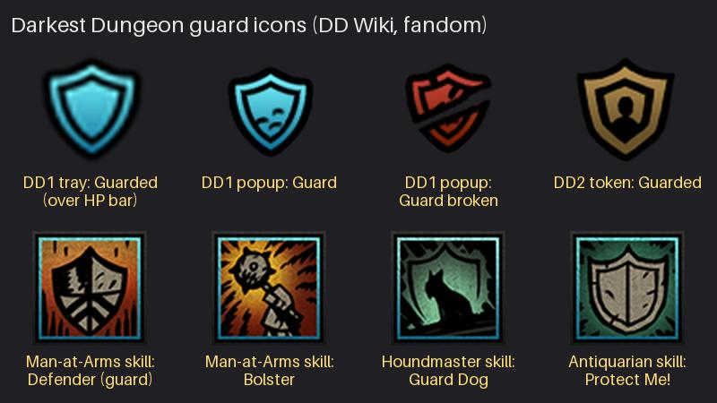</a> | `2d_dd_guard_icons_wikisheet.jpg` The guard's marks: the tray icon, the Guard and Guard broken popups, Darkest Dungeon II's Guarded token, and the skills that guard. | [Darkest Dungeon Wiki](https://darkestdungeon.fandom.com/) · [Tray_guard.png](https://darkestdungeon.fandom.com/wiki/File:Tray_guard.png) · [Poptext_guard.png](https://darkestdungeon.fandom.com/wiki/File:Poptext_guard.png) · [Poptext_guard_break.png](https://darkestdungeon.fandom.com/wiki/File:Poptext_guard_break.png) · [Dd2_token_guarded.png](https://darkestdungeon.fandom.com/wiki/File:Dd2_token_guarded.png) · [Defender.png](https://darkestdungeon.fandom.com/wiki/File:Defender.png) · [Bolster.png](https://darkestdungeon.fandom.com/wiki/File:Bolster.png) · [Guard_Dog.png](https://darkestdungeon.fandom.com/wiki/File:Guard_Dog.png) · [Protect_Me.png](https://darkestdungeon.fandom.com/wiki/File:Protect_Me.png) |
| <a href="2e_ffv_pixel_remaster_cover.jpg">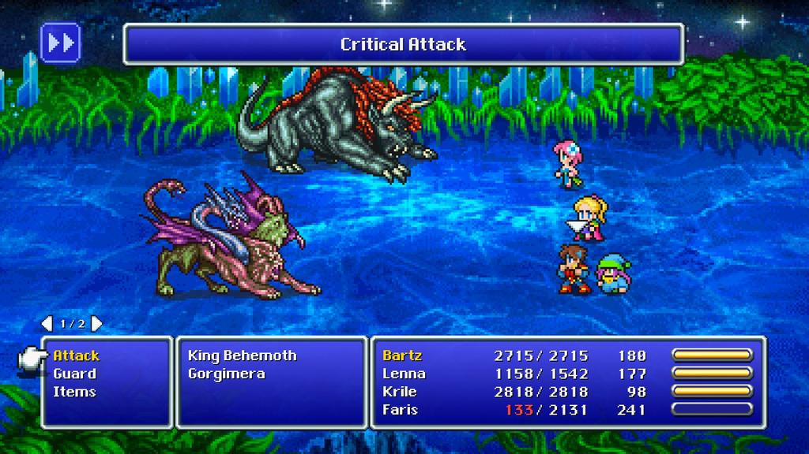</a> | `2e_ffv_pixel_remaster_cover.jpg` Final Fantasy V: a knight steps in front of a weak ally and takes the blow. | [finalfantasy wiki, File:Cover_from_FFV_Pixel_Remaster.jpg](https://finalfantasy.fandom.com/wiki/File:Cover_from_FFV_Pixel_Remaster.jpg) · [image](https://static.wikia.nocookie.net/finalfantasy/images/c/cf/Cover_from_FFV_Pixel_Remaster.jpg/revision/latest?cb=20220101002949) |

## Throwables and the bag

Slay the Spire (Mega Crit): the potion belt, and Throw or Discard when a potion is tapped. Darkest Dungeon and Darkest Dungeon II (Red Hook Studios): provisions and combat items. Slay the Spire on iPad and Honkai: Star Rail on phones: picking a target by touch.

| | What it shows | Source |
|---|---|---|
| <a href="3a_sts_potion_belt_topbar.jpg">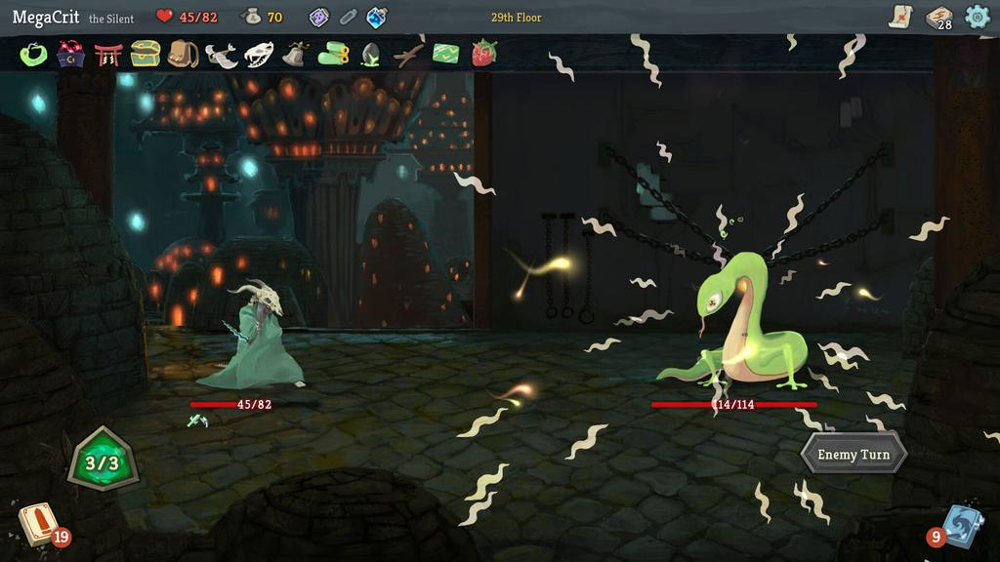</a> | `3a_sts_potion_belt_topbar.jpg` The top bar: HP, gold, the potion slots. | [Steam store](https://store.steampowered.com/app/646570/) · [image](https://shared.akamai.steamstatic.com/store_item_assets/steam/apps/646570/ss_c171816f7ecd35b5b46d2fa27532f4c5b8ca3cc5.1920x1080.jpg) |
| <a href="3a_sts_potion_belt_crop_x3.jpg">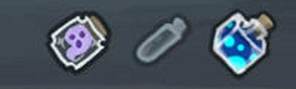</a> | `3a_sts_potion_belt_crop_x3.jpg` Crop: the potion slots, enlarged three times. | [Steam store](https://store.steampowered.com/app/646570/) · [image](https://shared.akamai.steamstatic.com/store_item_assets/steam/apps/646570/ss_c171816f7ecd35b5b46d2fa27532f4c5b8ca3cc5.1920x1080.jpg) |
| <a href="3a_sts_potion_belt_2_crop_x3.jpg">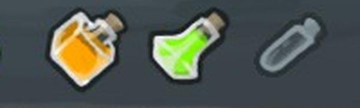</a> | `3a_sts_potion_belt_2_crop_x3.jpg` Crop: the potion slots in another run, enlarged three times. | [slay-the-spire wiki, File:Chad.jpg](https://slay-the-spire.fandom.com/wiki/File:Chad.jpg) · [image](https://static.wikia.nocookie.net/slay-the-spire/images/c/cf/Chad.jpg/revision/latest?cb=20190323010858) |
| <a href="3b_sts_potion_popup_throw_discard.jpg">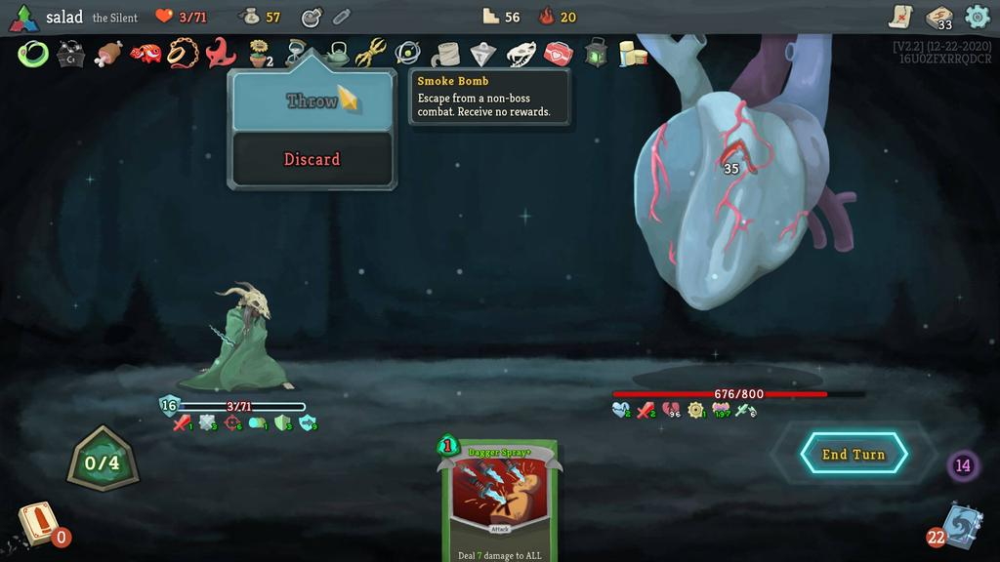</a> | `3b_sts_potion_popup_throw_discard.jpg` A potion tapped: Throw and Discard. | [Steam Community screenshot](https://images.steamusercontent.com/ugc/1707413878507238873/A08EF3AB00A244B30BDB27BED462062FFF066277/) · [image](https://images.steamusercontent.com/ugc/1707413878507238873/A08EF3AB00A244B30BDB27BED462062FFF066277/) |
| <a href="3b_sts_potion_popup_throw_discard_crop.jpg">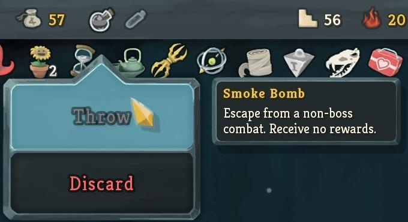</a> | `3b_sts_potion_popup_throw_discard_crop.jpg` Crop: the potion's popup. | [Steam Community screenshot](https://images.steamusercontent.com/ugc/1707413878507238873/A08EF3AB00A244B30BDB27BED462062FFF066277/) · [image](https://images.steamusercontent.com/ugc/1707413878507238873/A08EF3AB00A244B30BDB27BED462062FFF066277/) |
| <a href="3c_sts_fire_potion_hit_guardian_20.jpg">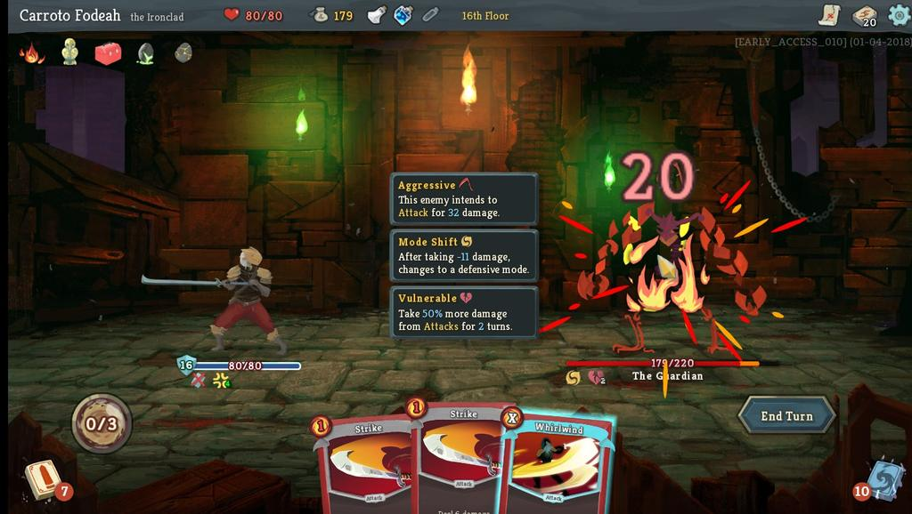</a> | `3c_sts_fire_potion_hit_guardian_20.jpg` A Fire Potion thrown at the Guardian: 20 damage. | [Steam Community screenshot](https://steamcommunity.com/sharedfiles/filedetails/?id=1261733430) · [image](https://images.steamusercontent.com/ugc/903402409220181971/9A258B363D159002E611D1864F7AD2B1AB2C00E6/) |
| <a href="3c_sts_fire_potion_hit_crop.jpg">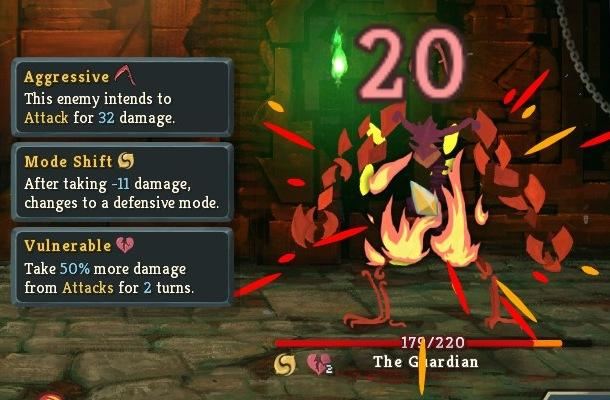</a> | `3c_sts_fire_potion_hit_crop.jpg` Crop: the hit. | [Steam Community screenshot](https://steamcommunity.com/sharedfiles/filedetails/?id=1261733430) · [image](https://images.steamusercontent.com/ugc/903402409220181971/9A258B363D159002E611D1864F7AD2B1AB2C00E6/) |
| <a href="3d_sts_potion_icons_wikisheet.jpg">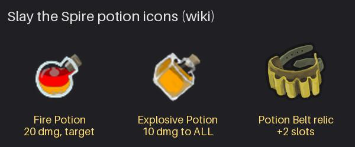</a> | `3d_sts_potion_icons_wikisheet.jpg` Fire Potion, Explosive Potion and the Potion Belt relic. | [Slay the Spire Wiki, Potions](https://slay-the-spire.fandom.com/wiki/Potions) · [FirePotion.png](https://slay-the-spire.fandom.com/wiki/File:FirePotion.png) · [ExplosivePotion.png](https://slay-the-spire.fandom.com/wiki/File:ExplosivePotion.png) · [PotionBelt.png](https://slay-the-spire.fandom.com/wiki/File:PotionBelt.png) |
| <a href="3e_dd1_combat_inventory_provisions.jpg">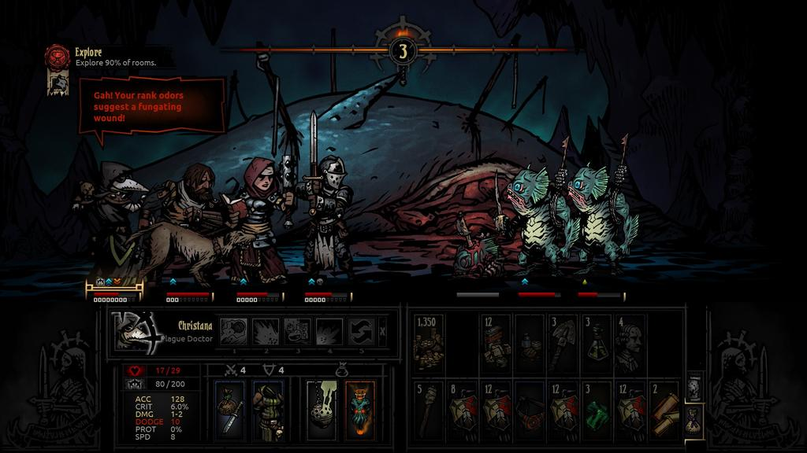</a> | `3e_dd1_combat_inventory_provisions.jpg` A fight with the inventory open: provisions to hand. | [Steam store](https://store.steampowered.com/app/262060/) · [image](https://shared.akamai.steamstatic.com/store_item_assets/steam/apps/262060/ss_e65f764e9af2a8173faf70efc1b785f797cd714d.1920x1080.jpg) |
| <a href="3e_dd1_inventory_grid_crop.jpg">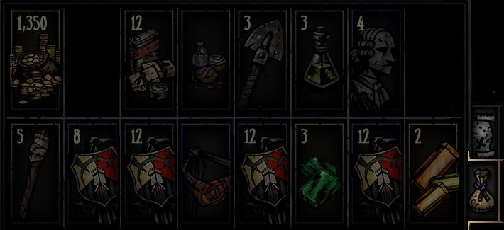</a> | `3e_dd1_inventory_grid_crop.jpg` Crop: the inventory grid. | [Steam store](https://store.steampowered.com/app/262060/) · [image](https://shared.akamai.steamstatic.com/store_item_assets/steam/apps/262060/ss_e65f764e9af2a8173faf70efc1b785f797cd714d.1920x1080.jpg) |
| <a href="3f_dd1_provision_shop.jpg">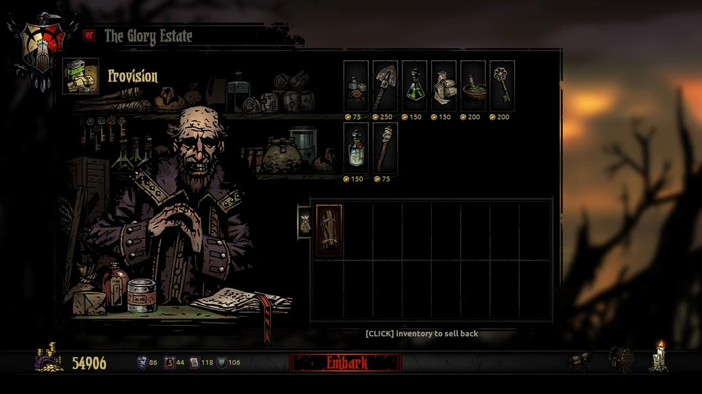</a> | `3f_dd1_provision_shop.jpg` Buying provisions before an expedition. | [darkestdungeon wiki, File:Provivons_Screen.jpg](https://darkestdungeon.fandom.com/wiki/File:Provivons_Screen.jpg) · [image](https://static.wikia.nocookie.net/darkestdungeon_gamepedia/images/d/d9/Provivons_Screen.jpg/revision/latest?cb=20150310121509) |
| <a href="3g_dd2_combat_items_panel_wikicrop.jpg">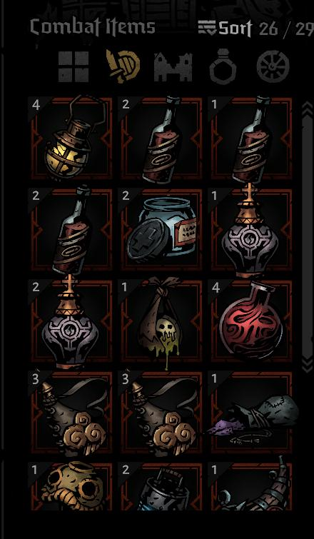</a> | `3g_dd2_combat_items_panel_wikicrop.jpg` Darkest Dungeon II: the combat items panel. | [darkestdungeon wiki, File:Combat_items_In_Menu.png](https://darkestdungeon.fandom.com/wiki/File:Combat_items_In_Menu.png) · [image](https://static.wikia.nocookie.net/darkestdungeon_gamepedia/images/8/81/Combat_items_In_Menu.png/revision/latest?cb=20230106183125) |
| <a href="3h_sts_mobile_ipad_targeting_arrow.jpg">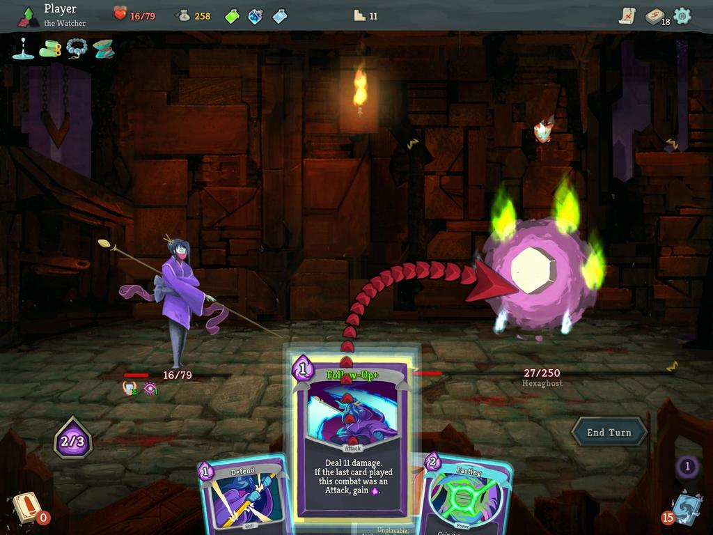</a> | `3h_sts_mobile_ipad_targeting_arrow.jpg` Slay the Spire+ on iPad: a card dragged to its target, the arrow showing it. | [App Store, Slay the Spire+](https://apps.apple.com/us/app/id6448808007) · [image](https://is1-ssl.mzstatic.com/image/thumb/Purple126/v4/f3/d6/05/f3d605e1-6ae0-1f95-739b-e5c735696d98/fa5ef8a8-0255-4e99-9cad-f9b7d7ff2d8a_SlayTheSpireArcade__6448808007_20230519_iPadPro12.9Screenshot_2732x2048_07.jpg/552x414bb.jpg) |
| <a href="3i_hsr_mobile_swipe_to_pick_target.jpg">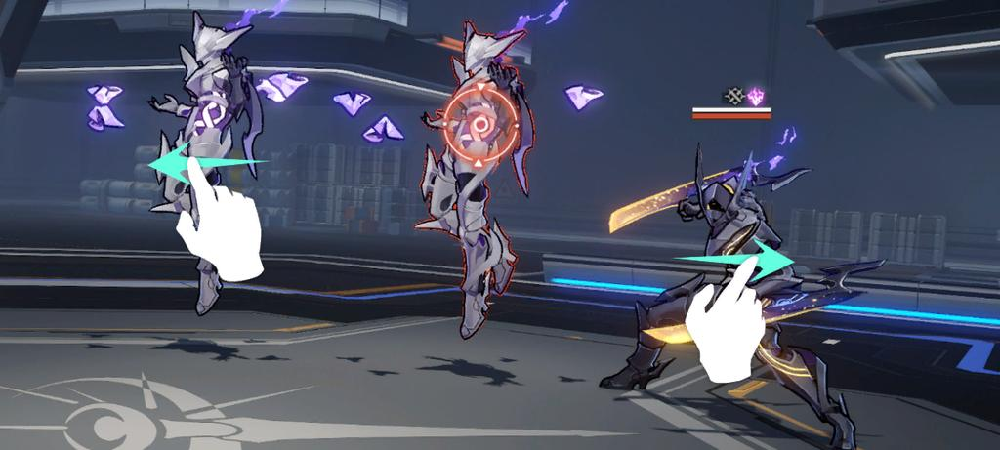</a> | `3i_hsr_mobile_swipe_to_pick_target.jpg` Honkai: Star Rail's tutorial: tap or swipe to pick the target. | [Honkai: Star Rail Wiki, File:Tutorial_Battle_Select_Target.png](https://honkai-star-rail.fandom.com/wiki/File:Tutorial_Battle_Select_Target.png) · [image](https://static.wikia.nocookie.net/houkai-star-rail/images/6/61/Tutorial_Battle_Select_Target.png/revision/latest?cb=20230607212148) |

## What creatures do besides hit

Slay the Spire (Mega Crit): intent icons that tell an attack from a buff, a defend, a debuff or a sleep at a glance. Wildfrost (Deadpan Games and Gaziter): counters. Into the Breach (Subset Games): the attack order and every attack previewed.

| | What it shows | Source |
|---|---|---|
| <a href="4a_sts_intent_icons_wikisheet.jpg">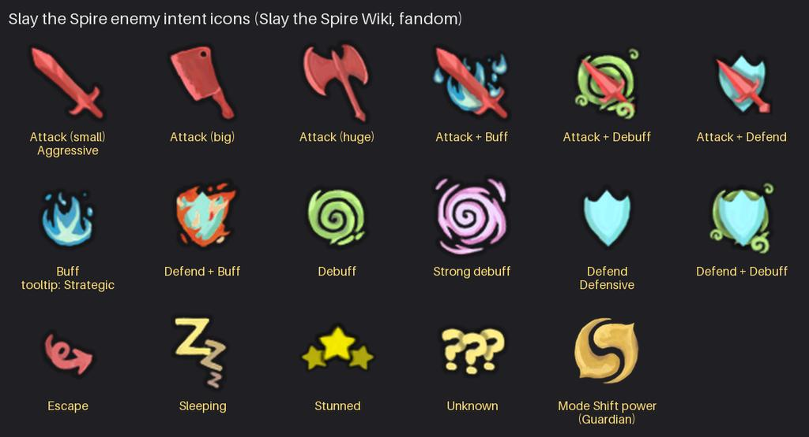</a> | `4a_sts_intent_icons_wikisheet.jpg` Every intent icon: attacks by weight, attack and buff, attack and debuff, buff, debuff, defend, escape, sleeping, stunned, unknown, and Mode Shift. | [Slay the Spire Wiki, Intent](https://slay-the-spire.fandom.com/wiki/Intent) · [Intent_-_Aggressive_-_Sword.png](https://slay-the-spire.fandom.com/wiki/File:Intent_-_Aggressive_-_Sword.png) · [Attack_intent_5.png](https://slay-the-spire.fandom.com/wiki/File:Attack_intent_5.png) · [Intent_Attack_6.png](https://slay-the-spire.fandom.com/wiki/File:Intent_Attack_6.png) · [Intent_-_Attack_Buff.png](https://slay-the-spire.fandom.com/wiki/File:Intent_-_Attack_Buff.png) · [Intent_-_Attack_Debuff.png](https://slay-the-spire.fandom.com/wiki/File:Intent_-_Attack_Debuff.png) · [Attack_Defend.png](https://slay-the-spire.fandom.com/wiki/File:Attack_Defend.png) · [Intent_-_Buff.png](https://slay-the-spire.fandom.com/wiki/File:Intent_-_Buff.png) · [Intent_-_Buff_-_Defend.png](https://slay-the-spire.fandom.com/wiki/File:Intent_-_Buff_-_Defend.png) · [Debuff1.png](https://slay-the-spire.fandom.com/wiki/File:Debuff1.png) · [Debuff2.png](https://slay-the-spire.fandom.com/wiki/File:Debuff2.png) · [Defend.png](https://slay-the-spire.fandom.com/wiki/File:Defend.png) · [Defense_-_Debuff.png](https://slay-the-spire.fandom.com/wiki/File:Defense_-_Debuff.png) · [Escape.png](https://slay-the-spire.fandom.com/wiki/File:Escape.png) · [Intent-asleep.png](https://slay-the-spire.fandom.com/wiki/File:Intent-asleep.png) · [Intent-stunned.png](https://slay-the-spire.fandom.com/wiki/File:Intent-stunned.png) · [Intent_-_Unknown.png](https://slay-the-spire.fandom.com/wiki/File:Intent_-_Unknown.png) · [Icon_ModeShift.png](https://slay-the-spire.fandom.com/wiki/File:Icon_ModeShift.png) |
| <a href="4b_sts_strategic_buff_intent_tooltip_gremlin_nob.jpg">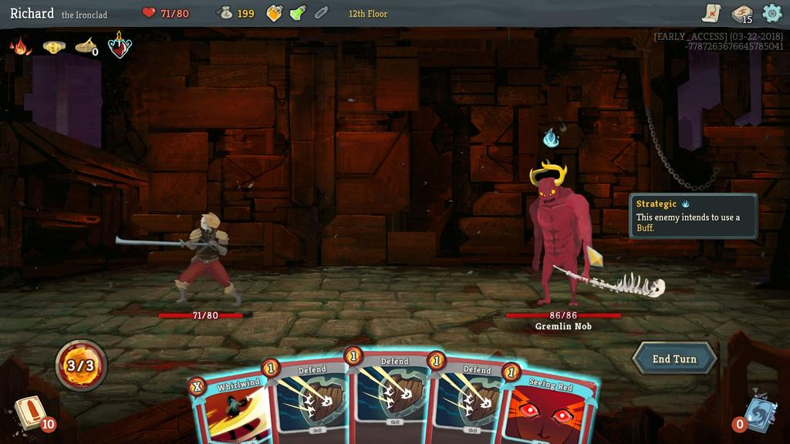</a> | `4b_sts_strategic_buff_intent_tooltip_gremlin_nob.jpg` The Gremlin Nob's buff intent, its tip open: "Strategic". | [slay-the-spire wiki, File:Chad.jpg](https://slay-the-spire.fandom.com/wiki/File:Chad.jpg) · [image](https://static.wikia.nocookie.net/slay-the-spire/images/c/cf/Chad.jpg/revision/latest?cb=20190323010858) |
| <a href="4b_sts_strategic_intent_crop.jpg">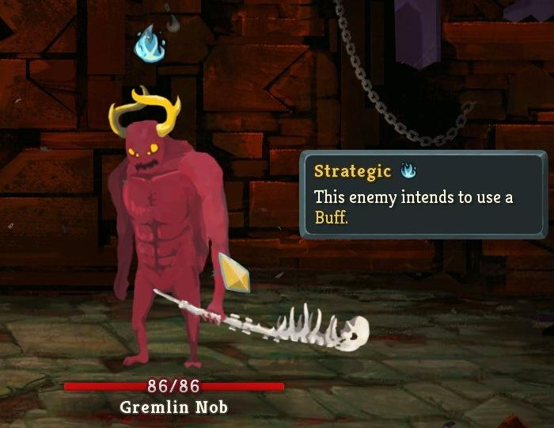</a> | `4b_sts_strategic_intent_crop.jpg` Crop: the intent and its tip. | [slay-the-spire wiki, File:Chad.jpg](https://slay-the-spire.fandom.com/wiki/File:Chad.jpg) · [image](https://static.wikia.nocookie.net/slay-the-spire/images/c/cf/Chad.jpg/revision/latest?cb=20190323010858) |
| <a href="4c_sts_sentries_attack_and_debuff_intents.jpg">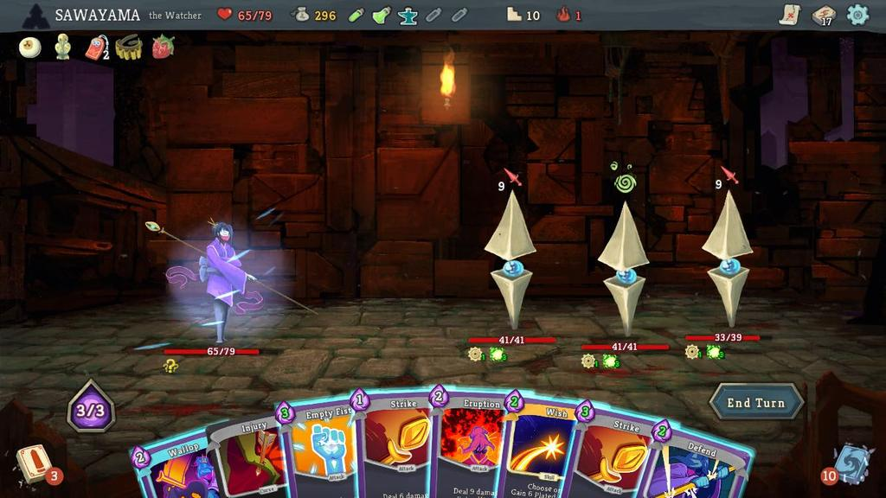</a> | `4c_sts_sentries_attack_and_debuff_intents.jpg` Three Sentries, an attack and a debuff among their intents. | [slay-the-spire wiki, File:CalmStance.jpg](https://slay-the-spire.fandom.com/wiki/File:CalmStance.jpg) · [image](https://static.wikia.nocookie.net/slay-the-spire/images/a/a3/CalmStance.jpg/revision/latest?cb=20210409232305) |
| <a href="4c_sts_sentries_intents_crop.jpg">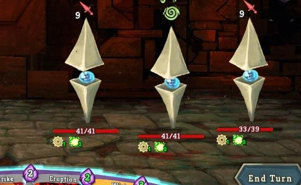</a> | `4c_sts_sentries_intents_crop.jpg` Crop: the Sentries' intents. | [slay-the-spire wiki, File:CalmStance.jpg](https://slay-the-spire.fandom.com/wiki/File:CalmStance.jpg) · [image](https://static.wikia.nocookie.net/slay-the-spire/images/a/a3/CalmStance.jpg/revision/latest?cb=20210409232305) |
| <a href="4d_sts_donu_deca_multiattack_and_buff_intents.jpg">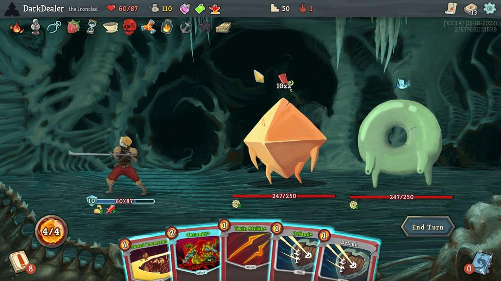</a> | `4d_sts_donu_deca_multiattack_and_buff_intents.jpg` Donu and Deca: a multi-hit attack and a buff. | [High Ground Gaming, Slay the Spire bosses](https://www.highgroundgaming.com/slay-the-spire-bosses-guide/) · [image](https://www.highgroundgaming.com/wp-content/uploads/2023/06/Slay-the-Spire-Donu-and-Deca.jpg) |
| <a href="4d_sts_donu_deca_intents_crop.jpg">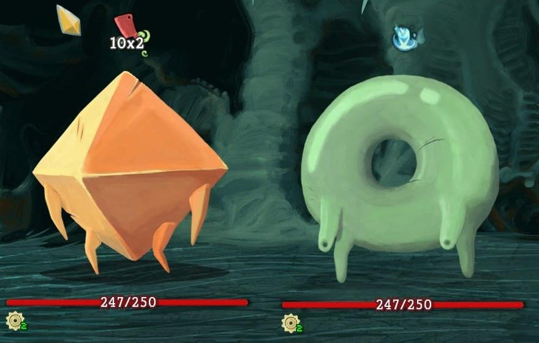</a> | `4d_sts_donu_deca_intents_crop.jpg` Crop: their intents. | [High Ground Gaming, Slay the Spire bosses](https://www.highgroundgaming.com/slay-the-spire-bosses-guide/) · [image](https://www.highgroundgaming.com/wp-content/uploads/2023/06/Slay-the-Spire-Donu-and-Deca.jpg) |
| <a href="4e_sts_slime_boss_debuff_intent.jpg">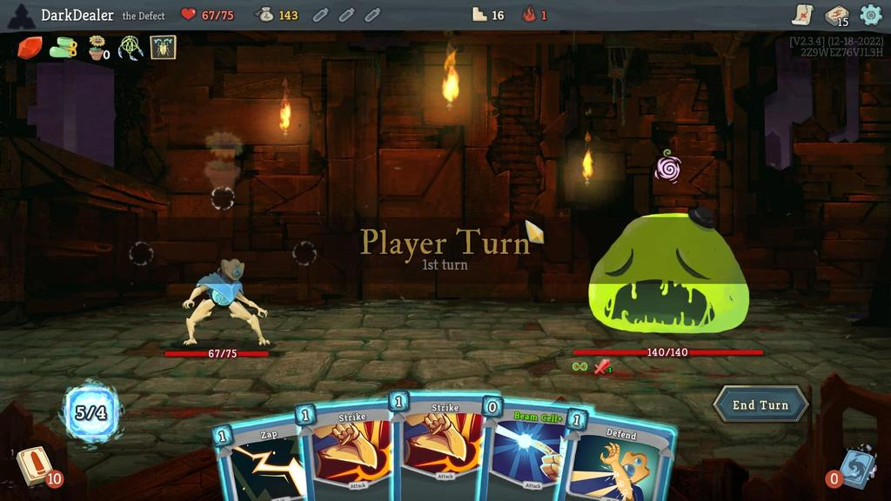</a> | `4e_sts_slime_boss_debuff_intent.jpg` The Slime Boss and its debuff intent. | [High Ground Gaming, Slay the Spire bosses](https://www.highgroundgaming.com/slay-the-spire-bosses-guide/) · [image](https://www.highgroundgaming.com/wp-content/uploads/2023/06/Slay-the-Spire-Slime-Boss.jpg) |
|  | `4f_wildfrost_counter_inspect_bumbo.jpg` A card inspected: its counter and what it does when the counter runs out. | [Steam store](https://store.steampowered.com/app/1811990/) · [image](https://shared.akamai.steamstatic.com/store_item_assets/steam/apps/1811990/ss_0251000ca945c16ebadd7af9abbe2b501b6513ce.1920x1080.jpg) |
|  | `4f_wildfrost_counter_tooltip_crop.jpg` Crop: the counter's tip. | [Steam store](https://store.steampowered.com/app/1811990/) · [image](https://shared.akamai.steamstatic.com/store_item_assets/steam/apps/1811990/ss_0251000ca945c16ebadd7af9abbe2b501b6513ce.1920x1080.jpg) |
|  | `4g_wildfrost_board_counter_clocks.jpg` The board: a counter on every foe, ticking down to its attack. | [Steam store](https://store.steampowered.com/app/1811990/) · [image](https://shared.akamai.steamstatic.com/store_item_assets/steam/apps/1811990/ss_21b9944d77b9eaf47601d56bf90eb55476b8f62b.1920x1080.jpg) |
|  | `4g_wildfrost_enemy_counters_crop.jpg` Crop: the foes' counters. | [Steam store](https://store.steampowered.com/app/1811990/) · [image](https://shared.akamai.steamstatic.com/store_item_assets/steam/apps/1811990/ss_21b9944d77b9eaf47601d56bf90eb55476b8f62b.1920x1080.jpg) |
|  | `4h_itb_attack_order_and_target_tiles.jpg` The attack order numbered on each Vek, and the tiles it will hit. | [Steam store](https://store.steampowered.com/app/590380/) · [image](https://shared.akamai.steamstatic.com/store_item_assets/steam/apps/590380/ss_4b985c7747c1ff0b7fbbf3eaf8ca5a1272f0dadb.1920x1080.jpg) |
|  | `4h_itb_attack_order_crop_x2.jpg` Crop: the order and the targets, enlarged twice. | [Steam store](https://store.steampowered.com/app/590380/) · [image](https://shared.akamai.steamstatic.com/store_item_assets/steam/apps/590380/ss_4b985c7747c1ff0b7fbbf3eaf8ca5a1272f0dadb.1920x1080.jpg) |
|  | `4i_itb_vek_attack_previews_push_arrows.jpg` Every Vek's attack previewed, with the arrows for what it pushes. | [Steam store](https://store.steampowered.com/app/590380/) · [image](https://shared.akamai.steamstatic.com/store_item_assets/steam/apps/590380/ss_6113590509c195f98fa64cd738df534762e0c358.1920x1080.jpg) |
|  | `4i_itb_vek_attack_previews_crop_x2.jpg` Crop: the previews, enlarged twice. | [Steam store](https://store.steampowered.com/app/590380/) · [image](https://shared.akamai.steamstatic.com/store_item_assets/steam/apps/590380/ss_6113590509c195f98fa64cd738df534762e0c358.1920x1080.jpg) |
