# Step 4: Seals, Feats and condition drops

The references for Seals, Feats and condition drops, built in
[docs/DESIGN.md](../../../DESIGN.md#seals-feats-and-special-drops--built).

Every image belongs to the game's publisher, or to the wiki, site or player who captured it, as listed beside it. They are kept here as design reference only: nothing in ARISE copies their art, and none of them ships with the game.

## Seals

Opt-in risk for stated pay. Hades' Pact of Punishment and Hades II's Oath of the Unseen list one rule a row, each with what it costs, and a total that moves. Path of Exile and Diablo IV put the pay beside the danger; Minecraft Dungeons' slider states what a harder notch pays. ARISE took the row to each Seal, its rule in red and its pay in green, with the assessment above moving as one is taken.

| | What it shows | Source |
|---|---|---|
| <a href="seal_hades_pact_heat16_screen.jpg">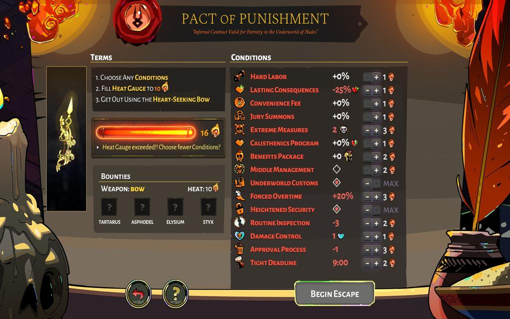</a> | `seal_hades_pact_heat16_screen.jpg` Hades, Pact of Punishment at Heat 16: each Condition is a row with its current effect (+20%, -25%, 9:00), -/+ rank buttons and its Heat cost; the gauge is over the Heat this weapon's next Bounty asks for (10). | [page](https://steamcommunity.com/sharedfiles/filedetails/?id=2907475969) · [image](https://images.steamusercontent.com/ugc/5081780833999848237/73A4268609581C9CAF4008452EE44109C553C089/) |
| <a href="seal_hades_pact_conditions_ranks_crop.jpg">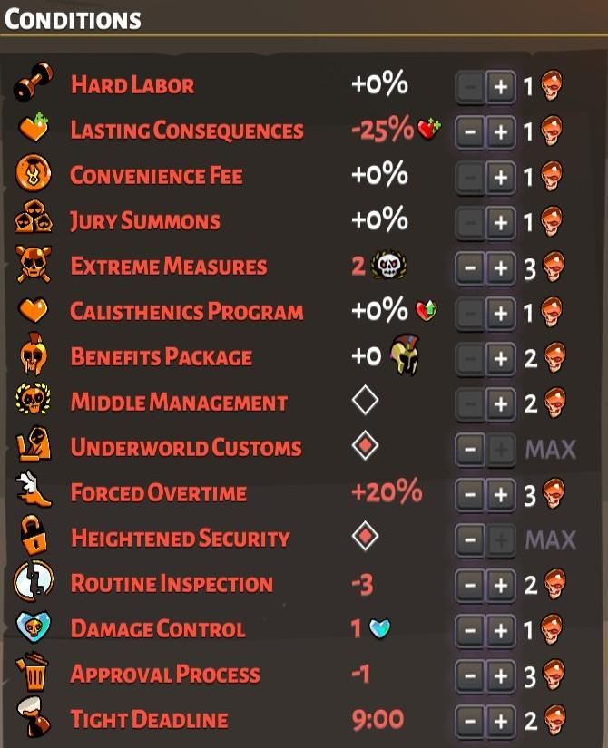</a> | `seal_hades_pact_conditions_ranks_crop.jpg` Crop: the Conditions list, one rule per row, effect value in red when taken, rank stepper, Heat per rank, MAX when capped. Cropped from the same source as `seal_hades_pact_heat16_screen.jpg`. | [page](https://steamcommunity.com/sharedfiles/filedetails/?id=2907475969) · [image](https://images.steamusercontent.com/ugc/5081780833999848237/73A4268609581C9CAF4008452EE44109C553C089/) |
| <a href="seal_hades_pact_heat_gauge_bounty_crop.jpg">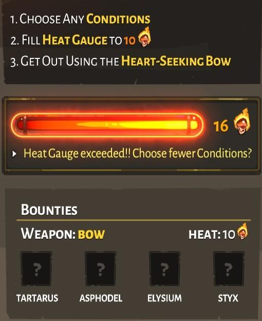</a> | `seal_hades_pact_heat_gauge_bounty_crop.jpg` Crop: the Terms (choose Conditions, fill the Heat gauge to 10, escape with this weapon), the Heat gauge reading 16 and 'Heat Gauge exceeded!! Choose fewer Conditions?', and the per-region Bounties strip. Cropped from the same source as `seal_hades_pact_heat16_screen.jpg`. | [page](https://steamcommunity.com/sharedfiles/filedetails/?id=2907475969) · [image](https://images.steamusercontent.com/ugc/5081780833999848237/73A4268609581C9CAF4008452EE44109C553C089/) |
| <a href="seal_hades_pact_bounties_by_region_crop.jpg">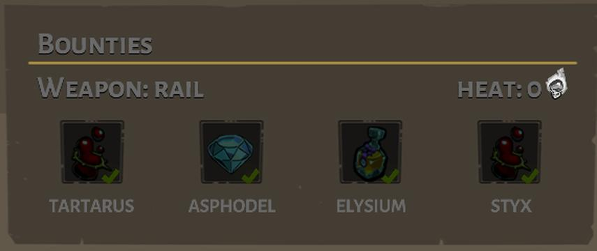</a> | `seal_hades_pact_bounties_by_region_crop.jpg` Crop (wiki screenshot at Heat 0): the Bounties panel, the reward each region pays the first time it is cleared with this weapon at this Heat (Titan Blood, Diamond, Ambrosia), ticked when claimed. Cropped (and where marked, enlarged) from the source image. | [page](https://hades.fandom.com/wiki/File:PactInterface.png) · [image](https://static.wikia.nocookie.net/hades_gamepedia_en/images/c/c4/PactInterface.png/revision/latest?cb=20200713172120&format=original) |
| <a href="seal_hades2_oath_of_unseen_screen.jpg">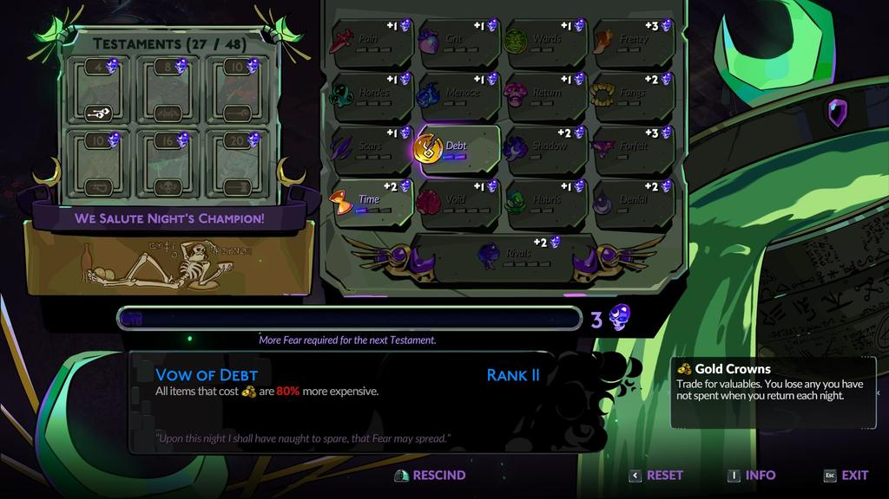</a> | `seal_hades2_oath_of_unseen_screen.jpg` Hades II, Oath of the Unseen: a grid of Vows, each tile with its Fear per rank (+1, +2, +3) and rank pips; the Fear bar toward the next Testament (a reward tier) runs along the bottom. | [page](https://hades.fandom.com/wiki/File:OathInterface.png) · [image](https://static.wikia.nocookie.net/hades_gamepedia_en/images/5/5d/OathInterface.png/revision/latest?cb=20251026051627&format=original) |
| <a href="seal_hades2_oath_vow_rank_fear_crop.jpg">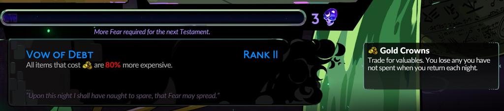</a> | `seal_hades2_oath_vow_rank_fear_crop.jpg` Crop: the selected Vow's card (Vow of Debt, Rank II: 'All items that cost Gold are 80% more expensive.') with the number in red, the Fear total (3) and 'More Fear required for the next Testament.' Cropped from the same source as `seal_hades2_oath_of_unseen_screen.jpg`. | [page](https://hades.fandom.com/wiki/File:OathInterface.png) · [image](https://static.wikia.nocookie.net/hades_gamepedia_en/images/5/5d/OathInterface.png/revision/latest?cb=20251026051627&format=original) |
| <a href="seal_poe_map_tooltips_quantity_rarity_pack.jpg">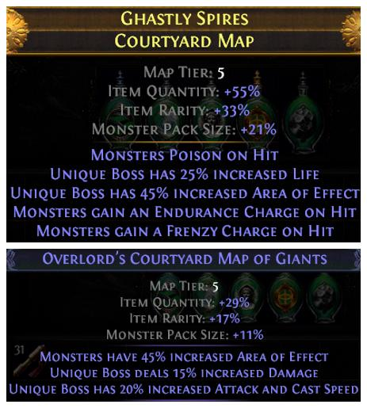</a> | `seal_poe_map_tooltips_quantity_rarity_pack.jpg` Path of Exile map tooltips, a rare map and a magic map of the same tier: the totals block (Item Quantity +55%, Item Rarity +33%, Monster Pack Size +21%) sits above the list of handicaps that earned it, so more mods reads as more pay. | [page](https://www.poe-vault.com/guides/atlas-of-worlds-map-guide) · [image](https://www.poe-vault.com/uploads/2025/10/30/EqAM5dugx2UelqmCivuKEzpUSIYxgFTSxxgdXNEi.png) |
| <a href="seal_poe_map_tooltips_t16_comparison.jpg">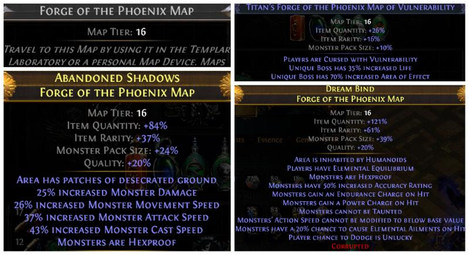</a> | `seal_poe_map_tooltips_t16_comparison.jpg` Path of Exile, four tier-16 maps of one base with different modifiers: the Quantity/Rarity/Pack Size totals move with the number and kind of handicaps listed below them. | [page](https://www.poe-vault.com/guides/atlas-of-worlds-map-guide) · [image](https://www.poe-vault.com/uploads/2025/10/30/tkfhSqIBruCxrelbwDpQi2lbSMHQkiLaCYkClqKl.png) |
| <a href="seal_poe_map_device_crafting_options.jpg">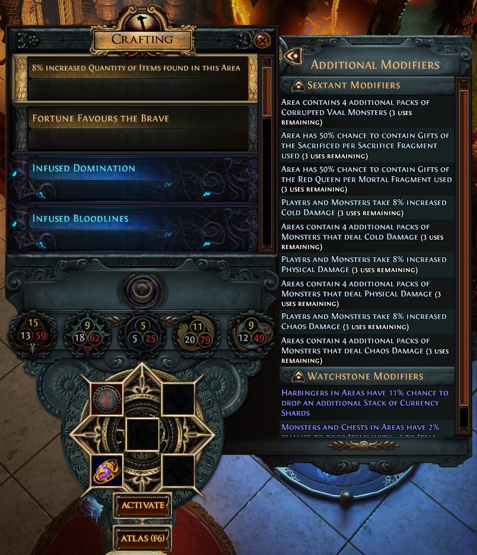</a> | `seal_poe_map_device_crafting_options.jpg` Path of Exile, Map Device crafting: a paid option ('8% increased Quantity of Items found in this Area') and modifiers that pair a danger with a payoff ('Players and Monsters take 8% increased Cold Damage', 'Area contains 4 additional packs...'), each with uses remaining. | [page](https://pathofexile.fandom.com/wiki/File:Map_Device_Crafting_interface.png) · [image](https://static.wikia.nocookie.net/pathofexile_gamepedia/images/a/a3/Map_Device_Crafting_interface.png/revision/latest?cb=20210317085626&format=original) |
| <a href="seal_d4_infernal_compass_affixes_tooltip_crop.jpg">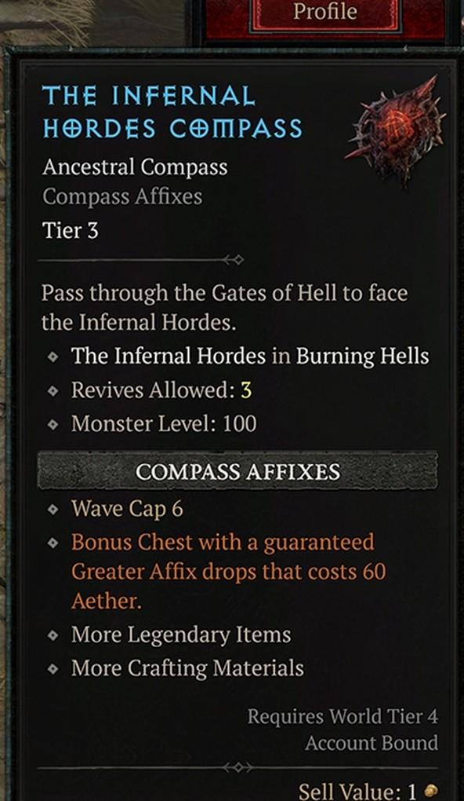</a> | `seal_d4_infernal_compass_affixes_tooltip_crop.jpg` Diablo IV, Infernal Hordes Compass tooltip (the same frame as a Nightmare Sigil): tier, revives allowed, monster level, then Compass Affixes, a harder rule (Wave Cap 6) next to what it pays (bonus chest, more Legendary items, more crafting materials). Cropped (and where marked, enlarged) from the source image. | [page](https://news.blizzard.com/en-us/article/24119591/slay-endless-demons-in-season-of-the-infernal-hordes) · [image](https://bnetcmsus-a.akamaihd.net/cms/page_media/Y7B4BPLKK5J71721933070920.png) |
| <a href="seal_d4_infernal_hordes_chosen_offer_crop.jpg">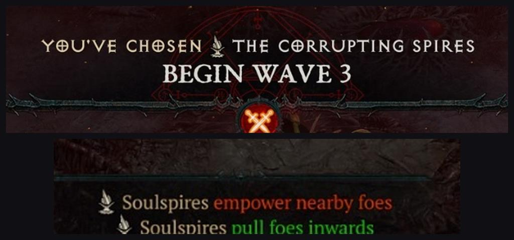</a> | `seal_d4_infernal_hordes_chosen_offer_crop.jpg` Diablo IV, Infernal Hordes, after an Infernal Offer is taken: the wave banner names the offer chosen ('You've chosen The Corrupting Spires'), and the on-screen lines give its bane in red and its boon in green ('Soulspires empower nearby foes' / 'Soulspires pull foes inwards'). Cropped (and where marked, enlarged) from the source image. | [page](https://diablo.fandom.com/wiki/File:Infernal_Hordes.jpg) · [image](https://static.wikia.nocookie.net/diablo/images/a/aa/Infernal_Hordes.jpg/revision/latest?cb=20240627132554&format=original) |
| <a href="seal_sts_burning_elite_map_node_crop_x2.jpg">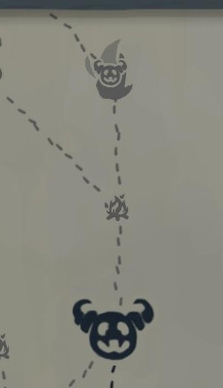</a> | `seal_sts_burning_elite_map_node_crop_x2.jpg` Slay the Spire map, enlarged: the burning (flaming) elite node at the top beside a plain elite node below; the flame is the only mark that this fight is stronger and carries the Emerald Key. Cropped (and where marked, enlarged) from the source image. | [page](https://steamcommunity.com/sharedfiles/filedetails/?id=1815304912) · [image](https://images.steamusercontent.com/ugc/786359883311221810/5815B756131E508FB19CEBB30DEDE48AEE7966E9/) |
| <a href="seal_sts_burning_elite_loot_emerald_key.jpg">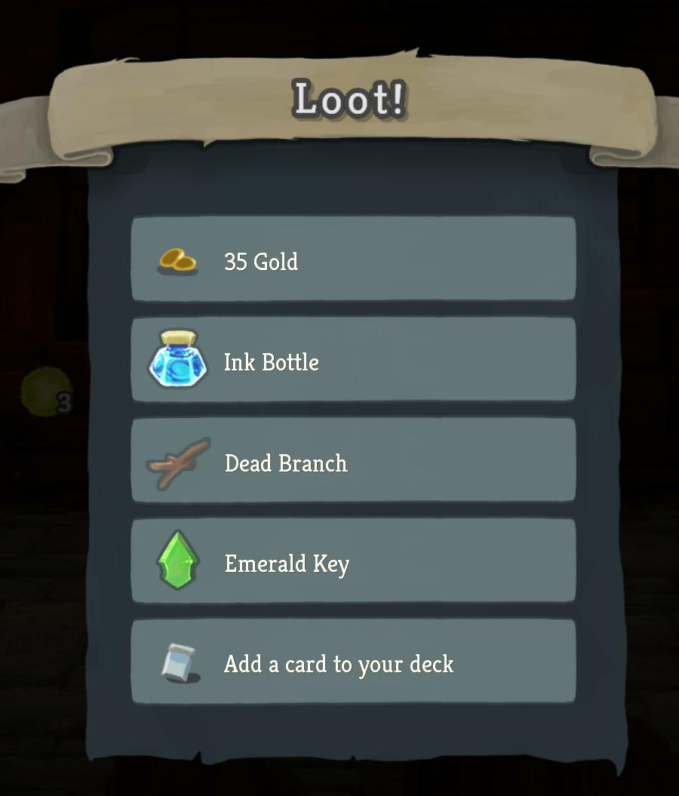</a> | `seal_sts_burning_elite_loot_emerald_key.jpg` Slay the Spire, loot after a burning elite: the usual gold, relic and card rows plus the Emerald Key, the stated extra reward for taking the harder fight. | [page](https://slaythespire.wiki.gg/wiki/File:Burning_Elite_does_not_drop_potion_with_Black_Star_(unmodded).png) · [image](https://slaythespire.wiki.gg/images/Burning_Elite_does_not_drop_potion_with_Black_Star_%28unmodded%29.png?ffe5ec) |
| <a href="seal_le_monolith_echo_corruption_screen.jpg">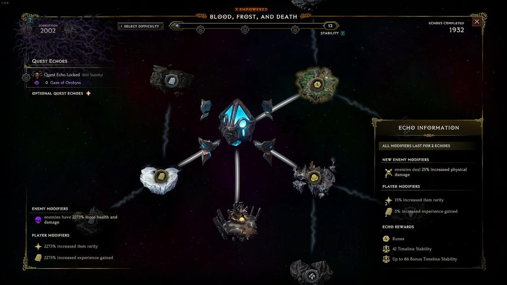</a> | `seal_le_monolith_echo_corruption_screen.jpg` Last Epoch, Monolith echo web at Corruption 2002: the running totals bottom left (enemies have 2273% more health and damage, 2273% increased item rarity and experience) and an echo's own modifiers and rewards on the right. | [page](https://steamcommunity.com/sharedfiles/filedetails/?id=3223779122) · [image](https://images.steamusercontent.com/ugc/2524905437633298971/4168E08EAC93B8C8F4FC7BC8C3F6A6951C65DD5A/) |
| <a href="seal_le_echo_information_modifiers_rewards_crop.jpg">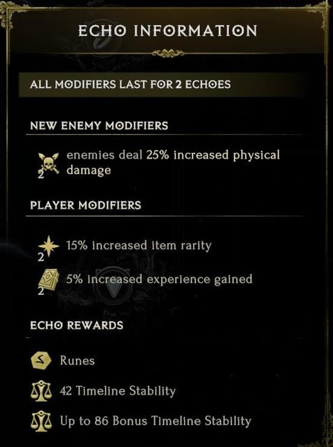</a> | `seal_le_echo_information_modifiers_rewards_crop.jpg` Crop: Echo Information, the rule and its pay in one card: 'All modifiers last for 2 echoes', New Enemy Modifiers (25% increased physical damage), Player Modifiers (15% item rarity, 5% experience), Echo Rewards. Cropped from the same source as `seal_le_monolith_echo_corruption_screen.jpg`. | [page](https://steamcommunity.com/sharedfiles/filedetails/?id=3223779122) · [image](https://images.steamusercontent.com/ugc/2524905437633298971/4168E08EAC93B8C8F4FC7BC8C3F6A6951C65DD5A/) |
| <a href="seal_mcd_mission_difficulty_slider_screen.jpg">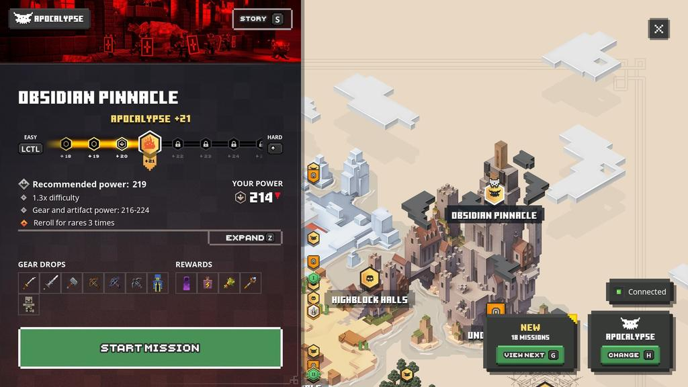</a> | `seal_mcd_mission_difficulty_slider_screen.jpg` Minecraft Dungeons, mission select on Apocalypse +21: the threat slider runs Easy to Hard, and the panel lists what that notch means (recommended power, 1.3x difficulty, gear power 216-224, reroll for rares 3 times), with the gear drops and rewards below. | [page](https://steamcommunity.com/sharedfiles/filedetails/?id=3634806639) · [image](https://images.steamusercontent.com/ugc/10812304963446732050/00850C51C105964FC97649C4AA4CA3C2EAE13F3F/) |
| <a href="seal_mcd_difficulty_slider_drops_crop.jpg">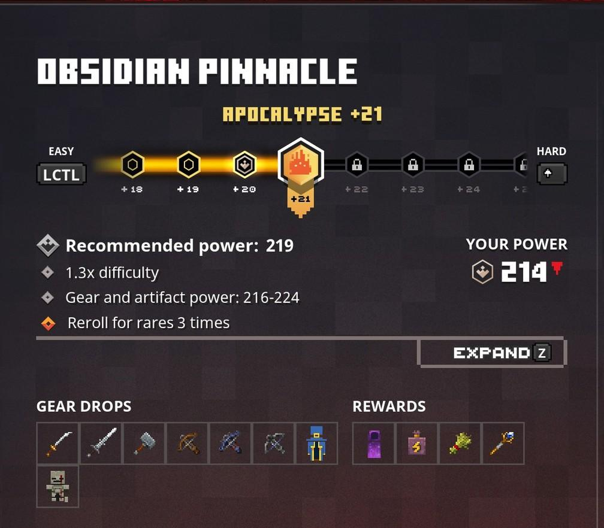</a> | `seal_mcd_difficulty_slider_drops_crop.jpg` Crop: the threat slider with locked notches ahead, the difficulty multiplier and gear power that rise with it, your power against the recommended one (red arrow when short), and the drop table. Cropped from the same source as `seal_mcd_mission_difficulty_slider_screen.jpg`. | [page](https://steamcommunity.com/sharedfiles/filedetails/?id=3634806639) · [image](https://images.steamusercontent.com/ugc/10812304963446732050/00850C51C105964FC97649C4AA4CA3C2EAE13F3F/) |
| <a href="seal_mt_customize_challenge_mutators_covenant_crop.jpg">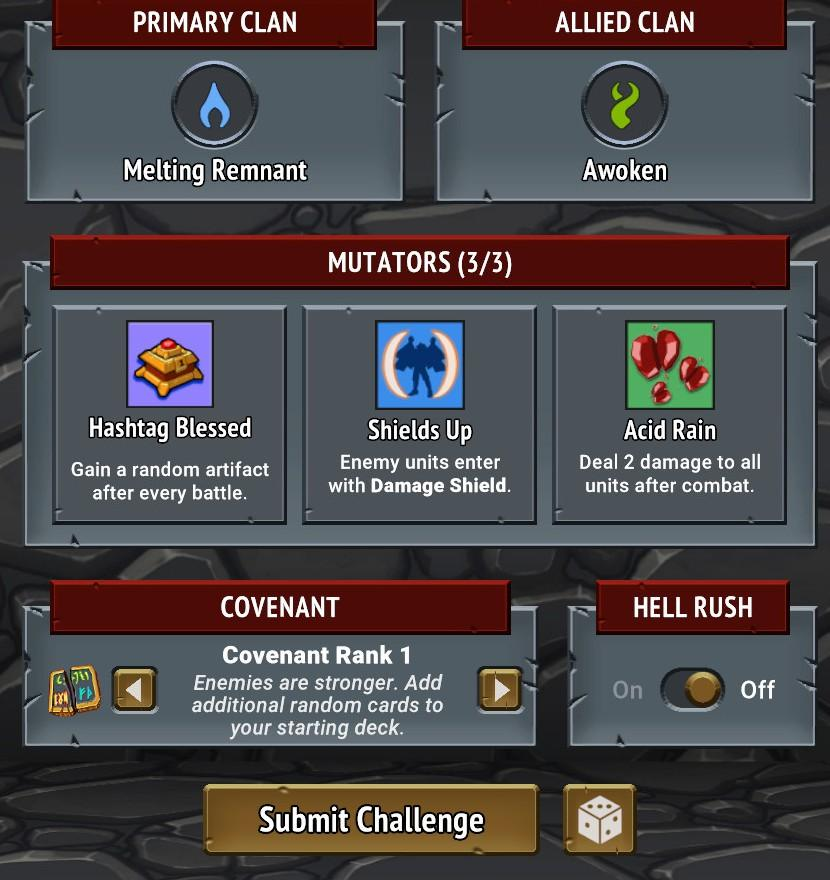</a> | `seal_mt_customize_challenge_mutators_covenant_crop.jpg` Monster Train, Customize Challenge: three Mutators (each a rule card such as 'Shields Up: enemy units enter with Damage Shield'), a Covenant rank stepper with its rule ('Enemies are stronger. Add additional random cards to your starting deck.') and a Hell Rush toggle. Cropped (and where marked, enlarged) from the source image. | [page](https://store.steampowered.com/app/1102190/) · [image](https://shared.akamai.steamstatic.com/store_item_assets/steam/apps/1102190/ss_482b7d543a1e5773eb469b4702258b7eb34f2da1.1920x1080.jpg?t=1779381275) |
| <a href="seal_mt_covenant_rank_up_crop.jpg">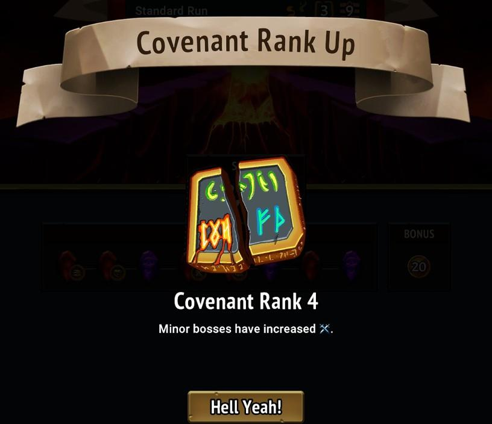</a> | `seal_mt_covenant_rank_up_crop.jpg` Monster Train, Covenant Rank Up after a win: the next rank and the one rule it adds ('Minor bosses have increased' health). Cropped (and where marked, enlarged) from the source image. | [page](https://steamcommunity.com/sharedfiles/filedetails/?id=2895718871) · [image](https://images.steamusercontent.com/ugc/1978798788281041712/88CC28084D23D7D056778EF4F0B8B86F180C3BA7/) |

## Feats

Stated objectives on a fight. Into the Breach's bonus objectives and Solo Leveling: Arise's Reward Missions are three per mission, each with its reward, ticked when met; Genshin's Spiral Abyss and Rogue Legacy 2 grade against a par. ARISE took three Feats to each Gate, a star to each that turns gold once met, and the board's row of stars.

| | What it shows | Source |
|---|---|---|
| <a href="feat_itb_island_mission_bonus_objectives.jpg">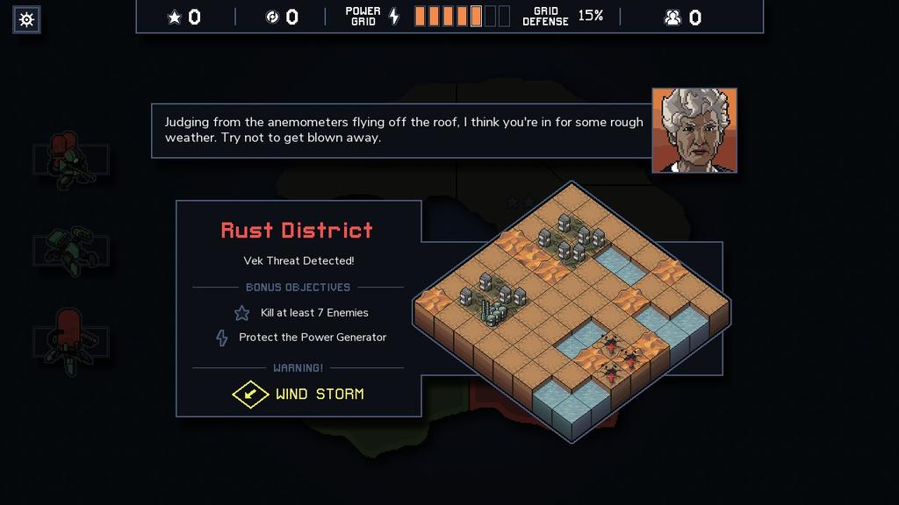</a> | `feat_itb_island_mission_bonus_objectives.jpg` Into the Breach, mission preview on the island map: the region, the threat, two Bonus Objectives each with its reward icon (star = reputation, lightning = grid power) and a warning for the map's hazard. | [page](https://store.steampowered.com/app/590380/) · [image](https://shared.akamai.steamstatic.com/store_item_assets/steam/apps/590380/ss_82cfc5241c4a093091fbd7d2e124a52a57930527.1920x1080.jpg?t=1755610784) |
| <a href="feat_itb_mission_preview_bonus_objectives_crop_x2.jpg">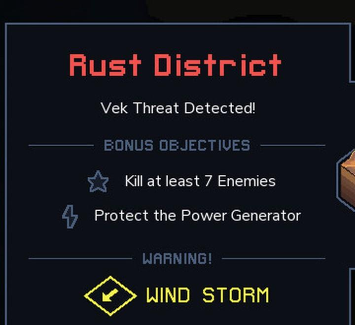</a> | `feat_itb_mission_preview_bonus_objectives_crop_x2.jpg` Crop: 'Rust District / Vek Threat Detected / BONUS OBJECTIVES: Kill at least 7 Enemies, Protect the Power Generator / WARNING: Wind Storm'. Cropped from the same source as `feat_itb_island_mission_bonus_objectives.jpg`. | [page](https://store.steampowered.com/app/590380/) · [image](https://shared.akamai.steamstatic.com/store_item_assets/steam/apps/590380/ss_82cfc5241c4a093091fbd7d2e124a52a57930527.1920x1080.jpg?t=1755610784) |
| <a href="feat_itb_bonus_objectives_panel_ingame.jpg">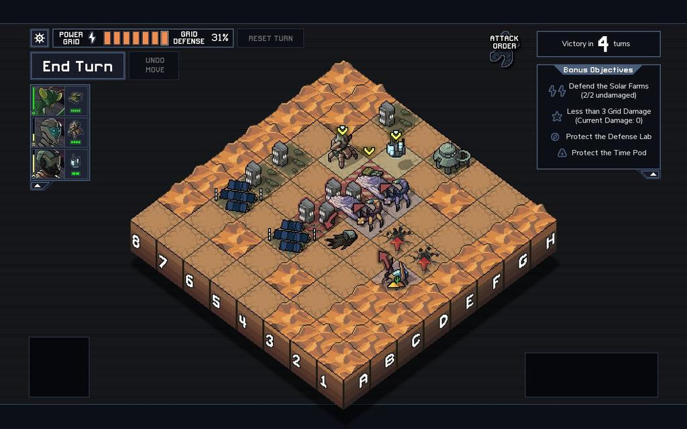</a> | `feat_itb_bonus_objectives_panel_ingame.jpg` Into the Breach in a mission: the Bonus Objectives panel sits top right under 'Victory in 4 turns' for the whole fight. | [page](https://steamcommunity.com/sharedfiles/filedetails/?id=1858308734) · [image](https://images.steamusercontent.com/ugc/787489507721439209/F3BBC0E29BA327ABD22404996862844FCED772B0/) |
| <a href="feat_itb_bonus_objectives_panel_crop_x2.jpg">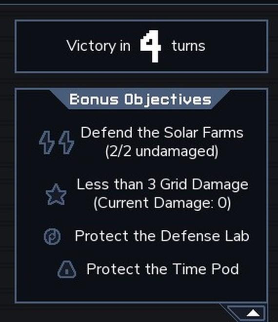</a> | `feat_itb_bonus_objectives_panel_crop_x2.jpg` Crop: each objective shows its live state ('Defend the Solar Farms (2/2 undamaged)', 'Less than 3 Grid Damage (Current Damage: 0)') beside its reward icon. Cropped from the same source as `feat_itb_bonus_objectives_panel_ingame.jpg`. | [page](https://steamcommunity.com/sharedfiles/filedetails/?id=1858308734) · [image](https://images.steamusercontent.com/ugc/787489507721439209/F3BBC0E29BA327ABD22404996862844FCED772B0/) |
| <a href="feat_itb_region_secured_stars_crop.jpg">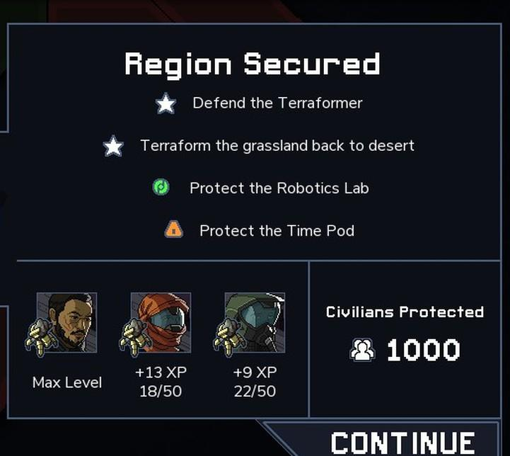</a> | `feat_itb_region_secured_stars_crop.jpg` Into the Breach, Region Secured: the objectives again, each marked with the reward it paid (stars for reputation; other icons for grid power and the time pod), then pilot XP and civilians protected. Cropped (and where marked, enlarged) from the source image. | [page](https://steamcommunity.com/sharedfiles/filedetails/?id=3443253287) · [image](https://images.steamusercontent.com/ugc/2919914780766618/C628D68C3A5EB2926AFD028CD7C6B1EF136E6A5F/) |
| <a href="feat_itb_perfect_island_free_reward_crop.jpg">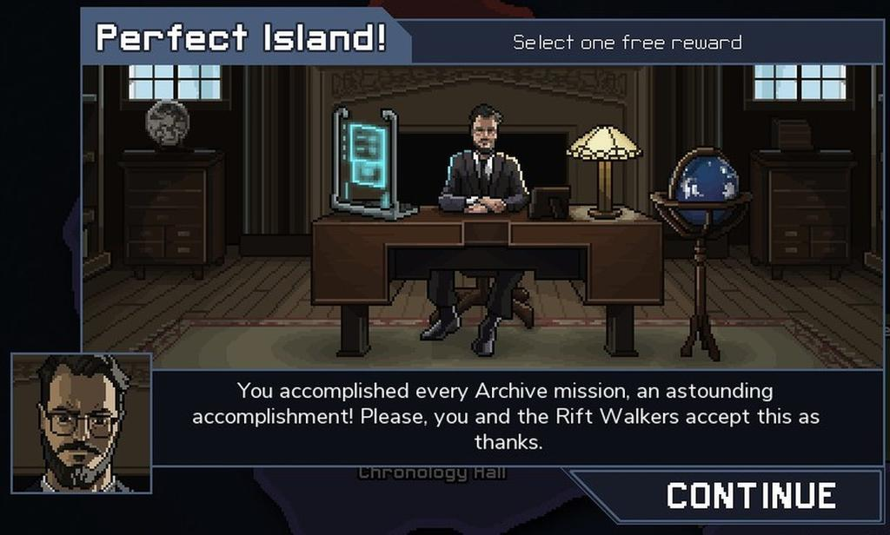</a> | `feat_itb_perfect_island_free_reward_crop.jpg` Into the Breach, Perfect Island!: meeting every objective on an island earns a free pick of reward, announced by the corporation's CEO. Cropped (and where marked, enlarged) from the source image. | [page](https://steamcommunity.com/sharedfiles/filedetails/?id=1317680050) · [image](https://images.steamusercontent.com/ugc/923673299818871605/7E84BF46EDE1861EE123311F726F3F7B4E4DB67E/) |
| <a href="feat_sla_boss_challenge_reward_missions.jpg">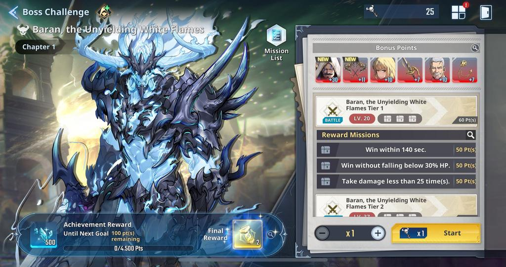</a> | `feat_sla_boss_challenge_reward_missions.jpg` Solo Leveling: Arise, Boss Challenge: the boss tiers on the right, each with three mission pips, and the selected tier's Reward Missions listed under it. | [page](https://solo-leveling-arise.fandom.com/wiki/File:2nd_Anniversary!_Dawn_of_the_Clash_Event_Hunter_Challenge_Menu.png) · [image](https://static.wikia.nocookie.net/solo-leveling-arise/images/7/76/2nd_Anniversary%21_Dawn_of_the_Clash_Event_Hunter_Challenge_Menu.png/revision/latest?cb=20260603022213&format=original) |
| <a href="feat_sla_boss_challenge_reward_missions_crop.jpg">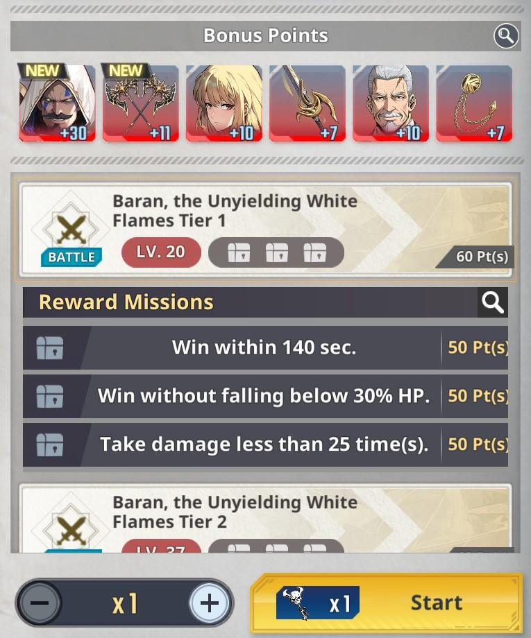</a> | `feat_sla_boss_challenge_reward_missions_crop.jpg` Crop: Reward Missions as three rows with a points value each: 'Win within 140 sec.', 'Win without falling below 30% HP', 'Take damage less than 25 time(s)', 50 Pt(s) each. Cropped from the same source as `feat_sla_boss_challenge_reward_missions.jpg`. | [page](https://solo-leveling-arise.fandom.com/wiki/File:2nd_Anniversary!_Dawn_of_the_Clash_Event_Hunter_Challenge_Menu.png) · [image](https://static.wikia.nocookie.net/solo-leveling-arise/images/7/76/2nd_Anniversary%21_Dawn_of_the_Clash_Event_Hunter_Challenge_Menu.png/revision/latest?cb=20260603022213&format=original) |
| <a href="feat_sla_boss_challenge_tiers_clear_crop.jpg">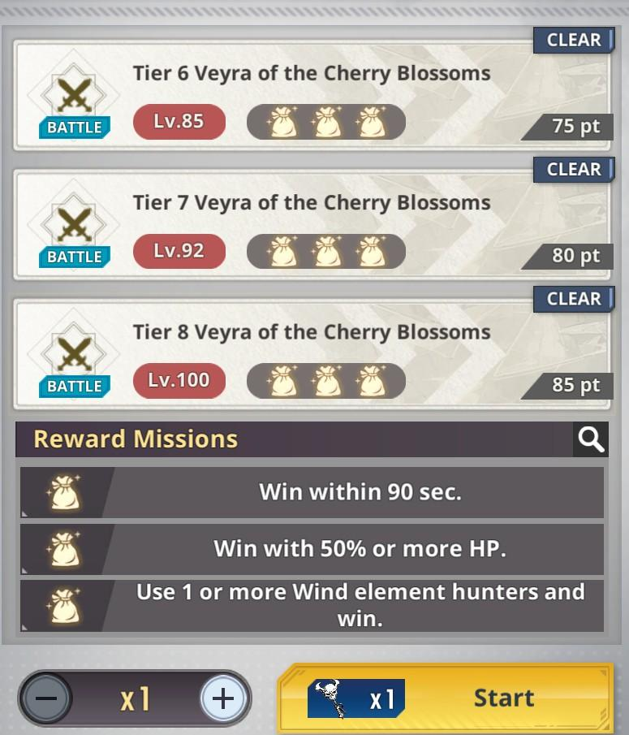</a> | `feat_sla_boss_challenge_tiers_clear_crop.jpg` Solo Leveling: Arise, a second boss: cleared tiers tagged CLEAR with their three mission pips lit, and missions mixing time, HP and party rules ('Win within 90 sec.', 'Win with 50% or more HP', 'Use 1 or more Wind element hunters and win'). Cropped (and where marked, enlarged) from the source image. | [page](https://solo-leveling-arise.fandom.com/wiki/File:Exciting_Spring_Outing_Event_Boss_Challenge_Menu.png) · [image](https://static.wikia.nocookie.net/solo-leveling-arise/images/0/07/Exciting_Spring_Outing_Event_Boss_Challenge_Menu.png/revision/latest?cb=20250408085109&format=original) |
| <a href="feat_genshin_abyss_chamber_challenge_target_par.jpg">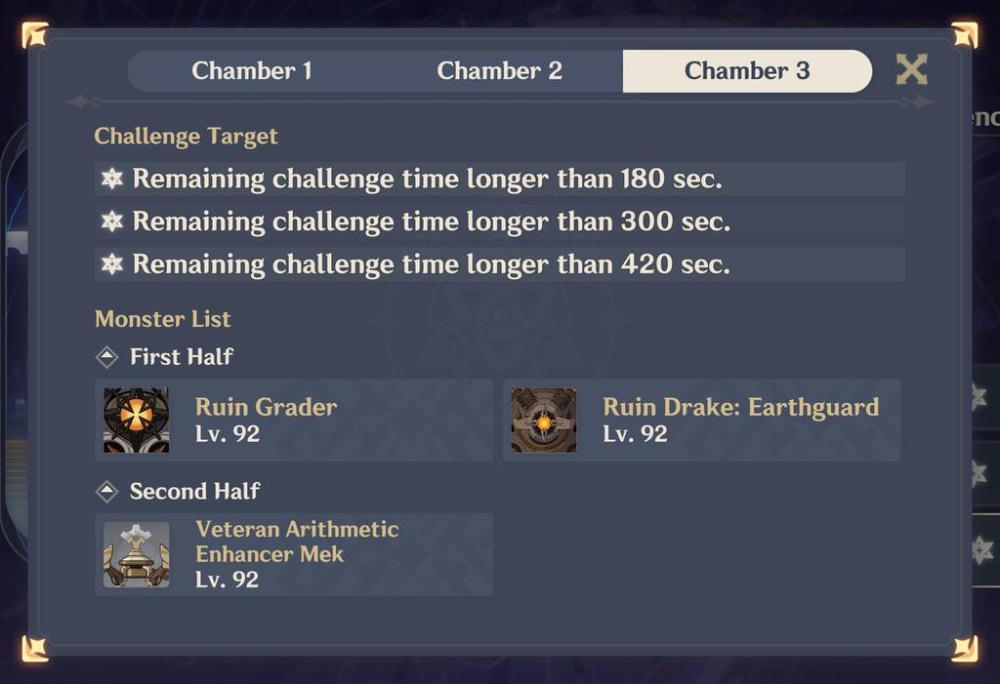</a> | `feat_genshin_abyss_chamber_challenge_target_par.jpg` Genshin Impact, Spiral Abyss chamber details: the Challenge Target is three stars set against a par ('Remaining challenge time longer than 180 / 300 / 420 sec.'), above the list of monsters in each half. | [page](https://genshin-impact.fandom.com/wiki/File:Spiral_Abyss_Chamber_Details_Menu.png) · [image](https://static.wikia.nocookie.net/gensin-impact/images/1/1e/Spiral_Abyss_Chamber_Details_Menu.png/revision/latest?cb=20250322024032&format=original) |
| <a href="feat_genshin_abyss_floor_star_targets.jpg">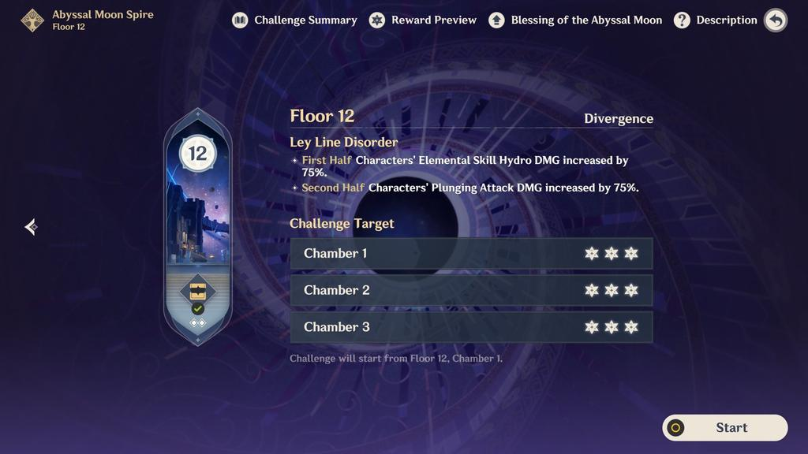</a> | `feat_genshin_abyss_floor_star_targets.jpg` Genshin Impact, Spiral Abyss floor details: the floor's modifier (Ley Line Disorder) and a Challenge Target strip with three stars per chamber. | [page](https://genshin-impact.fandom.com/wiki/File:Spiral_Abyss_Floor_Details_Menu.png) · [image](https://static.wikia.nocookie.net/gensin-impact/images/d/d2/Spiral_Abyss_Floor_Details_Menu.png/revision/latest?cb=20250322020444&format=original) |
| <a href="feat_genshin_abyss_stars_bounty.jpg">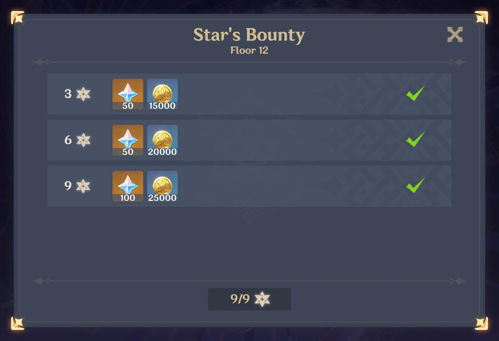</a> | `feat_genshin_abyss_stars_bounty.jpg` Genshin Impact, Star's Bounty: rewards unlocked by the star total on a floor (3, 6, 9 stars), each row ticked when reached, 9/9 at the foot. | [page](https://genshin-impact.fandom.com/wiki/File:Spiral_Abyss_Star%27s_Bounty.png) · [image](https://static.wikia.nocookie.net/gensin-impact/images/2/25/Spiral_Abyss_Star%27s_Bounty.png/revision/latest?cb=20250322023747&format=original) |
| <a href="feat_hades2_chaos_trial_clears_best_time_reward.jpg">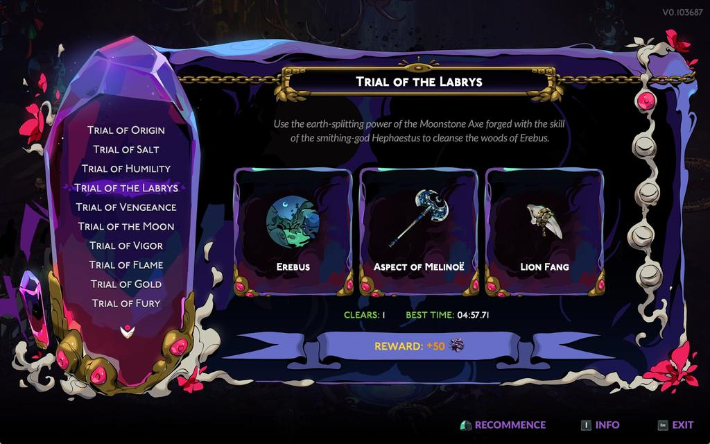</a> | `feat_hades2_chaos_trial_clears_best_time_reward.jpg` Hades II, Chaos Trials: a fixed challenge (region, weapon aspect, keepsake) with its record kept on the card (Clears: 1, Best Time) and its reward stated on a ribbon ('Reward: +50'). | [page](https://hades.fandom.com/wiki/File:Chaos_Trials_UI.png) · [image](https://static.wikia.nocookie.net/hades_gamepedia_en/images/7/79/Chaos_Trials_UI.png/revision/latest?cb=20250122121232&format=original) |
| <a href="feat_hades_fated_list_harsh_conditions.jpg">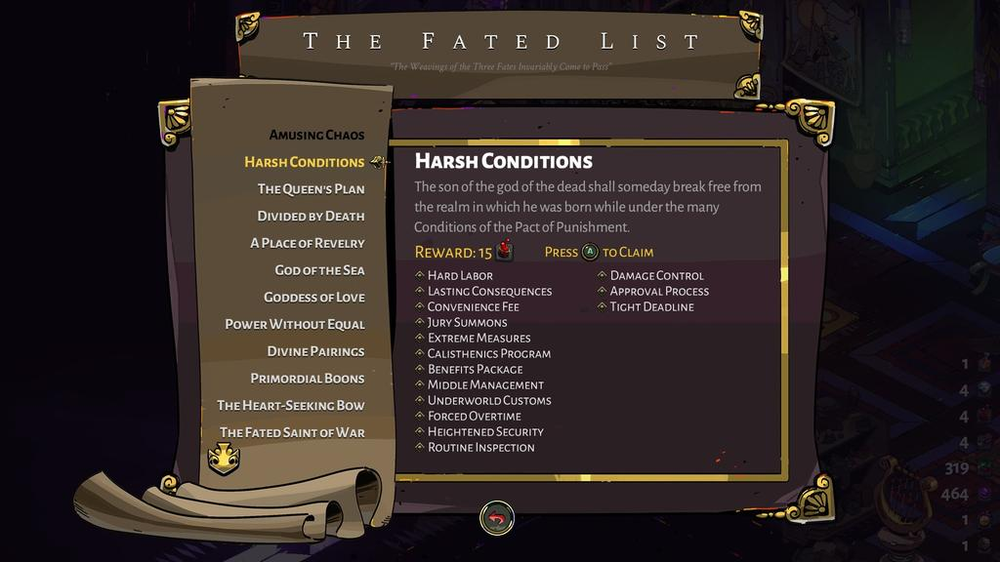</a> | `feat_hades_fated_list_harsh_conditions.jpg` Hades, Fated List prophecy 'Harsh Conditions': an objective stated in one sentence, a checklist of the Pact Conditions each ticked when escaped under, and its reward (15 Titan Blood) with 'Press to claim'. | [page](https://steamcommunity.com/sharedfiles/filedetails/?id=2274084284) · [image](https://images.steamusercontent.com/ugc/1693877386905933057/FFC2F55C8F84900881C6A8D5708A4DF4FE5146E7/) |
| <a href="feat_hades_victory_heat_best_per_weapon_crop.jpg">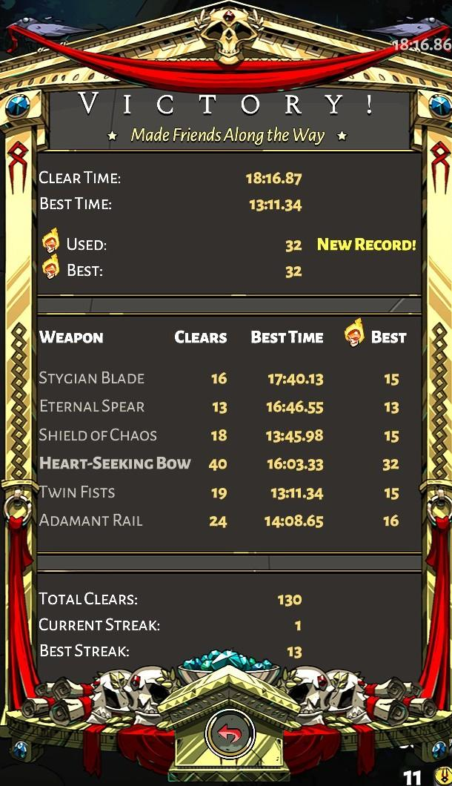</a> | `feat_hades_victory_heat_best_per_weapon_crop.jpg` Hades, Victory panel: clear time against best time, Heat used against best Heat ('New Record!'), and a per-weapon table of clears, best time and best Heat, the record a challenge would be graded against. Cropped (and where marked, enlarged) from the source image. | [page](https://steamcommunity.com/sharedfiles/filedetails/?id=3518297374) · [image](https://images.steamusercontent.com/ugc/15396790771730624595/6A9804C78B5333611B3914868717AFFC9EAA68B1/) |
| <a href="feat_sts_victory_score_bonuses_crop.jpg">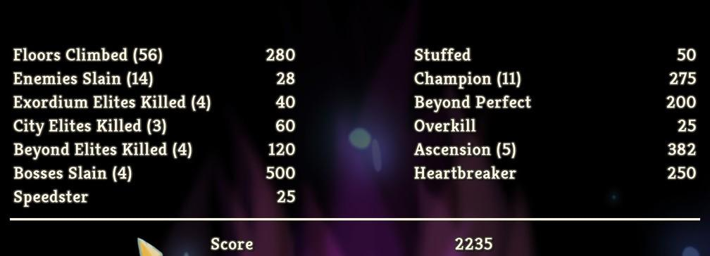</a> | `feat_sts_victory_score_bonuses_crop.jpg` Slay the Spire, Victory score screen: named feats with their points (Champion (11) 275, Beyond Perfect 200, Overkill 25, Heartbreaker 250, Speedster 25) beside the plain tallies. Cropped (and where marked, enlarged) from the source image. | [page](https://steamcommunity.com/sharedfiles/filedetails/?id=3475318534) · [image](https://images.steamusercontent.com/ugc/13347846932888918554/E66F9CF985CBF5CEE471FBF46122B5C5958E8898/) |
| <a href="feat_rl2_scars_all_gold_trophy_room.jpg">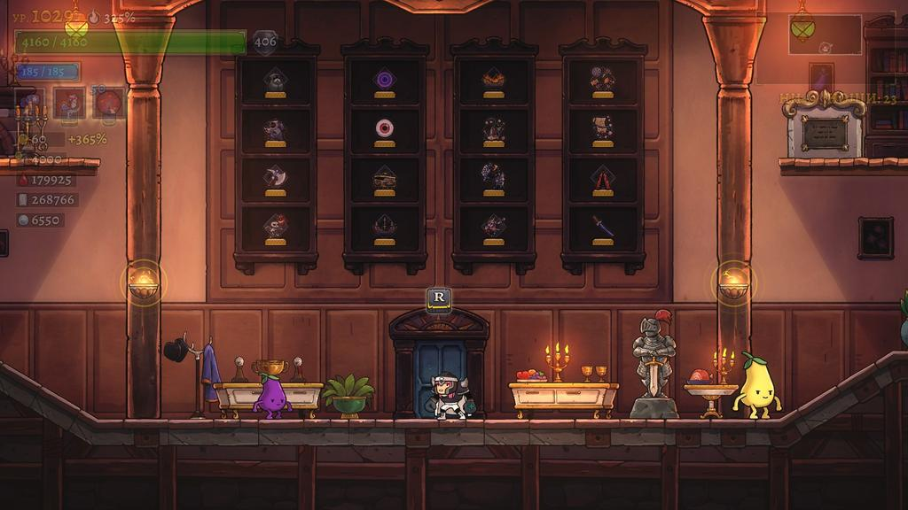</a> | `feat_rl2_scars_all_gold_trophy_room.jpg` Rogue Legacy 2, the trophy room with every Scar of Erebus at Gold: each challenge's best grade is kept as a trophy on a shelf in the hub. | [page](https://steamcommunity.com/sharedfiles/filedetails/?id=2940523256) · [image](https://images.steamusercontent.com/ugc/2049738728122995078/1AF7DD513AE443A2791D5941A211E8A6B9BD4BA0/) |

## Condition drops

A stated way to fell a creature for more. Etrian Odyssey gives each creature one condition (with fire, within three turns, while bound) and names the drop after it; Monster Hunter's reward screen says how each extra was earned. ARISE took one condition to each family and every boss, shown on the brief and as the part's glyph on the foe's card, gold while it holds.

| | What it shows | Source |
|---|---|---|
| <a href="drop_mhrise_broke_tail_reward_screen.jpg">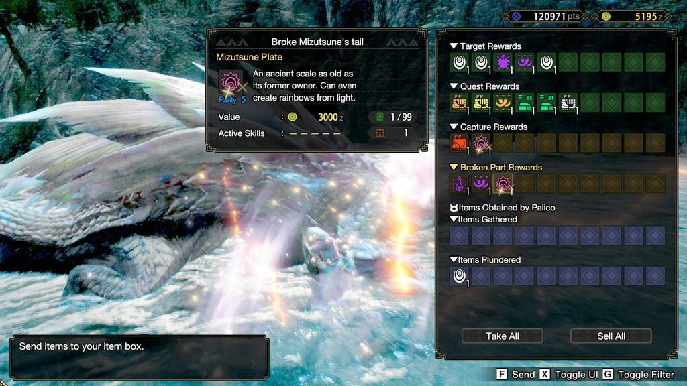</a> | `drop_mhrise_broke_tail_reward_screen.jpg` Monster Hunter Rise, quest rewards: the reward board split into Target, Quest, Capture and Broken Part Rewards, and the item card names how it was earned ('Broke Mizutsune's tail'). | [page](https://steamcommunity.com/sharedfiles/filedetails/?id=2736629187) · [image](https://images.steamusercontent.com/ugc/1842537308908822745/8ADD75EBB862FC71C7FF29C7350F118BE68A198B/) |
| <a href="drop_mhrise_broken_part_capture_rewards_crop.jpg">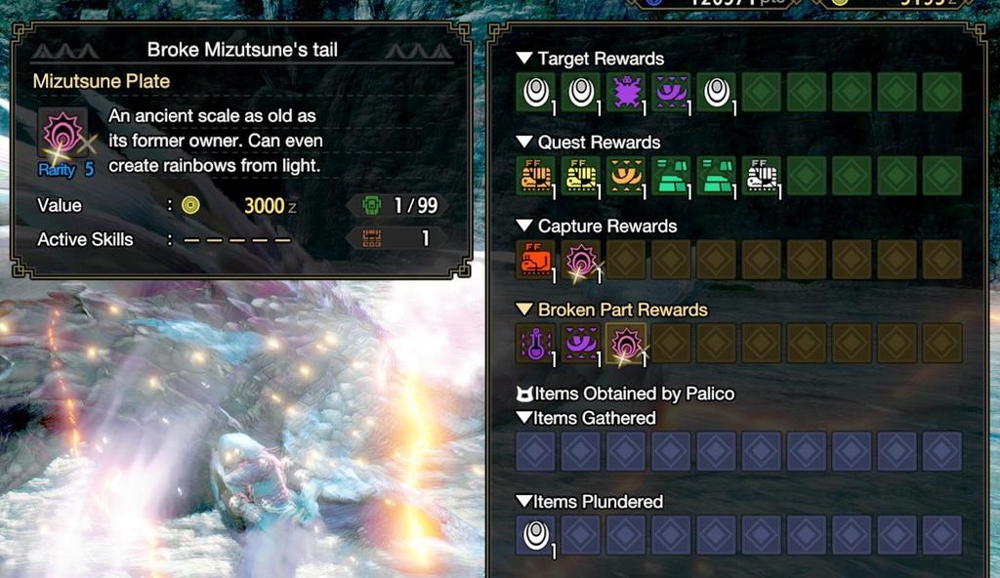</a> | `drop_mhrise_broken_part_capture_rewards_crop.jpg` Crop: 'Broke Mizutsune's tail / Mizutsune Plate' with rarity and value, beside the board's separate Capture Rewards and Broken Part Rewards rows. Cropped from the same source as `drop_mhrise_broke_tail_reward_screen.jpg`. | [page](https://steamcommunity.com/sharedfiles/filedetails/?id=2736629187) · [image](https://images.steamusercontent.com/ugc/1842537308908822745/8ADD75EBB862FC71C7FF29C7350F118BE68A198B/) |
| <a href="drop_mhrise_broke_horn_orb_of_origin_crop.jpg">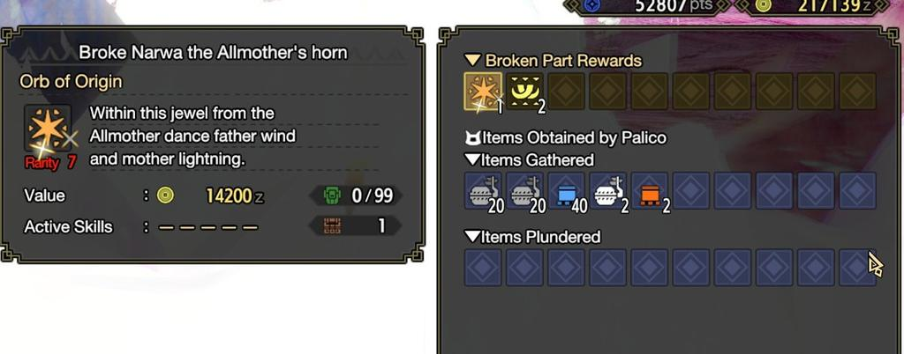</a> | `drop_mhrise_broke_horn_orb_of_origin_crop.jpg` Monster Hunter Rise: a boss's rarest material credited to the break that earned it ('Broke Narwa the Allmother's horn / Orb of Origin', Rarity 7) under Broken Part Rewards. Cropped (and where marked, enlarged) from the source image. | [page](https://steamcommunity.com/sharedfiles/filedetails/?id=2822829179) · [image](https://images.steamusercontent.com/ugc/1859438430148347235/89C7E9CF78F4D18FBB334D1ADF0D01EF55D60C7C/) |
| <a href="drop_mhrise_capture_tutorial_rare_materials_crop.jpg">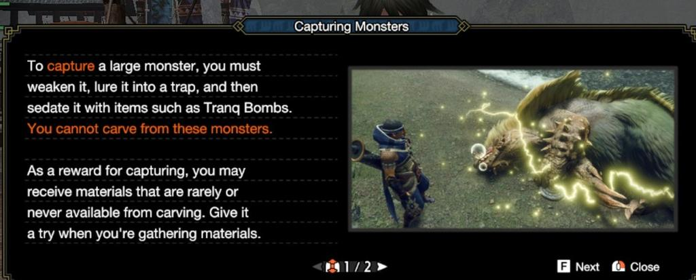</a> | `drop_mhrise_capture_tutorial_rare_materials_crop.jpg` Monster Hunter Rise, the Capturing Monsters tip: how to capture (weaken, trap, tranquilize), what it costs (no carves) and what it pays ('materials that are rarely or never available from carving'). Cropped (and where marked, enlarged) from the source image. | [page](https://steamcommunity.com/sharedfiles/filedetails/?id=3809109778) · [image](https://images.steamusercontent.com/ugc/12192295722181106404/811F5FF8D46EC2446F81C88D8773E35B550FD2A0/) |
| <a href="drop_mhwilds_quest_rewards_bonus_target_crop.jpg">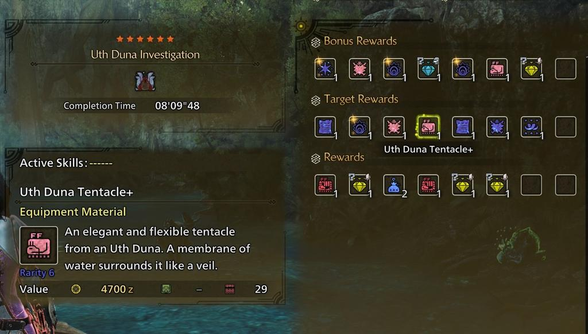</a> | `drop_mhwilds_quest_rewards_bonus_target_crop.jpg` Monster Hunter Wilds, quest rewards: completion time and star rank on the left, the board split into Bonus, Target and plain Rewards, with the selected item's card. Cropped (and where marked, enlarged) from the source image. | [page](https://steamcommunity.com/sharedfiles/filedetails/?id=3473835941) · [image](https://images.steamusercontent.com/ugc/14437043766416605211/6ADD90B7DC32D9A584D7145AC864F6075FE29CFB/) |
