# Step 5: Shrines and rests

The references for Shrines rebuilt around the five Paths and rests that offer a choice, the fifth step of the
order to build in [docs/DESIGN.md](../../../DESIGN.md#shrines-and-rests--built).

Every image belongs to the game's publisher, or to the wiki, site or player who captured it, as listed beside it. They are kept here as design reference only: nothing in ARISE copies their art, and none of them ships with the game.

## Shrines

A few blessings from one source, and the run keeps the one taken. Hades and Hades II offer three boons from one god in one window: the god's sign at its top left, a row to each boon with its icon, its name and its rarity in a fixed colour (Common white, Rare blue, Epic purple, Heroic red, Legendary orange, Duo green), its line and the number it sets, the old value beside the new where it replaces one, and the terms it uses explained at the side. A Pom of Power raises one boon already held, each row reading its level and its number before and after. Enter the Gungeon's shrine states its price in a text box, and Dead Cells' scroll lays three colour-coded stat paths side by side. ARISE can take the window to a shrine: its Path's sign, three blessings each with its tier in a fixed colour and the number it changes, and a Deepen room drawn as the Pom is, one blessing's tier before and after.

| | What it shows | Source |
|---|---|---|
| <a href="shrine_hades_boon_choice_athena.jpg">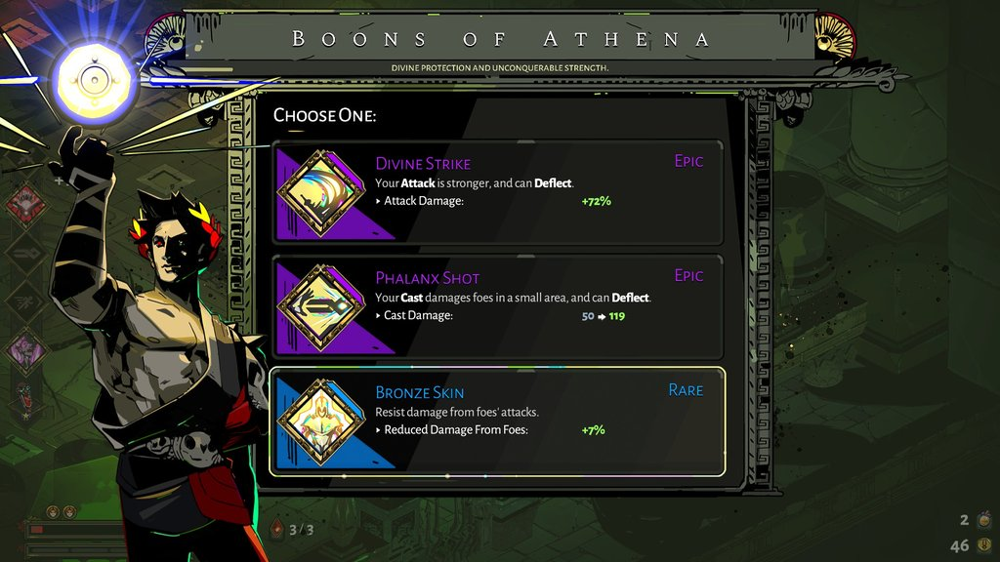</a> | `shrine_hades_boon_choice_athena.jpg` Hades, Boons of Athena: the god's sign held up at top left, her line under the title ('Divine protection and unconquerable strength.'), and 'Choose One:' over three rows: Divine Strike and Phalanx Shot (Epic) and Bronze Skin (Rare). | [page](https://steamcommunity.com/sharedfiles/filedetails/?id=3798429756) · [image](https://images.steamusercontent.com/ugc/9967430282610893829/13C21C0A0F6307487E690555A4E78369962DFDCA/) |
| <a href="shrine_hades_boon_cards_rarity_crop.jpg">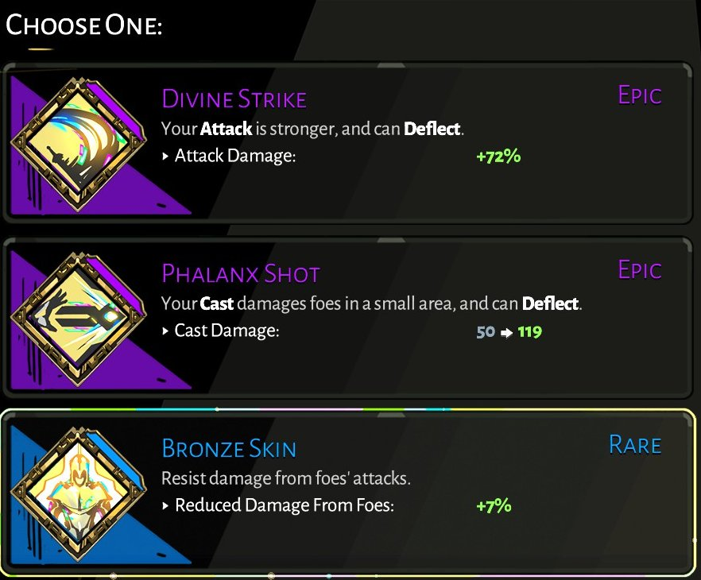</a> | `shrine_hades_boon_cards_rarity_crop.jpg` Crop: each row's rarity in its colour, the icon's frame tinted to match (purple Epic, blue Rare), one line ('Your Attack is stronger, and can Deflect.') and one number ('Attack Damage: +72%'); Phalanx Shot shows the value it replaces, 'Cast Damage: 50 → 119'. Cropped from the same source as `shrine_hades_boon_choice_athena.jpg`. | [page](https://steamcommunity.com/sharedfiles/filedetails/?id=3798429756) · [image](https://images.steamusercontent.com/ugc/9967430282610893829/13C21C0A0F6307487E690555A4E78369962DFDCA/) |
| <a href="shrine_hades_boon_choice_zeus_duo_legendary.jpg">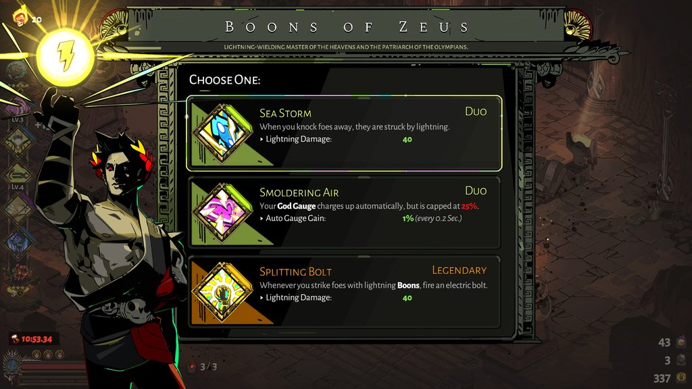</a> | `shrine_hades_boon_choice_zeus_duo_legendary.jpg` Hades, Boons of Zeus offering two Duo boons and a Legendary at once: Sea Storm and Smoldering Air (Duo, green) and Splitting Bolt (Legendary, orange). | [page](https://steamcommunity.com/sharedfiles/filedetails/?id=3779360322) · [image](https://images.steamusercontent.com/ugc/15516660771249219317/806A5E5E0BF3E9E70ABBC1D2C0EBF4AF2FC068C6/) |
| <a href="shrine_hades_duo_legendary_cards_crop.jpg">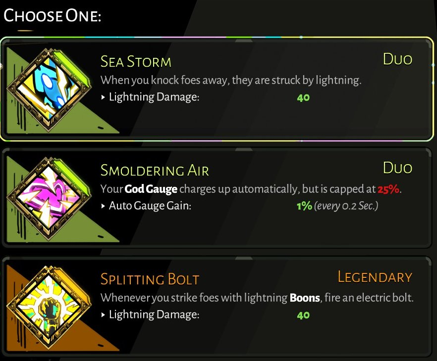</a> | `shrine_hades_duo_legendary_cards_crop.jpg` Crop: 'Sea Storm: When you knock foes away, they are struck by lightning.', 'Smoldering Air: Your God Gauge charges up automatically, but is capped at 25%.' with its cost in red, and 'Splitting Bolt: Whenever you strike foes with lightning Boons, fire an electric bolt.' Cropped from the same source as `shrine_hades_boon_choice_zeus_duo_legendary.jpg`. | [page](https://steamcommunity.com/sharedfiles/filedetails/?id=3779360322) · [image](https://images.steamusercontent.com/ugc/15516660771249219317/806A5E5E0BF3E9E70ABBC1D2C0EBF4AF2FC068C6/) |
| <a href="shrine_hades_boon_choice_aphrodite_keywords.jpg">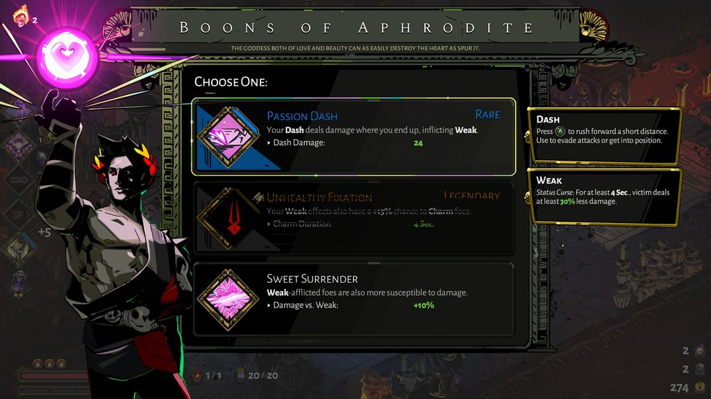</a> | `shrine_hades_boon_choice_aphrodite_keywords.jpg` Hades, Boons of Aphrodite: Passion Dash (Rare) selected, Unhealthy Fixation (Legendary) drawn faded in this capture, Sweet Surrender; the terms the selected row uses explained in boxes at the side. | [page](https://steamcommunity.com/sharedfiles/filedetails/?id=3791664707) · [image](https://images.steamusercontent.com/ugc/18140237832219179345/1374BBF7DD2A18EBC1DBA03BF0C23BCD0482A7DF/) |
| <a href="shrine_hades_faded_legendary_keyword_tooltips_crop.jpg">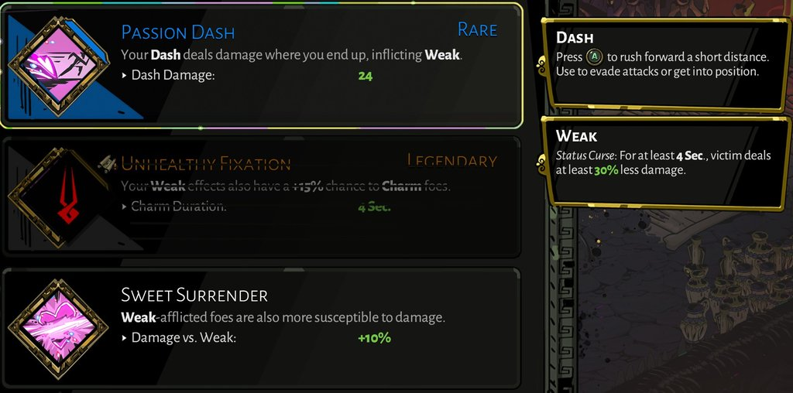</a> | `shrine_hades_faded_legendary_keyword_tooltips_crop.jpg` Crop: the faded Legendary row ('Your Weak effects also have a +13% chance to Charm foes.') between two plain rows, and the glossary boxes for the selected row: 'Dash' and 'Weak: Status Curse: For at least 4 Sec., victim deals at least 30% less damage.' Cropped from the same source as `shrine_hades_boon_choice_aphrodite_keywords.jpg`. | [page](https://steamcommunity.com/sharedfiles/filedetails/?id=3791664707) · [image](https://images.steamusercontent.com/ugc/18140237832219179345/1374BBF7DD2A18EBC1DBA03BF0C23BCD0482A7DF/) |
| <a href="shrine_hades_pom_of_power_choice.jpg">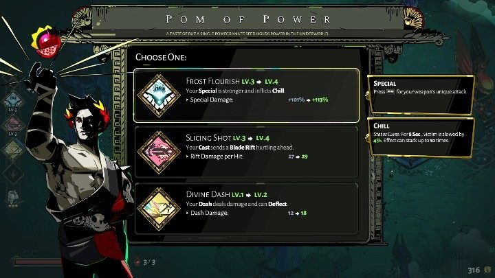</a> | `shrine_hades_pom_of_power_choice.jpg` Hades, Pom of Power: the same window as a boon offer, titled for the Pom, with 'Choose One:' over three boons already held and the glossary at the side ('Special', 'Chill'). | [page](https://www.gamepressure.com/hades/pom-of-power/z2d9cb) · [image](https://www.gamepressure.com/hades/gfx/word/544262546.jpg) |
| <a href="shrine_hades_pom_of_power_levels_crop_x2.jpg">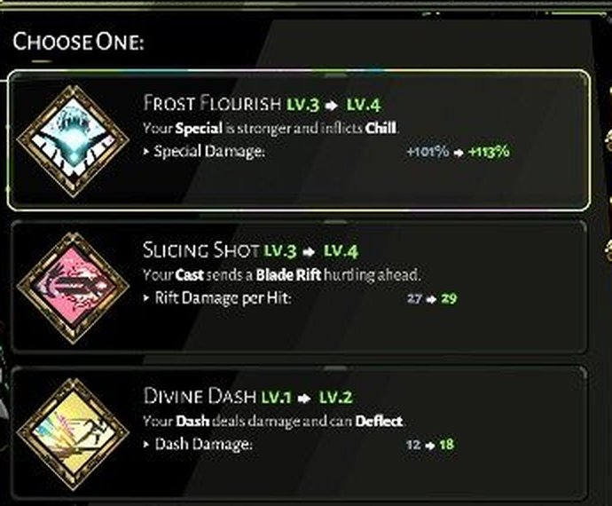</a> | `shrine_hades_pom_of_power_levels_crop_x2.jpg` Crop: each row's level and number before and after: 'Frost Flourish Lv.3 → Lv.4', 'Special Damage: +101% → +113%'; 'Slicing Shot Lv.3 → Lv.4', '27 → 29'; 'Divine Dash Lv.1 → Lv.2', '12 → 18'. Cropped from the same source as `shrine_hades_pom_of_power_choice.jpg`, enlarged two times. | [page](https://www.gamepressure.com/hades/pom-of-power/z2d9cb) · [image](https://www.gamepressure.com/hades/gfx/word/544262546.jpg) |
| <a href="shrine_hades2_pom_of_power_choice.jpg">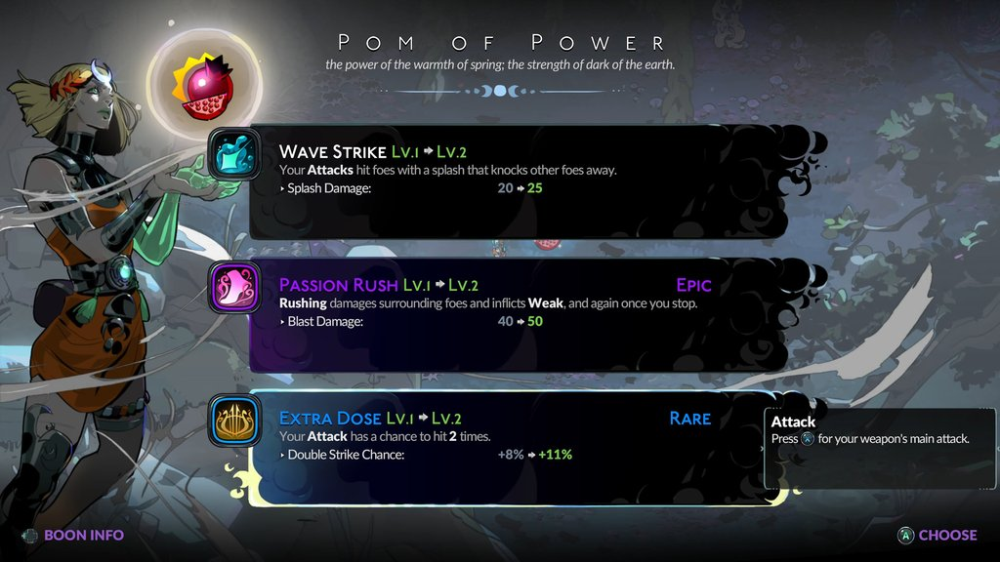</a> | `shrine_hades2_pom_of_power_choice.jpg` Hades II, Pom of Power: three held boons, each 'Lv.1 → Lv.2' with its number before and after ('Splash Damage: 20 → 25', 'Blast Damage: 40 → 50', 'Double Strike Chance: +8% → +11%'), rarity at the right (Epic, Rare), 'Boon Info' and 'Choose' at the foot. The site credits the Game UI Database for the capture. | [page](https://saschb2b.github.io/game-mechanics/games/hades/boons-and-gods) · [image](https://saschb2b.github.io/game-mechanics/images/hades/h2-pom-of-power.jpg) |
| <a href="shrine_hades2_boon_choice_apollo_duo_legendary.jpg">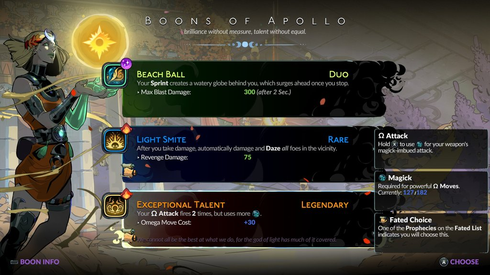</a> | `shrine_hades2_boon_choice_apollo_duo_legendary.jpg` Hades II, Boons of Apollo: Beach Ball (Duo), Light Smite (Rare) and Exceptional Talent (Legendary), whose gain carries its cost ('Your Ω Attack fires 2 times, but uses more [Magick]', 'Omega Move Cost: +30'); a scroll mark on two rows, explained at the side as 'Fated Choice'. | [page](https://steamcommunity.com/sharedfiles/filedetails/?id=3640919263) · [image](https://images.steamusercontent.com/ugc/17737301009846145145/32C4D259ED7E32D33F736690B25D1A4232E0B07F/) |
| <a href="shrine_hades2_boon_choice_hera_levels.jpg">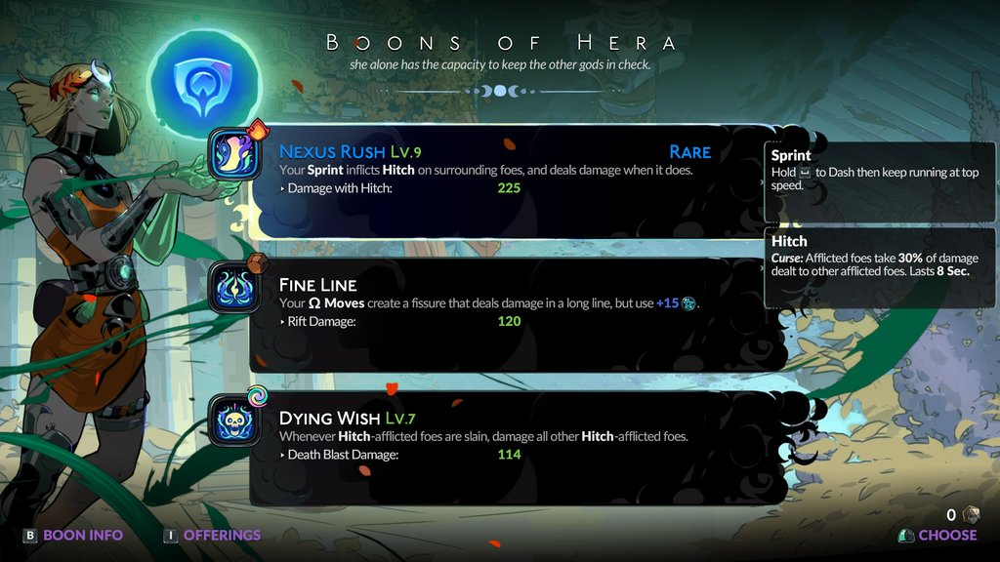</a> | `shrine_hades2_boon_choice_hera_levels.jpg` Hades II, Boons of Hera: two of the three offers carry a level after the name ('Nexus Rush Lv.9', Rare; 'Dying Wish Lv.7'), the third none ('Fine Line'); a small element badge on each icon, and 'Sprint' and 'Hitch' explained at the side. | [page](https://steamcommunity.com/sharedfiles/filedetails/?id=3770968636) · [image](https://images.steamusercontent.com/ugc/14528980002834209962/F5F468EF5926DEC1F12C571D011A98FFE8CC2B09/) |
| <a href="shrine_etg_companion_shrine_offer_heart.jpg">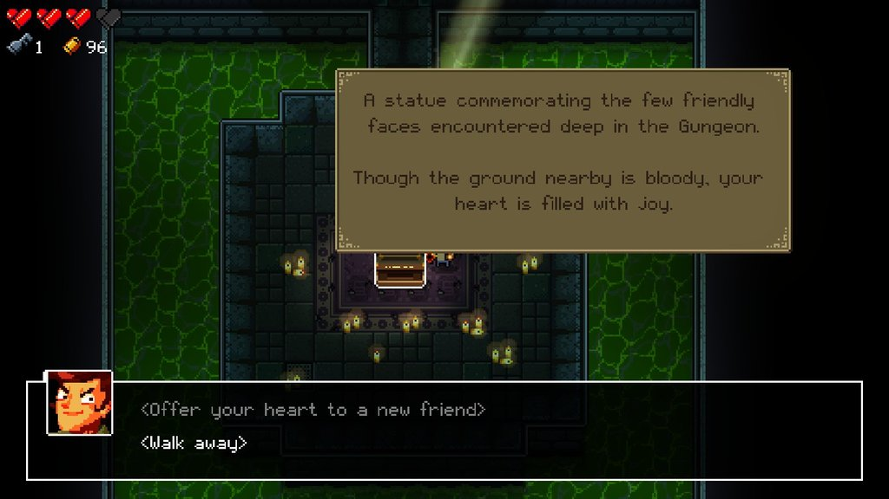</a> | `shrine_etg_companion_shrine_offer_heart.jpg` Enter the Gungeon, a shrine's text box: 'A statue commemorating the few friendly faces encountered deep in the Gungeon. Though the ground nearby is bloody, your heart is filled with joy.', and two answers, '&lt;Offer your heart to a new friend&gt;' and '&lt;Walk away&gt;'; the price is a heart container. | [page](https://steamcommunity.com/sharedfiles/filedetails/?id=1455212762) · [image](https://images.steamusercontent.com/ugc/969848689214478221/C65975377E64E9EBC37C317A31A1FAC505192181/) |
| <a href="shrine_etg_shrine_room.jpg">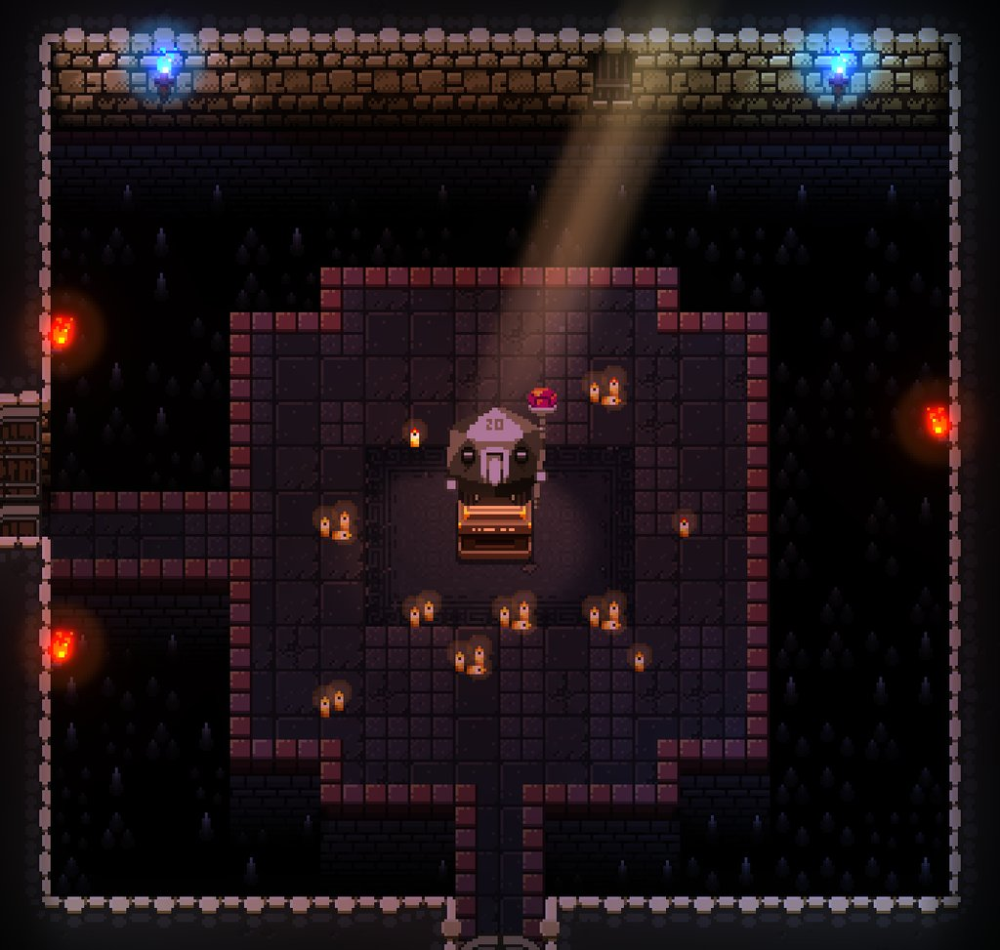</a> | `shrine_etg_shrine_room.jpg` Enter the Gungeon, a shrine room: the statue on its plinth under a shaft of light, ringed by candles, a room of its own off the corridor. | [page](https://enterthegungeon.wiki.gg/wiki/File:LetsGetSomeShrines_001_fuzzy.png) · [image](https://enterthegungeon.wiki.gg/images/LetsGetSomeShrines_001_fuzzy.png?775db0) |
| <a href="shrine_dc_scroll_of_power_choice.jpg">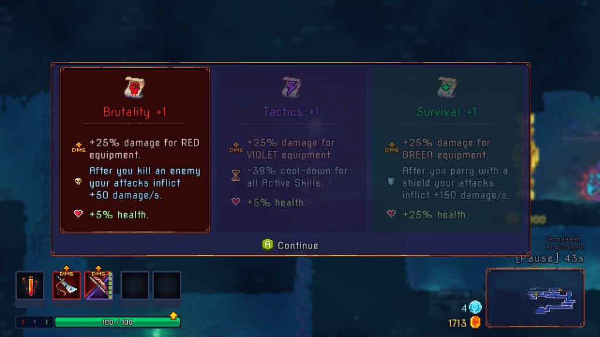</a> | `shrine_dc_scroll_of_power_choice.jpg` Dead Cells, a scroll's choice of three stat paths, each in its colour: 'Brutality +1' (red: '+25% damage for RED equipment', 'After you kill an enemy your attacks inflict +50 damage/s', '+5% health'), 'Tactics +1' (violet: '-39% cool-down for all Active Skills') and 'Survival +1' (green: '+25% health'); the one selected lit, the others dimmed, 'Continue' under them. | [page](https://steamcommunity.com/sharedfiles/filedetails/?id=1196152931) · [image](https://images.steamusercontent.com/ugc/865116363345782411/6A39F7325A3FC8F356CABBE4E8D067EFA5FBDA2A/) |

## Steering

What waits behind a door, and what tips the draw. Hades puts the reward's sign over each exit before the chamber is entered, so the player picks the god by picking the door, and a keepsake names the god whose boon comes next and raises its odds of Rare or better. ARISE can show a seen shrine room with its Path's sign on the plan, and let one item or choice name the Path the next shrine draws from.

| | What it shows | Source |
|---|---|---|
| <a href="steer_hades_keepsake_frostbitten_horn.jpg">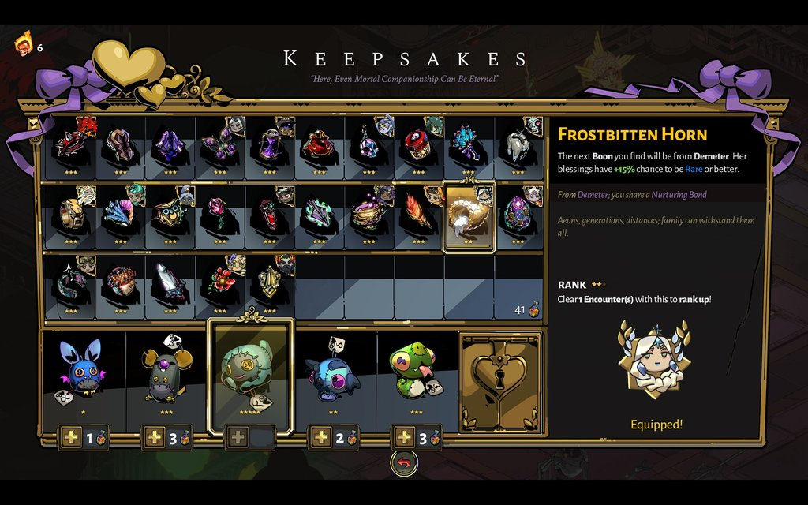</a> | `steer_hades_keepsake_frostbitten_horn.jpg` Hades, the Keepsakes case: a grid of keepsakes, each from one character, with the selected one's card at the right and 'Equipped!' under it. | [page](https://steamcommunity.com/sharedfiles/filedetails/?id=3688197641) · [image](https://images.steamusercontent.com/ugc/10895725924747599118/7BE58289FEF53EA83C474CDF874C4C5040736BC7/) |
| <a href="steer_hades_keepsake_frostbitten_horn_crop.jpg">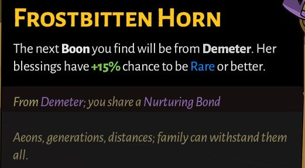</a> | `steer_hades_keepsake_frostbitten_horn_crop.jpg` Crop: 'Frostbitten Horn: The next Boon you find will be from Demeter. Her blessings have +15% chance to be Rare or better.', 'Rare' in its blue. Cropped from the same source as `steer_hades_keepsake_frostbitten_horn.jpg`. | [page](https://steamcommunity.com/sharedfiles/filedetails/?id=3688197641) · [image](https://images.steamusercontent.com/ugc/10895725924747599118/7BE58289FEF53EA83C474CDF874C4C5040736BC7/) |
| <a href="steer_hades_door_reward_orbs.jpg">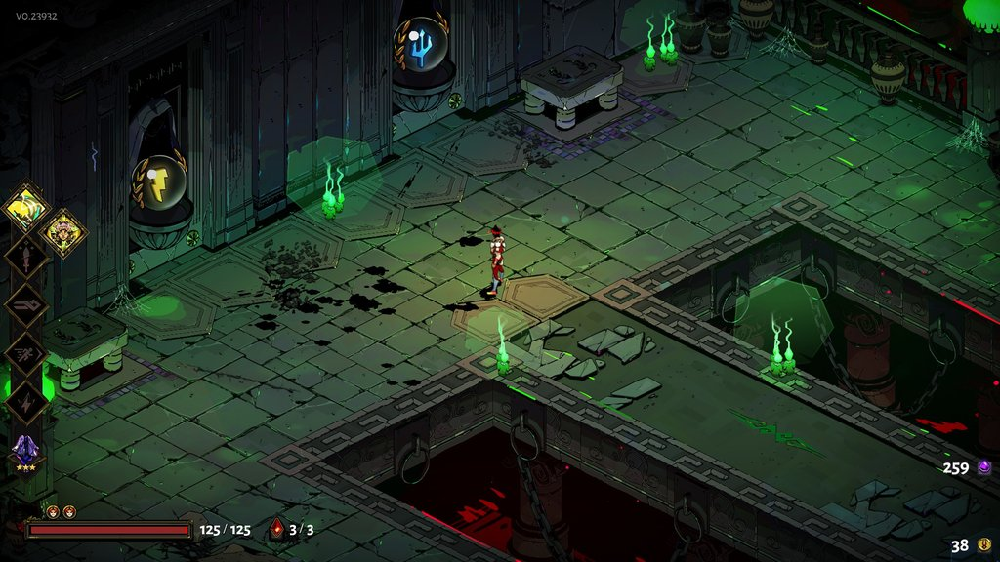</a> | `steer_hades_door_reward_orbs.jpg` Hades, a cleared chamber in Tartarus with two exits, an orb over each door showing what waits beyond it. | [page](https://steamcommunity.com/sharedfiles/filedetails/?id=1958145280) · [image](https://images.steamusercontent.com/ugc/777367299903960244/933C413E672E7DDA3D1090400C849FBDAA729464/) |
| <a href="steer_hades_door_reward_orbs_crop.jpg">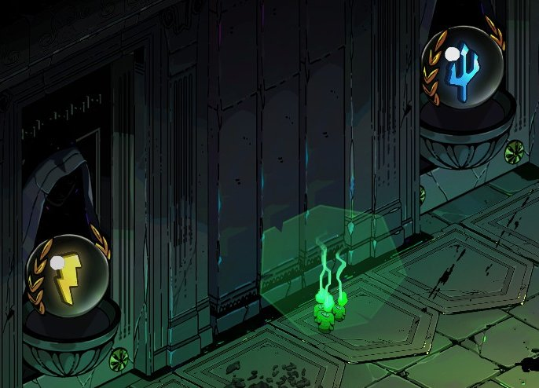</a> | `steer_hades_door_reward_orbs_crop.jpg` Crop: the two orbs in their laurels, Zeus's bolt over one door and Poseidon's trident over the other, a god's boon behind each. Cropped from the same source as `steer_hades_door_reward_orbs.jpg`. | [page](https://steamcommunity.com/sharedfiles/filedetails/?id=1958145280) · [image](https://images.steamusercontent.com/ugc/777367299903960244/933C413E672E7DDA3D1090400C849FBDAA729464/) |

## Pacts

A gain stated with its cost. The Chaos boons of Hades and Hades II are each a curse for a few encounters, then a blessing for the rest of the run, the cost in red and the pay in green on two lines. Slay the Spire's events and Neow put the price on the same line as the prize, a boss relic states its drawback in its tooltip, and Dead Cells' cursed chest pays at once and hangs a kill count over the hero until the curse lifts. ARISE can write a Pact as one card in two colours, the cost first with the count that ends it, the gain after.

| | What it shows | Source |
|---|---|---|
| <a href="pact_hades_chaos_curse_then_blessing.jpg">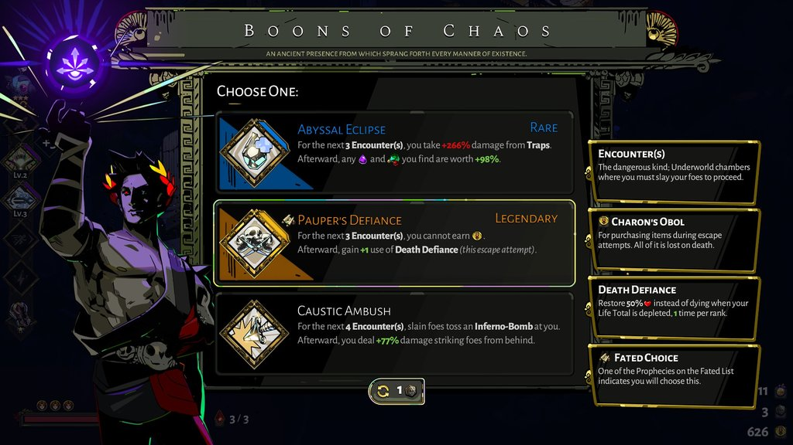</a> | `pact_hades_chaos_curse_then_blessing.jpg` Hades, Boons of Chaos: three offers, each a curse then a blessing: Abyssal Eclipse (Rare), Pauper's Defiance (Legendary) and Caustic Ambush; the glossary at the side, and a reroll counter ('1') under the rows. | [page](https://steamcommunity.com/sharedfiles/filedetails/?id=3430441082) · [image](https://images.steamusercontent.com/ugc/60338911509320653/6EAFC70E661035DFD5E8FA4C66C2FCB1583ADF7B/) |
| <a href="pact_hades_chaos_cards_glossary_crop.jpg">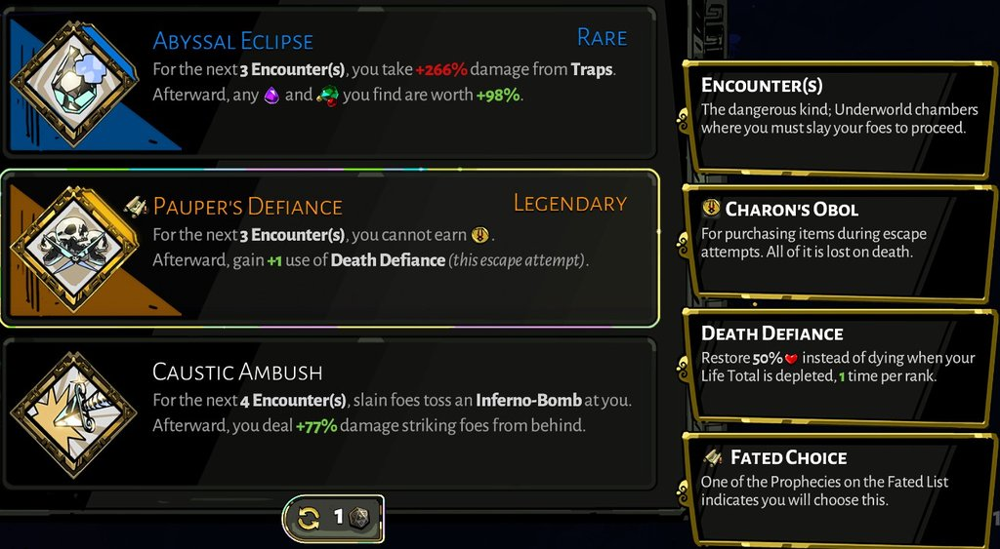</a> | `pact_hades_chaos_cards_glossary_crop.jpg` Crop: 'For the next 3 Encounter(s), you take +266% damage from Traps. Afterward, any [gems] and [Darkness] you find are worth +98%.'; 'For the next 3 Encounter(s), you cannot earn [Obol]. Afterward, gain +1 use of Death Defiance (this escape attempt).'; the terms 'Encounter(s)', 'Charon's Obol', 'Death Defiance' and 'Fated Choice' explained beside them. Cropped from the same source as `pact_hades_chaos_curse_then_blessing.jpg`. | [page](https://steamcommunity.com/sharedfiles/filedetails/?id=3430441082) · [image](https://images.steamusercontent.com/ugc/60338911509320653/6EAFC70E661035DFD5E8FA4C66C2FCB1583ADF7B/) |
| <a href="pact_hades2_chaos_curse_then_blessing.jpg">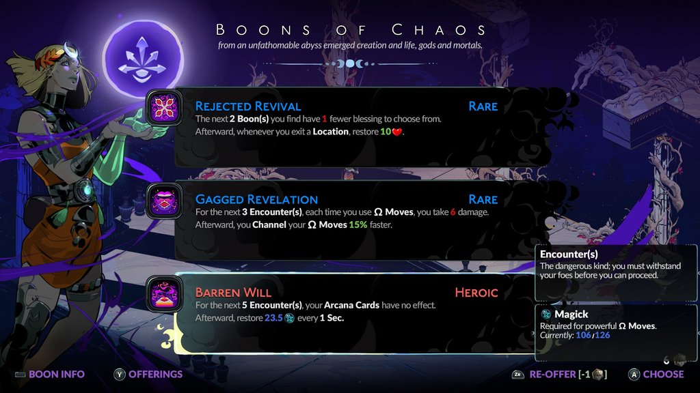</a> | `pact_hades2_chaos_curse_then_blessing.jpg` Hades II, Boons of Chaos: 'Rejected Revival: The next 2 Boon(s) you find have 1 fewer blessing to choose from. Afterward, whenever you exit a Location, restore 10 [Life].'; 'Gagged Revelation' (Rare); 'Barren Will' (Heroic, red): 'For the next 5 Encounter(s), your Arcana Cards have no effect. Afterward, restore 23.5 [Magick] every 1 Sec.'; 'Re-Offer [-1]' at the foot. | [page](https://steamcommunity.com/sharedfiles/filedetails/?id=3653212645) · [image](https://images.steamusercontent.com/ugc/12043504816868290692/F92F3E74F1D22BE6B4178B9A1FEEEB8ACB26149E/) |
| <a href="pact_sts2_neow_options.jpg">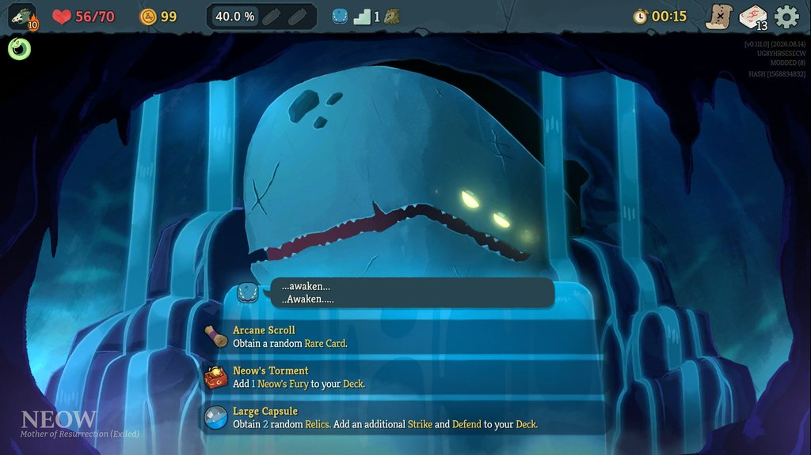</a> | `pact_sts2_neow_options.jpg` Slay the Spire 2, Neow at the start of a run (the capture's game is modded): her speech bubble over three blessings in a column, each with its relic's art, name and line. | [page](https://steamcommunity.com/sharedfiles/filedetails/?id=3804885048) · [image](https://images.steamusercontent.com/ugc/11750738777132433757/C92FD7A302A3BDA47F8A36D5C95258E5793176E4/) |
| <a href="pact_sts2_neow_options_crop.jpg">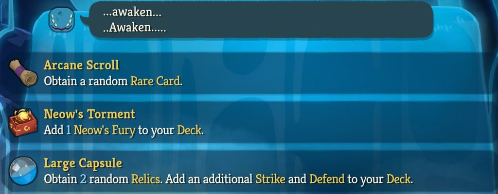</a> | `pact_sts2_neow_options_crop.jpg` Crop: 'Arcane Scroll: Obtain a random Rare Card.', 'Neow's Torment: Add 1 Neow's Fury to your Deck.' and 'Large Capsule: Obtain 2 random Relics. Add an additional Strike and Defend to your Deck.', the gain and its cost in one line. Cropped from the same source as `pact_sts2_neow_options.jpg`. | [page](https://steamcommunity.com/sharedfiles/filedetails/?id=3804885048) · [image](https://images.steamusercontent.com/ugc/11750738777132433757/C92FD7A302A3BDA47F8A36D5C95258E5793176E4/) |
| <a href="pact_sts_council_of_ghosts_event.jpg">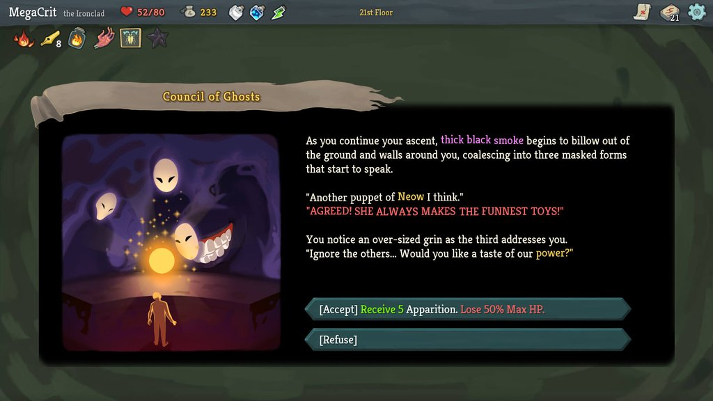</a> | `pact_sts_council_of_ghosts_event.jpg` Slay the Spire, Council of Ghosts: '[Accept] Receive 5 Apparition. Lose 50% Max HP.' with the gain in green and the cost in red on one line, and '[Refuse]' under it. | [page](https://store.steampowered.com/app/646570/) · [image](https://shared.akamai.steamstatic.com/store_item_assets/steam/apps/646570/ss_1299d7fe55771cf564848c5046fbef7936178440.1920x1080.jpg?t=1774015376) |
| <a href="pact_sts_sozu_boss_relic_drawback_crop.jpg">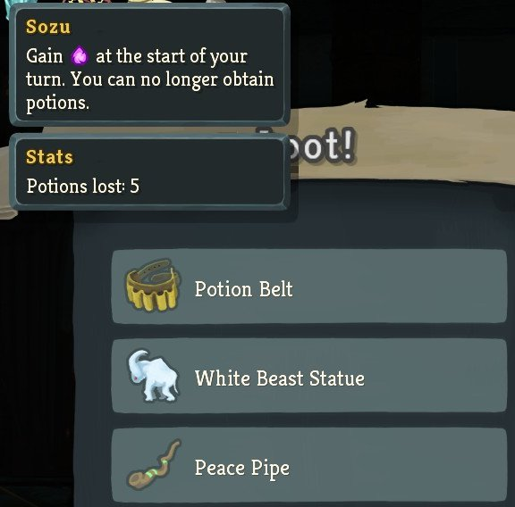</a> | `pact_sts_sozu_boss_relic_drawback_crop.jpg` Crop (Slay the Spire, a boss relic's tooltip over a chest's loot): 'Sozu: Gain [Energy] at the start of your turn. You can no longer obtain potions.', and under it 'Stats: Potions lost: 5', the cost counted for the run. Cropped (and where marked, enlarged) from the source image. | [page](https://steamcommunity.com/sharedfiles/filedetails/?id=2807822023) · [image](https://images.steamusercontent.com/ugc/1840294802081871059/CDA67B219DA0F38994FD2D36537DFF89A83121A0/) |
| <a href="pact_dc_cursed_chest_opened.jpg">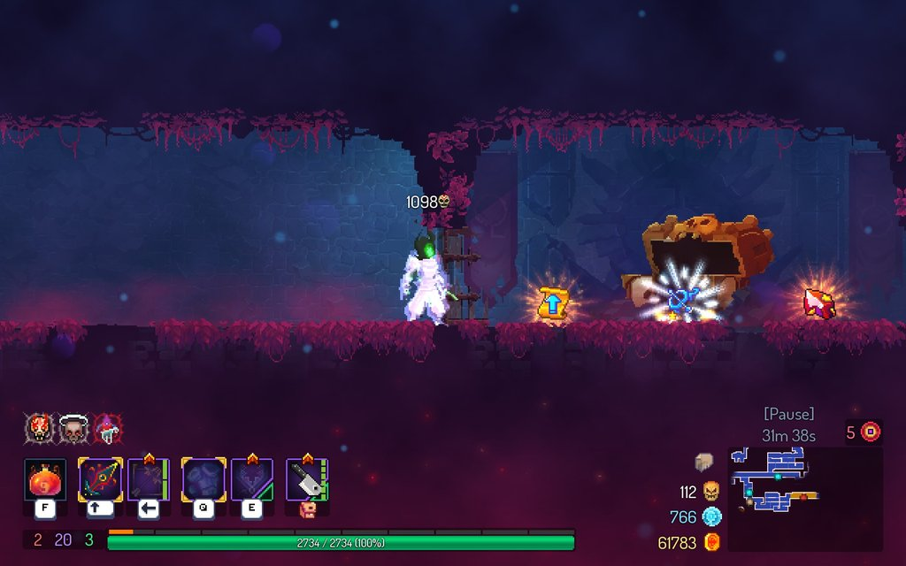</a> | `pact_dc_cursed_chest_opened.jpg` Dead Cells, a cursed chest just opened: its loot on the floor (a stat scroll and a weapon) and a count over the hero's head. | [page](https://steamcommunity.com/sharedfiles/filedetails/?id=3780798983) · [image](https://images.steamusercontent.com/ugc/11697819422804551176/6B5D1370E116A7E9281C06926EE2828A6EB152A3/) |
| <a href="pact_dc_cursed_chest_counter_crop.jpg">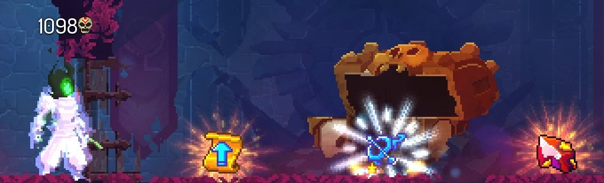</a> | `pact_dc_cursed_chest_counter_crop.jpg` Crop: the count over the hero's head ('1098' and a skull), the kills still owed before the curse lifts, beside the chest and what it paid. Cropped from the same source as `pact_dc_cursed_chest_opened.jpg`. | [page](https://steamcommunity.com/sharedfiles/filedetails/?id=3780798983) · [image](https://images.steamusercontent.com/ugc/11697819422804551176/6B5D1370E116A7E9281C06926EE2828A6EB152A3/) |

## Rests

A rest that offers a choice. Slay the Spire's campfire shows a card to each option, Rest and Smith, and Toke, Lift or Recall where a relic or a key adds one; a relic that forbids an option greys it, and one that forbids healing takes Rest away. Slay the Spire 2 states under the options what the one pointed at will do. Darkest Dungeon spends a camp's Respite on each hero's camp skills, Inscryption's campfire raises a card's power again and again at the risk of losing it, Dark Souls' bonfire is a menu with a lasting upgrade on it, and Hades' fountain names what it restores before it is used. ARISE can take the campfire's row of cards, Heal, Hone and Steady, with what the one picked will do stated under the row before it is taken, and an option the run cannot use greyed.

| | What it shows | Source |
|---|---|---|
| <a href="rest_sts_campfire_rest_smith_toke_lift_recall.jpg">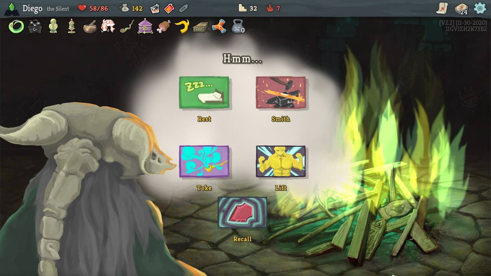</a> | `rest_sts_campfire_rest_smith_toke_lift_recall.jpg` Slay the Spire, a rest site with five options, a picture card to each: 'Rest', 'Smith', 'Toke' and 'Lift' (added by relics in the bar, the Peace Pipe and the Girya) and 'Recall', under 'Hmm...'. | [page](https://steamcommunity.com/sharedfiles/filedetails/?id=2308324585) · [image](https://images.steamusercontent.com/ugc/1664606963446853274/D29851DEF637C859D3DA6822113BE335C3D9ED7E/) |
| <a href="rest_sts_campfire_rest_smith_greyed.jpg">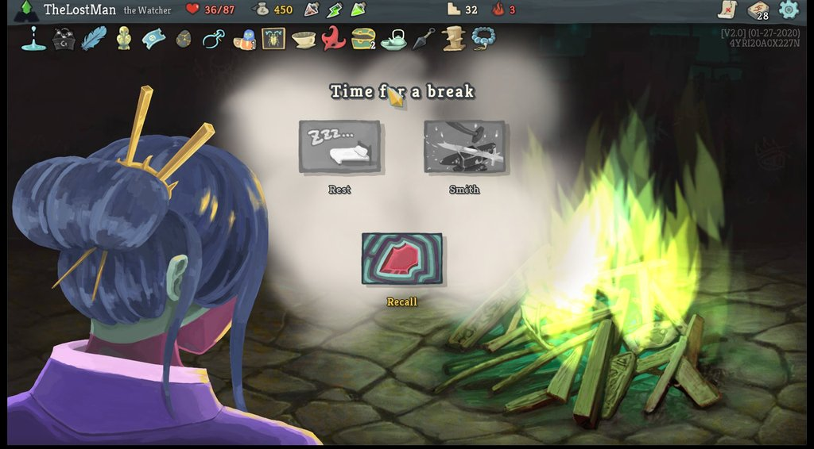</a> | `rest_sts_campfire_rest_smith_greyed.jpg` Slay the Spire, 'Time for a break': Rest and Smith drawn in grey and unavailable (the Coffee Dripper in the relic bar forbids Rest), with Recall still lit. | [page](https://steamcommunity.com/sharedfiles/filedetails/?id=2168050617) · [image](https://images.steamusercontent.com/ugc/1456302674912167009/CC74BEC5016AA465A2906C5FD3D76B8F99BA6838/) |
| <a href="rest_sts_campfire_smith_only_mark_of_bloom.jpg">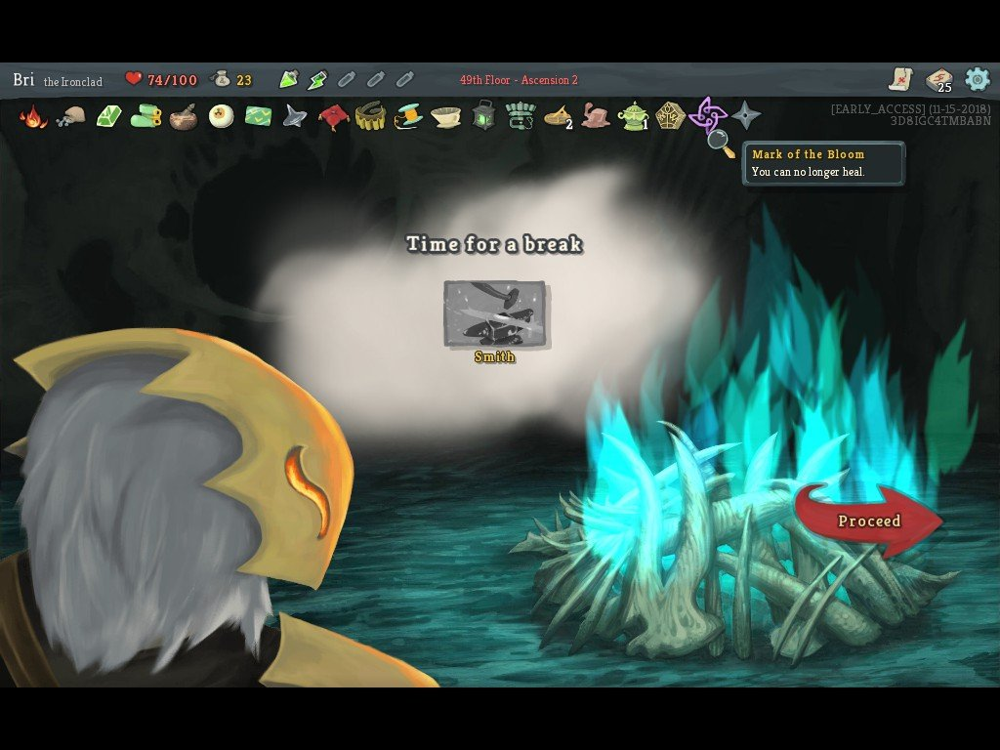</a> | `rest_sts_campfire_smith_only_mark_of_bloom.jpg` Slay the Spire, a rest site with Smith alone: the relic hovered, 'Mark of the Bloom: You can no longer heal.', takes Rest off the row rather than greying it. | [page](https://steamcommunity.com/sharedfiles/filedetails/?id=1583000870) · [image](https://images.steamusercontent.com/ugc/948468464649779293/4B646178DA8D031E924BF979E1AE66FFA1BF7CC7/) |
| <a href="rest_sts2_rest_site_heal_preview.jpg">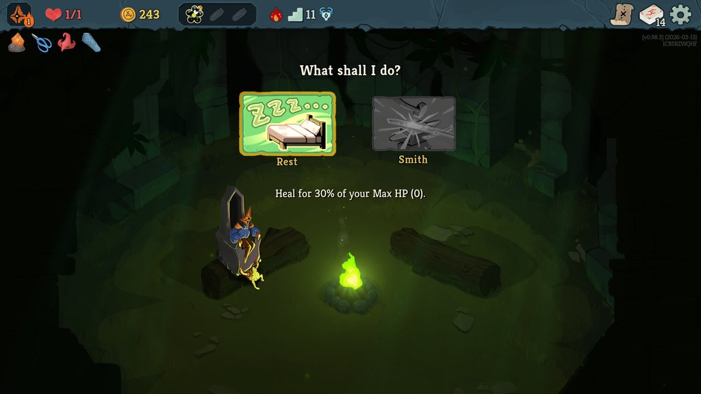</a> | `rest_sts2_rest_site_heal_preview.jpg` Slay the Spire 2, a rest site: 'What shall I do?' over Rest and Smith, the hero by the fire below. | [page](https://steamcommunity.com/sharedfiles/filedetails/?id=3684482632) · [image](https://images.steamusercontent.com/ugc/14766293293970959651/9DCB4C77FC879004F4A498516ABA038ABE599366/) |
| <a href="rest_sts2_rest_site_heal_preview_crop.jpg">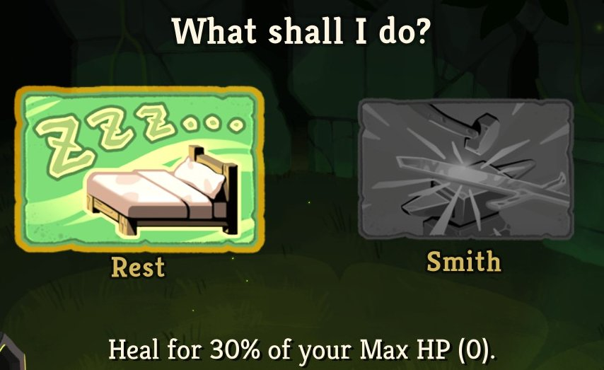</a> | `rest_sts2_rest_site_heal_preview_crop.jpg` Crop: Rest lit and framed in gold as it is pointed at, Smith in grey, and under them what Rest will do: 'Heal for 30% of your Max HP (0).', the amount worked out for this hero. Cropped from the same source as `rest_sts2_rest_site_heal_preview.jpg`. | [page](https://steamcommunity.com/sharedfiles/filedetails/?id=3684482632) · [image](https://images.steamusercontent.com/ugc/14766293293970959651/9DCB4C77FC879004F4A498516ABA038ABE599366/) |
| <a href="rest_sts_big_fish_event.jpg">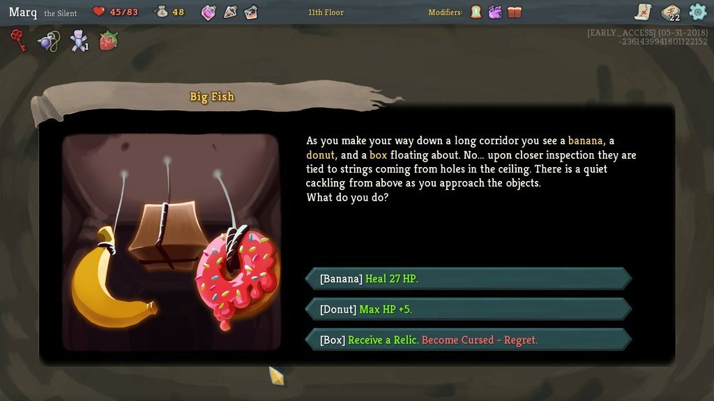</a> | `rest_sts_big_fish_event.jpg` Slay the Spire, the Big Fish event, a rest's choice in an event's frame: three answers to heal now, grow for the run, or take a prize with a curse. | [page](https://steamcommunity.com/sharedfiles/filedetails/?id=1400397637) · [image](https://images.steamusercontent.com/ugc/912422544778986502/701F54BEF49A1EAF5A5B9591C40C7F156FE9AB44/) |
| <a href="rest_sts_big_fish_options_crop.jpg">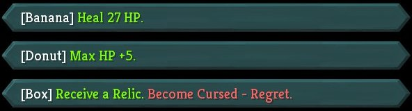</a> | `rest_sts_big_fish_options_crop.jpg` Crop: '[Banana] Heal 27 HP.', '[Donut] Max HP +5.', '[Box] Receive a Relic. Become Cursed - Regret.', each gain in green and the cost in red, the heal worked out in HP. Cropped from the same source as `rest_sts_big_fish_event.jpg`. | [page](https://steamcommunity.com/sharedfiles/filedetails/?id=1400397637) · [image](https://images.steamusercontent.com/ugc/912422544778986502/701F54BEF49A1EAF5A5B9591C40C7F156FE9AB44/) |
| <a href="rest_dd1_camping_respite_12.jpg">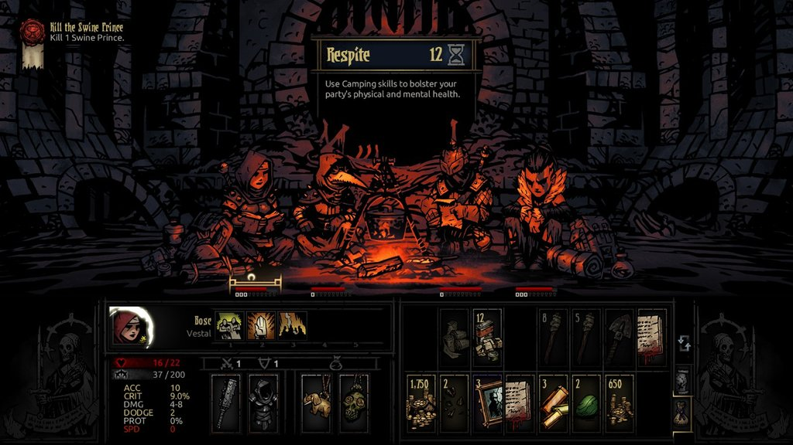</a> | `rest_dd1_camping_respite_12.jpg` Darkest Dungeon, camping: the party round the fire, the Respite box at the top, the selected hero's three camp skills in the hero panel and the party's supplies at the right. | [page](https://steamcommunity.com/sharedfiles/filedetails/?id=1736664023) · [image](https://images.steamusercontent.com/ugc/787478730077726448/E6169FB8DA29AF74F20BDE68BEDD94EFB36EBEB9/) |
| <a href="rest_dd1_respite_12_camp_skills_crop.jpg">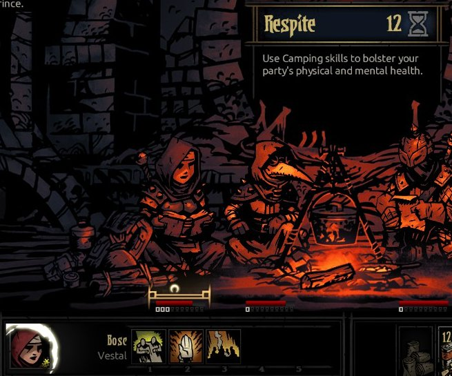</a> | `rest_dd1_respite_12_camp_skills_crop.jpg` Crop: 'Respite 12' with an hourglass, 'Use Camping skills to bolster your party's physical and mental health.', and the Vestal's camp skills lit, ready to spend it on. Cropped from the same source as `rest_dd1_camping_respite_12.jpg`. | [page](https://steamcommunity.com/sharedfiles/filedetails/?id=1736664023) · [image](https://images.steamusercontent.com/ugc/787478730077726448/E6169FB8DA29AF74F20BDE68BEDD94EFB36EBEB9/) |
| <a href="rest_dd1_respite_0_rest_crop.jpg">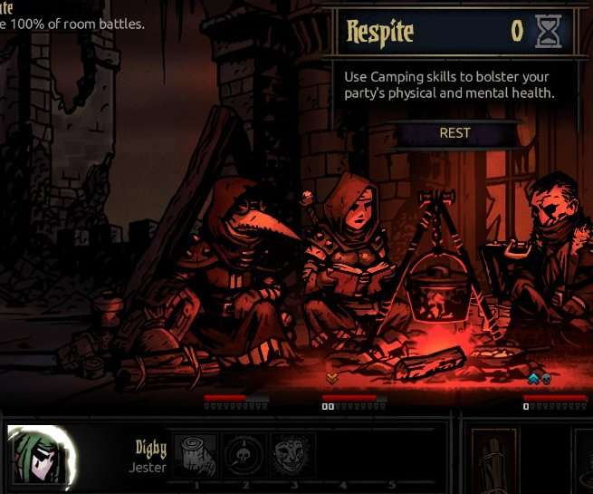</a> | `rest_dd1_respite_0_rest_crop.jpg` Crop (another camp): 'Respite 0' once every point is spent, a 'REST' button under the line to end the camp, and the Jester's camp skills greyed. Cropped (and where marked, enlarged) from the source image. | [page](https://steamcommunity.com/sharedfiles/filedetails/?id=855126008) · [image](https://images.steamusercontent.com/ugc/94975470796532688/994D134726A24C41010FBAB98854DBE9183A25C8/) |
| <a href="rest_inscryption_campfire_warmed_power.jpg">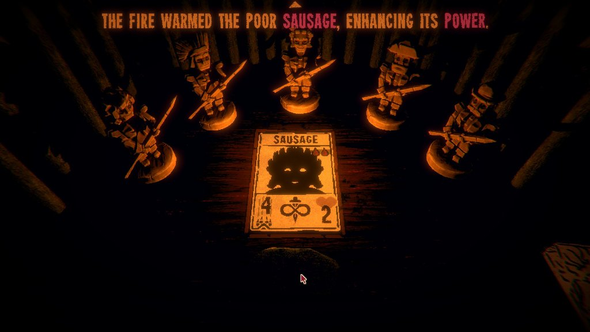</a> | `rest_inscryption_campfire_warmed_power.jpg` Inscryption, the survivors' campfire: 'THE FIRE WARMED THE POOR SAUSAGE, ENHANCING ITS POWER.', the card by the fire with the survivors round it. | [page](https://steamcommunity.com/sharedfiles/filedetails/?id=2633210819) · [image](https://images.steamusercontent.com/ugc/1780603711534410466/F246F3E71D38699D058EE4D2A512D5DF999D7A2E/) |
| <a href="rest_inscryption_campfire_survivors_retreat.jpg">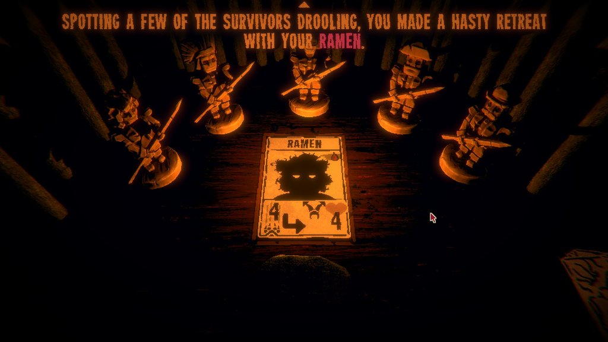</a> | `rest_inscryption_campfire_survivors_retreat.jpg` Inscryption, the same fire's risk: 'SPOTTING A FEW OF THE SURVIVORS DROOLING, YOU MADE A HASTY RETREAT WITH YOUR RAMEN.', the line that ends a visit; the survivors' hunger is the risk of warming a card again. | [page](https://steamcommunity.com/sharedfiles/filedetails/?id=2853516262) · [image](https://images.steamusercontent.com/ugc/1754735880944165929/B9BD08B441B525839399791E3D8B505546131541/) |
| <a href="rest_ds3_bonfire_menu.jpg">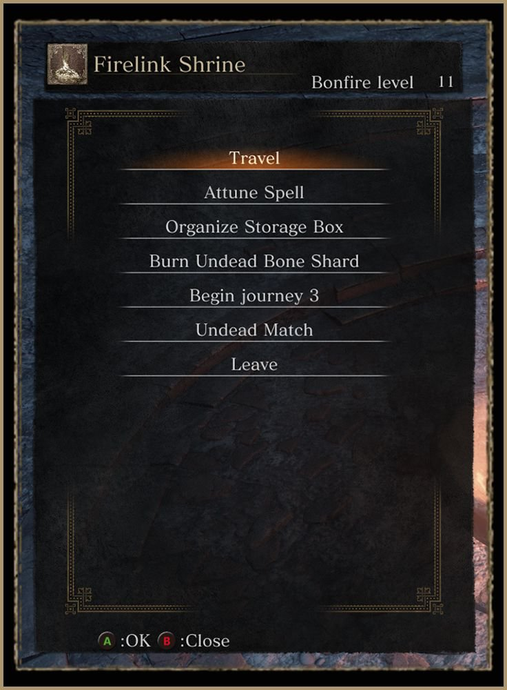</a> | `rest_ds3_bonfire_menu.jpg` Dark Souls III, the bonfire menu: 'Firelink Shrine', 'Bonfire level 11', then 'Travel', 'Attune Spell', 'Organize Storage Box', 'Burn Undead Bone Shard', 'Begin journey 3', 'Undead Match', 'Leave'; one plain list, the upgrade among the chores. | [page](https://darksouls3.wiki.fextralife.com/Bonfires) · [image](https://static0.fextralifeimages.com/file/darksouls3/6/67/Menu_maxbonfire-jpg.png) |
| <a href="rest_ds1_bonfire_kindle_stages.jpg">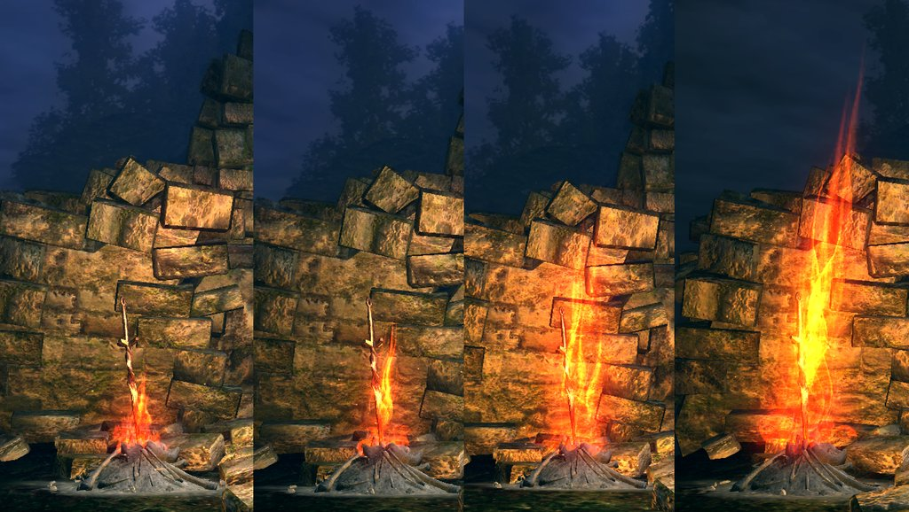</a> | `rest_ds1_bonfire_kindle_stages.jpg` Dark Souls, one bonfire at four stages of kindling side by side, the flame taller at each; kindling raises the Estus Flasks the bonfire refills. | [page](https://darksouls.fandom.com/wiki/File:Bonfire_Kindle_stages.png) · [image](https://static.wikia.nocookie.net/darksouls/images/8/81/Bonfire_Kindle_stages.png/revision/latest?cb=20130730201228&format=original) |
| <a href="rest_hades_fountain_restore.jpg">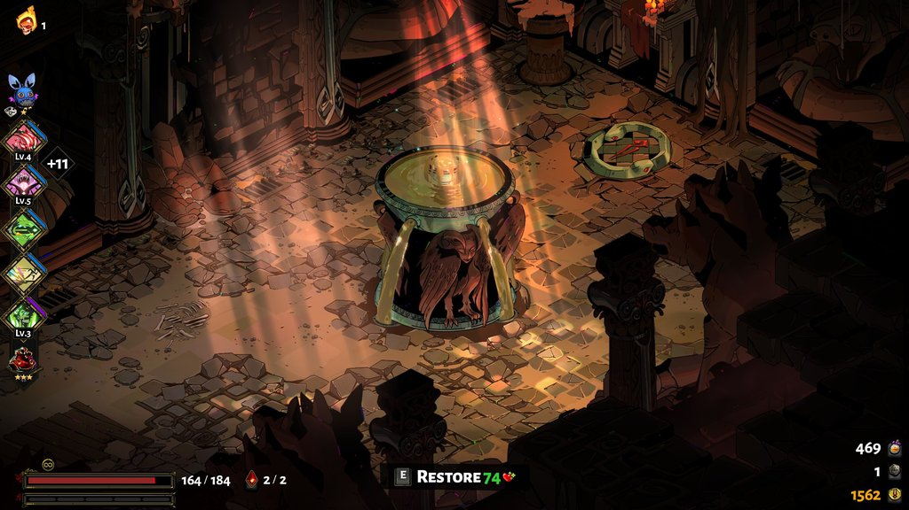</a> | `rest_hades_fountain_restore.jpg` Hades, a fountain chamber: the fountain in a shaft of light, the hero's boons down the left, and the prompt at the foot. | [page](https://steamcommunity.com/sharedfiles/filedetails/?id=2906910555) · [image](https://images.steamusercontent.com/ugc/5103172932225509915/01301DF962C62FB8C2BFA426B6DB9420421FE63F/) |
| <a href="rest_hades_fountain_restore_prompt_crop.jpg">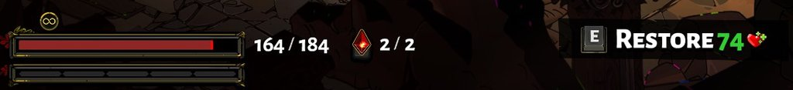</a> | `rest_hades_fountain_restore_prompt_crop.jpg` Crop: the health bar at '164 / 184' and the prompt 'E Restore 74' with a heart, the amount named before the fountain is used. Cropped from the same source as `rest_hades_fountain_restore.jpg`. | [page](https://steamcommunity.com/sharedfiles/filedetails/?id=2906910555) · [image](https://images.steamusercontent.com/ugc/5103172932225509915/01301DF962C62FB8C2BFA426B6DB9420421FE63F/) |

## What ARISE took

- **The window.** A shrine's panel is headed by its Path (`Shrine of Sight`, its stat's mark), with a card to
  each of its three blessings, as Hades' boon rows are: the Path's mark in a diamond at the left on a wedge,
  the name in capitals over its Path (or `Duo · Ruin + Tempest`, `Capstone · Ruin`), one line of what it does
  coloured as the fight's tips are, and its tier at the top right in pips and a numeral. The tier is
  advancement's gold growing stronger from I to III, never a rarity colour of its own: colour already means
  something in ARISE.
- **The Font** is Hades' Pom of Power: the same window and the same cards, each one a blessing held, its
  tier `I → II` and its number before and after (`Bleeding for 3 → 4 turns`). With nothing to raise, it
  blesses as a shrine does.
- **The Path on the plan** is Hades' door orb: a shrine seen shows its Path's name before the hunter steps in,
  and the Path the hunter has spent most in comes up most, as a keepsake steers the next god.
- **The rest** is Slay the Spire's campfire, as Slay the Spire 2 draws it: Heal, Hone and Steady as three
  picture tiles side by side, what each gives worked out under its name, one this rest cannot give greyed in
  place with the reason (`Sealed: Lightless`). Hone opens the skills it can raise, `Lv.MAX → Lv.MAX+1`.
- **Pacts** are left for later, at the owner's call.
