# Step 6: A map, an army, gear and a daily Gate

The references for a map worth reading (landmarks, secrets and gradients), Shadows with family and role bonuses,
rule-changing gear kept in a Codex, and the Daily Rift, the sixth step of the order to build in
[docs/DESIGN.md](../../../DESIGN.md#order-to-build).

Every image belongs to the game's publisher, or to the wiki, site or player who captured it, as listed beside it. They are kept here as design reference only: nothing in ARISE copies their art, and none of them ships with the game.

## Map

A plan worth reading: a place to look for, secrets that are counted, and a floor that tells the hunter where it is. Legend of Grimrock says 'Secret Found' once, at the foot of the view, the moment a hidden alcove opens, and its statistics count every secret out of its total ('Secrets Found 76/77') beside the other things that can be found to an end. The Binding of Isaac puts a '?' on the minimap tile of a secret room once it is found, among tiles marked with what they still hold; Enter the Gungeon hangs its secret room off a corridor by a stub and names its hidden floor 'Chamber ?: Oubliette'; Shattered Pixel Dungeon places its secret rooms on purpose, always wholly hidden, rewards them with rarer consumables rather than needed gear, and pays 'all secrets found' in the score. For landmarks, Dead Cells names each biome on a world map of picture tiles and writes each exit's destination on a floor's map, Etrian Odyssey III titles a stratum as the party walks onto it, Persona 3 Reload marks a chest not yet reached and states it as the floor's aim, and Darkest Dungeon and Slay the Spire draw each room as the icon of what waits in it. ARISE can take the counter as Grimrock draws it (`Secrets 1/3` on the floor, out of its total), Isaac's mark on the room once found, and a landmark named on the plan as Dead Cells names an exit.

| | What it shows | Source |
|---|---|---|
| <a href="map_grimrock2_statistics_secrets_found.jpg">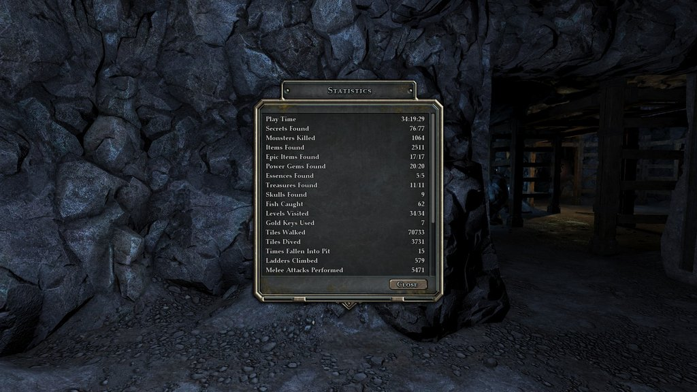</a> | `map_grimrock2_statistics_secrets_found.jpg` Legend of Grimrock 2, the Statistics window open over the dungeon: one row a count, the second row 'Secrets Found 76/77'. | [page](https://steamcommunity.com/sharedfiles/filedetails/?id=329766146) · [image](https://images.steamusercontent.com/ugc/36352556889178968/E2BEBD442F183F1DD87EC30CE4F071AC5E83C061/) |
| <a href="map_grimrock2_statistics_secrets_found_crop.jpg">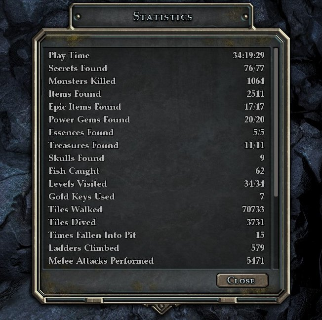</a> | `map_grimrock2_statistics_secrets_found_crop.jpg` Crop: 'Play Time 34:19:29', 'Secrets Found 76/77', 'Monsters Killed 1064', 'Items Found 2511', 'Epic Items Found 17/17', 'Power Gems Found 20/20', 'Essences Found 5/5', 'Treasures Found 11/11', 'Levels Visited 34/34': what can be counted to an end is shown out of its total, what cannot (Skulls Found 9, Tiles Walked 70733) is a bare number. Cropped from the same source as `map_grimrock2_statistics_secrets_found.jpg`. | [page](https://steamcommunity.com/sharedfiles/filedetails/?id=329766146) · [image](https://images.steamusercontent.com/ugc/36352556889178968/E2BEBD442F183F1DD87EC30CE4F071AC5E83C061/) |
| <a href="map_grimrock_secret_found_message.jpg">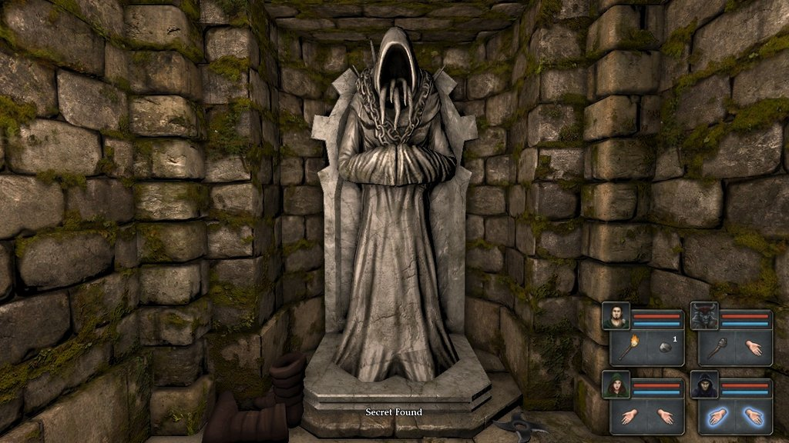</a> | `map_grimrock_secret_found_message.jpg` Legend of Grimrock, a statue in an alcove that was hidden: 'Secret Found' written once at the foot of the view as it opens, with no window. | [page](https://steamcommunity.com/sharedfiles/filedetails/?id=141009) · [image](https://images.steamusercontent.com/ugc/577827436787420701/1837FB41EF9F0948D10D7521D041D32C135CE721/) |
| <a href="map_grimrock2_map_note_secret_passage.jpg">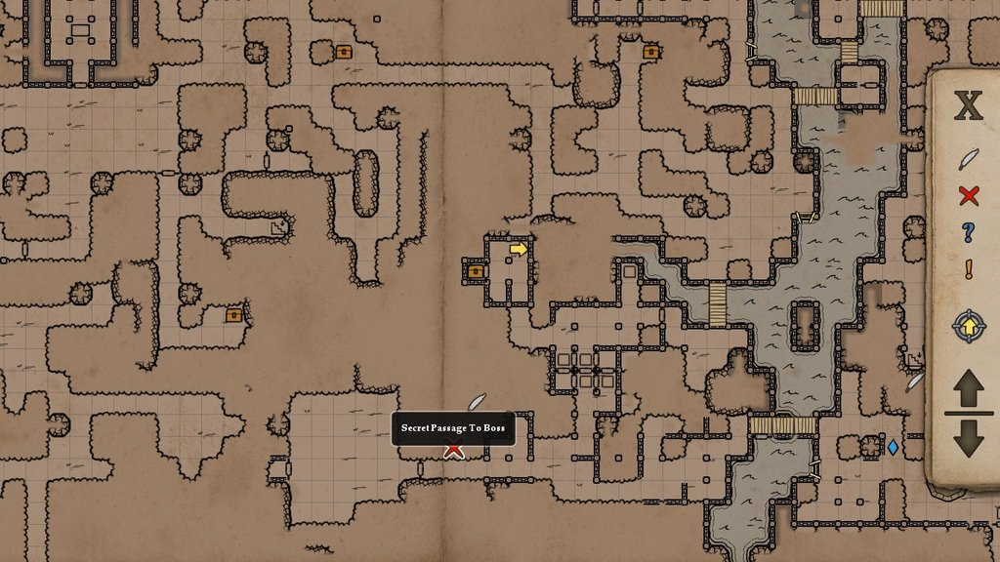</a> | `map_grimrock2_map_note_secret_passage.jpg` Legend of Grimrock 2, the parchment map with a player's own note on a square, 'Secret Passage To Boss', beside a red X; the tools down the right (quill, X, ?, !) pin marks to the plan. | [page](https://steamcommunity.com/sharedfiles/filedetails/?id=329834697) · [image](https://images.steamusercontent.com/ugc/39730256613948789/ED417F0D04617E026A43A2688ED94FB84CE3C082/) |
| <a href="map_isaac_void_minimap_secret_room.jpg">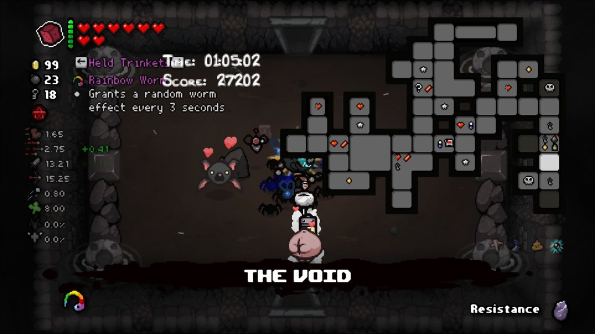</a> | `map_isaac_void_minimap_secret_room.jpg` The Binding of Isaac: Repentance, the minimap of the Void floor opened over the room, 'THE VOID' across the foot. The text at top left is a mod's item description, not the game's. | [page](https://steamcommunity.com/sharedfiles/filedetails/?id=3782951243) · [image](https://images.steamusercontent.com/ugc/15724364184586607591/291589EA913E5A999E8ED1930C78A74B902FB2AB/) |
| <a href="map_isaac_void_minimap_secret_room_crop.jpg">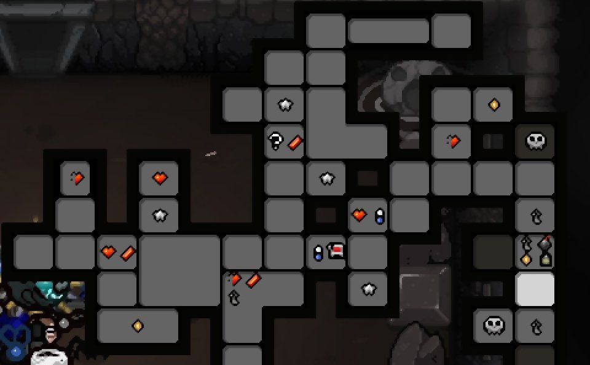</a> | `map_isaac_void_minimap_secret_room_crop.jpg` Crop: each room a grey tile marked with icons for what it still holds, the boss rooms with a skull, and a white '?' on the tile of a secret room once it is found. Cropped from the same source as `map_isaac_void_minimap_secret_room.jpg`. | [page](https://steamcommunity.com/sharedfiles/filedetails/?id=3782951243) · [image](https://images.steamusercontent.com/ugc/15724364184586607591/291589EA913E5A999E8ED1930C78A74B902FB2AB/) |
| <a href="map_etg_secret_room_minimap.jpg">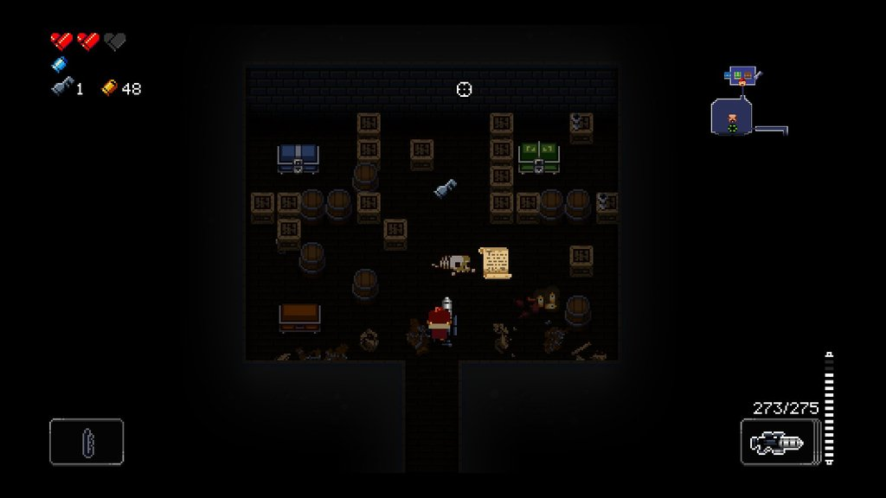</a> | `map_etg_secret_room_minimap.jpg` Enter the Gungeon, inside a secret room: crates, barrels, a blue and a green chest and a note; on the minimap at top right it is a room hung off a corridor by a short stub. | [page](https://enterthegungeon.wiki.gg/wiki/File:Secret_room.jpg) · [image](https://enterthegungeon.wiki.gg/images/Secret_room.jpg) |
| <a href="map_etg_oubliette_secret_floor_map.jpg">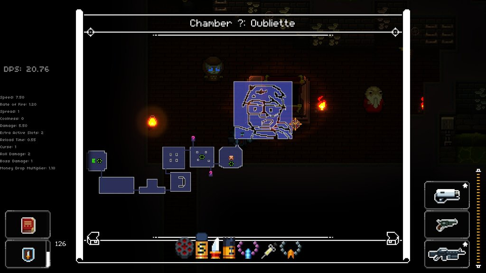</a> | `map_etg_oubliette_secret_floor_map.jpg` Enter the Gungeon, the map of the Oubliette, a hidden floor reached through a secret: titled 'Chamber ?: Oubliette', its rooms as blue outlines, two pink '?' marks at doorways. | [page](https://steamcommunity.com/sharedfiles/filedetails/?id=3613906694) · [image](https://images.steamusercontent.com/ugc/10094395219895542348/B764A95A21B77141B28CCF1C790DA26083B2146F/) |
| <a href="map_spd_secret_room_examples.jpg">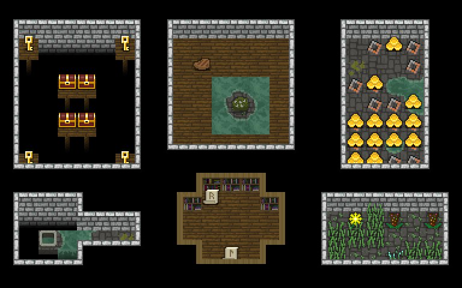</a> | `map_spd_secret_room_examples.jpg` Shattered Pixel Dungeon, six of its secret rooms as the developer showed them (a vault of chests, a garden, a pool, a library, a room of gold). The post says they are placed on purpose and always wholly hidden, hold rarer consumables rather than necessary gear, and come at a steady rate so a player can tell when one was missed. | [page](https://shatteredpixel.com/blog/coming-soon-to-shattered-better-secrets.html) · [image](https://shatteredpixel.com/assets/images/2017/2017-10-23/secret-rooms.png) |
| <a href="map_dc_world_map_biomes.jpg">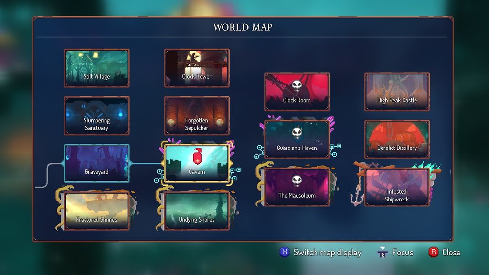</a> | `map_dc_world_map_biomes.jpg` Dead Cells, 'WORLD MAP': each biome a named picture tile ('Graveyard', 'Cavern', 'Clock Tower', 'Forgotten Sepulcher', 'Stilt Village', 'Infested Shipwreck', 'Undying Shores'), boss biomes with a skull ('Guardian's Haven', 'The Mausoleum', 'Clock Room'), the road taken drawn as a line and one tile framed in gold. | [page](https://steamcommunity.com/sharedfiles/filedetails/?id=2723344629) · [image](https://images.steamusercontent.com/ugc/1838032657065594471/A1C3D04315220A2B8267C951DF03E62B760E825C/) |
| <a href="map_dc_prisoners_cells_map_labels.jpg">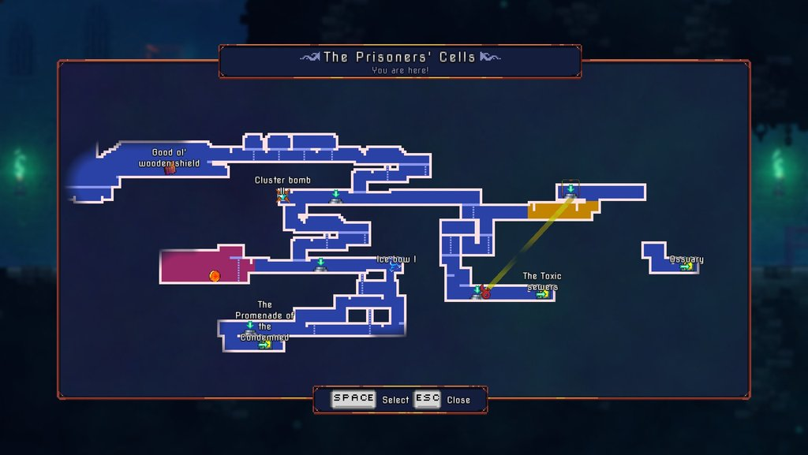</a> | `map_dc_prisoners_cells_map_labels.jpg` Dead Cells, the map of one biome, 'The Prisoners' Cells, You are here!': what was seen written where it lies ('Good ol' wooden shield', 'Cluster bomb', 'Ice bow I') and each exit named for where it leads ('The Toxic sewers', 'Ossuary', 'The Promenade of the Condemned'). | [page](https://steamcommunity.com/sharedfiles/filedetails/?id=929927563) · [image](https://images.steamusercontent.com/ugc/770525295635909974/965D90DEFA3773E6BC351C79C0FE29D11E49208E/) |
| <a href="map_dd_dungeon_map_room_icons_crop_x2.jpg">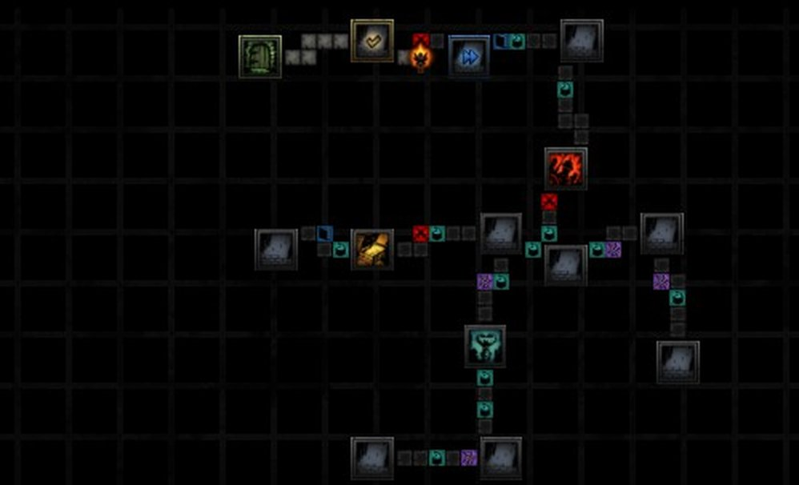</a> | `map_dd_dungeon_map_room_icons_crop_x2.jpg` Crop, enlarged twice: Darkest Dungeon's dungeon map, each room a square icon (the entrance, a treasure room, a battle, the boss in red) and each corridor a row of small squares, some carrying the mark of what waits or was found in them. | [page](https://steamcommunity.com/sharedfiles/filedetails/?id=1309224806) · [image](https://images.steamusercontent.com/ugc/936057564704275879/AE104F67D8B93822A96F4583CD32D0072EBAC353/) |
| <a href="map_eo3_b23f_map_icons.jpg">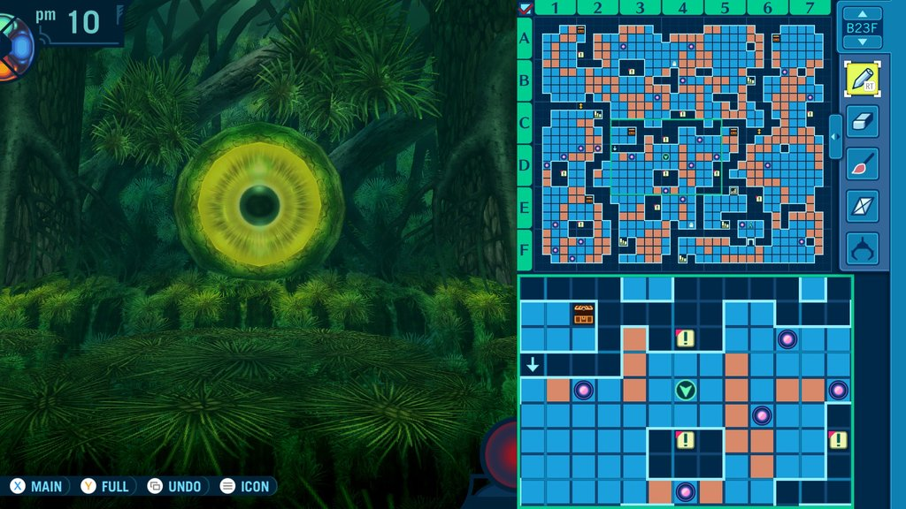</a> | `map_eo3_b23f_map_icons.jpg` Etrian Odyssey III HD, 'B23F': the whole floor in a lettered and numbered grid above the near squares, with chests, '!' marks, stairs and orb icons on the squares they belong to, and the drawing tools at the right. | [page](https://steamcommunity.com/sharedfiles/filedetails/?id=2997716696) · [image](https://images.steamusercontent.com/ugc/2056504904010386801/A478A38DE8524CAB7CC649338725F80383A23E62/) |
| <a href="map_eo3_b20f_stratum_title.jpg">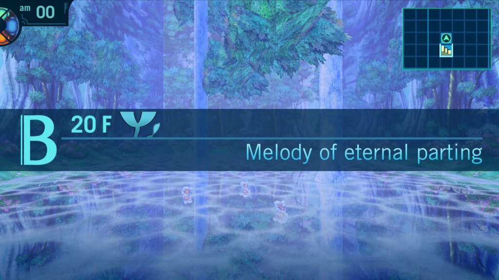</a> | `map_eo3_b20f_stratum_title.jpg` Etrian Odyssey III HD, a floor's title as the party steps onto it, 'B 20F' and the stratum's sign over its name, 'Melody of eternal parting'. | [page](https://steamcommunity.com/sharedfiles/filedetails/?id=3146532762) · [image](https://images.steamusercontent.com/ugc/2301970112505282565/5035BBFF10DCD7F213AD0B6C16C015F11D4E3A39/) |
| <a href="map_p3r_tartarus_16f_treasure_objective.jpg">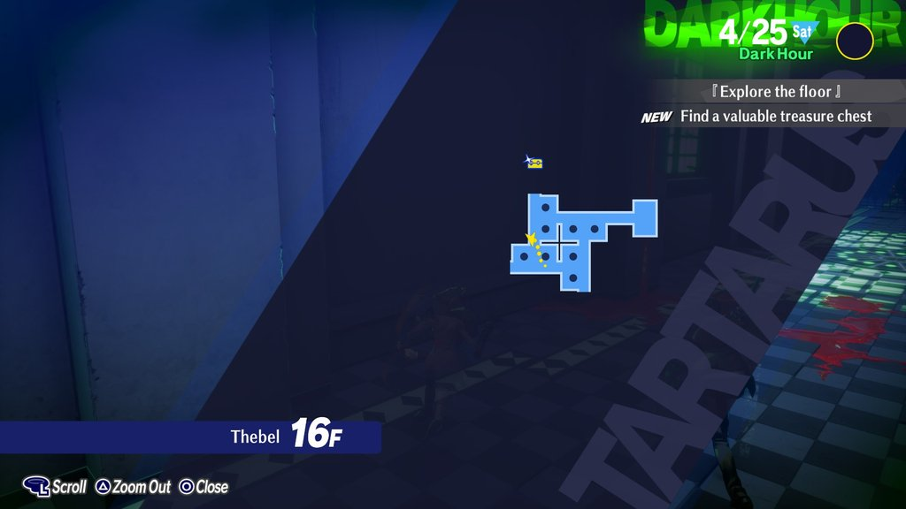</a> | `map_p3r_tartarus_16f_treasure_objective.jpg` Persona 3 Reload, the Tartarus floor map, 'Thebel 16F': the part walked in blue, a treasure chest marked beyond it, and the floor's aims at the top right, '『Explore the floor』' and 'NEW Find a valuable treasure chest'. | [page](https://steamcommunity.com/sharedfiles/filedetails/?id=3727847837) · [image](https://images.steamusercontent.com/ugc/15240233076475822727/50409CF78359DD1AEDFDA93E6CCCF954C0C6441A/) |
| <a href="map_p3r_tartarus_106f_shortcut.jpg">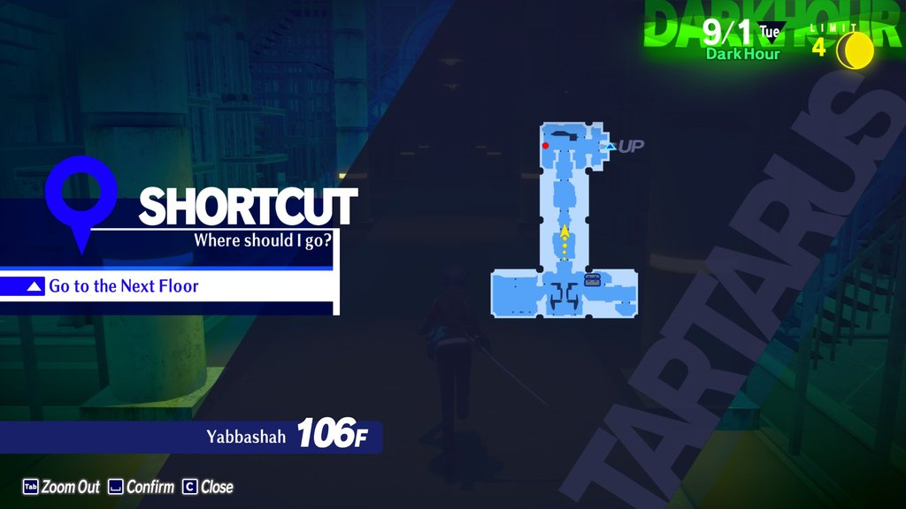</a> | `map_p3r_tartarus_106f_shortcut.jpg` Persona 3 Reload, 'Yabbashah 106F': a shortcut found on the floor, 'SHORTCUT Where should I go? Go to the Next Floor', with the map beside it. | [page](https://steamcommunity.com/sharedfiles/filedetails/?id=3379548201) · [image](https://images.steamusercontent.com/ugc/32184619289833755/6C78716CEA69841568F4A722CF6D0D757CA720B1/) |
| <a href="map_sts_map_legend.jpg">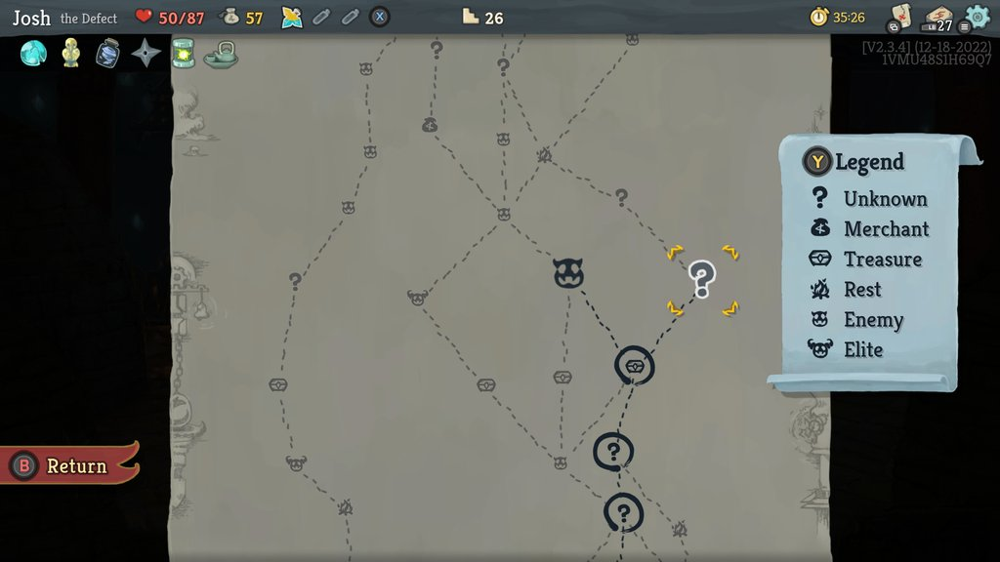</a> | `map_sts_map_legend.jpg` Slay the Spire, the map with its 'Legend' (Unknown, Merchant, Treasure, Rest, Enemy, Elite): the rooms taken circled in ink, the next choice framed in gold. | [page](https://steamcommunity.com/sharedfiles/filedetails/?id=3133581572) · [image](https://images.steamusercontent.com/ugc/2277197144485422573/27D856B887B7B1F004D6EF30A8CCB76625C0E80F/) |

## Army

A bonus for bringing several of one kind, drawn where the party is. Teamfight Tactics lists each trait down the side of the board, the number fielded beside its icon and its steps written out ('2 › 4 › 6 › 8'), coloured by the step reached and grey until the first; Dota Underlords gives each alliance a column of pips that light as units join. Siralim Ultimate writes a family's bonus as a condition on the whole party ('If all the creatures in your party are Banshees...'), and Solo Leveling: Arise Overdrive gives each Shadow an aura for the whole team under its stats ('Shadow's Authority: Increases entire team's Defense'). Hades II's Arcana and Diablo IV's Book of the Dead show bonuses with a price or a condition in the same window as the cards or minions they belong to. ARISE can take Teamfight Tactics' tracker for Kin (the family, the count, the tier lit) and Solo Leveling's line under each Shadow for its role's aura.

| | What it shows | Source |
|---|---|---|
| <a href="army_tft_trait_tracker_tiers.jpg">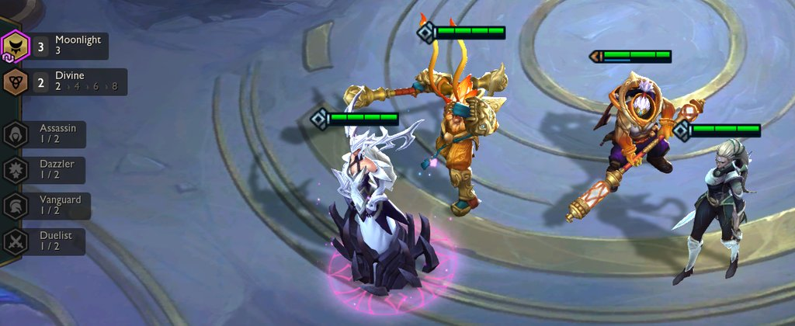</a> | `army_tft_trait_tracker_tiers.jpg` Teamfight Tactics (Fates), the trait tracker down the left of the board: an active trait as a coloured hexagon with the count fielded ('3 Moonlight 3', gold), a tiered one with its steps ('2 Divine 2 › 4 › 6 › 8', bronze, the reached step lit), and traits not yet active in grey, 'Assassin 1 / 2', 'Dazzler 1 / 2', 'Vanguard 1 / 2', 'Duelist 1 / 2'. | [page](https://wiki.leagueoflegends.com/en-us/File:Chosen_Double_Trait.png) · [image](https://wiki.leagueoflegends.com/en-us/images/Chosen_Double_Trait.png) |
| <a href="army_underlords_board_alliances.jpg">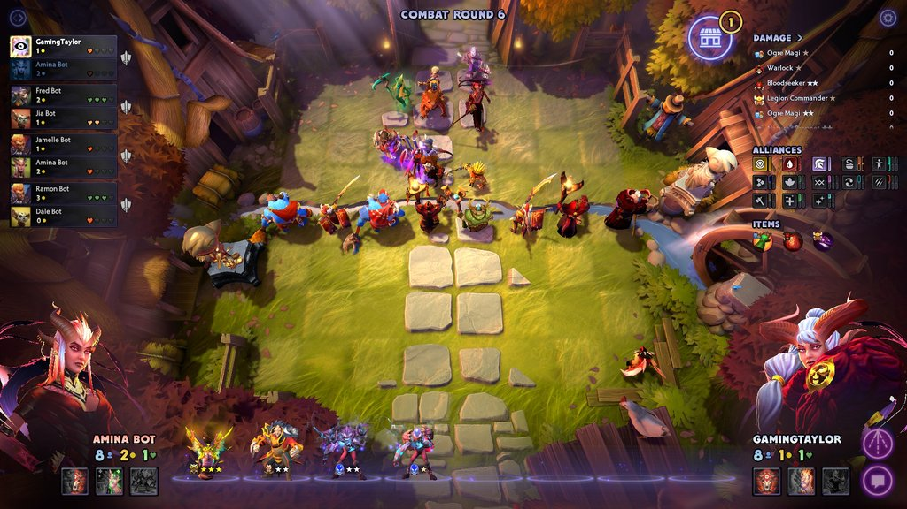</a> | `army_underlords_board_alliances.jpg` Dota Underlords, 'COMBAT ROUND 6': the board, and down the right the damage list, 'ALLIANCES' and 'ITEMS'. | [page](https://steamcommunity.com/sharedfiles/filedetails/?id=2018928564) · [image](https://images.steamusercontent.com/ugc/790884041223856012/BAB33C3323D4DA1A66ED565AE640EA1E2EFE707B/) |
| <a href="army_underlords_alliances_panel_crop_x3.jpg">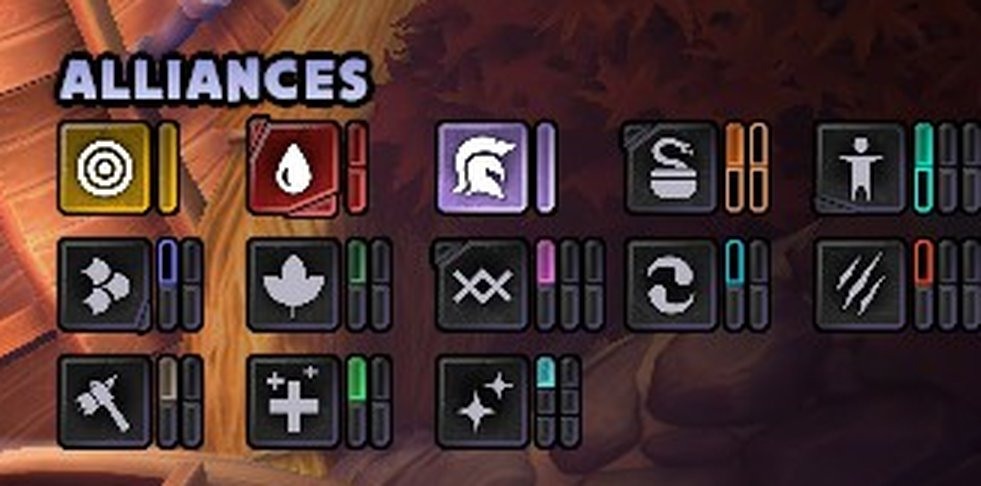</a> | `army_underlords_alliances_panel_crop_x3.jpg` Crop, enlarged three times: each alliance an icon with a column of pips beside it, the pips lit as units of that alliance are fielded; the alliances already active framed in colour. Cropped from the same source as `army_underlords_board_alliances.jpg`. | [page](https://steamcommunity.com/sharedfiles/filedetails/?id=2018928564) · [image](https://images.steamusercontent.com/ugc/790884041223856012/BAB33C3323D4DA1A66ED565AE640EA1E2EFE707B/) |
| <a href="army_siralim_master_of_banshees_trait.jpg">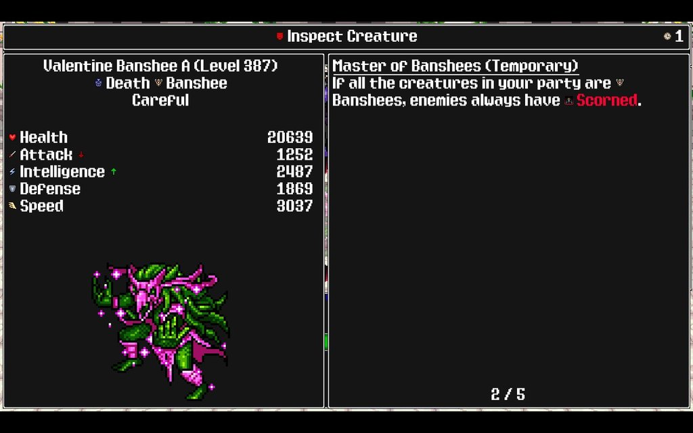</a> | `army_siralim_master_of_banshees_trait.jpg` Siralim Ultimate, 'Inspect Creature': 'Valentine Banshee A (Level 387)', 'Death · Banshee', and its trait 'Master of Banshees (Temporary): If all the creatures in your party are Banshees, enemies always have Scorned.', a bonus that holds only while the whole party is one family. | [page](https://steamcommunity.com/sharedfiles/filedetails/?id=3603777182) · [image](https://images.steamusercontent.com/ugc/10664256739018620419/2832F0339BC68D9EB2A0CCA44A801D779940B6D6/) |
| <a href="army_sla_army_of_shadows_authority.jpg">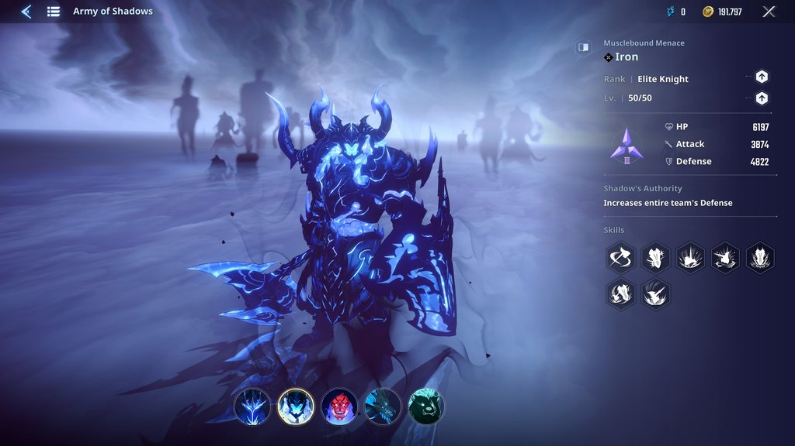</a> | `army_sla_army_of_shadows_authority.jpg` Solo Leveling: Arise Overdrive, 'Army of Shadows': one Shadow at full size, its kin standing in the fog behind, the Shadows owned in a row at the foot. | [page](https://steamcommunity.com/sharedfiles/filedetails/?id=3624202743) · [image](https://images.steamusercontent.com/ugc/17059731680714314083/7752CA469BCC9276379FEB18B61DCB65CE73D478/) |
| <a href="army_sla_army_of_shadows_authority_crop.jpg">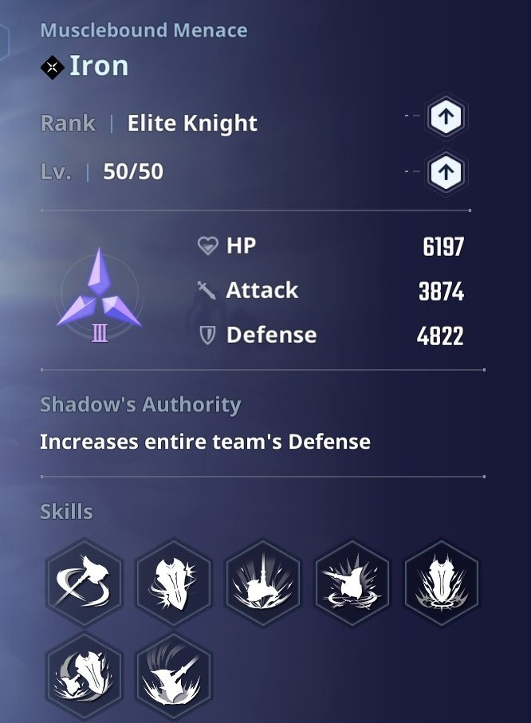</a> | `army_sla_army_of_shadows_authority_crop.jpg` Crop: 'Musclebound Menace Iron', 'Rank | Elite Knight', 'Lv. | 50/50', HP, Attack and Defense, and the Shadow's aura for the whole party, 'Shadow's Authority: Increases entire team's Defense', above its seven skills. Cropped from the same source as `army_sla_army_of_shadows_authority.jpg`. | [page](https://steamcommunity.com/sharedfiles/filedetails/?id=3624202743) · [image](https://images.steamusercontent.com/ugc/17059731680714314083/7752CA469BCC9276379FEB18B61DCB65CE73D478/) |
| <a href="army_hades2_arcana_judgment_awakening.jpg">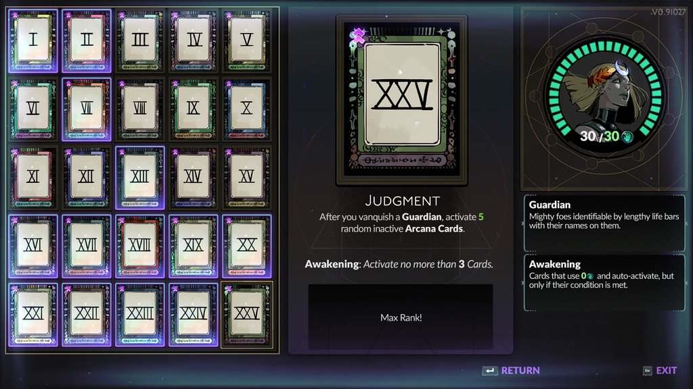</a> | `army_hades2_arcana_judgment_awakening.jpg` Hades II, the Arcana: twenty-five cards in a grid, one opened, 'Judgment: After you vanquish a Guardian, activate 5 random inactive Arcana Cards.', its condition 'Awakening: Activate no more than 3 Cards.', the Grasp '30/30', and the terms explained at the side ('Awakening: Cards that use 0 and auto-activate, but only if their condition is met.'). | [page](https://steamcommunity.com/sharedfiles/filedetails/?id=3253278822) · [image](https://images.steamusercontent.com/ugc/2478747265489174997/7758F538333BEC69256525EA83E95E8C799D0783/) |
| <a href="army_overlord_minion_pits_colours.jpg">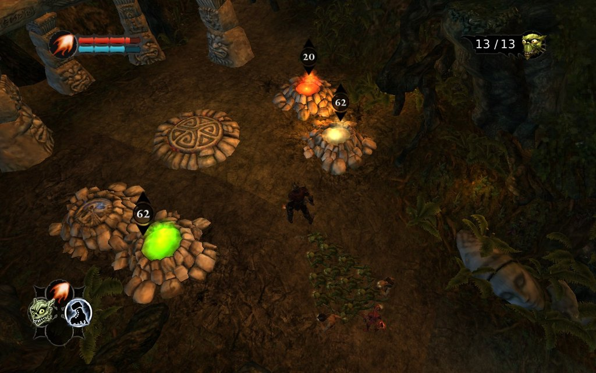</a> | `army_overlord_minion_pits_colours.jpg` Overlord, three minion pits, each glowing in one minion colour with the stock it holds above it (20, 62, 62); the horde '13 / 13' at top right and the colour selector at bottom left. | [page](https://steamcommunity.com/sharedfiles/filedetails/?id=23986794) · [image](https://images.steamusercontent.com/ugc/595814531204392181/9702E675E7C0AAE5A4C0181A4D03DA5EF38A665D/) |
| <a href="army_d4_book_of_the_dead_minion_types.jpg">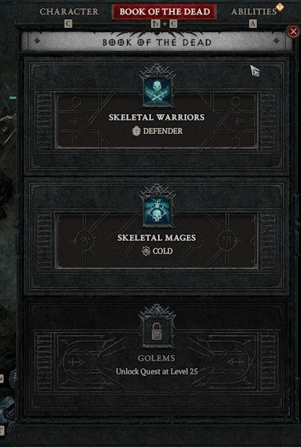</a> | `army_d4_book_of_the_dead_minion_types.jpg` Diablo IV, 'BOOK OF THE DEAD': one row to each kind of minion with the variant chosen under its name, 'SKELETAL WARRIORS Defender', 'SKELETAL MAGES Cold', and 'GOLEMS Unlock Quest at Level 25'. | [page](https://beebom.com/how-use-book-of-the-dead-diablo-4/) · [image](https://static.beebom.com/wp-content/uploads/2023/06/The-Book-of-the-Dead-Page-for-Necromancer-in-Diablo-4.jpg) |
| <a href="army_d4_book_of_the_dead_sacrifice_crop.jpg">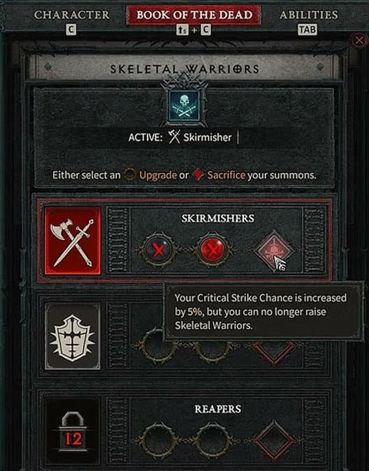</a> | `army_d4_book_of_the_dead_sacrifice_crop.jpg` Crop: 'SKELETAL WARRIORS', 'ACTIVE: Skirmisher', 'Either select an Upgrade or Sacrifice your summons.', and the Sacrifice node's line, 'Your Critical Strike Chance is increased by 5%, but you can no longer raise Skeletal Warriors.' | [page](https://segmentnext.com/diablo-4-book-of-the-dead) · [image](https://r2.segmentnextimages.com/wp-content/uploads/2023/06/Diablo-4-Book-of-the-Dead.jpg) |

## Gear

A power that changes a rule, kept once it is taken from the item. Diablo III's Kanai's Cube destroys a legendary to extract its power into a collection shared by every hero, and equips one power each from a weapon, an armour and a piece of jewellery in three slots under the box; Diablo IV's Codex of Power lists every aspect by kind and counts them ('ALL (1/115)'), each tooltip saying what it does and where it was found. The powers themselves are worded as one rule, often with its cost in the same line: 'Chaos Damage does not bypass Energy Shield' (Path of Exile), '+1 to Teleport' for any class (Enigma), 'all stats on this item are tripled for 4 seconds' (Last Epoch), 'When you encounter the Merchant, immediately obtain EVERYTHING he sells.' (Slay the Spire 2), a power bound to a skill the hero already uses (Grim Dawn), and Hades' hammer changing what the weapon in hand does. ARISE can take the Cube's shape for the Codex (extract once, keep for good, a slot per kind of gear) and the one-line wording of a rule with its cost.

| | What it shows | Source |
|---|---|---|
| <a href="gear_d3_kanais_cube_extract_recipe.jpg">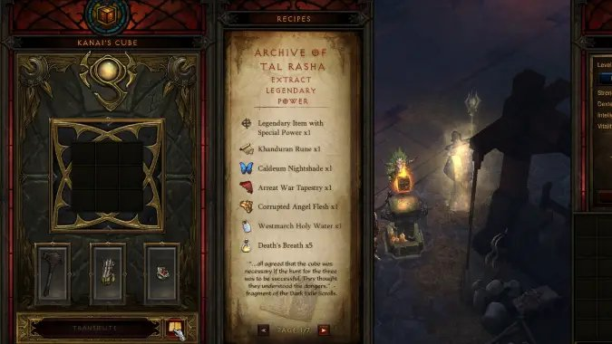</a> | `gear_d3_kanais_cube_extract_recipe.jpg` Diablo III (2015 test realm), 'KANAI'S CUBE': the 3 × 3 box and the three power slots under it, and the recipe page 'Archive of Tal Rasha, Extract Legendary Power': 'Legendary Item with Special Power x1', one each of five Act materials, 'Death's Breath x5'. | [page](https://blizzardwatch.com/2015/08/01/overview-kanais-cube-diablo-3/) · [image](https://blizzardwatch.com/wp-content/uploads/2015/07/d3-kanais-cube-extract.jpg) |
| <a href="gear_d3_kanais_cube_powers_collection.jpg">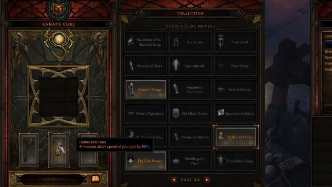</a> | `gear_d3_kanais_cube_powers_collection.jpg` Diablo III, the Cube beside its 'COLLECTION, KANAI'S CUBE POWERS', opened from the armour slot; three powers equipped below the box (a weapon's, an armour's, a ring's). | [page](https://blizzardwatch.com/2015/08/01/overview-kanais-cube-diablo-3/) · [image](https://blizzardwatch.com/wp-content/uploads/2015/07/d3-kanais-cube-library.jpg) |
| <a href="gear_d3_kanais_cube_powers_collection_crop_x2.jpg">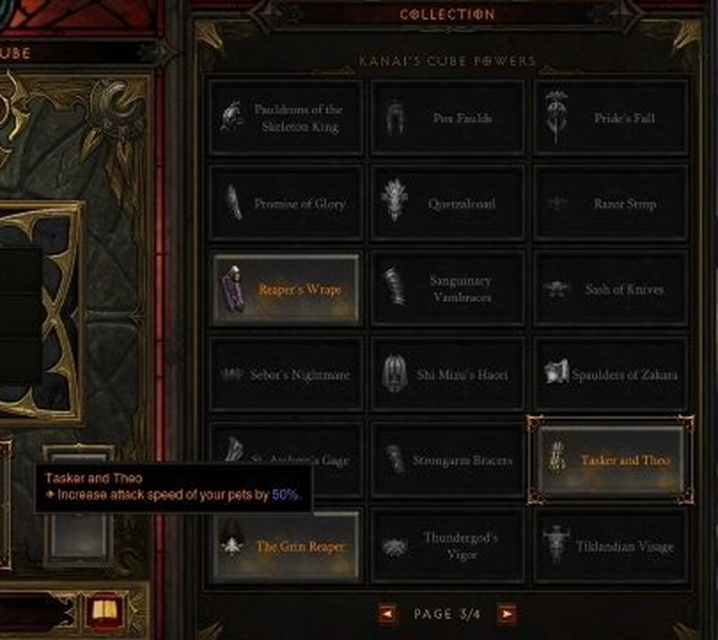</a> | `gear_d3_kanais_cube_powers_collection_crop_x2.jpg` Crop, enlarged twice: a grid of extracted powers by item name ('Reaper's Wraps', 'Tasker and Theo' and 'The Grin Reaper' lit, 'Spaulders of Zakara' and the rest dark), 'PAGE 3/4', and the slot's tooltip 'Tasker and Theo: Increase attack speed of your pets by 50%.' Cropped from the same source as `gear_d3_kanais_cube_powers_collection.jpg`. | [page](https://blizzardwatch.com/2015/08/01/overview-kanais-cube-diablo-3/) · [image](https://blizzardwatch.com/wp-content/uploads/2015/07/d3-kanais-cube-library.jpg) |
| <a href="gear_d4_codex_of_power_aspect_tooltip.jpg">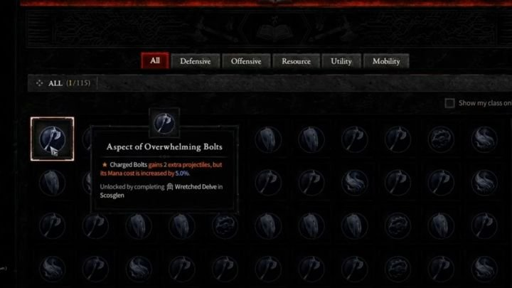</a> | `gear_d4_codex_of_power_aspect_tooltip.jpg` Diablo IV at launch, the Codex of Power: 'ALL (1/115)' and tabs 'All, Defensive, Offensive, Resource, Utility, Mobility', a grid of aspect sigils with one known, and its tooltip, 'Aspect of Overwhelming Bolts: Charged Bolts gains 2 extra projectiles, but its Mana cost is increased by 5.0%. Unlocked by completing Wretched Delve in Scosglen.' | [page](https://www.gamepressure.com/diablo-iv/what-are-aspects/z6109c9) · [image](https://www.gamepressure.com/diablo-iv/gfx/word/1431303046.jpg) |
| <a href="gear_d4_codex_of_power_progress.jpg">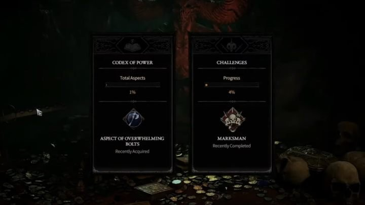</a> | `gear_d4_codex_of_power_progress.jpg` Diablo IV, the collections at a glance: 'CODEX OF POWER, Total Aspects 1%', 'ASPECT OF OVERWHELMING BOLTS, Recently Acquired', beside 'CHALLENGES, Progress 4%'. | [page](https://www.gamepressure.com/diablo-iv/what-are-aspects/z6109c9) · [image](https://www.gamepressure.com/diablo-iv/gfx/word/1431303031.jpg) |
| <a href="gear_d2r_enigma_runeword_tooltip.jpg">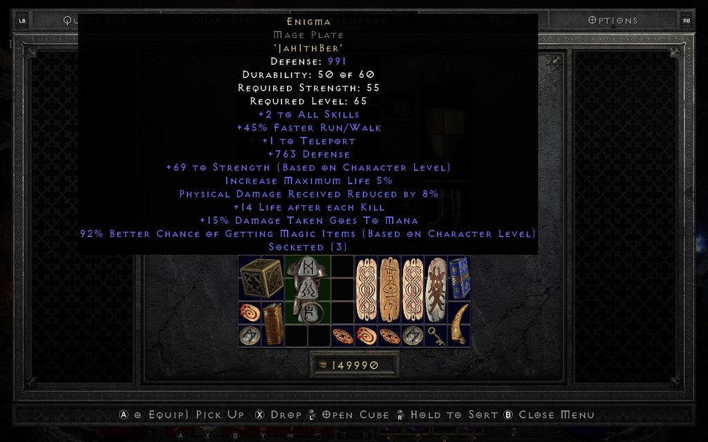</a> | `gear_d2r_enigma_runeword_tooltip.jpg` Diablo II: Resurrected, the runeword Enigma in a Mage Plate, the runes that made it under its name ('JahIthBer'), a skill any class gains from it, '+1 to Teleport', among its stat lines, and 'Socketed (3)'. | [page](https://steamcommunity.com/sharedfiles/filedetails/?id=3733040347) · [image](https://images.steamusercontent.com/ugc/12147084942466805888/F02AC44FCC1B181742376E624AE4F55968DC92EC/) |
| <a href="gear_poe_shavronnes_wrappings_tooltip_crop_x2.jpg">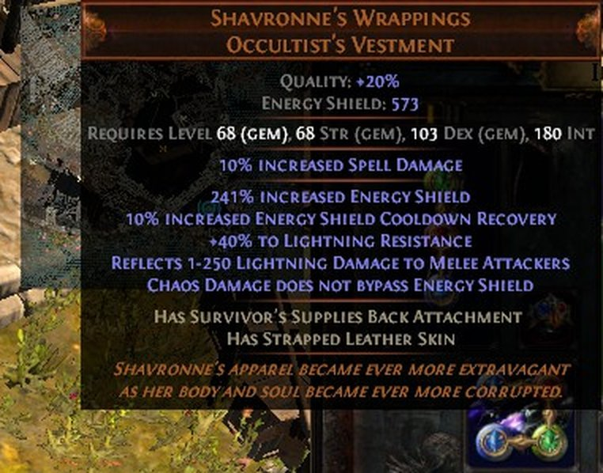</a> | `gear_poe_shavronnes_wrappings_tooltip_crop_x2.jpg` Crop, enlarged twice: Path of Exile, 'Shavronne's Wrappings, Occultist's Vestment', stat lines in blue and one line that changes a rule, 'Chaos Damage does not bypass Energy Shield', with the flavour text in orange under it. | [page](https://steamcommunity.com/sharedfiles/filedetails/?id=200616498) · [image](https://images.steamusercontent.com/ugc/510327888330584294/C9566B00935751844C9CF393A30B9CEEE8B310FF/) |
| <a href="gear_gd_celestial_power_elemental_storm_crop.jpg">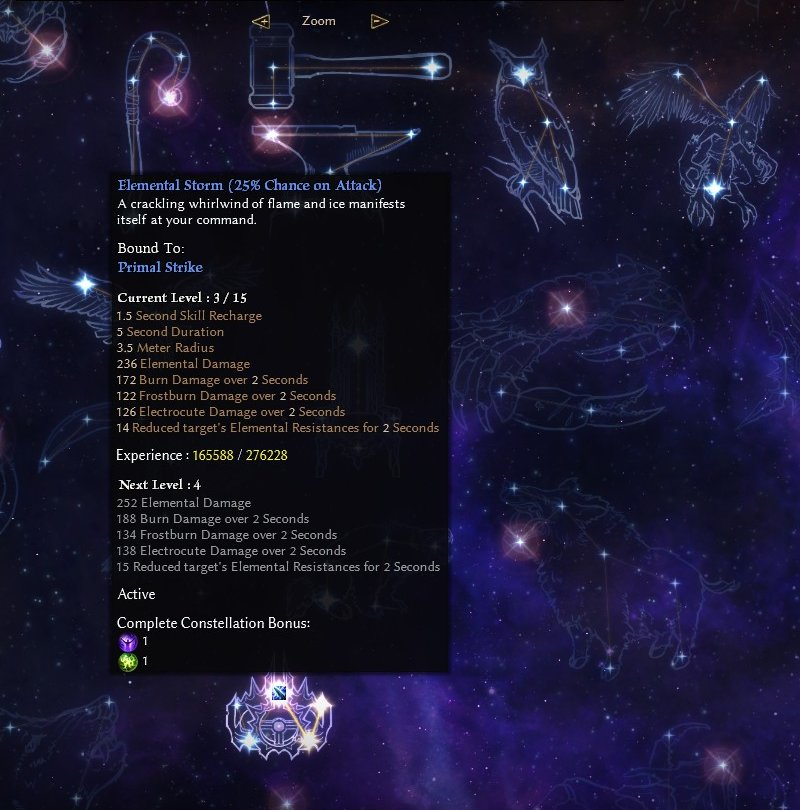</a> | `gear_gd_celestial_power_elemental_storm_crop.jpg` Crop: Grim Dawn, a constellation's power, 'Elemental Storm (25% Chance on Attack)', 'Bound To: Primal Strike', 'Current Level: 3 / 15', its numbers, 'Experience: 165588 / 276228' and the next level's numbers: a power that rides on a skill the hero already uses. | [page](https://steamcommunity.com/sharedfiles/filedetails/?id=713206261) · [image](https://images.steamusercontent.com/ugc/442858682647555920/F0C1589513E0641CB9A7C74210B2715603715ABA/) |
| <a href="gear_hades_daedalus_hammer_choice.jpg">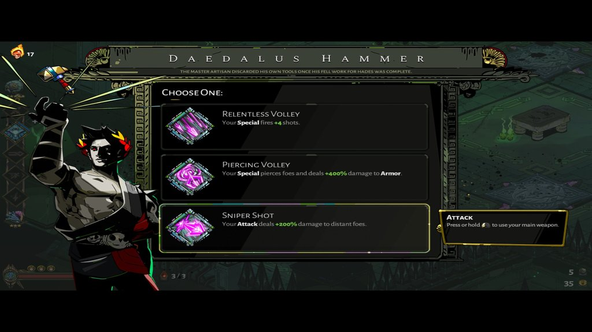</a> | `gear_hades_daedalus_hammer_choice.jpg` Hades, 'DAEDALUS HAMMER, Choose One:': three changes to the weapon in hand, 'Relentless Volley: Your Special fires +4 shots.', 'Piercing Volley: Your Special pierces foes and deals +400% damage to Armor.', 'Sniper Shot: Your Attack deals +200% damage to distant foes.' | [page](https://steamcommunity.com/sharedfiles/filedetails/?id=2401219951) · [image](https://images.steamusercontent.com/ugc/1774952167694605312/5A07C24F29FAFE283B62A7FD6A4EDC4E1D9D435B/) |
| <a href="gear_le_julras_stardial_eternity_cache_crop.jpg">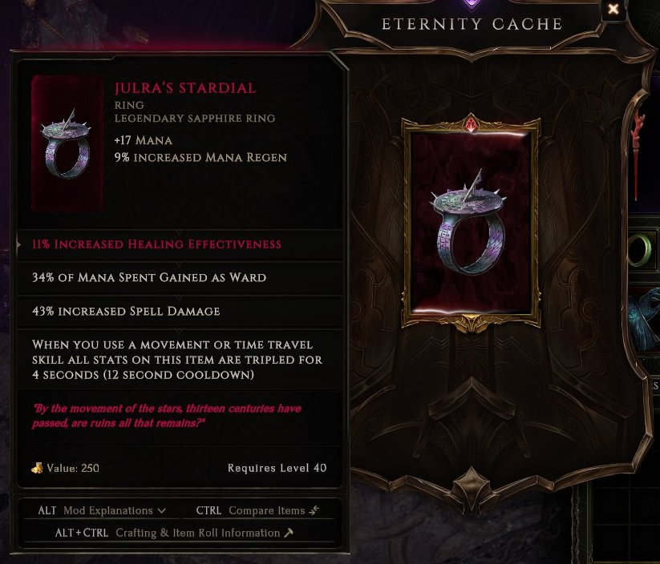</a> | `gear_le_julras_stardial_eternity_cache_crop.jpg` Crop: Last Epoch, 'Julra's Stardial, Legendary Sapphire Ring' laid in the 'ETERNITY CACHE': its unique line 'When you use a movement or time travel skill all stats on this item are tripled for 4 seconds (12 second cooldown)' under the affixes it was made legendary with. | [page](https://steamcommunity.com/sharedfiles/filedetails/?id=2895608794) · [image](https://images.steamusercontent.com/ugc/1979924688186902767/C313BE742A2BE03341F984373519C7CD7B7D1817/) |
| <a href="gear_sts2_lords_parasol_relic_tooltip_crop_x2.jpg">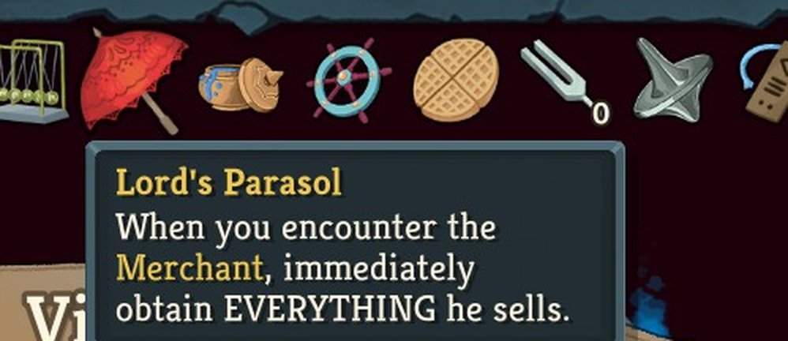</a> | `gear_sts2_lords_parasol_relic_tooltip_crop_x2.jpg` Crop, enlarged twice: Slay the Spire 2, the relic bar and one relic's tooltip, 'Lord's Parasol: When you encounter the Merchant, immediately obtain EVERYTHING he sells.', the keyword in gold. | [page](https://steamcommunity.com/sharedfiles/filedetails/?id=3685332794) · [image](https://images.steamusercontent.com/ugc/14431037493888393999/39C2048CAC755D57D941A4FFC48D553C1BC8A5D3/) |

## Daily

One run a day from the date, the same for everyone, with its modifiers stated and a score to beat. Slay the Spire's Daily Climb opens on the date, the time left, the fixed character and its modifiers one a line, each named and coloured, with the day's leaderboard beside it and a warning that achievements are off; its run history marks the run 'Victory! (Daily)' with its score, the modifiers' icons and its seed. Wildfrost and Spelunky 2 put the date at the head of the board, Wildfrost with arrows to step between days; Dead Cells ends the run with its score worked out and the rank it reached; Risk of Rain 2 states that every player gets 'an identical seeded game world'. Shattered Pixel Dungeon's dailies are offline and keep a local history, and its score breakdown writes out what each part is based on. ARISE can take Slay the Spire's window for the Rift (date, time left, modifiers one a line), Dead Cells' worked score, and Shattered Pixel Dungeon's local history in place of a leaderboard.

| | What it shows | Source |
|---|---|---|
| <a href="daily_sts_daily_challenge_leaderboard.jpg">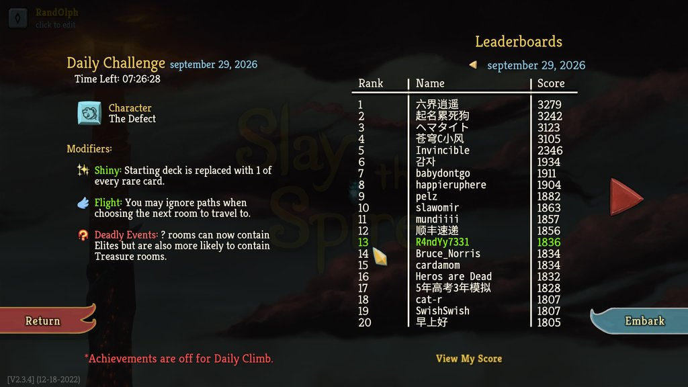</a> | `daily_sts_daily_challenge_leaderboard.jpg` Slay the Spire, 'Daily Challenge september 29, 2026', 'Time Left: 07:26:28', 'Character: The Defect', and 'Modifiers:' one a line ('Shiny: Starting deck is replaced with 1 of every rare card.', 'Flight: You may ignore paths when choosing the next room to travel to.', 'Deadly Events: ? rooms can now contain Elites but are also more likely to contain Treasure rooms.'); the day's 'Leaderboards' beside it, Rank, Name, Score, the player at 13 in green; '*Achievements are off for Daily Climb.', 'View My Score', 'Embark'. | [page](https://steamcommunity.com/sharedfiles/filedetails/?id=3810301453) · [image](https://images.steamusercontent.com/ugc/13310219089603006126/6BC249BB84A7CB511F9EFECAC2D006F955BFD29B/) |
| <a href="daily_sts_daily_challenge_modifiers_crop.jpg">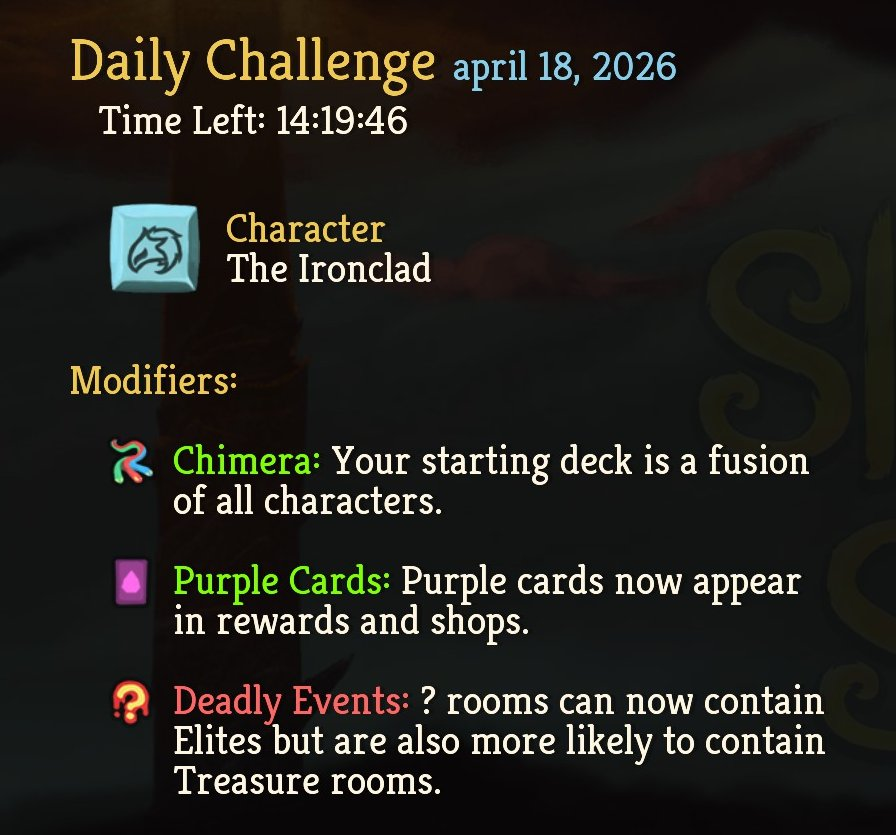</a> | `daily_sts_daily_challenge_modifiers_crop.jpg` Crop: another day's climb, 'april 18, 2026', 'Time Left: 14:19:46', 'The Ironclad', and its modifiers, 'Chimera: Your starting deck is a fusion of all characters.', 'Purple Cards: Purple cards now appear in rewards and shops.', 'Deadly Events'. | [page](https://steamcommunity.com/sharedfiles/filedetails/?id=3709112738) · [image](https://images.steamusercontent.com/ugc/16213142307958335203/EF29ECA8E083689A50B504382FEF5E6EE5E44D97/) |
| <a href="daily_sts_run_history_victory_daily.jpg">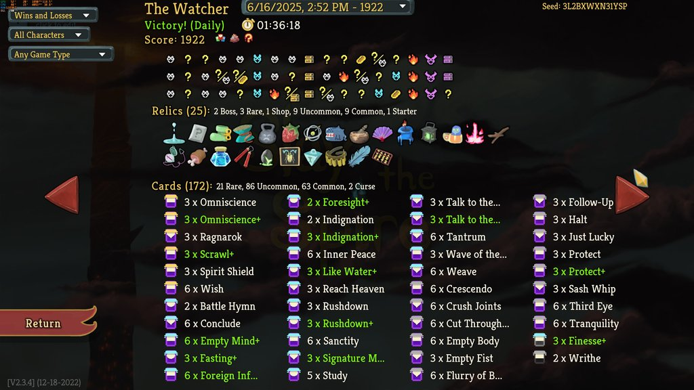</a> | `daily_sts_run_history_victory_daily.jpg` Slay the Spire, Run History: 'The Watcher', '6/16/2025, 2:52 PM - 1922', 'Victory! (Daily)', the time '01:36:18', 'Score: 1922' with the day's three modifier icons beside it, the 'Seed', and filters 'Wins and Losses', 'All Characters', 'Any Game Type'; the road climbed as a row of room icons, then 'Relics (25)' and 'Cards (172)'. | [page](https://steamcommunity.com/sharedfiles/filedetails/?id=3501136565) · [image](https://images.steamusercontent.com/ugc/11654374397126332574/B55B46B78F718FE51A757ED39FF06C605CE2E52C/) |
| <a href="daily_wildfrost_daily_leaderboard.jpg">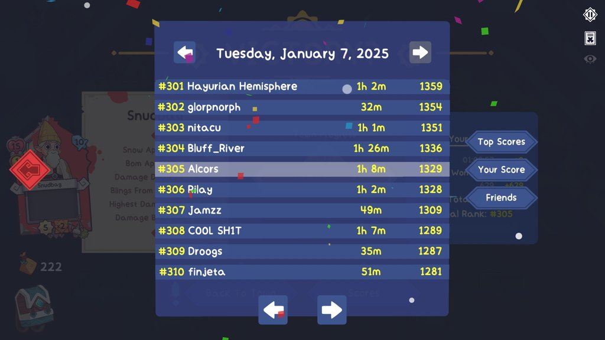</a> | `daily_wildfrost_daily_leaderboard.jpg` Wildfrost, the Daily Voyage's board: 'Tuesday, January 7, 2025' between arrows that step to other days, rank, name, time and score a row ('#305 Alcors 1h 8m 1329' lit), and 'Top Scores', 'Your Score', 'Friends'. | [page](https://steamcommunity.com/sharedfiles/filedetails/?id=3402982678) · [image](https://images.steamusercontent.com/ugc/10795510683359066/EBD2F6424AE08E8FE0C8AC6C233F246F973857D5/) |
| <a href="daily_spelunky2_daily_leaderboard.jpg">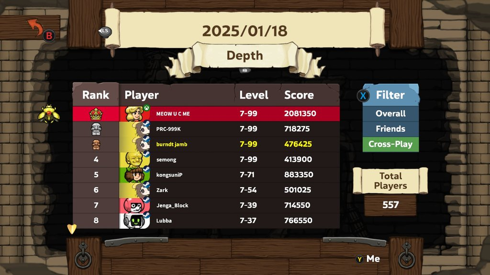</a> | `daily_spelunky2_daily_leaderboard.jpg` Spelunky 2, the daily's board: '2025/01/18', 'Depth', Rank, Player, Level, Score, the top three marked with a crown and two idols, 'Filter: Overall, Friends, Cross-Play', 'Total Players 557', 'Me'. | [page](https://steamcommunity.com/sharedfiles/filedetails/?id=3409633775) · [image](https://images.steamusercontent.com/ugc/27684734846805674/09CBB41402C1243B69442E51C778EE0860575CFA/) |
| <a href="daily_dc_daily_challenge_finished.jpg">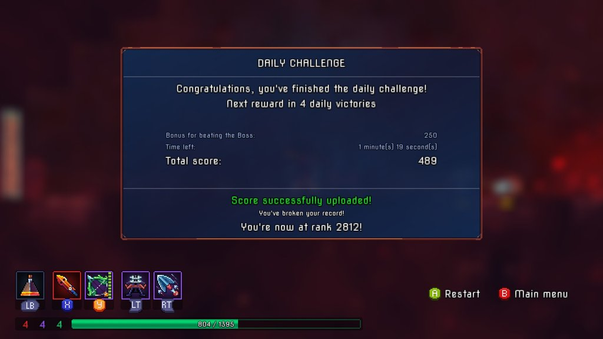</a> | `daily_dc_daily_challenge_finished.jpg` Dead Cells, 'DAILY CHALLENGE': 'Congratulations, you've finished the daily challenge! Next reward in 4 daily victories', 'Bonus for beating the Boss: 250', 'Time left: 1 minute(s) 19 second(s)', 'Total score: 489', 'Score successfully uploaded! You've broken your record! You're now at rank 2812!' | [page](https://steamcommunity.com/sharedfiles/filedetails/?id=1509117971) · [image](https://images.steamusercontent.com/ugc/943957141156636075/B69B3AD5A294B3326E1FD494CF6C89AD2D756D0B/) |
| <a href="daily_dc_daily_challenge_ranking.jpg">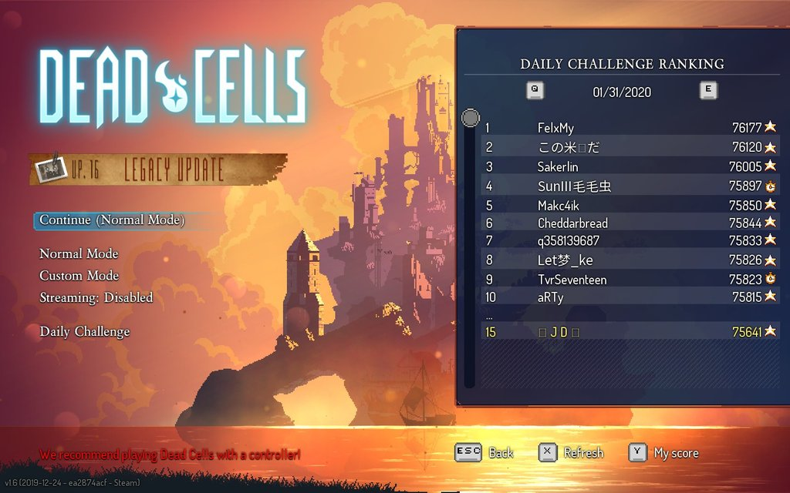</a> | `daily_dc_daily_challenge_ranking.jpg` Dead Cells, the title screen's 'DAILY CHALLENGE RANKING, 01/31/2020': the top ten and their scores, then '...' and the player's own row at 15. | [page](https://steamcommunity.com/sharedfiles/filedetails/?id=1984512693) · [image](https://images.steamusercontent.com/ugc/788628870015315571/67D14AB0289E124E8636E79EFDC2BA0137C7CE1D/) |
| <a href="daily_balatro_win_seed.jpg">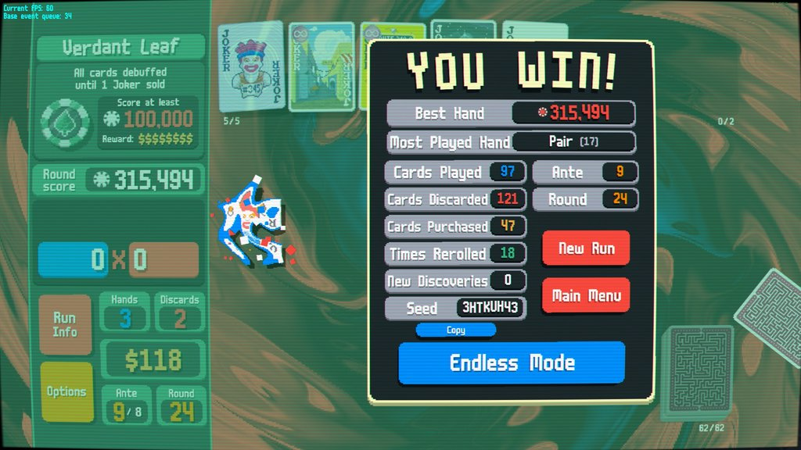</a> | `daily_balatro_win_seed.jpg` Balatro, 'YOU WIN!' after the boss blind 'Verdant Leaf': 'Best Hand 315,494', 'Most Played Hand Pair (17)', cards played, discarded and purchased, 'Times Rerolled 18', 'Ante 9', 'Round 24', and 'Seed 3HTKUH43' with 'Copy' under it. | [page](https://steamcommunity.com/sharedfiles/filedetails/?id=3495751415) · [image](https://images.steamusercontent.com/ugc/18053458294647050531/DE1E6C9964FD824F058DCB257986C777D40BFB73/) |
| <a href="daily_balatro_challenges_list.jpg">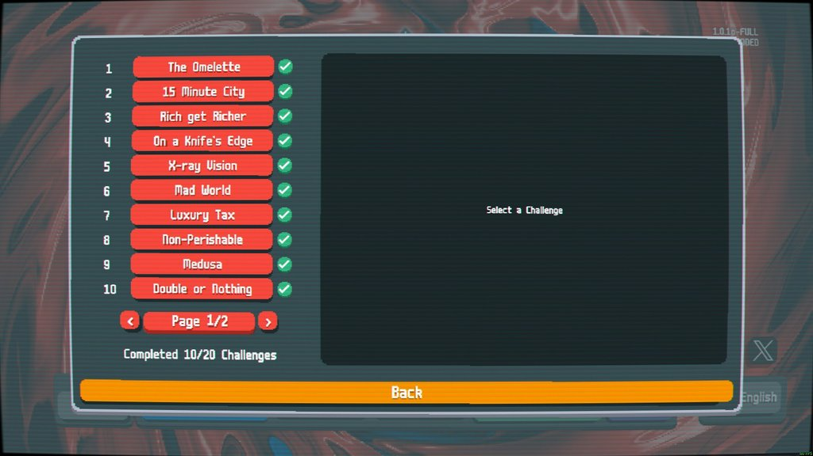</a> | `daily_balatro_challenges_list.jpg` Balatro, the Challenges: a numbered list ('The Omelette', '15 Minute City', 'Rich get Richer', 'On a Knife's Edge', 'X-ray Vision', 'Mad World', 'Luxury Tax', 'Non-Perishable', 'Medusa', 'Double or Nothing'), each ticked when beaten, 'Page 1/2', 'Completed 10/20 Challenges'. | [page](https://steamcommunity.com/sharedfiles/filedetails/?id=3576969477) · [image](https://images.steamusercontent.com/ugc/16167154674122210001/892ADBD03B8B0A721144FC8C4EED6EAAC134D9E2/) |
| <a href="daily_ror2_prismatic_trials.jpg">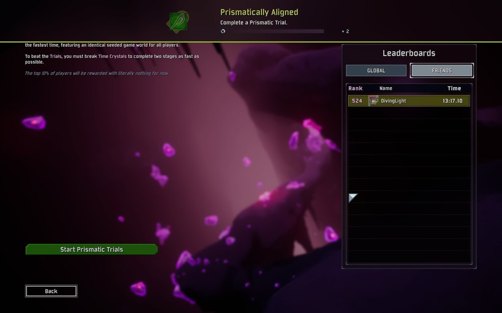</a> | `daily_ror2_prismatic_trials.jpg` Risk of Rain 2, the Prismatic Trials: '...the fastest time, featuring an identical seeded game world for all players. To beat the Trials, you must break Time Crystals to complete two stages as fast as possible.', 'Leaderboards' (Global, Friends; Rank, Name, Time), 'Start Prismatic Trials'. | [page](https://steamcommunity.com/sharedfiles/filedetails/?id=3781407464) · [image](https://images.steamusercontent.com/ugc/9919058073673744581/EAD4FC49E4EB636F6FFF9E5B1F1A0FA14A5767E0/) |
| <a href="daily_spd_score_breakdown.jpg">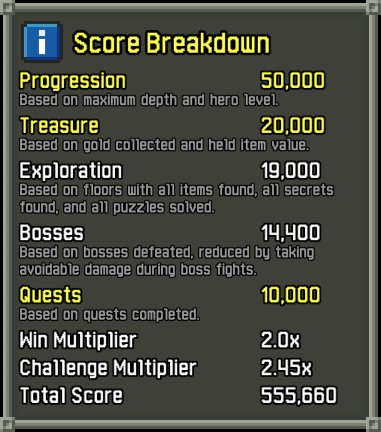</a> | `daily_spd_score_breakdown.jpg` Shattered Pixel Dungeon, 'Score Breakdown': 'Progression 50,000', 'Treasure 20,000', 'Exploration 19,000, Based on floors with all items found, all secrets found, and all puzzles solved.', 'Bosses 14,400, Based on bosses defeated, reduced by taking avoidable damage during boss fights.', 'Quests 10,000', 'Win Multiplier 2.0x', 'Challenge Multiplier 2.45x', 'Total Score 555,660'. Shown by the developer with the dailies, which are offline and keep a local history of every daily score. | [page](https://shatteredpixel.com/blog/coming-soon-to-shattered-badges-and-ascension.html) · [image](https://shatteredpixel.com/assets/images/2022/2022-06-24/score.png) |
| <a href="daily_spd_custom_seed_entry.jpg">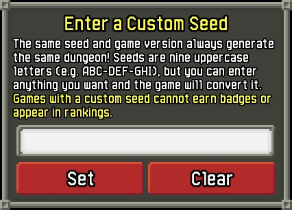</a> | `daily_spd_custom_seed_entry.jpg` Shattered Pixel Dungeon, 'Enter a Custom Seed: The same seed and game version always generate the same dungeon! Seeds are nine uppercase letters (e.g. ABC-DEF-GHI), but you can enter anything you want and the game will convert it. Games with a custom seed cannot earn badges or appear in rankings.' | [page](https://shatteredpixel.com/blog/coming-soon-to-shattered-seeded-runs.html) · [image](https://shatteredpixel.com/assets/images/2022/2022-05-02/seed-entry.png) |

## Not found

- **The Binding of Isaac:** a screenshot of a bombed wall opening onto a secret room. The wiki has the door's sprite and the rooms' layouts, not the moment; the minimap kept is the Void's, a large late floor.
- **Enter the Gungeon:** a cracked wall before it is shot open.
- **Etrian Odyssey:** a named landmark room on the map; the maps found carry icons only, so the stratum's title card stands in.
- **Persona 3 Reload:** a landmark room in Tartarus; only floor maps, a shortcut and the floor's aims.
- **Operencia: The Stolen Sun:** the map's secret counter. Its Steam screenshots hold no map, and no wiki image was found.
- **Brogue:** magic mapping or a secret door found by searching. The Brogue wiki has no screenshot of either.
- **Diablo:** a set-piece room marked on the automap. The Diablo II: Resurrected and Diablo IV maps found mark none.
- **Gradients:** a map that shades rooms by danger or reward with distance from the start. No game found draws it on the plan.
- **Hades' door reward previews:** not taken again; step 1 has `crop-hades-2-door.jpg` and step 5 `steer_hades_door_reward_orbs.jpg`.
- **Teamfight Tactics:** a trait's tooltip listing each tier's effect, and the tracker in a current set; only the Fates tracker from the League of Legends wiki.
- **Dota Underlords:** an alliance's tooltip with its tiers; only the panel of pips.
- **Monster Train:** the primary and allied clans' synergy in play; only run summaries and the clan progress book.
- **Marvel Snap:** a bonus lit once enough of a kind are on the board.
- **Diablo IV's Book of the Dead and Codex of Power** at high resolution, and the Codex as it is after Season 4; the images kept are guide sites' captures at 377 to 1200 pixels from launch.
- **Kanai's Cube** outside the 2015 test realm, larger than 675 pixels.
- **Path of Exile:** a unique that is wholly one rule (Kaom's Heart, Mjölner); Shavronne's Wrappings has one rule line among stats.
- **Risk of Rain 2:** a readable logbook entry or item pickup line.
- **Wildfrost:** the Daily Voyage's start screen with its modifiers; the wiki's Daily Voyage page has only art.
- **Shattered Pixel Dungeon:** the in-game list of past daily scores; only the developer's seed entry and score breakdown.
- **Dead Cells, Spelunky 2 and Balatro:** the daily's or seeded run's start screen; only their ends, boards and seed fields.

## What ARISE took, for the map

Built as "A map worth reading" in [docs/DESIGN.md](../../../DESIGN.md#a-map-worth-reading--built).

- **Secrets counted out of a total**, as Grimrock's statistics count them: `Secrets 1/2` at the plan's top,
  for the floor shown. Said once when one is found, as Grimrock's `Secret Found` is: the feed's
  `A wall gives way. There is a passage behind it.`
- **A secret room on a mark of its own**, as Isaac's `?` sits on its room: a cache found behind a hidden
  passage reads `Secret`, a gold dot at its corner. Until then it is not on the plan at all, not even fog,
  and sits in a gap beside rooms, so the plan's shape hints at it as Isaac's does.
- **Named places**, as Dead Cells names its biomes and Etrian Odyssey titles its floors: a landmark goes by
  its own name on the plan (`Ossuary`), seen from the moment the hunter walks in.
- **The way the plan reads**, as Slay the Spire's legend keys every node: the brief's map key lists the
  landmark with the rest.
- No game shades its plan by distance or danger, so neither does ARISE: the gradient is in what the rooms
  hold, stated in the Guide, and a fight's pips already say how many wait in it.

