# Step 7: Something for Ember to buy

The references for Tempering at perfect, the seventh step of the order to build in
[docs/DESIGN.md](../../../DESIGN.md#order-to-build).

Every image belongs to the game's publisher, or to the wiki, site or player who captured it, as listed beside it. They are kept here as design reference only: nothing in ARISE copies their art, and none of them ships with the game.

## Tempering

A property chosen, a size rolled within its range, and the old roll set against the new. Diablo IV's Blacksmith files its Tempering recipes by kind ('Weapons', 'Offensive', 'Defensive', 'Utility', 'Mobility', 'Resource') and writes each affix with its range ('+[2.5 - 5.0]% Lucky Hit Chance', '+[484 - 646] Thorns'); since Season 11 the player picks the affix from the recipe and only its size is random, a piece holds one tempered affix, and Blizzard's notes say its Tempering charges can be restored indefinitely. Maxroll counts three charges to an item (up to seven on one with four Greater Affixes), restored by a Scroll of Restoration only once all are spent, and a re-temper takes the old roll away ('Note: Existing affix will be replaced.', 'Temper Rerolls Remaining: 1'): Tempering does not let the previous result be kept. Enchanting at the Occultist does: the affix to replace is picked on the item, then the current roll is shown over two new ones and 'No Change', whose line warns that the materials are not refunded; Maxroll says the keep is always offered and the cost is paid either way. Masterworking raises Quality a rank at a time ('QUALITY 5/25', 'Base stat increased by 5%'). Before Season 11 every fourth of its twelve ranks lifted one random affix by 25% and named it; now full Quality ends in a Capstone that makes a random affix Greater, and the Capstone can be rerolled for Obducite and Gold without losing the Quality. Warframe's Riven cycle is the plainest compare: the old mod dimmed beside the new, the player keeping either, and the card counting its cycles. TheGamer's table has the Kuva cost rising roll by roll from 900 to 3,150 and holding at 3,500 from the tenth roll on, and locking a trait doubles it ('CYCLE FOR 7,000'). Last Epoch picks the affix from the shards held, listed by name, prefix or suffix and count, and rolls the cost as well as the value: 'COSTS 1 TO 24 FORGING POTENTIAL' over '21 Forging Potential Remaining', the result written under the button ('CRAFTING OUTCOME', '+3% PHYSICAL RESISTANCE'). An upgrade changes the affix's roll unless a Glyph of Order holds it, a Glyph of Hope gives a 25% chance of paying no Forging Potential, and an item at 0 Forging Potential is closed to the forge. Path of Exile 2 prints each modifier's roll beside its range and tier ('+47(33-60) to Accuracy Rating', 'Tier: 2'), and an Essence names the kind of modifier it adds ('with one speed modifier'), not its size. Lost Ark's honing is the contrast, odds in place of a range: 'Honing Success Rate 45.00% / 65.00%', materials that add to it, and Artisan's Energy that fills on each failure ('86.51%(+13.49%)') until, at 100%, the next attempt cannot fail.

| | What it shows | Source |
|---|---|---|
| <a href="d4_tempering_recipe_choose_affix_ranges.jpg">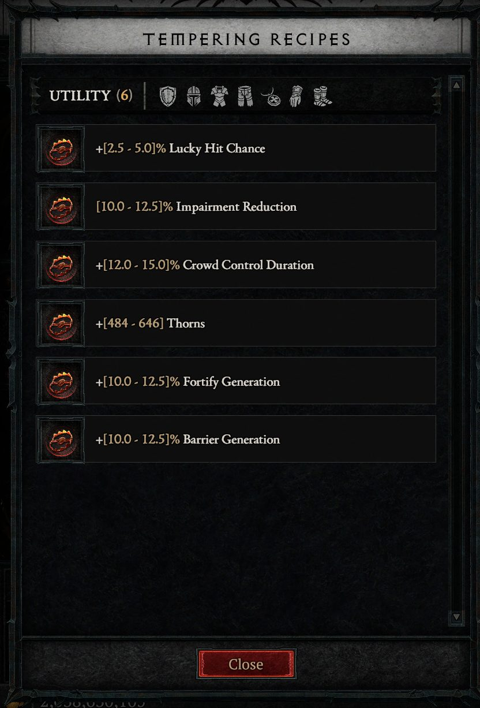</a> | `d4_tempering_recipe_choose_affix_ranges.jpg` Diablo IV, 'TEMPERING RECIPES' open on one recipe, 'UTILITY (6)', with the kinds of gear it fits as icons beside it: six affixes, each written with its range, '+[2.5 - 5.0]% Lucky Hit Chance', '[10.0 - 12.5]% Impairment Reduction', '+[12.0 - 15.0]% Crowd Control Duration', '+[484 - 646] Thorns', '+[10.0 - 12.5]% Fortify Generation', '+[10.0 - 12.5]% Barrier Generation'. | [page](https://maxroll.gg/d4/resources/tempering-guide) · [image](https://assets-ng.maxroll.gg/wordpress/tempering_choose.png) |
| <a href="d4_tempering_blacksmith_rerolls_remaining.jpg">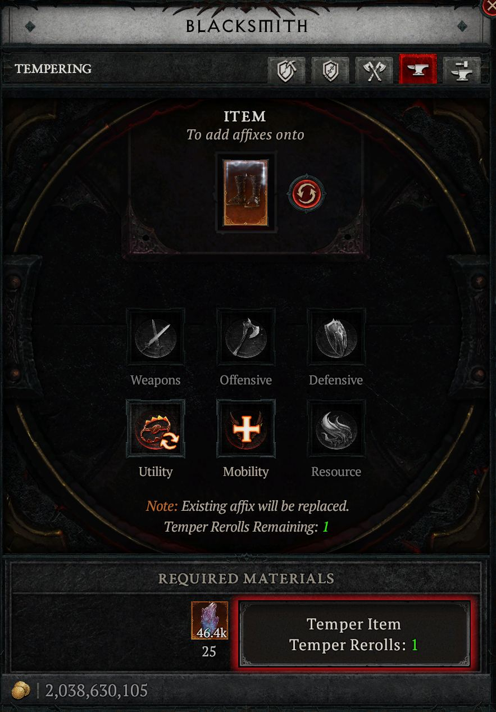</a> | `d4_tempering_blacksmith_rerolls_remaining.jpg` Diablo IV, 'BLACKSMITH', 'TEMPERING': boots in 'ITEM, To add affixes onto', the six recipe kinds ('Weapons', 'Offensive', 'Defensive', 'Utility', 'Mobility', 'Resource') with the two that boots take lit, Utility marked for a reroll; 'Note: Existing affix will be replaced.', 'Temper Rerolls Remaining: 1' in green, and 'REQUIRED MATERIALS' beside 'Temper Item, Temper Rerolls: 1'. | [page](https://maxroll.gg/d4/resources/tempering-guide) · [image](https://assets-ng.maxroll.gg/wordpress/tempering_apply.png) |
| <a href="d4_enchant_choose_affix_to_replace.jpg">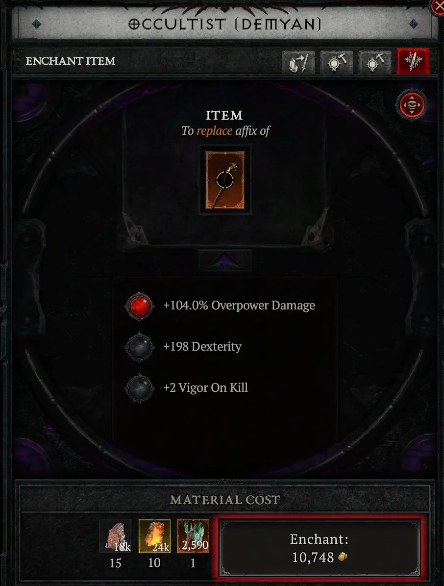</a> | `d4_enchant_choose_affix_to_replace.jpg` Diablo IV, 'OCCULTIST (DEMYAN)', 'ENCHANT ITEM': a staff in 'ITEM, To replace affix of', its three affixes listed with the one to replace marked red ('+104.0% Overpower Damage', '+198 Dexterity', '+2 Vigor On Kill'), and 'MATERIAL COST' beside 'Enchant: 10,748' gold. | [page](https://maxroll.gg/d4/resources/occultist-enchanting-legendary-aspects) · [image](https://assets-ng.maxroll.gg/wordpress/EnchantingVoH.webp) |
| <a href="d4_enchant_keep_or_replace_de.jpg">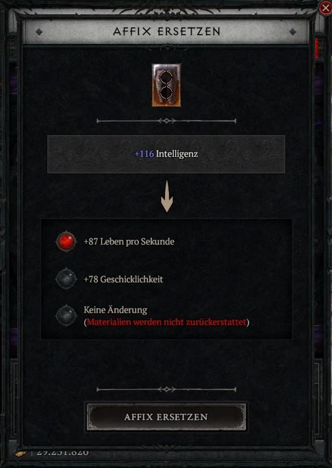</a> | `d4_enchant_keep_or_replace_de.jpg` Diablo IV in German, 'AFFIX ERSETZEN' ('Replace Affix'): the current roll, '+116 Intelligenz', over an arrow, then two new rolls, '+87 Leben pro Sekunde' (chosen) and '+78 Geschicklichkeit', and 'Keine Änderung' ('No Change') with '(Materialien werden nicht zurückerstattet)' in red ('materials are not refunded'). | [page](https://mein-mmo.de/diablo-4-staerkere-affixe-nach-masterworking-verbessern-aendern/) · [image](https://images.mein-mmo.de/medien/2024/06/affix-kritisch-verzaubert-masterworking-diablo-4.jpg) |
| <a href="d4_masterwork_one_affix_increases_crop.jpg">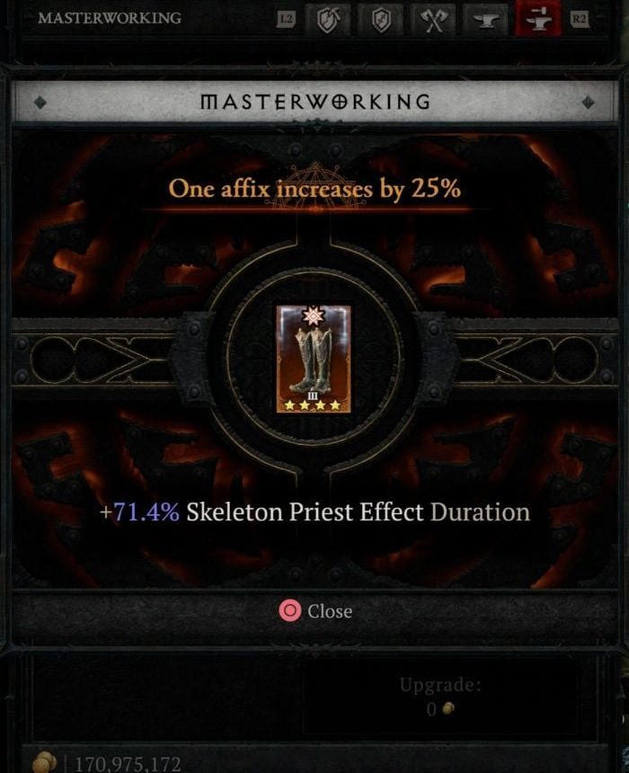</a> | `d4_masterwork_one_affix_increases_crop.jpg` Crop: Diablo IV before Season 11, played on a controller, 'MASTERWORKING': 'One affix increases by 25%' over the boots' card, a Roman 'III' and four gold stars at its foot, and the affix it lifted, '+71.4% Skeleton Priest Effect Duration', with 'Close'. | [page](https://www.sportskeeda.com/mmo/diablo-4-season-11-masterwork-changes-boon-or-bust) · [image](https://staticg.sportskeeda.com/editor/2025/10/7af17-17610436625244-1920.jpg) |
| <a href="d4_masterwork_quality_5_of_25.jpg">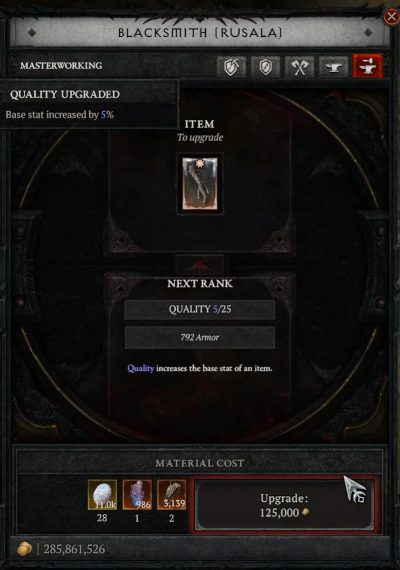</a> | `d4_masterwork_quality_5_of_25.jpg` Diablo IV since Season 11, 'BLACKSMITH (RUSALA)', 'MASTERWORKING': 'QUALITY UPGRADED, Base stat increased by 5%', 'NEXT RANK, QUALITY 5/25', '792 Armor', 'Quality increases the base stat of an item.', and 'MATERIAL COST' beside 'Upgrade: 125,000' gold. | [page](https://diablo4.wiki.fextralife.com/Masterworking) · [image](https://static0.fextralifeimages.com/file/diablo4/1/12/Masterworking-guide-diablo-4-wiki-guide.png) |
| <a href="warframe_riven_cycle_compare.jpg">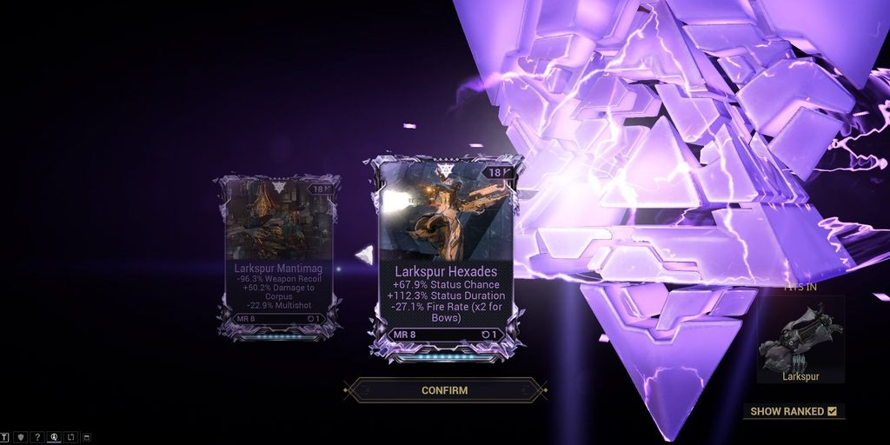</a> | `warframe_riven_cycle_compare.jpg` Warframe, a Riven just cycled: the old mod dimmed at the left, 'Larkspur Mantimag', '-96.3% Weapon Recoil', '+50.2% Damage to Corpus', '-22.9% Multishot', and the new one lit beside it, 'Larkspur Hexades', '+67.9% Status Chance', '+112.3% Status Duration', '-27.1% Fire Rate (x2 for Bows)', both counting one cycle, over 'CONFIRM'. TheGamer: 'you'll be given the choice of either taking the new roll or keeping your old one.' | [page](https://www.thegamer.com/warframe-riven-mods-guide/) · [image](https://static0.thegamerimages.com/wordpress/wp-content/uploads/2021/04/Warframe-Riven-Reroll-Result.jpg) |
| <a href="warframe_riven_cycle_lock_cost.jpg">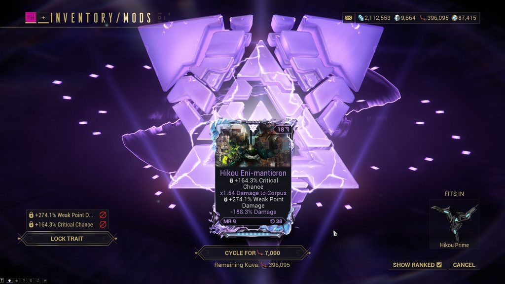</a> | `warframe_riven_cycle_lock_cost.jpg` Warframe after Update 44, the cycle screen: 'Hikou Eni-manticron' with two traits locked ('+164.3% Critical Chance' by Trait Locking, '+274.1% Weak Point Damage' spliced), the cycles counted on the card (38), 'LOCK TRAIT' at the left, and 'CYCLE FOR 7,000' over 'Remaining Kuva: 396,095'. The wiki says the cost is doubled by the locked trait. | [page](https://wiki.warframe.com/w/Riven_Mods) · [image](https://wiki.warframe.com/images/89cc566c1c33fbd786304b797f15b369.jpg) |
| <a href="le_forge_upgrade_cost_outcome_crop.jpg">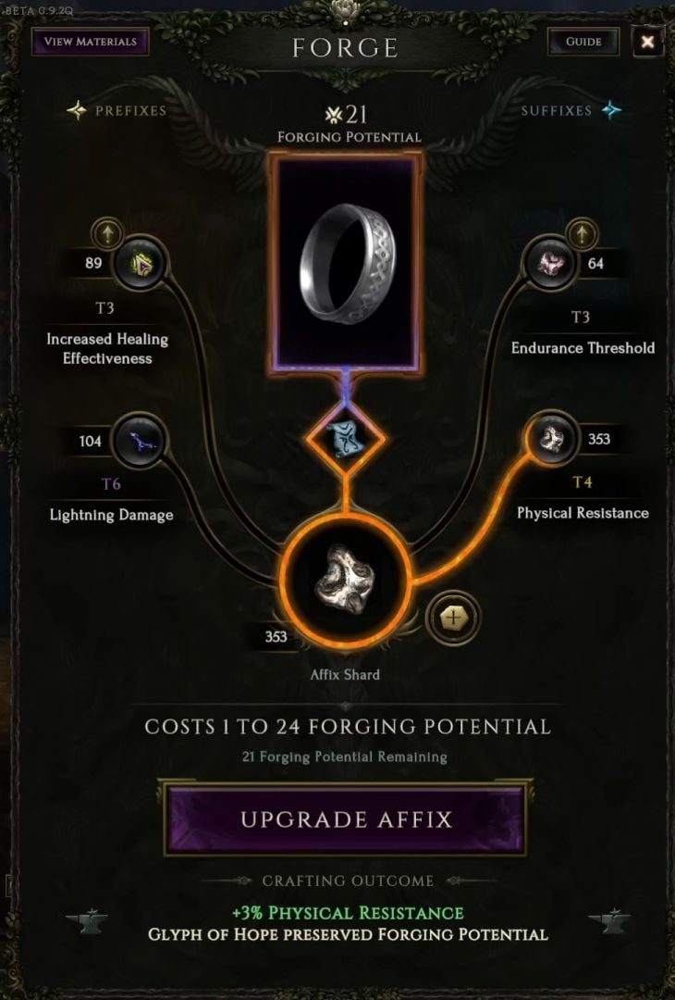</a> | `le_forge_upgrade_cost_outcome_crop.jpg` Crop: Last Epoch (beta 0.9.2), 'FORGE': a ring at '21, FORGING POTENTIAL', its prefixes and suffixes each with its tier ('T3 Increased Healing Effectiveness', 'T6 Lightning Damage', 'T3 Endurance Threshold', 'T4 Physical Resistance'), the Physical Resistance shard set to upgrade, 'COSTS 1 TO 24 FORGING POTENTIAL', '21 Forging Potential Remaining', 'UPGRADE AFFIX', and the last craft's 'CRAFTING OUTCOME', '+3% PHYSICAL RESISTANCE', 'GLYPH OF HOPE PRESERVED FORGING POTENTIAL'. | [page](https://www.sportskeeda.com/mmo/last-epoch-crafting-guide) · [image](https://staticg.sportskeeda.com/editor/2024/02/84d18-17084630600491-1920.jpg) |
| <a href="le_crafting_inventory_affix_shards.jpg">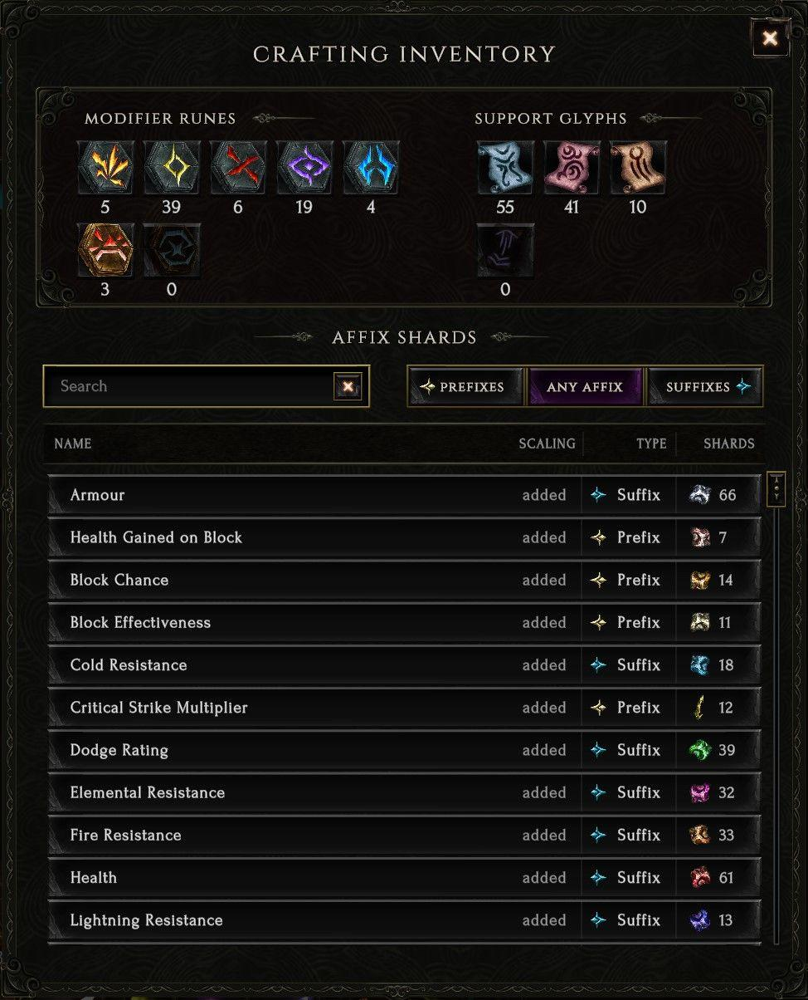</a> | `le_crafting_inventory_affix_shards.jpg` Last Epoch, 'CRAFTING INVENTORY': 'MODIFIER RUNES' and 'SUPPORT GLYPHS' with the count held of each, then 'AFFIX SHARDS', a searchable list filtered by 'PREFIXES', 'ANY AFFIX' or 'SUFFIXES', each affix with its scaling, type and shards held ('Armour, added, Suffix, 66', 'Critical Strike Multiplier, added, Prefix, 12', 'Dodge Rating, added, Suffix, 39'). | [page](https://www.gfinityesports.com/article/last-epoch-crafting-explained) · [image](https://gdm-universal-media.b-cdn.net/gfinityesports/3bbb90ad665a9a454a277fcabce668b4cde33764-974x1204.jpg) |
| <a href="poe2_essence_of_haste_one_modifier.jpg">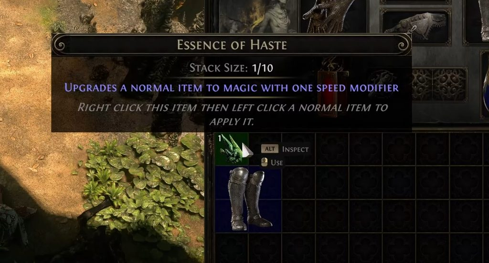</a> | `poe2_essence_of_haste_one_modifier.jpg` Path of Exile 2, the tooltip of 'Essence of Haste', 'Stack Size: 1/10', 'Upgrades a normal item to magic with one speed modifier', 'Right click this item then left click a normal item to apply it.', over a pair of normal boots in the inventory. | [page](https://maxroll.gg/poe2/resources/path-of-exile-2-crafting-overview) · [image](https://assets-ng.maxroll.gg/wordpress/Screenshot_19-3.png) |
| <a href="poe2_recombination_mod_ranges.jpg">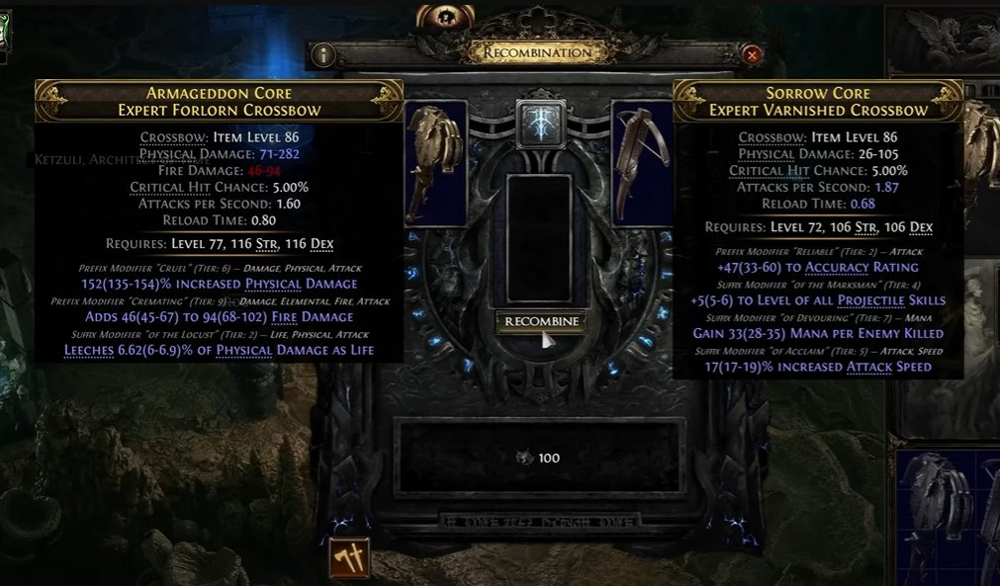</a> | `poe2_recombination_mod_ranges.jpg` Path of Exile 2, 'RECOMBINATION': two crossbows either side of the bench ('Armageddon Core, Expert Forlorn Crossbow' and 'Sorrow Core, Expert Varnished Crossbow'), every modifier shown in full, its name, tier and tags over its roll and range, and 'RECOMBINE'. Maxroll: the bench merges two items, 'hoping to keep the best modifiers from both onto a single new item.' | [page](https://maxroll.gg/poe2/resources/path-of-exile-2-crafting-overview) · [image](https://assets-ng.maxroll.gg/wordpress/Screenshot_23-2.png) |
| <a href="poe2_recombination_mod_ranges_crop_x2.jpg">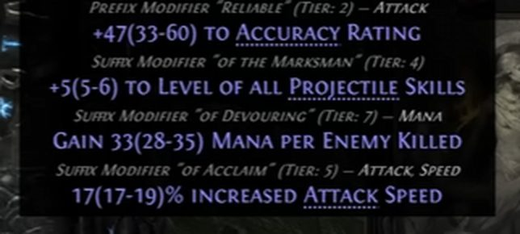</a> | `poe2_recombination_mod_ranges_crop_x2.jpg` Crop, enlarged twice: 'Prefix Modifier "Reliable" (Tier: 2) — Attack' over '+47(33-60) to Accuracy Rating', then '+5(5-6) to Level of all Projectile Skills', 'Gain 33(28-35) Mana per Enemy Killed', '17(17-19)% increased Attack Speed': each roll followed by its range in brackets, each line headed by its tier. Cropped from the same source as `poe2_recombination_mod_ranges.jpg`. | [page](https://maxroll.gg/poe2/resources/path-of-exile-2-crafting-overview) · [image](https://assets-ng.maxroll.gg/wordpress/Screenshot_23-2.png) |
| <a href="lostark_gear_honing_success_rate.jpg">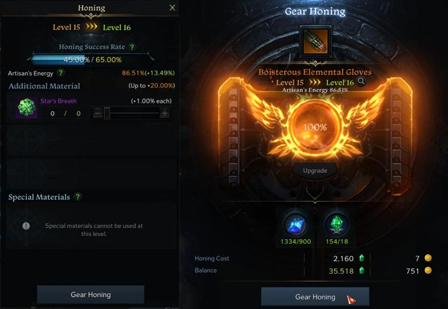</a> | `lostark_gear_honing_success_rate.jpg` Lost Ark, 'Honing' and 'Gear Honing': 'Boisterous Elemental Gloves', 'Level 15' to 'Level 16', 'Honing Success Rate 45.00% / 65.00%', 'Artisan's Energy 86.51%(+13.49%)', 'Additional Material (Up to +20.00%)', 'Star's Breath (+1.00% each)', 'Honing Cost 2,160' and '7' gold, and 'Gear Honing'. Maxroll: each failure raises the rate for later attempts, up to a limit, and adds Artisan's Energy; at 100% the next attempt cannot fail. | [page](https://maxroll.gg/lost-ark/resources/gear-honing-system) · [image](https://assets.maxroll.gg/wordpress/gear-honing-screen.jpg) |

## What ARISE took

Built as "Tempering" in [docs/DESIGN.md](../../../DESIGN.md#tempering--built).

- **The property chosen, only its size rolled**, as Diablo IV has tempered since Season 11: the `TEMPER` window lists
  the slot's properties, and the hunter picks one. One Temper slot to a piece, as Diablo IV gives one tempered affix.
- **Each property written with its range**, as Diablo IV's recipes write `+[2.5 - 5.0]%` and Path of Exile 2 writes
  `+47(33-60)`: every row of the window carries its range at the piece's rarity, and the slot shows where the roll held
  sits in it, a mark on a bar.
- **Keep the old roll or take the new**, as the Occultist's enchant and Warframe's Riven cycle do, and not as Diablo
  IV's Tempering does, which takes the old one away: a second temper waits beside the one held, Held against New,
  until the hunter keeps one. The price is paid either way, as the enchant's warns.
- **A price that rises and stops rising**, as the Riven's Kuva climbs for nine cycles and then holds: each temper after
  the first costs 50% of the first more, up to three times it. The piece counts its tempers, as the Riven card counts
  its cycles.
- **A roll that lands where the window can see it**, as Last Epoch writes its crafting outcome under the button: the
  mark sweeps the range and stops on the new roll.
- **No odds and nothing broken**, unlike Lost Ark's honing and Last Epoch's Forging Potential: a temper always lands
  in its range, a piece is never closed to it, and the top of a range is its ceiling. Ember buys a better roll, never
  more than the range.
