# Step 8: Challenges graded against a par

The references for challenges graded against a par, the eighth step of the order to build in
[docs/DESIGN.md](../../../DESIGN.md#order-to-build).

Every image belongs to the game's publisher, or to the wiki, site or player who captured it, as listed beside it. They are kept here as design reference only: nothing in ARISE copies their art, and none of them ships with the game.

## Graded against a par

A clear measured against a mark, the mark stated before play or kept back, and the grade paid once. Advance Wars keeps its mark back. Its rank screen scores Speed, Power and Technique and draws one letter from the three: Re-Boot Camp counts them in points ('SPEED 0092 Pts.', 'POWER 0100 Pts.', 'TECHNIQUE 0100 Pts.', 'TOTAL 0292 Pts.') beside a large S in a laurel under 'RANK', and the Game Boy Advance original drew the same three as bars beside 'A RANK', the Speed bar a little short on a map the player says cost him 'a little bit on my speed score'. Nell explains the three after the first map ('Speed is based on how quickly you won, while Power is based on how well you concentrated your attacks and overcame your enemies. Technique is based on how many of your own troops were lost. You'll earn a rank for each map you clear'), but the number of days that earns full Speed is never shown: Gameranx calls it 'an unstated range you must fall in in order to get 100 points', counts 300 points to a mission with an S lost not far below the 90s in each, Technique full while 80% of the army lives and Power full for one day that destroys 10% of the enemy. The mission list keeps the best rank earned beside each map's name ('Troop Orders' A, 'Terrain Intel' A). Genshin Impact's Spiral Abyss states its mark, and it is time left. The floor's 'Challenge Target' lists 'Chamber 1', 'Chamber 2', 'Chamber 3', each with three empty stars, and inside the chamber the three thresholds sit in the corner: 'Floor 8 Chamber 1 First Half', 'Remaining challenge time longer than 180 sec.', '... 330 sec.', '... 420 sec.'. Gfinity gives Floor 1's as 90/150/210 seconds against a five-minute clock (ten minutes from Floor 5, where the second half starts with the time the first half left). The corridor of floors counts each floor's stars on its chest ('8/9', '0/9'), a tick once all nine are in, over 'Treasures from the Abyss Corridor can only be obtained once.' Honkai: Star Rail states its mark as three stars before the fight, two on cycles left and one on losses: Memory of Chaos's 'Objectives' are 'Win with at least 10 cycle(s) left', 'Win with at least 18 cycle(s) left' and 'Have no downed characters'. TheGamer: 'To get the first two stars, you'll have to finish the floor in a certain number of turns', the bar rising floor by floor, and on the older Memory floors the third star allows 'no more than one downed character'. The stage map writes each stage's best under its number, three gold stars or three grey, and the running total, '27/36', beside a gift; the gift opens 'Insignia Reward', one row to every three stars ('Obtained in total 3', '6', '9', '12'), each paid once and ticked when claimed (200 Stellar Jade a row on the Memory floors, 60 on Memory of Chaos, where a row not yet taken shows a yellow 'Claim'). Apocalyptic Shadow grades a score in place of cycles: 'Clear Target, Defeat 2 bosses', 'Star Target, Gain 4000 points, Gain 5200 points', and 'Clear this difficulty with 3 stars to obtain all the rewards in previous difficulties'; Kotaku says the score 'is determined by how much of the action value and the boss's HP (if any) remains'. Its four difficulties run along the foot of the screen with the best of each ('01 Quick-Clear', '02 Quick-Clear', '03 7166', each with three gold stars, '04 No Data' with three grey) and '9/12' by the gift. Devil May Cry 5 shows no mark before a mission and grades after it: 'Bonus & Penalty' multiplies the style score for health kept ('No Damage x2.0', 'No Continues x1.2'), then 'RESULTS' lists 'Total Stylish Pts', 'Bonus Red Orbs', 'Extra Bonus' and 'Total Red Orbs' beside one large letter, S. TheGamer puts the S on Dante Must Die at 5,500 points and says No Damage 'will double the player's score'. Blue Archive and Solo Leveling: Arise, both on phones, write three conditions under the stage before it starts and light each one met. Blue Archive's 'Mission Objectives' read 'Mission Complete', 'Acquire S rank 2 time(s).' and 'Clear stage within 4 turn(s).', met ones with a gold star and the unmet one grey; the 70 Pyroxene under 'Expected Rewards' carry three stars, and 'Sweep', which skips the stage, stays shut with '3 Required' beside a gold star. Solo Leveling: Arise's 'Battle Missions' read 'Win within 105 sec.', 'Win with fewer than 1 fallen hunters' and 'Kill the boss with a Light element hunter's attack.' as grey trophies over 'Acquirable Rewards' before the first clear; on a stage done they read 'Win within 150 sec.', 'Win with 30% or more HP.' and 'Use Extreme Evasion 3 or more times.' in gold, the stage is tagged 'COMPLETE' with three gold trophies in the chapter list, the chapter counts 'Battle Missions 6/6', and the reward box says only 'Story rewards can only be obtained once.' TheGamer counts 15 Essence Stones for each battle mission, and two or three draw tickets for clearing every battle mission in a chapter.

| | What it shows | Source |
|---|---|---|
| <a href="advancewars_reboot_victory_rank_s_points.jpg">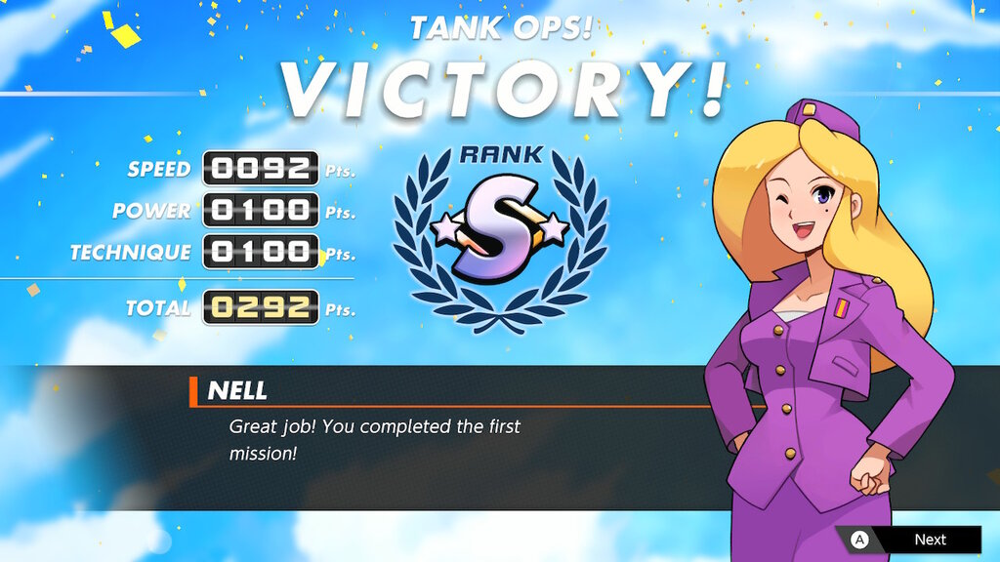</a> | `advancewars_reboot_victory_rank_s_points.jpg` Advance Wars 1+2: Re-Boot Camp, the end of the first mission: 'TANK OPS!', 'VICTORY!', 'SPEED 0092 Pts.', 'POWER 0100 Pts.', 'TECHNIQUE 0100 Pts.', 'TOTAL 0292 Pts.' in gold, and 'RANK' over a large S with two stars in a laurel; Nell: 'Great job! You completed the first mission!' Gameranx: 'Every mission has an unstated range you must fall in in order to get 100 points.' | [page](https://gameranx.com/features/id/464212/article/advance-wars-12-re-boot-camp-how-to-get-s-rank/) · [image](https://gameranx.com/wp-content/uploads/2023/04/S-rank.jpg) |
| <a href="advancewars_gba_victory_rank_a_bars.jpg">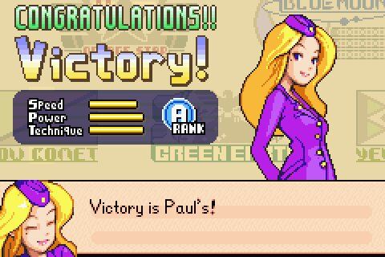</a> | `advancewars_gba_victory_rank_a_bars.jpg` Advance Wars on the Game Boy Advance, Field Training: 'CONGRATULATIONS!!', 'Victory!', 'Speed', 'Power' and 'Technique' drawn as gold bars with no numbers, the Speed bar a little shorter than the other two, and a blue 'A RANK' badge; 'Victory is Paul's!'. The player: 'Yeah, cost me a little bit on my speed score. Still good enough for an A'. | [page](https://lparchive.org/Advance-Wars/Update%2003/) · [image](https://lparchive.org/Advance-Wars/Update%2003/69-capture_13022012_171435.png) |
| <a href="advancewars_gba_field_training_mission_ranks.jpg">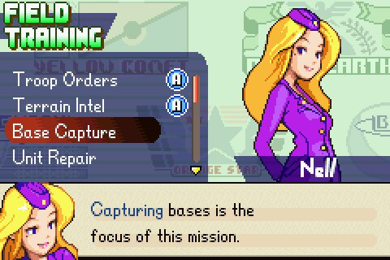</a> | `advancewars_gba_field_training_mission_ranks.jpg` Advance Wars on the Game Boy Advance, the 'FIELD TRAINING' list: 'Troop Orders' and 'Terrain Intel' each with the A rank earned on it in a blue badge, 'Base Capture' (selected) and 'Unit Repair' with none yet; Nell: 'Capturing bases is the focus of this mission.' | [page](https://lparchive.org/Advance-Wars/Update%2003/) · [image](https://lparchive.org/Advance-Wars/Update%2003/70-capture_13022012_171454.png) |
| <a href="genshin_abyss_floor_challenge_target_stars.jpg">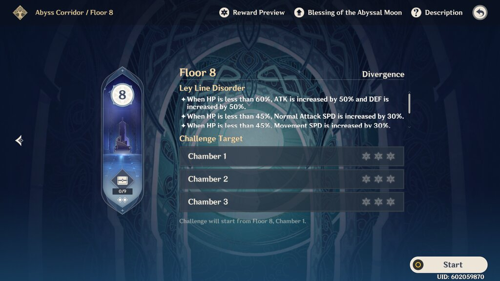</a> | `genshin_abyss_floor_challenge_target_stars.jpg` Genshin Impact, 'Abyss Corridor / Floor 8', 'Divergence': the 'Ley Line Disorder' ('When HP is less than 60%, ATK is increased by 50% and DEF is increased by 50%.'), then 'Challenge Target' with 'Chamber 1', 'Chamber 2' and 'Chamber 3', three empty stars to each; the floor's chest at '0/9'; 'Challenge will start from Floor 8, Chamber 1.' and 'Start'. | [page](https://www.gfinityesports.com/article/spiral-abyss-guide) · [image](https://gdm-universal-media.b-cdn.net/gfinityesports/756f7917ed7cf5b9ccde7ade0f5fcdd42fa73279-1920x1080.png) |
| <a href="genshin_abyss_chamber_time_left_crop_x2.jpg">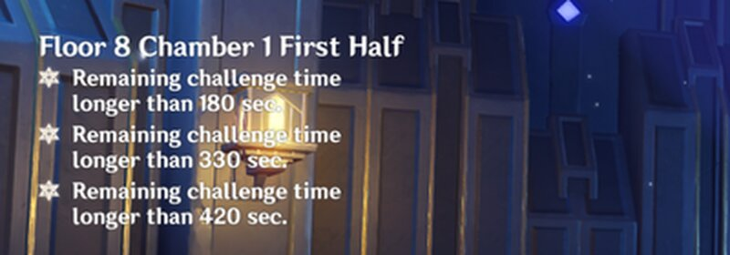</a> | `genshin_abyss_chamber_time_left_crop_x2.jpg` Crop, enlarged twice: Genshin Impact inside the chamber, the three stars' conditions in the top left corner, each behind a star: 'Floor 8 Chamber 1 First Half', 'Remaining challenge time longer than 180 sec.', 'Remaining challenge time longer than 330 sec.', 'Remaining challenge time longer than 420 sec.' Gfinity: Floor 1's are 'longer than 90/150/210 sec.' | [page](https://www.gfinityesports.com/article/spiral-abyss-guide) · [image](https://gdm-universal-media.b-cdn.net/gfinityesports/974a964a710270eb3f98ac10435c44f13602da3d-1920x1080.png) |
| <a href="genshin_abyss_corridor_floor_stars_treasure_once.jpg">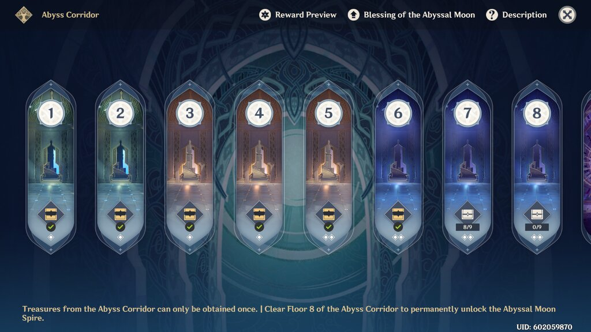</a> | `genshin_abyss_corridor_floor_stars_treasure_once.jpg` Genshin Impact, 'Abyss Corridor': floors 1 to 8 as tall cards, each with a chest; floors 1 to 6 ticked green, floor 7 at '8/9' and floor 8 at '0/9'; 'Reward Preview' at the top, and at the foot 'Treasures from the Abyss Corridor can only be obtained once. \| Clear Floor 8 of the Abyss Corridor to permanently unlock the Abyssal Moon Spire.' | [page](https://www.gfinityesports.com/article/spiral-abyss-guide) · [image](https://gdm-universal-media.b-cdn.net/gfinityesports/96c4a8aa071dc0788ca4545490e376b87e42c29d-1920x1080.png) |
| <a href="hsr_moc_objectives_cycles_left.jpg">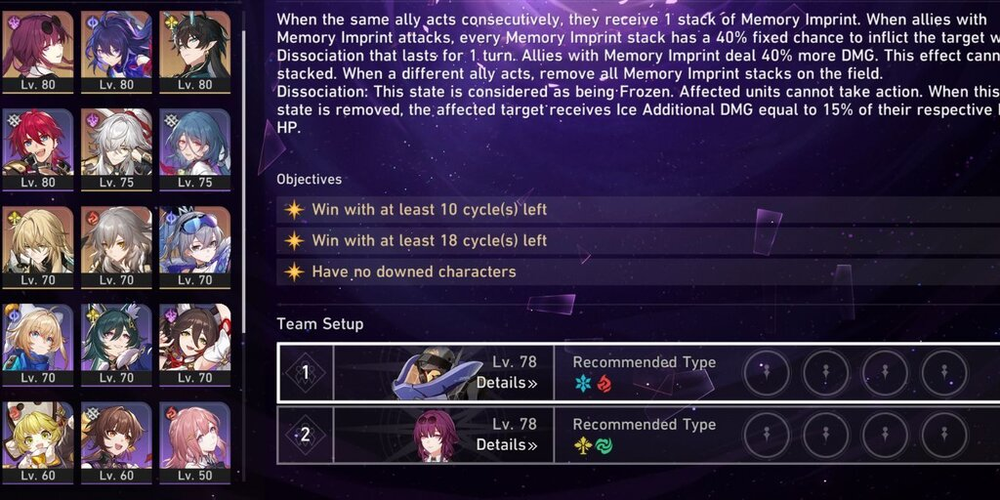</a> | `hsr_moc_objectives_cycles_left.jpg` Honkai: Star Rail, a Memory of Chaos stage before the fight: the turbulence's rule, then 'Objectives', three lines each behind a gold star, 'Win with at least 10 cycle(s) left', 'Win with at least 18 cycle(s) left', 'Have no downed characters', then 'Team Setup' for two teams with a 'Recommended Type' each. | [page](https://www.thegamer.com/honkai-star-rail-forgotten-halls-memory-of-chaos-levels-guide/) · [image](https://static0.thegamerimages.com/wordpress/wp-content/uploads/2023/10/honkai-star-rail-memory-of-chaos-current-floor-enemies.jpg) |
| <a href="hsr_moc_stage_stars_27_of_36.jpg">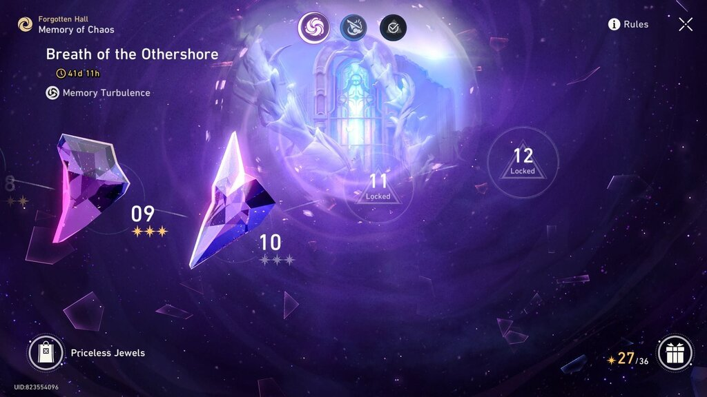</a> | `hsr_moc_stage_stars_27_of_36.jpg` Honkai: Star Rail, 'Forgotten Hall, Memory of Chaos', 'Breath of the Othershore', '41d 11h' left: stage '09' with three gold stars, '10' with three grey, '11' and '12' 'Locked'; at the bottom right '27/36' beside a gold star and a gift that opens the star rewards. | [page](https://www.sportskeeda.com/esports/honkai-star-rail-hsr-3-2-memory-chaos-best-teams-strategies) · [image](https://staticg.sportskeeda.com/editor/2025/05/59d12-17470382516960-1920.jpg) |
| <a href="hsr_memory_insignia_reward_claimed.jpg">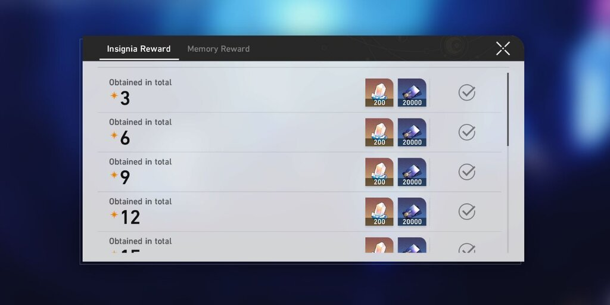</a> | `hsr_memory_insignia_reward_claimed.jpg` Honkai: Star Rail, the Forgotten Hall's star rewards, 'Insignia Reward' beside 'Memory Reward': rows 'Obtained in total 3', '6', '9', '12' (and '15' below), each paying 200 Stellar Jade and 20000 Credits, each ticked as claimed. TheGamer: 'These are all one-time rewards.' | [page](https://www.thegamer.com/honkai-star-rail-forgotten-halls-memory-levels-guide/) · [image](https://static0.thegamerimages.com/wordpress/wp-content/uploads/2023/06/honkai-star-rail-forgotten-hall-rewards-memory-level.jpg) |
| <a href="hsr_apocalyptic_shadow_star_target_points.jpg">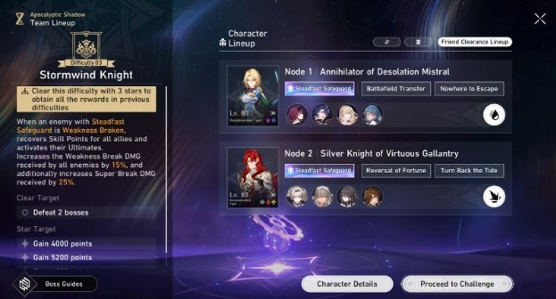</a> | `hsr_apocalyptic_shadow_star_target_points.jpg` Honkai: Star Rail, 'Apocalyptic Shadow, Team Lineup', 'Difficulty 03', 'Stormwind Knight': 'Clear this difficulty with 3 stars to obtain all the rewards in previous difficulties' on a gold note, the phase's rule, then 'Clear Target, Defeat 2 bosses' and 'Star Target, Gain 4000 points, Gain 5200 points' (the list runs on below the fold); the two nodes and their bosses at the right, and 'Proceed to Challenge'. | [page](https://kotaku.com/honkai-star-rail-apocalyptic-shadow-hsr-guide-1851559645) · [image](https://kotaku.com/app/uploads/2024/06/8858b2ecd42af463619590f78ae0bb1a.jpg) |
| <a href="hsr_apocalyptic_shadow_difficulties_best.jpg">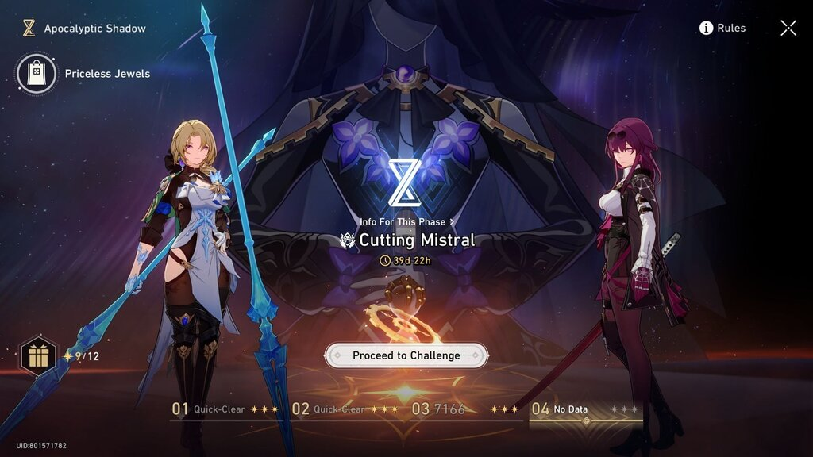</a> | `hsr_apocalyptic_shadow_difficulties_best.jpg` Honkai: Star Rail, 'Apocalyptic Shadow', 'Cutting Mistral', '39d 22h': the four difficulties along the foot with the best of each, '01 Quick-Clear' and '02 Quick-Clear' with three gold stars, '03 7166' with three gold stars, '04 No Data' with three grey; '9/12' beside a gold star and a gift at the left; 'Proceed to Challenge'. | [page](https://www.sportskeeda.com/esports/honkai-star-rail-hsr-3-3-apocalyptic-shadow-cutting-mistral-guide) · [image](https://staticg.sportskeeda.com/editor/2025/05/3a6c5-17483826927353-1920.jpg) |
| <a href="dmc5_bonus_penalty_no_damage.jpg">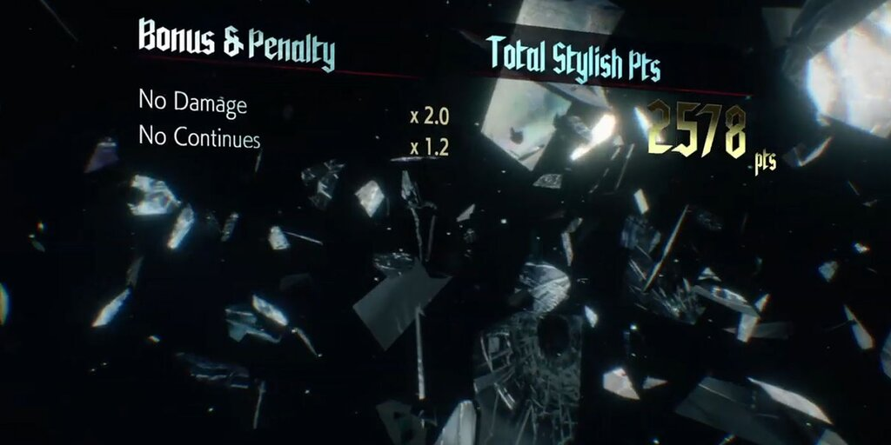</a> | `dmc5_bonus_penalty_no_damage.jpg` Devil May Cry 5, the mission's end before the rank: 'Bonus & Penalty', 'No Damage x2.0', 'No Continues x1.2', and 'Total Stylish Pts 2578 pts' in gold. TheGamer: finishing 'with No Damage which will double the player's score'. | [page](https://www.thegamer.com/devil-may-cry-5-dante-must-die-tips/) · [image](https://static0.thegamerimages.com/wordpress/wp-content/uploads/2020/07/Multipliers.jpg) |
| <a href="dmc5_results_mission_rank_s.jpg">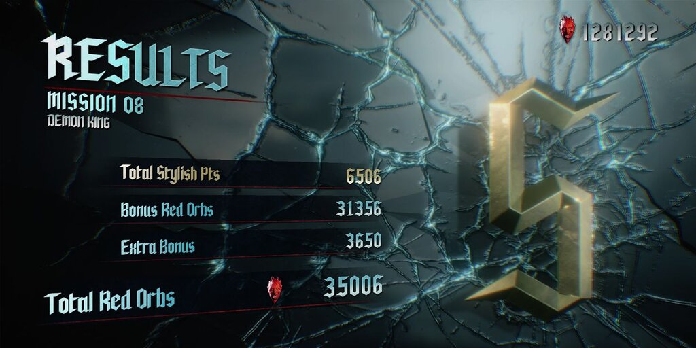</a> | `dmc5_results_mission_rank_s.jpg` Devil May Cry 5, 'RESULTS', 'MISSION 08', 'DEMON KING': 'Total Stylish Pts 6506', 'Bonus Red Orbs 31356', 'Extra Bonus 3650', 'Total Red Orbs 35006', and one large gold S over cracked glass. TheGamer puts the least for an S on Dante Must Die at 5,500 Stylish Points. | [page](https://www.thegamer.com/devil-may-cry-5-dante-must-die-tips/) · [image](https://static0.thegamerimages.com/wordpress/wp-content/uploads/2020/07/Style-Point.jpg) |
| <a href="bluearchive_mission_info_turns_stars.jpg">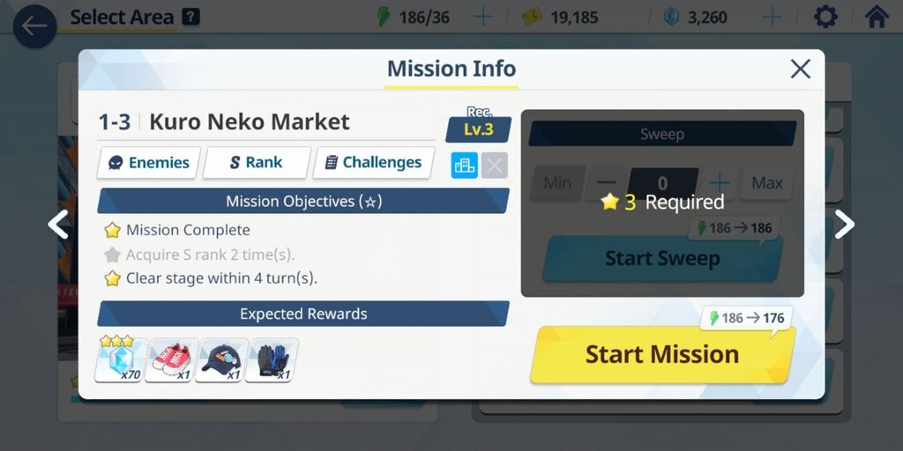</a> | `bluearchive_mission_info_turns_stars.jpg` Blue Archive on a phone, 'Mission Info', '1-3 Kuro Neko Market', 'Rec. Lv.3', tabs 'Enemies', 'S Rank', 'Challenges': 'Mission Objectives (☆)', 'Mission Complete' (gold star), 'Acquire S rank 2 time(s).' (grey), 'Clear stage within 4 turn(s).' (gold); 'Expected Rewards' led by 70 Pyroxene with three stars over it; 'Sweep' shut with '3 Required' beside a gold star; 'Start Mission'. GameRant: Sweep 'allows players to skip playing the missions if they have cleared the stage with all 3 stars.' | [page](https://gamerant.com/blue-archive-best-ways-level-up-experience/) · [image](https://static0.gamerantimages.com/wordpress/wp-content/uploads/2024/04/mixcollage-15-apr-2024-12-09-am-4089.jpg) |
| <a href="sololevelingarise_battle_missions_rewards.jpg">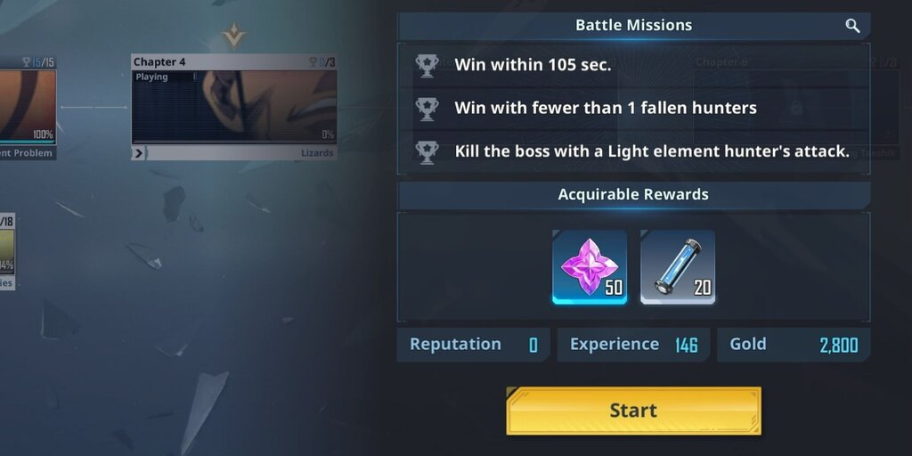</a> | `sololevelingarise_battle_missions_rewards.jpg` Solo Leveling: Arise on a phone, a stage not yet cleared ('Chapter 4', 'Playing', '0/3' trophies): 'Battle Missions', 'Win within 105 sec.', 'Win with fewer than 1 fallen hunters', 'Kill the boss with a Light element hunter's attack.', each behind a grey trophy; 'Acquirable Rewards', 50 Essence Stones and 20 of a second item; 'Reputation 0', 'Experience 146', 'Gold 2,800'; 'Start'. | [page](https://www.thegamer.com/solo-leveling-arise-best-beginner-tips/) · [image](https://static0.thegamerimages.com/wordpress/wp-content/uploads/2024/05/battlemissions.jpg) |
| <a href="sololevelingarise_battle_missions_time_hp_complete.jpg">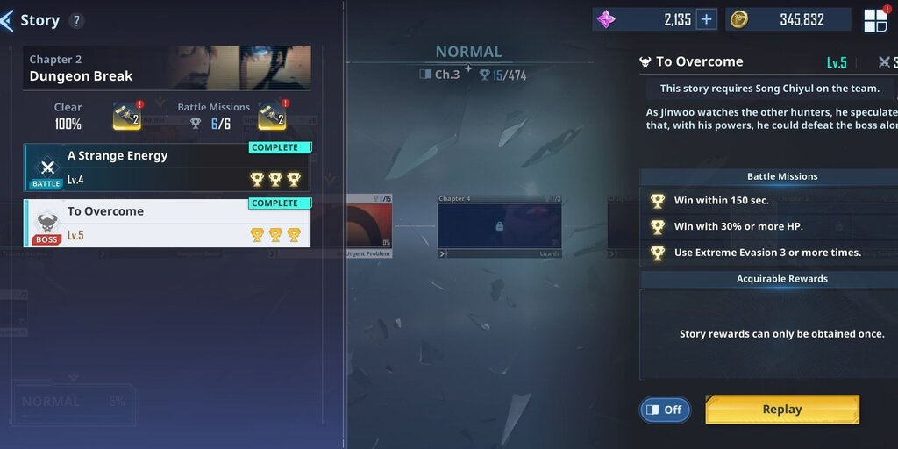</a> | `sololevelingarise_battle_missions_time_hp_complete.jpg` Solo Leveling: Arise, 'Story', 'Chapter 2, Dungeon Break': 'Clear 100%' and 'Battle Missions 6/6', each with a reward waiting; 'A Strange Energy' (BATTLE, Lv.4) and 'To Overcome' (BOSS, Lv.5) tagged 'COMPLETE', three gold trophies each; at the right, 'To Overcome', 'Battle Missions', 'Win within 150 sec.', 'Win with 30% or more HP.', 'Use Extreme Evasion 3 or more times.' in gold, 'Acquirable Rewards' replaced by 'Story rewards can only be obtained once.', and 'Replay'. TheGamer: 15 Essence Stones for each battle mission, and two to three draw tickets for clearing every one in a chapter. | [page](https://www.thegamer.com/solo-leveling-arise-best-beginner-tips/) · [image](https://static0.thegamerimages.com/wordpress/wp-content/uploads/2024/05/chpaters.jpg) |

## What ARISE took

Built as "Par" in [docs/DESIGN.md](../../../DESIGN.md#par--built).

- **The mark stated before play**, as Honkai: Star Rail's Memory of Chaos states its cycles left and Blue Archive its
  `Clear stage within 4 turn(s).`, not kept back as Advance Wars keeps its Speed range: the brief's `Par` card states
  today's road's par and the rounds each medal allows.
- **Rounds, not time**, as Star Rail counts cycles where Genshin and Solo Leveling: Arise count seconds: a turn-based
  fight's clock is its rounds.
- **Three grades of one measure**, as Genshin's three stars are three thresholds of time left: Bronze within par,
  Silver within 65% of it, Gold within half. Not three separate objectives: those are ARISE's Feats already, and wear
  its stars.
- **The System's odds beside each medal**, as the Feats show theirs: how often the System reached it in its runs.
- **Paid once, the first time**, as Genshin's `Treasures ... can only be obtained once` and Star Rail's Insignia rows,
  ticked as claimed; a better medal reached first pays the ones below it, as clearing a harder Apocalyptic Shadow
  with three stars pays the easier ones.
- **A scorecard on the results**, after Advance Wars' rank screen and Devil May Cry 5's results: the medal struck large
  beside the rounds, the par and the difference, under in green and over in red.
- **The best grade kept beside each Gate**, as Advance Wars' mission list keeps each map's rank and Star Rail's stage map
  each stage's stars: a Gate's row on the board carries its best medal.
