# Step 9: Ranks, revisited

The references for front and rear ranks, the ninth step of the order to build in
[docs/DESIGN.md](../../../DESIGN.md#order-to-build).

Every image belongs to the game's publisher, or to the wiki, site or player who captured it, as listed beside it. They are kept here as design reference only: nothing in ARISE copies their art, and none of them ships with the game.

## Front and rear

Where a fighter stands in its line, what that lets it reach, and what standing back changes. Darkest Dungeon has four ranks a side, counted from the middle outwards, and every skill says where it may be used from and which ranks it reaches as two sets of four pips. Darkest Dungeon II puts them under the skill's name in the fight: Duong's 'Come Hither' is 'Ranged', four gold pips, two hollow and two blue, 'Target:' 'Pull 2', and the large creature at the back, the only foe in the ranks it reaches, is bracketed in blue; beside the five skills sit a swap button (two arrows in a circle) and a pass. On the hero's sheet the same pips head the skills, 'Rank' in gold and 'Target' in red, larger where more of the hero's skills use them, and each tooltip carries its own: the Man-at-Arms' 'Hold the Line' shows three gold and a hollow one, two red and two hollow, 'DMG: 3-6 CRIT: 10.0%', 'Self:' 'Forward 3'. PC Gamer: 'The yellow dots indicate where he has to be positioned to activate this ability, and the red dots indicate the locations in the enemy lineup he can target'; Fextralife calls Hold the Line 'best used if you are pushed back to the back ranks', so the hero's pips read as the party stands, rank 4 at the left, and the foe's as the foes stand, rank 1 at the left. A creature's panel uses the same pips, red then gold: the Fish Monger's 'Debone' and 'Flense' are 'Ranged', three red and a hollow one, then a hollow one and three gold, and 'Whetstone', which it uses on itself, three hollow and one gold. Movement is a skill's effect ('Forward 3', 'Pull 2') or the swap button; before a fight, Gamepressure: 'Just grab one of them with the cursor and move forward or backward, as desired.' The first game's sheet sums a hero's chosen skills as 'Preferred Position' and 'Preferred Target' (a Vestal lit at ranks 4 and 3, faint at 2, dark at 1, and reaching all four), lists 'Move 90%' among the resistances to being shoved, and stands the four heroes picked in order in four slots under the sheet before 'Provision'. In a fight a creature defeated leaves a heap under a grey bar that keeps its rank. Highwang's guide to the ranks: 'a lot of healing & support spells cannot be casted at rank 1', and 'only enemies in rank 3/4 will try to attack your rank 3/4 characters'. Etrian Odyssey has two rows a side. Atlus's page for Etrian Odyssey V: 'Combat is arranged in two rows on both sides. Combatants who attack from the front row to the back row, or vice versa, deal less damage. Your back row and the enemy's back row are too far apart from each other for melee attacks (summoned allies, such as hounds or hawks, are treated as frontline fighters). Ranged weapons and magic spells, however, bypass these restrictions altogether.' Its fight draws the party as name plates in two staggered rows, three over two or two over three, the summoned hawk on a plate of its own, and 'Move' is one of its seven commands. The first game sets the rows from the menu, 'FRONT' and 'BACK' with three places each; its damage formula, as the Let's Play gives it, has 'party members in the back have their DEF doubled', and when the front row has all died the back row is forced to the front. Final Fantasy draws a row as a step: the front-row hero's portrait or sprite stands nearer the foes. Final Fantasy II on the Famicom makes it absolute: 'being in the back row makes you completely untargetable by physical attacks as long as there's someone in the front row', 'from the back row, you can't physically attack either unless you have a bow', and a creature in the foes' back rows 'can't attack or be attacked physically until you kill the enemies in front', so a hornet there shows 'Nothing'. Final Fantasy III on the DS gives each hero a fight command, 'Rear' ('it's Front if you're already there'). Final Fantasy IV fixes the shape, 'either two characters in front and three in the back, or three front/two back', with 'Form' and 'Change' in the menu, and 'back row reduces physical damage, both from enemies and from the character', while Rydia's Shortbow deals 'the same amount of damage from the back row'. Gamer Corner gives Final Fantasy VI's: 'Characters in the back row deal half damage with the Fight command ... some weapons will deal full damage from the back row. They also take half damage from all physical attacks'. AFK Arena, on a phone, sets its five before the fight on the field itself: two columns a side facing across the middle, two in front and three behind, each side's power either side of 'VS', and 'Begin Battle' below. BlueStacks numbers the places, putting a hero who should be hit 'in the 1st position (top right one)' and a healer 'in 5, right behind Estrilda'. Monster Train's rank is the order along a floor: the units stand in a line facing the foes, the front one striking, and the floor's capacity shows as pips at its corner. Rogueliker: 'attack damage hits front-line units first'; BlueStacks: 'units also cost Capacity on whichever floor you place them', and enemies 'move up one floor at the end of each turn if they're still alive'. Arknights places by tile instead: Shaw 'Can be deployed on Ranged Grids', 'Block 2'; BlueStacks: on the ground 'operators will be attacked by melee enemies', on raised tiles they are 'safe from melee attacks, but can still be targeted by snipers, bombers, and spell casters', and 'enemies will always attack the last operator that you have placed on the map'. Atelier Resleriana makes its back row a reserve: 'Up to three members can be placed on the front row', front-row members 'can attack enemies directly', back-row members 'can swap places with characters on the front row by switching or using Multi-Actions', and 'If a member on the front row has their HP drop to 0, a member on the back row will step in to replace them.'

| | What it shows | Source |
|---|---|---|
| <a href="darkestdungeon2_combat_come_hither_rank_pips.jpg">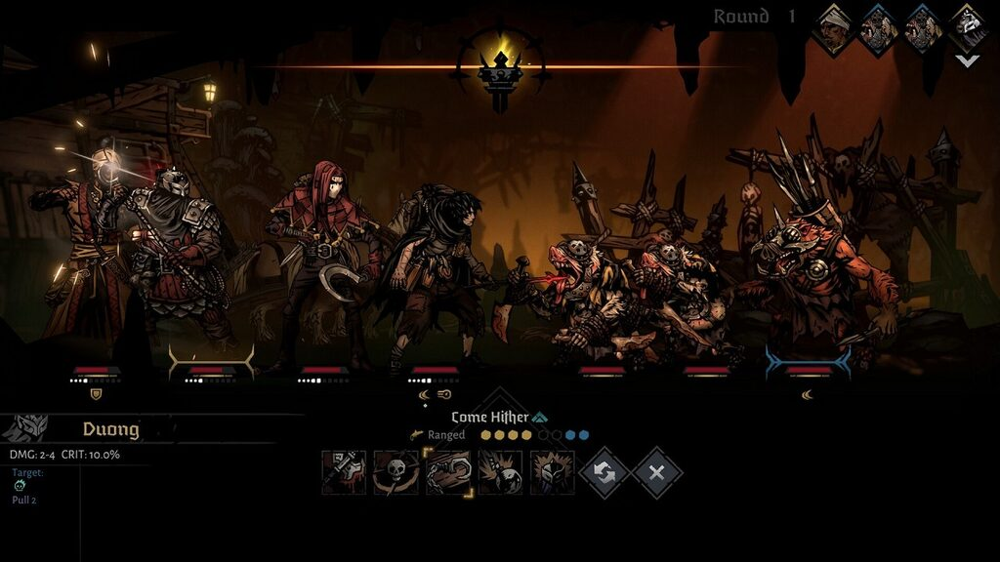</a> | `darkestdungeon2_combat_come_hither_rank_pips.jpg` Darkest Dungeon II, 'Round 1': four heroes at the left, three foes at the right, a large creature behind two small ones and bracketed in blue as the one foe the chosen skill can reach. Duong, at rank 3 under a gold bracket, has 'Come Hither' chosen: 'Ranged', four gold pips, two hollow and two blue; at the left 'DMG: 2-4 CRIT: 10.0%', 'Target:' and 'Pull 2'. Five skills, then a swap button (two arrows in a circle) and a pass (a cross). Gamepressure on the order before a fight: 'Moving characters out of combat is trivially easy.' | [page](https://www.gamepressure.com/newsroom/darkest-dungeon-2-how-to-change-party-order-in-combat-and-outside/z555f5) · [image](https://cdn.gracza.pl/i_gp/h/22/421414142.jpg) |
| <a href="darkestdungeon2_hold_the_line_rank_target_pips_crop.jpg">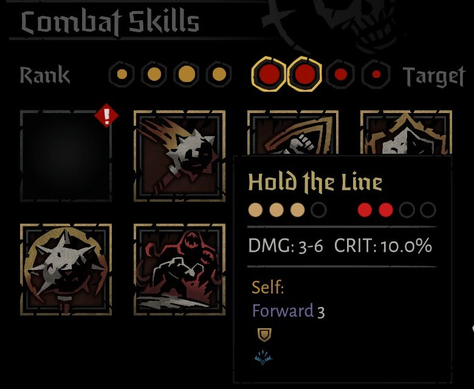</a> | `darkestdungeon2_hold_the_line_rank_target_pips_crop.jpg` Crop: Darkest Dungeon II, the Man-at-Arms' sheet, 'Combat Skills': 'Rank', four gold pips of different sizes, and 'Target', four red, the first two large and ringed in gold; the tooltip for 'Hold the Line', three gold pips and a hollow one, two red and two hollow, 'DMG: 3-6 CRIT: 10.0%', 'Self:' 'Forward 3' and two token icons. PC Gamer: 'The yellow dots indicate where he has to be positioned to activate this ability, and the red dots indicate the locations in the enemy lineup he can target.' | [page](https://www.pcgamer.com/darkest-dungeon-2-tips/) · [image](https://cdn.mos.cms.futurecdn.net/KFXU994RM6xkqYvdMoJxX8.jpg) |
| <a href="darkestdungeon2_fish_monger_skill_reach_crop.jpg">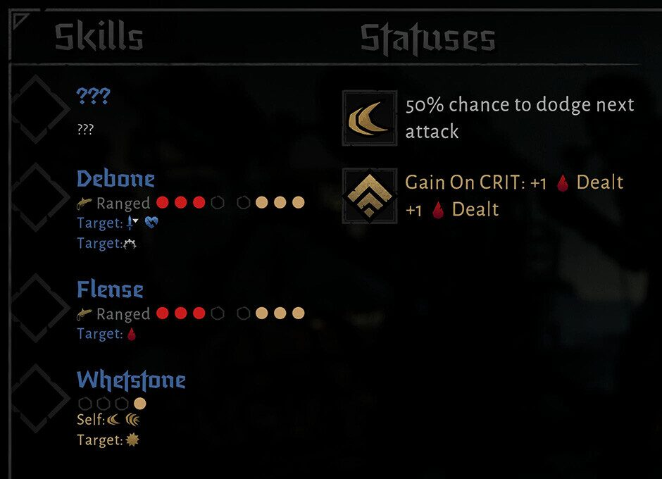</a> | `darkestdungeon2_fish_monger_skill_reach_crop.jpg` Crop: Darkest Dungeon II, a creature's panel (the Fish Monger), 'Skills' and 'Statuses': '???' for a skill not yet seen; 'Debone' and 'Flense', each 'Ranged', three red pips and a hollow one, then a hollow one and three gold, with 'Target:' and their effects as icons; 'Whetstone', three hollow pips and one gold, 'Self:' and 'Target:'; under 'Statuses', '50% chance to dodge next attack' and 'Gain On CRIT: +1 Dealt +1 Dealt' beside bleed drops. | [page](https://store.steampowered.com/app/1940340/Darkest_Dungeon_II/) · [image](https://shared.akamai.steamstatic.com/store_item_assets/steam/apps/1940340/ss_e45a78cf2c30c0bea63cd7db9c17782cabf82a16.1920x1080.jpg) |
| <a href="darkestdungeon_vestal_preferred_position_party_order.jpg">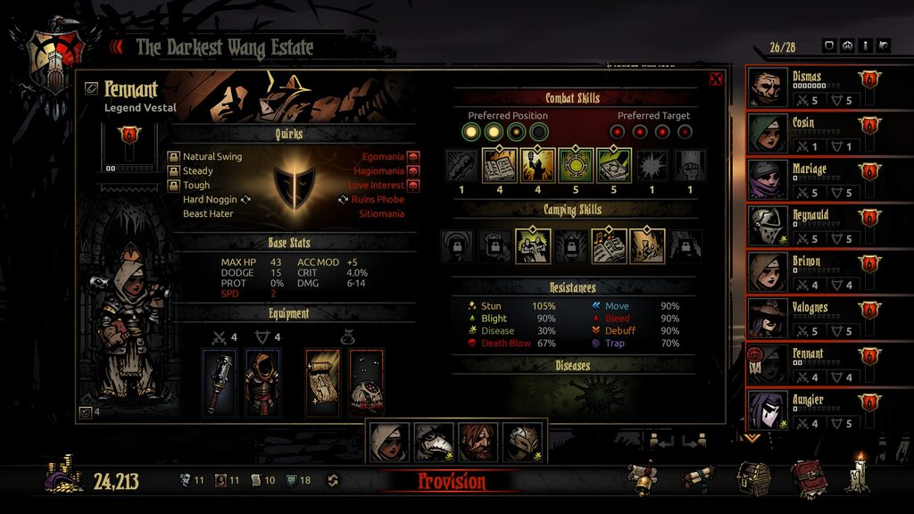</a> | `darkestdungeon_vestal_preferred_position_party_order.jpg` Darkest Dungeon, a hero's sheet in the hamlet, 'Pennant', 'Legend Vestal': 'Combat Skills' with 'Preferred Position', four gold pips, the two at the left bright, the third faint, the fourth dark, and 'Preferred Target', four red, all lit; seven skills with their levels; 'Resistances' including 'Move 90%'; under the sheet the four heroes picked, in order in four slots, and 'Provision'. Highwang: 'Make sure your support units are never up here, mainly because a lot of healing & support spells cannot be casted at rank 1.' | [page](https://lparchive.org/Darkest-Dungeon/Update%2004/) · [image](https://lparchive.org/Darkest-Dungeon/Update%2004/1-20160810161208_1.jpg) |
| <a href="darkestdungeon_combat_four_ranks_corpse.jpg">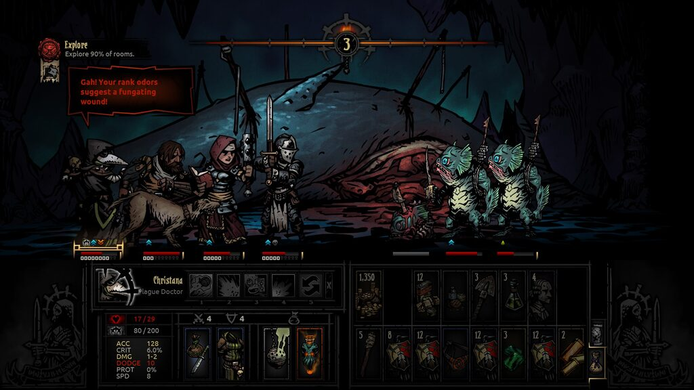</a> | `darkestdungeon_combat_four_ranks_corpse.jpg` Darkest Dungeon, a fight in the Cove: four heroes at the left, the Plague Doctor 'Christana' at the back under a gold bracket, her four skills numbered 1 to 4, a fifth numbered 5 (two arrows in a circle) and a pass; at the right a heap of bones under a grey bar holds the foes' front rank ahead of two fishmen; a hero's line, 'Gah! Your rank odors suggest a fungating wound!' Highwang, on a creature that needs a rank behind its fellows: 'if you manage to both kill every other enemy and also clear their corpses then all he has is the Backhand.' | [page](https://store.steampowered.com/app/262060/Darkest_Dungeon/) · [image](https://shared.akamai.steamstatic.com/store_item_assets/steam/apps/262060/ss_e65f764e9af2a8173faf70efc1b785f797cd714d.1920x1080.jpg) |
| <a href="etrianodyssey5_battle_three_front_two_back.jpg">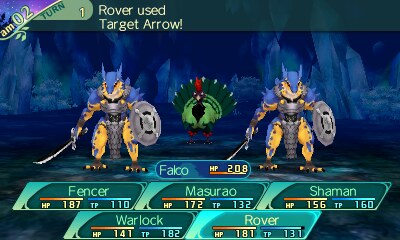</a> | `etrianodyssey5_battle_three_front_two_back.jpg` Etrian Odyssey V on the 3DS, 'TURN 1', 'Rover used Target Arrow!': two shield-bearing lizardmen in front and a peacock-like creature behind them; the party as plates in two staggered rows, 'Fencer', 'Masurao', 'Shaman' in front and 'Warlock', 'Rover' behind, the summoned hawk 'Falco' on a plate of its own. Atlus: 'Combat is arranged in two rows on both sides. Combatants who attack from the front row to the back row, or vice versa, deal less damage.' | [page](https://atlus.com/etrian5/system.html) · [image](https://atlus.com/etrian5/img/system/battle_01.png) |
| <a href="etrianodyssey5_battle_two_front_three_back_commands.jpg">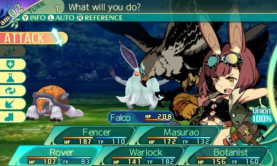</a> | `etrianodyssey5_battle_two_front_three_back_commands.jpg` Etrian Odyssey V, 'What will you do?': 'ATTACK' and the other commands as icons down the left, 'Union 100%'; two in front, 'Fencer', 'Masurao', three behind, 'Rover', 'Warlock', 'Botanist', and 'Falco' above them. Atlus: 'There are seven basic commands: Attack, Skills, Defend, Items, Move, Union, and Escape.' | [page](https://atlus.com/etrian5/system.html) · [image](https://atlus.com/etrian5/img/system/battle_02.png) |
| <a href="etrianodyssey_ds_party_front_back_slots.jpg">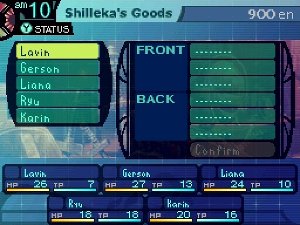</a> | `etrianodyssey_ds_party_front_back_slots.jpg` Etrian Odyssey on the DS, arranging the party from the menu: the five names at the left ('Lavin' chosen), 'FRONT' and 'BACK' with three empty places each, 'Confirm' greyed; below, the party bar, 'Lavin', 'Gerson', 'Liana' over 'Ryu', 'Karin', the second row set in by half a plate. The player: 'you'll only use this to put your front row back at the front after they've all died and forced your back row to the front'. | [page](https://lparchive.org/Etrian-Odyssey/Update%2002/) · [image](https://lparchive.org/Etrian-Odyssey/Update%2002/72-t1127.png) |
| <a href="finalfantasy2_famicom_row_marty_front.jpg">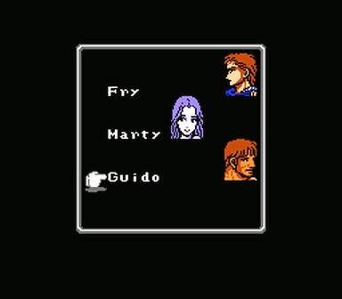</a> | `finalfantasy2_famicom_row_marty_front.jpg` Final Fantasy II on the Famicom, in a fan translation, the row window: 'Fry', 'Marty', 'Guido', Marty's portrait stepped out to the left, towards the foes, the other two set back. The player: 'being in the back row makes you completely untargetable by physical attacks as long as there's someone in the front row', and 'from the back row, you can't physically attack either unless you have a bow.' | [page](https://lparchive.org/Final-Fantasy-II/Update%2001/) · [image](https://lparchive.org/Final-Fantasy-II/Update%2001/56-ff_post1_048.png) |
| <a href="finalfantasy2_famicom_enemy_back_row_nothing.jpg">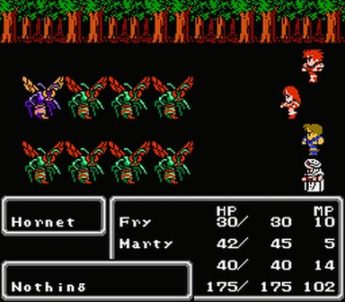</a> | `finalfantasy2_famicom_enemy_back_row_nothing.jpg` Final Fantasy II: eight hornets in two lines of four, a purple QueenBee at the far end; the party at the right, Marty stepped forward of the rest; 'Hornet' and 'Nothing'. The player: 'enemies have front and back rows similar to the party. Anything in the 3rd or 4th row away from the party is considered to be "in back" and can't attack or be attacked physically until you kill the enemies in front'. | [page](https://lparchive.org/Final-Fantasy-II/Update%2002/) · [image](https://lparchive.org/Final-Fantasy-II/Update%2002/50-ff_post2_078.png) |
| <a href="finalfantasy3_ds_rear_command.jpg">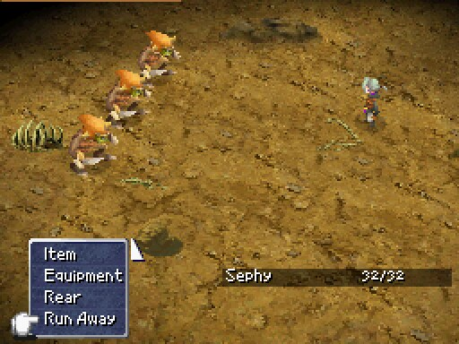</a> | `finalfantasy3_ds_rear_command.jpg` Final Fantasy III on the DS, the first fight, 'Sephy' alone against three goblins; the command list scrolled to 'Item', 'Equipment', 'Rear', 'Run Away'. The player: 'Rear switches the character to the back row (it's Front if you're already there)'. | [page](https://lparchive.org/Final-Fantasy-III-DS/Update%2001/) · [image](https://lparchive.org/Final-Fantasy-III-DS/Update%2001/21-FF3_0111.png) |
| <a href="finalfantasy4_snes_menu_form_change_back_row.jpg">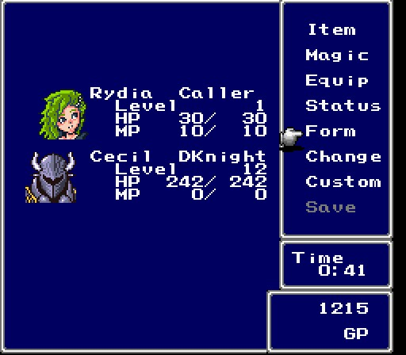</a> | `finalfantasy4_snes_menu_form_change_back_row.jpg` Final Fantasy IV (Final Fantasy II in America) on the Super NES, the menu: 'Rydia Caller' over 'Cecil DKnight', her portrait set a little to the right of his, in the back row; 'Item', 'Magic', 'Equip', 'Status', 'Form' (under the pointer), 'Change', 'Custom', 'Save'. The player: 'you have a set formation, with the choice of either two characters in front and three in the back, or three front/two back. Of course, back row reduces physical damage, both from enemies and from the character.' | [page](https://lparchive.org/Final-Fantasy-IV/Update%2003/) · [image](https://lparchive.org/Final-Fantasy-IV/Update%2003/57-image064.png) |
| <a href="afkarena_formation_two_front_three_back.jpg">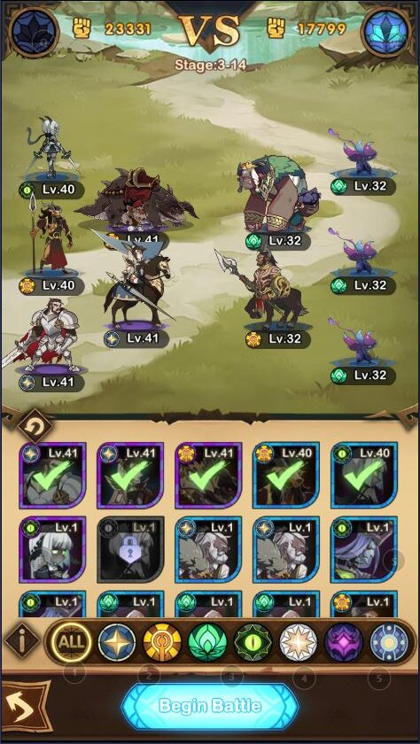</a> | `afkarena_formation_two_front_three_back.jpg` AFK Arena on a phone, the formation before a campaign fight, 'Stage:3-14', '23331' 'VS' '17799': the five heroes chosen stand on the field in two columns, two in front nearer the middle and three behind, and the foes the same, mirrored at the right; below, the roster with the five ticked, the faction filters, faint numbered circles 1 to 5, and 'Begin Battle'. BlueStacks: 'we want him in the 1st position (top right one)', and 'Belinda in 5, right behind Estrilda'. | [page](https://www.bluestacks.com/blog/game-guides/afk-arena/afka-team-building-guide-en.html) · [image](https://cdn-www.bluestacks.com/bs-images/AFK_AdvancedteamBuildingGuide_S1.jpg) |
| <a href="monstertrain_floor_front_of_floor.jpg">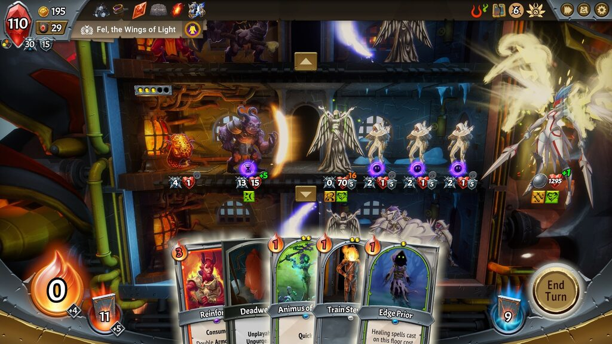</a> | `monstertrain_floor_front_of_floor.jpg` Monster Train, a floor of the train in the fight with 'Fel, the Wings of Light': the player's two units at the left, a 4 and 1 at the back and a 13 and 15 at the front, striking; the foes at the right, a 0 and 70 at their front and three 2 and 1 behind; the floor's capacity at its top left as five pips, three lit; arrows up and down to the floors above and below. Rogueliker: 'attack damage hits front-line units first'. | [page](https://store.steampowered.com/app/1102190/Monster_Train/) · [image](https://shared.akamai.steamstatic.com/store_item_assets/steam/apps/1102190/ss_cd1c375e15c677f1d79a5dcd59692f918b19ebde.1920x1080.jpg) |
| <a href="arknights_shaw_deployed_on_ranged_grids.jpg">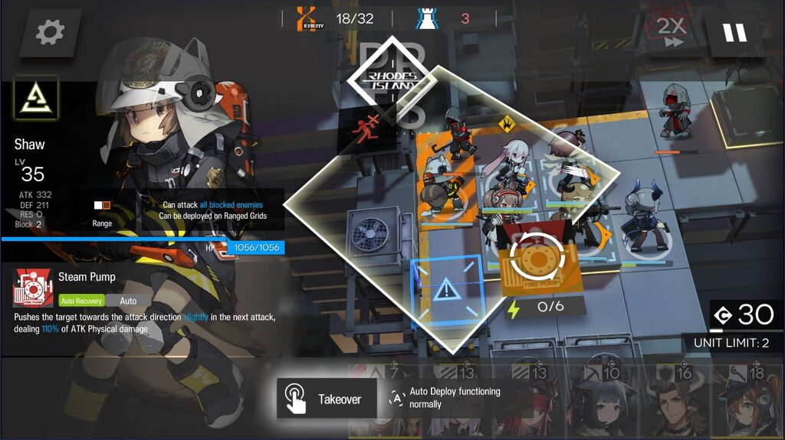</a> | `arknights_shaw_deployed_on_ranged_grids.jpg` Arknights, the phone game run in an emulator: Shaw just placed, the diamond for choosing which way she faces around her; 'LV 35', 'ATK 332', 'DEF 211', 'RES 0', 'Block 2', 'Range', 'Can attack all blocked enemies', 'Can be deployed on Ranged Grids'; 'Steam Pump', 'Pushes the target towards the attack direction slightly in the next attack, dealing 110% of ATK Physical damage'; 'UNIT LIMIT: 2'. BlueStacks: 'enemies will always attack the last operator that you have placed on the map.' | [page](https://www.bluestacks.com/blog/game-guides/arknights/ak-combat-guide-en.html) · [image](https://cdn-www.bluestacks.com/bs-images/A_EverythingYouNeedtoKnowAboutCombat_S7.jpg) |
| <a href="atelierresleriana_front_row_back_row_reserve.jpg">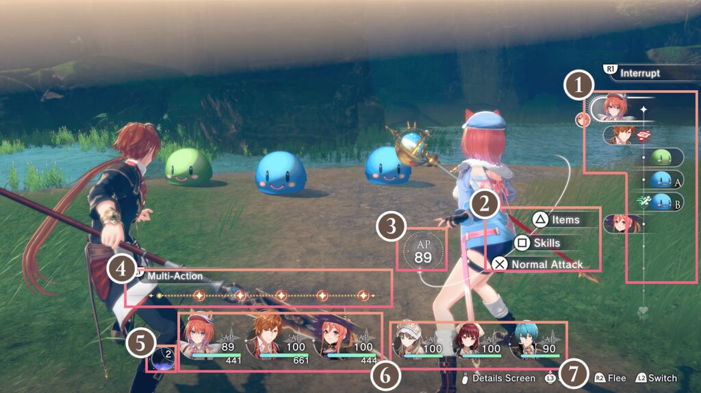</a> | `atelierresleriana_front_row_back_row_reserve.jpg` Atelier Resleriana: The Red Alchemist & the White Guardian, from Koei Tecmo's web manual, a fight with its parts numbered: the turn order at the right under 'Interrupt' (1), 'Items', 'Skills', 'Normal Attack' (2), 'AP 89' (3), 'Multi-Action' (4), and along the foot the front row, three portraits with their AP and HP (6), and the back row, three more (7); 'Flee' and 'Switch'. The manual: 'Members on the front row. They can attack enemies directly.' 'Members on the back row. They can swap places with characters on the front row by switching or using Multi-Actions.' | [page](https://www.gamecity.ne.jp/manual/v2QbVHQa/eng/6100.html) · [image](https://www.gamecity.ne.jp/manual/v2QbVHQa/eng/images/6000/6100-2.png) |

## What ARISE took

Built as "Front and rear" in [docs/DESIGN.md](../../../DESIGN.md#front-and-rear--built).

- **Two ranks a side, not four**, as Etrian Odyssey, Final Fantasy and AFK Arena stand theirs: Darkest Dungeon's four
  ranks, with a use-from and a target row of pips on every skill, are too much to read on a phone.
- **Melee reaches only the front while anyone stands in it**, Final Fantasy II's rule and Etrian Odyssey's "too far
  apart for melee": magic, volleys, spreads and throws reach either, as Etrian Odyssey's ranged weapons and spells
  "bypass these restrictions". The rear opens once the front is down, as Etrian Odyssey's back row is forced forward.
- **A melee hit from the rear lands at half**, as Final Fantasy VI's back row halves a Fight, and bows and shots lose
  nothing, as Final Fantasy IV's bows are unaffected.
- **A creature stands where its role does**, as Darkest Dungeon's creatures keep to their ranks: Brutes and Guardians
  in front, Casters and Archers behind; Assassins and Fliers reach past the front, as Darkest Dungeon's back-rank
  strikers do.
- **The place set before the fight, and a step for a turn in it**: the hunter's place is chosen on the brief, as Etrian
  Odyssey's formation and AFK Arena's are set before battle, and Step Back or Step Forward moves them for a turn, as
  Final Fantasy III's Rear and Darkest Dungeon's swap do.
- **Drawn as a step, not a grid**: a front card nearer the seam between the sides and a rear card stepped back, a
  hairline marked Rear between them, as Final Fantasy steps its front hero towards the foes; AFK Arena's two columns a
  side need more width than a phone's portrait column gives.
