# Tooltips

References for the tips ARISE opens on a tap, gathered for redoing every tooltip on the fight tooltip's model, the
Shadow card's first: its family's Kin and its role's rank and Formation aura. Not yet a step of the order to build in
[docs/DESIGN.md](../../../DESIGN.md#order-to-build).

The fight tooltip is the model: a status's or a habit's mark and its name in bold on one line, then one short sentence,
the trigger first and then what happens, figures in blue and stat and status keywords in gold ('Enrage', 'Below 50% HP,
gains 20% Attack for the rest of the fight.'). It follows Slay the Spire's keyword tips. The good tips here share its
shape. Each leads with a mark and a name, keeps the body to a line or two, and puts the trigger before the effect. A
bonus that grows with a count gives its steps a line each under the sentence, the step reached lit. A keyword the text
uses is coloured, and explained in a box of its own beside the tip. Where a unit stands is shown as a tile or a row of
pips, not written out. ARISE took the head, the sentence and the colours for every tooltip, Teamfight Tactics'
breakpoints for Kin, and Hades II's kind at the head's right; it left the glossary boxes and the rank's tile for later
(What ARISE takes, below).

Every image belongs to the game's publisher, or to the wiki, site or player who captured it, as listed beside it. They are kept here as design reference only: nothing in ARISE copies their art, and none of them ships with the game.

## Traits, roles and where a unit stands

**Teamfight Tactics** shows a trait's tip on a hover over the trait tracker or over a trait in a unit's panel. No
capture of the game's own trait tip turned up on a source this search could reach. The two here are drawn by the TFT
Tooltips Twitch extension, which reads the game's data and draws its tips over a stream in the game's manner, for
viewers to hover. Everything around them, the trait tracker and the unit's panel, is the game's. Top to bottom: the
trait's mark and name on one line; a short paragraph of what it does; the steps, one line each as '(3) 1.0x Hearts',
the step reached in white and the rest in grey; and a card to each champion with the trait, its name over its
portrait and its other traits under it. The tracker beside it colours each trait's hexagon by the step reached
(bronze, silver, gold) and greys a trait still short ('Heartsteel 2 / 3'), as the tracker already in
[step 6](../step-6-map-army-gear-daily/army_tft_trait_tracker_tiers.jpg) does. A unit's role has a tip of the same
shape, without the steps: its mark and name, then two sentences, 'Casters gain 7 mana per attack. Generate [mana] 2
Mana per second.'. Where the unit stands is a tile in its panel, three hexes over 'Back', beside its range, '4 Hex'.
Riot, introducing roles: 'If you've ever right-clicked a unit to check its details, such as Attack Damage and Attack
Speed, you'll also notice a role that currently serves as a way to recommend items for that unit.' And on naming a
kind of effect once: 'Effects that trigger once per combat at a certain health are now referred to as "Lifeline".
This creates a way to summarize these effects in one category and helps to simplify the tooltips at a glance.' Patch
13.12: 'Tooltips now show symbols to annotate scaling. These symbols are also color coded!'

**Solo Leveling: Arise** gives a set of gear its breakpoints in square brackets, '[2 Set Effect]' and
'[4 Set Effect]' in gold, each over its effect in cyan, its stats in brackets too ('[Attack] and [Max HP] increase.');
the piece's own power leads with its mark and its name in gold on one line. A Shadow's aura for the party is a line on
its panel, 'Shadow's Authority: Increases entire team's Defense', kept in
[step 6](../step-6-map-army-gear-daily/army_sla_army_of_shadows_authority_crop.jpg).

**Darkest Dungeon**'s trinket tip is its name, its rarity in the rarity's colour, and a line to each change, sign first
('+25% DMG', '-10% MAX HP'); on the sheet beside it the stats it moves turn red or gold. **Darkest Dungeon II**'s skill
tip names a status by its token, not a word, and puts the condition after the effect ('+50% CRIT when Target [combo]');
over the skill, its reach ('Ranged') and its ranks as pips, gold for where the hero must stand and blue for whom it
reaches, as [step 9](../step-9-ranks/darkestdungeon2_hold_the_line_rank_target_pips_crop.jpg) shows on the hero sheet.

| | What it shows | Source |
|---|---|---|
| <a href="tft_trait_tooltip_country_breakpoints.jpg">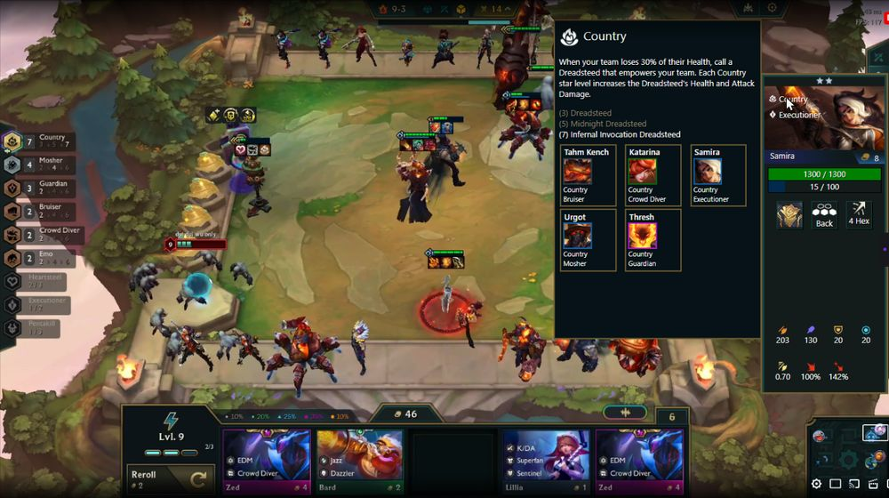</a> | `tft_trait_tooltip_country_breakpoints.jpg` Teamfight Tactics (Remix Rumble), a board late in a game, from a capture in the README of the TFT Tooltips Twitch extension; the tip in the middle is the extension's, the rest the game's. The pointer rests on 'Country' in Samira's panel at the right. The tip: the trait's mark and 'Country' on one line; 'When your team loses 30% of their Health, call a Dreadsteed that empowers your team. Each Country star level increases the Dreadsteed's Health and Attack Damage.'; the steps a line each, '(3) Dreadsteed' and '(5) Midnight Dreadsteed' in grey, '(7) Infernal Invocation Dreadsteed' in white; then a card to each Country champion ('Tahm Kench', 'Country', 'Bruiser'). At the left, the game's trait tracker: 'Country' 7 on a gold hexagon, '3 › 5 › 7', the 7 lit; 'Mosher' 4 on silver; 'Guardian' 3, 'Bruiser', 'Crowd Diver' and 'Emo' 2 on bronze; in grey 'Heartsteel 2 / 3', 'Executioner 1 / 2', 'Pentakill 1 / 3'. Samira's panel: 'Country', 'Executioner', '1300 / 1300', and the tiles 'Back' and '4 Hex'. | [page](https://github.com/conradftw/TFT-Tooltips-Twitch-Extension-Companion) · [image](https://i.imgur.com/nhyR6HW.png) |
| <a href="tft_trait_tooltip_country_breakpoints_crop_x2.jpg">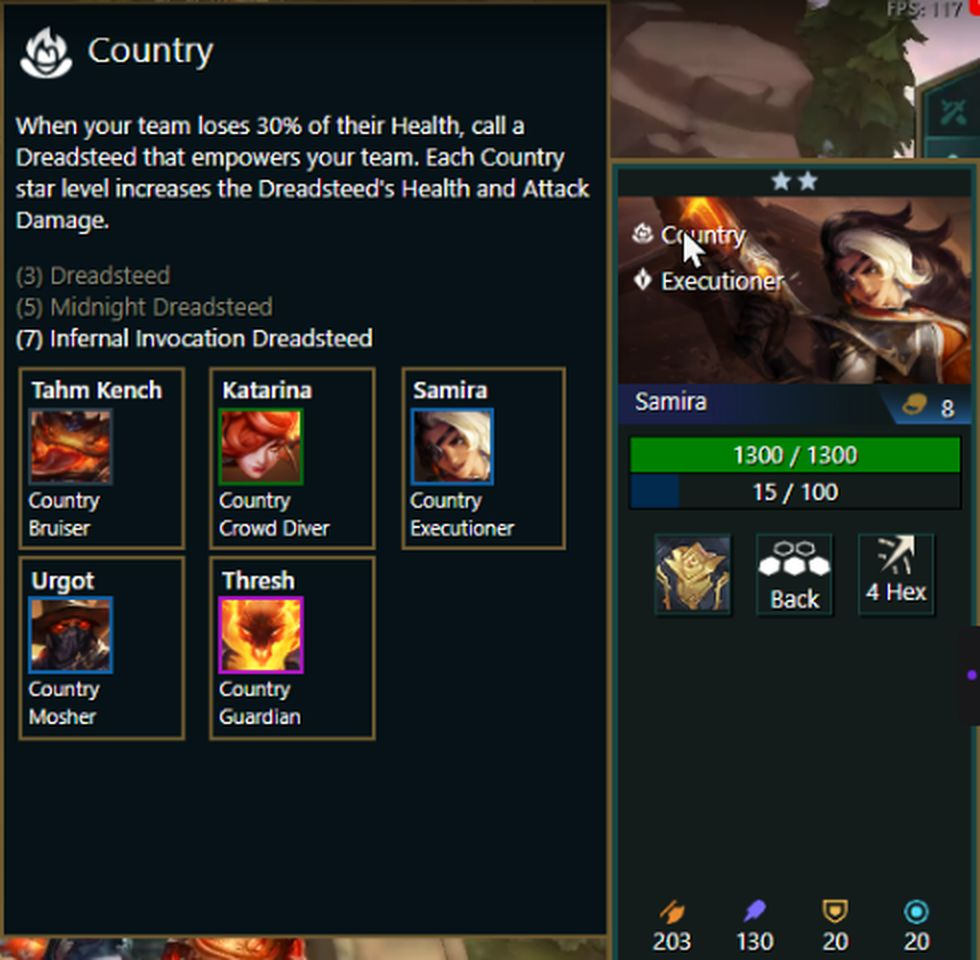</a> | `tft_trait_tooltip_country_breakpoints_crop_x2.jpg` Crop, enlarged twice: the tip, the five champion cards ('Katarina', 'Country', 'Crowd Diver'), and Samira's panel with 'Back' over three hexes and '4 Hex'. Cropped from the same source as `tft_trait_tooltip_country_breakpoints.jpg`. | [page](https://github.com/conradftw/TFT-Tooltips-Twitch-Extension-Companion) · [image](https://i.imgur.com/nhyR6HW.png) |
| <a href="tft_trait_tooltip_heartsteel_first_tier_lit_crop_x2.jpg">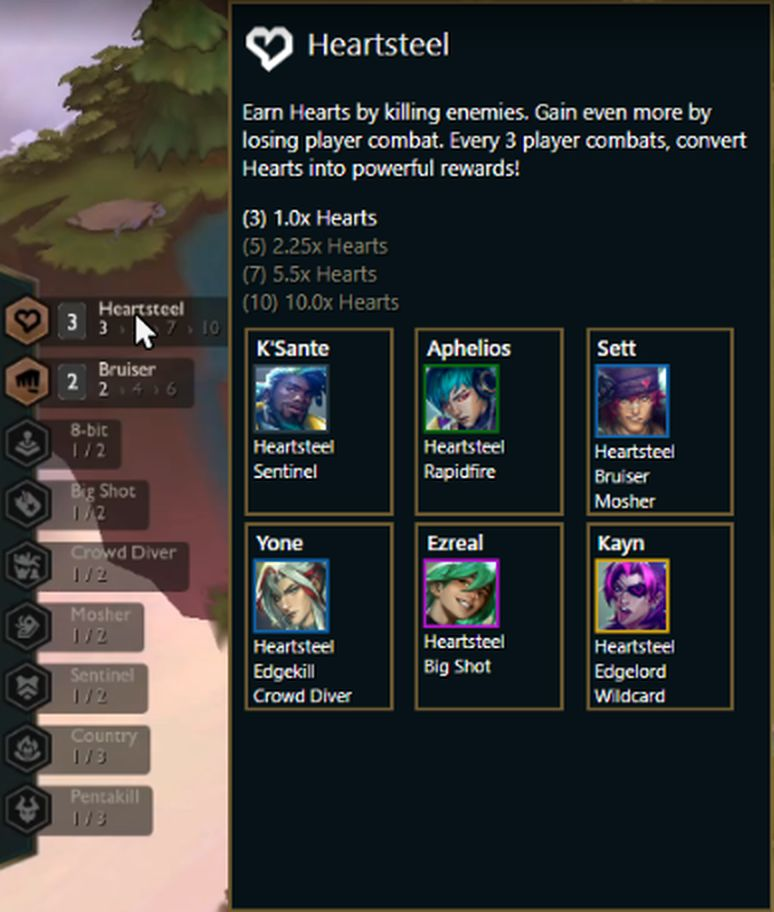</a> | `tft_trait_tooltip_heartsteel_first_tier_lit_crop_x2.jpg` Crop, enlarged twice, from another capture in the same README: the game's tracker, 'Heartsteel' 3 on bronze, '3 › 5 › 7 › 10', under the pointer, and the extension's tip beside it. The mark and 'Heartsteel'; 'Earn Hearts by killing enemies. Gain even more by losing player combat. Every 3 player combats, convert Hearts into powerful rewards!'; '(3) 1.0x Hearts' in white, '(5) 2.25x Hearts', '(7) 5.5x Hearts' and '(10) 10.0x Hearts' in grey; six champion cards ('K'Sante', 'Heartsteel', 'Sentinel'). Down the tracker, the traits not yet active in grey, 'Big Shot 1 / 2', 'Country 1 / 3'. | [page](https://github.com/conradftw/TFT-Tooltips-Twitch-Extension-Companion) · [image](https://i.imgur.com/ZgsEeKu.png) |
| <a href="tft_role_tooltip_magic_caster_back_4hex.jpg">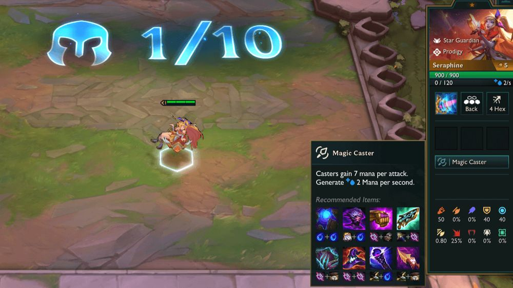</a> | `tft_role_tooltip_magic_caster_back_4hex.jpg` Teamfight Tactics (K.O. Coliseum), Riot's capture for 'Roles Revamped': Seraphine on the board ('1/10'), her panel open at the right and her role's tip under the pointer. The panel: her traits a line each with their marks ('Star Guardian', 'Prodigy'), 'Seraphine' and her cost '5', '900 / 900', '0 / 120' and '2/s'; three tiles, her ability, 'Back' over three hexes, and '4 Hex'; three empty item slots; her role as a chip with its mark, 'Magic Caster'. The tip: the mark and 'Magic Caster' on one line; 'Casters gain 7 mana per attack. Generate [mana] 2 Mana per second.', the mana's mark before its figure; 'Recommended Items:' in grey italic over eight items and their recipes. Riot: 'Caster: Ranged champions that primarily deal damage by casting'. | [page](https://teamfighttactics.leagueoflegends.com/en-us/news/game-updates/roles-revamped-and-item-changes/) · [page](https://teamfighttactics.leagueoflegends.com/en-us/news/game-updates/teamfight-tactics-patch-13-12-notes/) · [image](https://cmsassets.rgpub.io/sanity/images/dsfx7636/news_live/6c4e8223a1ae3c5449b103c51e63aeb2b046de09-1293x727.png) |
| <a href="tft_role_tooltip_magic_caster_back_4hex_crop.jpg">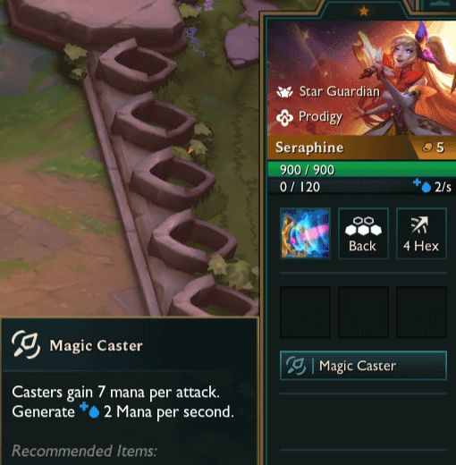</a> | `tft_role_tooltip_magic_caster_back_4hex_crop.jpg` Crop: the panel's head and tiles ('Back', '4 Hex'), the role's chip, and the tip down to 'Recommended Items:'. Cropped from the same source as `tft_role_tooltip_magic_caster_back_4hex.jpg`. | [page](https://teamfighttactics.leagueoflegends.com/en-us/news/game-updates/roles-revamped-and-item-changes/) · [image](https://cmsassets.rgpub.io/sanity/images/dsfx7636/news_live/6c4e8223a1ae3c5449b103c51e63aeb2b046de09-1293x727.png) |
| <a href="sololevelingarise_gear_set_effect_breakpoints_crop.jpg">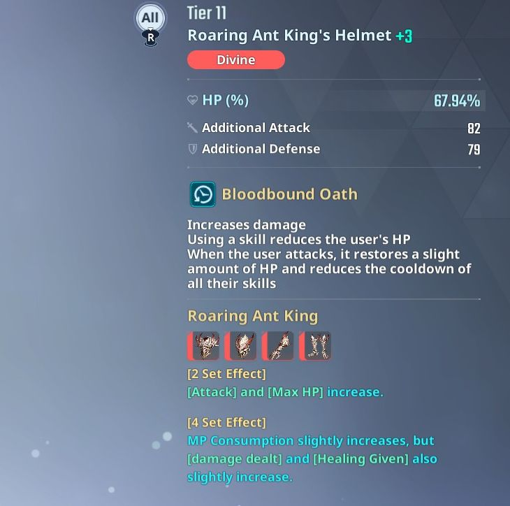</a> | `sololevelingarise_gear_set_effect_breakpoints_crop.jpg` Crop: Solo Leveling: Arise Overdrive, a piece of the hunter's gear inspected, a player's screenshot ('Full T11 Beru Set'). 'Tier 11', 'Roaring Ant King's Helmet +3' with '+3' in green, a red 'Divine' pill; 'HP (%) 67.94%', 'Additional Attack 82', 'Additional Defense 79'. The piece's power: a teal mark and 'Bloodbound Oath' in gold on one line, then 'Increases damage', 'Using a skill reduces the user's HP', 'When the user attacks, it restores a slight amount of HP and reduces the cooldown of all their skills'. The set: 'Roaring Ant King' in gold over its four pieces; '[2 Set Effect]' in gold over '[Attack] and [Max HP] increase.' in cyan; '[4 Set Effect]' over 'MP Consumption slightly increases, but [damage dealt] and [Healing Given] also slightly increase.' in cyan. | [page](https://steamcommunity.com/sharedfiles/filedetails/?id=3766821648) · [image](https://images.steamusercontent.com/ugc/18136725003105665618/5CC61FC04788F74D14A6135AD496EC6F048076EC/) |
| <a href="darkestdungeon_trinket_tooltip_dismas_head.jpg">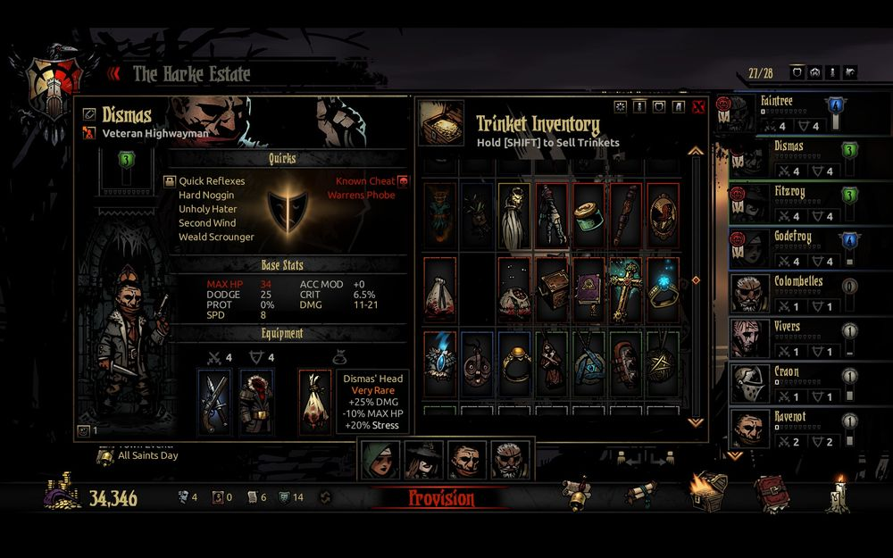</a> | `darkestdungeon_trinket_tooltip_dismas_head.jpg` Darkest Dungeon, a hero's sheet in the hamlet, a player's screenshot ('awkward trinket'): 'Dismas', 'Veteran Highwayman', his quirks, base stats and equipment, the 'Trinket Inventory' at the right, and the tip of the trinket he wears. On the sheet the stats it moves are coloured, 'MAX HP 34' in red and 'DMG 11-21' in gold. | [page](https://steamcommunity.com/sharedfiles/filedetails/?id=871999272) · [image](https://images.steamusercontent.com/ugc/96103261804067312/26A46B9BD91C464827280C5E7F274692539FA2A3/) |
| <a href="darkestdungeon_trinket_tooltip_dismas_head_crop.jpg">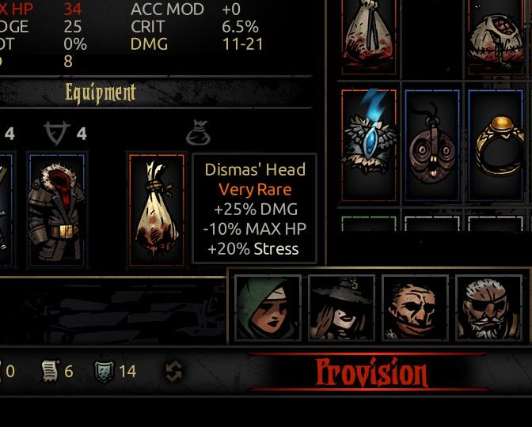</a> | `darkestdungeon_trinket_tooltip_dismas_head_crop.jpg` Crop: the tip beside the trinket's slot, a dark box with a thin frame: 'Dismas' Head', 'Very Rare' in orange, then a line to each change, '+25% DMG', '-10% MAX HP', '+20% Stress'. Cropped from the same source as `darkestdungeon_trinket_tooltip_dismas_head.jpg`. | [page](https://steamcommunity.com/sharedfiles/filedetails/?id=871999272) · [image](https://images.steamusercontent.com/ugc/96103261804067312/26A46B9BD91C464827280C5E7F274692539FA2A3/) |
| <a href="darkestdungeon2_skill_tooltip_conditions_rank_pips_crop.jpg">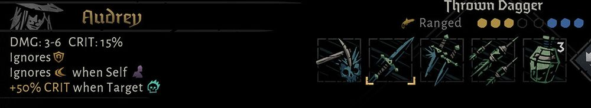</a> | `darkestdungeon2_skill_tooltip_conditions_rank_pips_crop.jpg` Crop: Darkest Dungeon II, a store screenshot of a fight, the hero's skill bar with a skill chosen. At the left, 'Audrey' and the skill's lines: 'DMG: 3-6 CRIT: 15%'; 'Ignores' and a gold shield token; 'Ignores' a gold crescent 'when Self' a violet figure; '+50% CRIT' in gold 'when Target' a teal skull. Over the skills, 'Thrown Dagger', 'Ranged', three gold pips and a hollow one, a hollow one and three blue. | [page](https://store.steampowered.com/app/1940340/Darkest_Dungeon_II/) · [image](https://shared.fastly.steamstatic.com/store_item_assets/steam/apps/1940340/ss_bc4c7aec5704ed4108a181ec9a790c3fea4a9f12.1920x1080.jpg) |

## Keywords and their glossaries

**Slay the Spire** colours a keyword gold in a card's text and leaves its figures white ('Gain 12 Block.', 'Whenever
you lose HP from a card, gain 1 Strength.'); a hover sets a small dark box beside the card for each keyword, its name
in gold over one line in white, 'Exhaust', 'Removed until end of combat.'. A creature's own tips, 'Strategic' and
'Mode Shift', are in [step 3](../step-3-answers-per-turn/4b_sts_strategic_intent_crop.jpg) and
[step 3](../step-3-answers-per-turn/1k_sts_guardian_mode_shift_crop.jpg).

**Hades II** gives each boon a row: its mark, its name in its rarity's colour, the rarity at the row's right end, one
line of effect with its keywords in bold white, and a line of figures, damage in green and a cost in blue. Beside the
rows, a box to each term the rows use, the term's mark and name in bold over one line ('Magick', 'Required for powerful
Ω Moves. Currently: 127/182'). The first game's boxes ('Weak: Status Curse: For at least 4 Sec., victim deals at least
30% less damage.') are in [step 5](../step-5-shrines-rests/shrine_hades_faded_legendary_keyword_tooltips_crop.jpg).

**Marvel Snap** writes a card's ability in two parts, the trigger in bold before a colon and the effect after it.
Monster Train 2's status tip ('Pyregel', '+1 incoming damage per stack.') and Wildfrost's callouts are in
[effect icons](../effect-icons/README.md).

| | What it shows | Source |
|---|---|---|
| <a href="slaythespire_shop_exhaust_keyword_tip.jpg">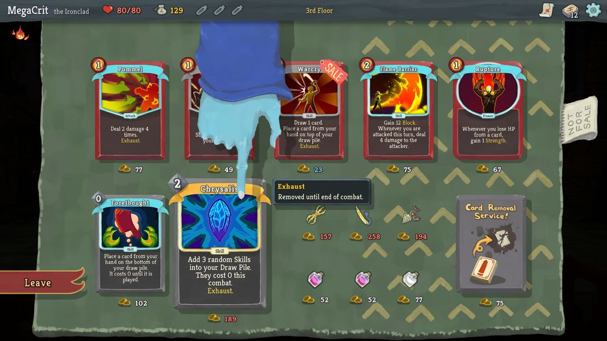</a> | `slaythespire_shop_exhaust_keyword_tip.jpg` Slay the Spire, the shop, a store screenshot: 'Chrysalis' raised under the pointer ('Add 3 random Skills into your Draw Pile. They cost 0 this combat. Exhaust.') and beside it the tip for the keyword it ends on. In the cards' text the keywords are gold and the figures white: 'Deal 2 damage 4 times. Exhaust.', 'Gain 12 Block.', 'Whenever you lose HP from a card, gain 1 Strength.' | [page](https://store.steampowered.com/app/646570/Slay_the_Spire/) · [image](https://shared.akamai.steamstatic.com/store_item_assets/steam/apps/646570/ss_5b2b32f09da5a5bed99d5c5168b50fd681a4690c.1920x1080.jpg) |
| <a href="slaythespire_shop_exhaust_keyword_tip_crop.jpg">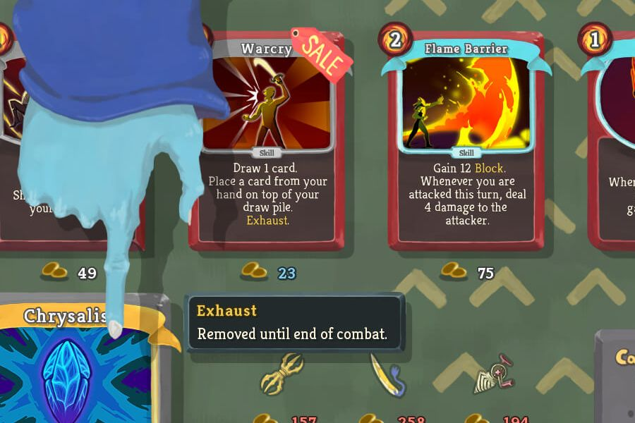</a> | `slaythespire_shop_exhaust_keyword_tip_crop.jpg` Crop: the tip, a dark box with a thin light frame, 'Exhaust' in gold over 'Removed until end of combat.' in white. Above it 'Warcry' ('Draw 1 card. Place a card from your hand on top of your draw pile. Exhaust.') and 'Flame Barrier' ('Gain 12 Block. Whenever you are attacked this turn, deal 4 damage to the attacker.'). Cropped from the same source as `slaythespire_shop_exhaust_keyword_tip.jpg`. | [page](https://store.steampowered.com/app/646570/Slay_the_Spire/) · [image](https://shared.akamai.steamstatic.com/store_item_assets/steam/apps/646570/ss_5b2b32f09da5a5bed99d5c5168b50fd681a4690c.1920x1080.jpg) |
| <a href="hades2_apollo_boons_glossary_boxes.jpg">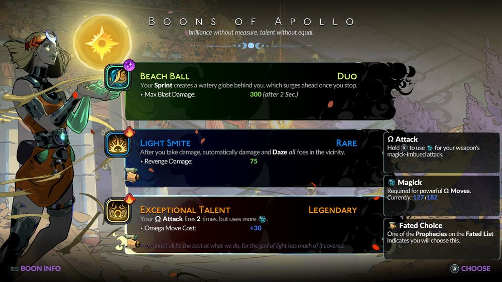</a> | `hades2_apollo_boons_glossary_boxes.jpg` Hades II, 'Boons of Apollo', a player's screenshot ('A duo and a legendary boon in the same choice...'): Apollo at the left, three boons offered, and at the right a column of boxes explaining terms the rows use; 'Boon Info' at the lower left. | [page](https://steamcommunity.com/sharedfiles/filedetails/?id=3640919263) · [image](https://images.steamusercontent.com/ugc/17737301009846145145/32C4D259ED7E32D33F736690B25D1A4232E0B07F/) |
| <a href="hades2_apollo_boons_glossary_boxes_crop.jpg">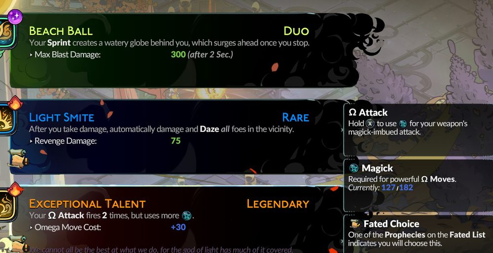</a> | `hades2_apollo_boons_glossary_boxes_crop.jpg` Crop: each boon a row, its name in its rarity's colour and the rarity at the right end ('Beach Ball' and 'Duo' in green, 'Light Smite' and 'Rare' in blue, 'Exceptional Talent' and 'Legendary' in orange), then a line of effect and a line of figures: 'Your Sprint creates a watery globe behind you, which surges ahead once you stop.' 'Max Blast Damage: 300 (after 2 Sec.)'; 'After you take damage, automatically damage and Daze all foes in the vicinity.' 'Revenge Damage: 75'; 'Your Ω Attack fires 2 times, but uses more [magick].' 'Omega Move Cost: +30'. The boxes, each a mark and a name in bold over one line: 'Ω Attack', 'Hold [X] to use [magick] for your weapon's magick-imbued attack.'; 'Magick', 'Required for powerful Ω Moves. Currently: 127/182'; 'Fated Choice', 'One of the Prophecies on the Fated List indicates you will choose this.' Cropped from the same source as `hades2_apollo_boons_glossary_boxes.jpg`. | [page](https://steamcommunity.com/sharedfiles/filedetails/?id=3640919263) · [image](https://images.steamusercontent.com/ugc/17737301009846145145/32C4D259ED7E32D33F736690B25D1A4232E0B07F/) |
| <a href="marvelsnap_wolverine_trigger_then_effect_crop.jpg">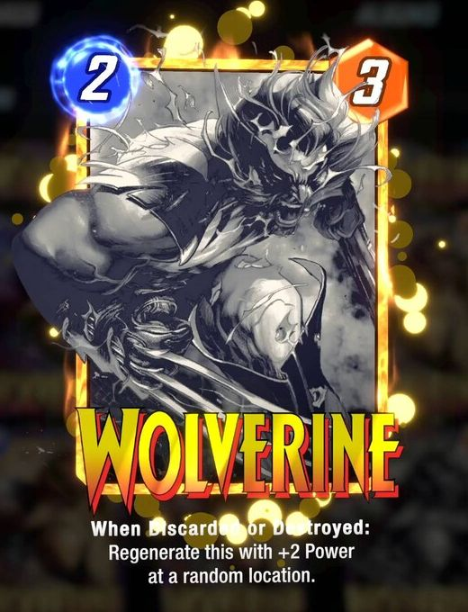</a> | `marvelsnap_wolverine_trigger_then_effect_crop.jpg` Crop: Marvel Snap, a card in the collection, from a store screenshot: 'Wolverine', its cost '2' on blue and its power '3' on orange; under the name its ability, the trigger in bold before a colon, 'When Discarded or Destroyed:' (partly behind the card's glow), then the effect, 'Regenerate this with +2 Power at a random location.' | [page](https://store.steampowered.com/app/1997040/MARVEL_SNAP/) · [image](https://shared.fastly.steamstatic.com/store_item_assets/steam/apps/1997040/012149a12287c8458e878d60188eba8360386e2d/ss_012149a12287c8458e878d60188eba8360386e2d.1920x1080.jpg) |

## What ARISE takes

- **The mark and the name on one line, the name in bold, the body under it.** Teamfight Tactics' trait and role tips,
  Hades II's boxes and Solo Leveling: Arise's 'Bloodbound Oath' all lead so; Slay the Spire's tip has the name alone.
  A Kin tip opens on the family's mark and name, a Formation tip on the role's.
- **One sentence, the trigger first, then what happens.** 'When your team loses 30% of their Health, call a
  Dreadsteed…' (Teamfight Tactics), 'After you take damage, automatically damage and Daze all foes in the vicinity.'
  (Hades II), 'Whenever you lose HP from a card, gain 1 Strength.' (Slay the Spire). Marvel Snap sets the trigger apart
  in bold before a colon. Darkest Dungeon II puts the condition last ('+50% CRIT when Target [combo]'); ARISE keeps it
  first, as the fight's tip does.
- **The steps a line each under the sentence, the count in brackets, the step reached lit and the rest grey.**
  Teamfight Tactics' '(3) 1.0x Hearts' in white over '(5) 2.25x Hearts' in grey, and '(7) Infernal Invocation
  Dreadsteed' lit at seven. Each line says only what that count gives, as the Army's chips already write Kin
  (`(2) Attack +10%`, `(3) Attack +20%`); the sentence above says what the steps share.
- **Keywords in one colour, figures in another.** Slay the Spire's keywords are gold ('Block', 'Strength', 'Exhaust')
  and its figures white; Hades II's keywords bold white, damage green and costs blue; Teamfight Tactics sets a stat's
  mark before its figure ('[mana] 2 Mana'). ARISE keeps the fight tip's colours: stat and status keywords gold, figures
  blue.
- **The kind small, at the head's right.** Hades II sets each boon's rarity at the right end of its head in the
  rarity's colour ('Duo', 'Rare', 'Legendary'); Darkest Dungeon's trinket and Solo Leveling: Arise's gear put theirs
  under the name ('Very Rare', 'Divine'). Teamfight Tactics' trait tip has none. ARISE took Hades II's place for it, and
  every tooltip says one: `Kin`, `Formation`, `Habit`, `Status`, `Blessing`, `Stat`, `In a fight`, so that a Shadow's
  two tips, and a habit's and a status's, are told apart at a glance.

ARISE did not take, for now:

- **A box of its own for each keyword the text uses.** Slay the Spire's 'Exhaust' tip stands beside the card whose
  text ends 'Exhaust.'; Hades II stacks a box to each term ('Ω Attack', 'Magick', 'Fated Choice'), each a mark and a
  name over one line, and Riot named a kind of effect, 'Lifeline', so that its tips could say the name and explain it
  once. No tooltip ARISE shows yet names a word it does not explain itself; the first that names a status in its
  sentence should give the status its box under it.
- **Where a unit stands as a tile, not a sentence.** Teamfight Tactics' panel shows 'Back' over three hexes and '4 Hex'
  beside the ability, and its role's tip says only what the role does ('Casters gain 7 mana per attack.'); Darkest
  Dungeon II shows a skill's ranks as pips beside 'Ranged'. ARISE took the role's tip saying only what the role does:
  a Shadow's Formation tip is its aura alone, since where the Shadow stands decides nothing of it. Then it took the
  tile: a `Front` or `Rear` tag of its own beside the role on a Shadow's card, its two lines with the one it stands in
  lit, and its tooltip what standing there decides in a fight.
